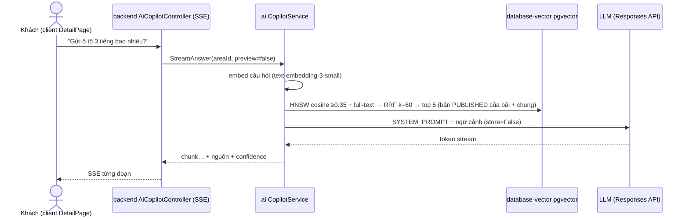

# core/copilot — Trợ lý hỏi đáp quy chế (RAG) + phân xử tranh chấp

> Trạng thái (2026-09-25): hỏi đáp RAG **code thật**, cần `AI_LLM_API_KEY` (thiếu → `FAILED_PRECONDITION` "chưa được cấu hình khoá"). Phân xử tranh chấp **tắt có chủ đích** (`UNIMPLEMENTED`, bug-003); khung LangGraph có sẵn nhưng chưa nối.

## Luồng hỏi đáp (StreamAnswer / AskQuestion)

```text
backend AiCopilotController (/v1/ai/copilot/stream — SSE; preview chỉ cho người quản lý scope)
  └─ grpc CopilotService → app/api/grpc/handlers/copilot_handler.py
       └─ services/copilot_service.py              ask_question / stream_answer (preview → bản nháp)
            └─ engines/rag_pipeline.py
                 ├─ infra/embedding/embedding_client.embed_query     câu hỏi → vector 1536 (text-embedding-3-small)
                 ├─ infra/database/pgvector_client.search_similar_chunks
                 │     Hybrid: cosine (≥0.35) + full-text 'simple' bỏ dấu, từ khoá OR → RRF k=60 → top 5
                 │     phạm vi: bãi + tài liệu chung; không có bãi → chỉ chung
                 │     góc nhìn: khách = bản PUBLISHED; preview = bản mới nhất của scope
                 ├─ không có đoạn nào, hoặc đoạn vector tốt nhất < AI_RAG_MIN_SIMILARITY
                 │     (đoạn chỉ khớp keyword có similarity 0) → NO_CONTEXT "chưa tìm thấy…", KHÔNG gọi LLM
                 └─ infra/llm/llm_factory.stream_response / generate_response
                       Responses API, SYSTEM_PROMPT: chỉ trả lời từ ngữ cảnh, trích [Nguồn], store=False
            └─ engines/output_guard.py   chặn câu trả lời có "miễn phí/0đ", link, SĐT/STK không có trong
                 các đoạn đã truy xuất → thay bằng GUARD_NOTICE, bỏ nguồn (stream: giữ đuôi 40 ký tự,
                 dừng trước khi phát phần vi phạm). Lý do và số đo: PROB-046 ở repo gốc
            confidence = 0.7×sim(top1) + 0.3×mean(sim)   (điểm truy xuất, không phải "độ chắc" của LLM)
```

## Phân xử tranh chấp

`copilot_service.arbitrate_dispute` → `FeatureNotImplementedError` (bản cũ luôn trả APPROVE_REFUND + bằng chứng bịa). Khung `engines/dispute_workflow/` (LangGraph: load_evidence → analyze → retrieve_policy → validate → draft → human_review → finalize, PROB-040) **chưa được gọi từ đâu**.

## File

| File | Việc |
|---|---|
| `services/copilot_service.py` | Điểm vào nghiệp vụ; chặn arbitrate |
| `engines/rag_pipeline.py` | Truy xuất → (không có đoạn khớp nghĩa đạt ngưỡng thì dừng, dùng `guardrails.check_scope_and_chunks`) → sinh câu trả lời; prompt + confidence |
| `engines/output_guard.py` | Kiểm đầu ra tất định chống prompt injection (PROB-046) |
| `engines/dispute_workflow/{graph,nodes,state,dependencies}.py` | Khung LangGraph phân xử (chưa nối) |
| `dtos/copilot_dto.py` | `AskQuestionRequest` (có `preview`), `CopilotAnswer`, `AnswerChunk` |

Tài liệu Copilot đọc được quản lý ở [core/knowledge](../knowledge/README.md) (nạp) và [core/knowledge_eval](../knowledge_eval/README.md) (test + xuất bản).

## Cấu hình

**Chạy bằng Ollama trên máy dev (ISSUE-011):** cài Ollama, `ollama pull <model>`, rồi trong `ai/.env.dev`:
`AI_LLM_BASE_URL=http://host.docker.internal:11434/v1` (ai chạy trong Docker; chạy thẳng trên máy thì `http://localhost:11434/v1`), `AI_LLM_MODEL=<model>`, `AI_LLM_API_KEY` để trống (tự dùng key giả). Hỏi đáp đi Responses API như OpenAI (Ollama ≥ v0.13.3); **JSON có cấu trúc** (AI đề xuất câu hỏi, giám khảo AI) tự chuyển sang Chat Completions + `response_format` vì Ollama không tài liệu hoá `text.format` ở `/v1/responses`. Embedding vẫn đi OpenAI trừ khi đặt `AI_EMBEDDING_BASE_URL` — đổi model embedding = nạp lại toàn bộ tài liệu (ISSUE-011 phase 2).


**`AI_RAG_MIN_SIMILARITY` theo model embedding.** Một núm cho cả hai việc: lọc nhánh vector của tìm kiếm lai *và* cổng từ chối (đoạn vector tốt nhất dưới ngưỡng → NO_CONTEXT, không gọi LLM). Thang similarity khác nhau giữa các model, nên đổi model embedding là phải hiệu chỉnh lại: hiệu chỉnh trên `data/knowledge/eval_set.json`, kiểm trên `data/knowledge/eval_set_heldout.json` bằng `python -m app.script.eval_copilot_e2e --dataset … --out report.json` (cột `best_vector_similarity`). Số đo: IPLMS ISSUE-126 review-7.

| Model embedding | Ngưỡng | Căn cứ |
|---|---|---|
| `bge-m3` (Ollama, 1024 chiều) | **0.55** | Chọn trên `eval_set` trước khi có held-out. Held-out 16 câu: giữ 9/9 câu có tài liệu, chặn 6/7 câu phải từ chối (câu lọt có similarity 0.555, sát câu có tài liệu thấp nhất 0.553) |
| `text-embedding-3-small` (OpenAI, 1536 chiều — mặc định) | 0.35 *(chưa hiệu chỉnh)* | Chưa đo được (không gọi OpenAI trong lượt đo). Giữ mặc định cũ; chạy script trên trước khi nâng |
| Model khác | — | Phải đo trước khi dùng |

`AI_LLM_API_KEY`, `AI_LLM_MODEL` (mặc định `gpt-5.6-luna`), `AI_RAG_TOP_K=5`, `AI_RAG_MIN_SIMILARITY=0.35`, `AI_EMBEDDING_*`, `AI_DATABASE_URL` (database-vector pgvector). Test: `test_rag_pipeline.py`, `test_llm_factory.py`, `test_arbitrate_dispute.py`, `test_dispute_workflow.py`. Smoke: `python app/script/smoke_copilot_stream.py`. Bộ tấn công hồi quy (ADR-0029: đổi prompt/guard/model thì chạy lại): `python -m app.script.redteam_copilot -n 10` — gọi LLM thật `n × 8` lần.

## 🎬 Viễn cảnh

**1. Khách hỏi giá ở trang chi tiết bãi**



**2. Bãi chưa có tài liệu / câu hỏi ngoài quy chế** — không có đoạn nào vượt ngưỡng → trả câu "chưa tìm thấy…" và **không gọi LLM** (không bịa, không tốn tiền).

**3. Owner thử bản nháp trước khi xuất bản** — `preview=true` chỉ cho người quản lý scope (backend `knowledge-scope.service` kiểm); đọc bản mới nhất thay vì bản PUBLISHED.

**4. Thiếu `AI_LLM_API_KEY`** — `FAILED_PRECONDITION` "chưa được cấu hình khoá" → UI báo rõ, không treo.

**5. Phân xử tranh chấp** — `UNIMPLEMENTED` (bug-003) cho tới khi nối khung LangGraph có bước người duyệt.

## 🧰 Công nghệ áp dụng

| Công nghệ | Dùng ở đâu | Vì sao |
|---|---|---|
| OpenAI Responses API (`openai` SDK, streaming) | `infra/llm/llm_factory.py` | Stream token về UI; `store=False` không lưu hội thoại phía nhà cung cấp |
| `text-embedding-3-small` (1536 chiều) | `infra/embedding/embedding_client.py` | Rẻ, đủ cho quy chế tiếng Việt ngắn |
| pgvector HNSW (`vector_cosine_ops`) + PostgreSQL full-text | `infra/database/pgvector_client.py` | Ngữ nghĩa + khớp từ khoá (số tiền, "Điều 5") trong một DB |
| Reciprocal Rank Fusion (k=60) | `search_similar_chunks` | Trộn hai bảng xếp hạng không cần chuẩn hoá điểm |
| gRPC server-streaming → SSE ở backend | `copilot_handler` → `AiCopilotController` | Trình duyệt nhận stream qua HTTP thường |
| LangGraph (+ checkpoint Postgres) | `engines/dispute_workflow/` | Luồng nhiều bước có điểm dừng chờ người — **chưa nối** |

## ⚡ Case tối ưu

**Đã áp dụng:** bỏ qua LLM khi không có ngữ cảnh · stream thay vì chờ trọn câu · top-k 5 + ngưỡng 0.35 giới hạn token đầu vào · khách chỉ đọc bản PUBLISHED (không cần lọc nháp ở tầng trên) · confidence tính từ điểm truy xuất (không tốn thêm lượt LLM).

**Nên làm khi có tín hiệu**

| Khi nào | Tối ưu |
|---|---|
| Nhiều câu hỏi lặp (giá, giờ mở cửa) | Cache câu trả lời theo (scope, phiên bản PUBLISHED, câu hỏi chuẩn hoá) — tự vô hiệu khi xuất bản mới |
| `app/script/eval_retrieval.py` cho recall thấp | Thêm reranker cross-encoder sau RRF; hoặc tăng top-k trước rerank |
| Khách gõ không dấu ("gui xe") | Full-text đang dùng cấu hình `simple` — thêm `unaccent` cho tiếng Việt |
| Chi phí LLM tăng | Model rẻ hơn cho câu `fact`, model mạnh cho câu giải thích; theo dõi token/lượt |
