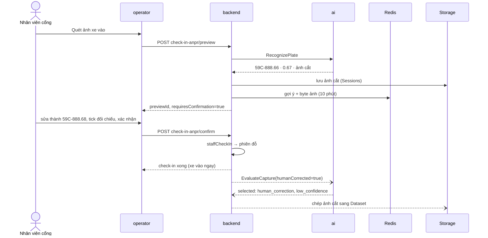
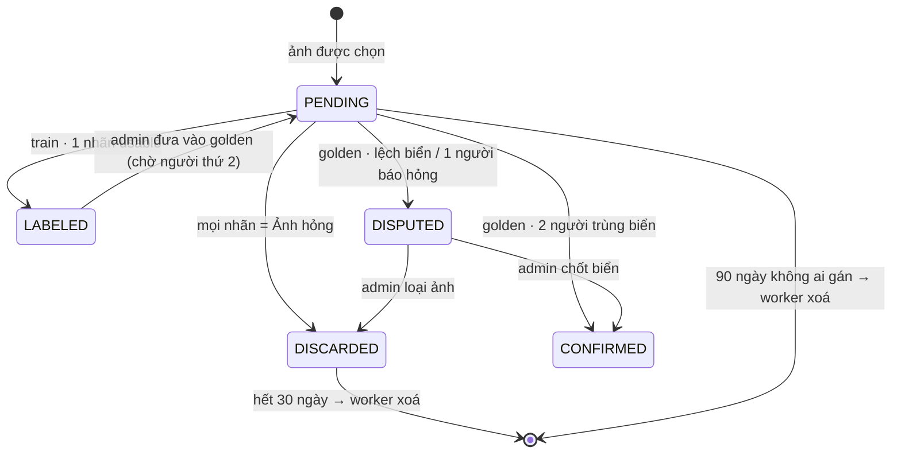

# core/dataset — Vòng dữ liệu ANPR: chọn ảnh cho người gán nhãn + khoá snapshot

> Trạng thái (2026-09-26): **chạy thật** (ISSUE-010). Luật chọn ảnh ở đây; hàng đợi, nhãn, quyền, ảnh và thời hạn ở backend `modules/Vision`; UI ở operator (cổng) + platform (moderator/admin). Còn thiếu: `training/materialize_dataset.py` (xuất ảnh theo manifest) và đo bộ vàng (PROB-038).

## Nguyên tắc

**Dự đoán của máy KHÔNG bao giờ tự thành nhãn.** Máy chỉ nói "ảnh này đáng để người xem". Nhãn do người gán; bộ test chuẩn (golden) cần **2 moderator khác nhau gán trùng**. Moderator chỉ thấy **ảnh cắt biển**, không thấy bãi/phiên/khách (biển số là dữ liệu cá nhân). Ảnh không vào git.

## Luồng đầy đủ (qua 3 repo)

```text
operator CheckInForm ─ quét ảnh ─▶ backend POST staff/parking-sessions/check-in-anpr/preview
    GateCheckInService.preview → StaffOperationService.recognizeGateImage
        → ai VisionService.RecognizePlate (ảnh cắt + điểm) → Storage folder Sessions (bằng chứng)
    giữ gợi ý 10 phút trong Redis (anpr:gate-preview:<id>, kèm byte ảnh cắt) → UI hiện ảnh + biển + điểm
    điểm < ngưỡng chính sách (0.75) hoặc không có điểm → bắt tick "đã đối chiếu"
operator ─ xác nhận (có thể đã sửa biển) ─▶ backend POST …/check-in-anpr/confirm
    → staffCheckIn (tạo phiên) → xoá gợi ý
    → (không chờ) AnprCaptureService.recordCapture
        → ai DatasetService.EvaluateCapture  ← app/api/grpc/handlers/dataset_handler.py
              services/curation_service.evaluate_capture
                ├─ engines/image_quality   ≥160×120 · sáng 25–235 · Laplacian ≥ 20
                ├─ bốc kiểm ngẫu nhiên theo random_audit_rate (3%)
                └─ engines/sample_selector  human_correction | low_confidence | random_audit | quality_edge_case
        → được chọn: Storage folder Dataset (dataset/<areaId>/<id>) + dòng vision.anpr_captures (PENDING, hết hạn 90 ngày)
platform "Gán nhãn biển số" ─▶ moderator/anpr-captures (hàng đợi, golden lên trước)
    → POST :id/labels  Đúng | Sửa | Ảnh hỏng   → plate-label.policy.decideLabelOutcome
        train: 1 nhãn → LABELED · golden: 2 người trùng → CONFIRMED, lệch → DISPUTED · hỏng → DISCARDED (30 ngày)
platform "Dữ liệu vision" (admin) ─▶ đánh dấu golden · phân xử DISPUTED · chính sách · snapshot
    POST admin/vision-datasets → ai DatasetService.BuildSnapshot (services/snapshot_service.build_lock)
        golden → test-golden · train → train/val theo hash(phiên) · train chung phiên với golden bị loại
        → vision.vision_dataset_snapshots (manifest + sha256)
backend CaptureRetentionWorker (mỗi giờ, chỉ worker) → xoá ảnh + dòng có expires_at < now
```

## 🎬 Viễn cảnh

**1. Nhân viên sửa biển máy đọc sai** — mẫu quý nhất, luôn được chọn.



**2. Máy đọc đúng, tự tin (≥75%)** — nhân viên chỉ bấm xác nhận. 97% ảnh loại này không vào dataset; 3% được bốc kiểm để đo model trên *ca thường*, không chỉ ca khó.

**3. Bộ test chuẩn, hai người gán lệch**



**4. Ảnh tối/mờ ban đêm** — `quality_edge_case`; moderator bấm "Ảnh hỏng" → xoá sau 30 ngày. Nếu vẫn đọc được thì gán bình thường: đó chính là dữ liệu dạy model đọc ảnh xấu.

**5. ai sập đúng lúc confirm** — check-in vẫn thành công; `recordCapture` nuốt lỗi và ghi cảnh báo; mất một mẫu, không kẹt barie.

**6. Khoá snapshot** — `anpr-2026-09`: mọi ảnh `LABELED` + `CONFIRMED`. Một chiếc xe (một phiên) không bao giờ nằm ở cả train và test-golden.

## 🧰 Công nghệ áp dụng

| Công nghệ | Dùng ở đâu | Vì sao |
|---|---|---|
| OpenCV (`cv2.Laplacian`, mean) | `engines/image_quality.py` | Đo độ nét/độ sáng rẻ, tất định, không cần model |
| gRPC + protobuf (`proto/dataset_service.proto`) | backend ↔ ai | Cùng kênh với Vision/Copilot, có deadline, gửi byte ảnh không base64 |
| SHA-256 + JSON canonical (sort keys) | `snapshot_service.build_lock`, backend `imageSha256` | Manifest tái lập được, phát hiện ảnh/nhãn bị đổi |
| PostgreSQL schema `vision` (jsonb, CHECK, unique index, `SELECT … FOR UPDATE`) | backend entities + migration 1799000000000 | 1 người gán 1 ảnh 1 lần; 2 moderator gán lượt 2 cùng lúc không cùng chốt |
| Redis (CacheProvider L1+L2, TTL 600s) | `GateCheckInService` | Gợi ý máy đọc sống giữa preview và confirm mà không tạo phiên nháp trong DB |
| Storage (Cloudinary/S3 qua `StorageProvider`, folder `Dataset`) | `AnprCaptureService` | Tách khỏi `Sessions` (bằng chứng) để có thời hạn/quyền riêng |
| NestJS `setInterval` worker (`APP_MODE≠api`) | `CaptureRetentionWorker` | Cùng mẫu `SlotExpirationWorker`; không chạy trùng ở N replica api |
| React Query + CSS Modules (Wayfinder) | `useVisionData*`, `PlateLabelingPage`, `VisionDataPage` | Làm mới cả nhánh `VISION_DATA` sau mỗi thao tác |

## ⚡ Case tối ưu

**Đã áp dụng**

| Case | Cách làm | Ở đâu |
|---|---|---|
| Không làm chậm cổng | Curation chạy sau khi phiên đã tạo, fire-and-forget, lỗi bị nuốt | `gate-check-in.service.ts` `confirm` |
| Không tải lại ảnh | Byte ảnh cắt đi kèm gợi ý trong Redis → confirm có sẵn | `GatePreview.cropBase64` |
| Ảnh nhỏ, ít PII | Chỉ lưu **ảnh cắt biển** (~vài chục KB), không lưu khung hình | `recordCapture` |
| Không lọc trùng ở moderator | `NOT EXISTS` nhãn của chính người đó ngay trong SQL hàng đợi | `plate-labeling.service.ts` `queue` |
| Không double-submit | UI bỏ qua ảnh vừa gán trong lúc hàng đợi tải lại; backend khoá dòng | `PlateLabelingPage` `doneIds` |
| Chia split tái lập được | `sha256(groupId)` → cùng phiên cùng phía, chạy lại y hệt | `vision-dataset.service.ts` `splitOf` |
| Dọn theo lô | 100 dòng/lô, index `expires_at`, `deleteByKey` không bao giờ ném lỗi | `capture-retention.worker.ts` |
| Hàng đợi nhanh | Index `(status, created_at)` | migration |

**Nên làm khi có tín hiệu**

| Khi nào | Tối ưu |
|---|---|
| Hàng đợi > vài nghìn ảnh | Đổi offset → keyset pagination (`created_at, id`) cho `queue` |
| Redis phình vì nhiều cổng quét liên tục | Không nhét byte ảnh vào cache; giữ `cropImage.key` rồi tải lại lúc confirm |
| Camera chụp liên tiếp cùng xe | Khử ảnh gần trùng bằng perceptual hash trước khi chép vào Dataset |
| Có ≥ 200 ảnh CONFIRMED | Chạy `training/eval_plates.py` trên test-golden → chỉnh ngưỡng 0.75 theo số đo thật |
| Moderator lệch nhau nhiều | Đo độ đồng thuận (tỉ lệ DISPUTED theo người) → huấn luyện lại người gán |
| Cần train lại `best.pt` | Làm `materialize_dataset.py`: tải ảnh theo `objectKey` của manifest, kiểm sha256 |
| Dữ liệu lệch về một cổng/giờ | Bốc kiểm phân tầng theo `laneId` × khung giờ thay vì 3% đồng đều |

## Chính sách (admin sửa ở platform → `vision.vision_data_policies`)

Ngưỡng bắt xác nhận **0.75** · bốc kiểm **3%** · ảnh chưa gán giữ **90 ngày** · ảnh hỏng **30 ngày** · ảnh đã có nhãn giữ vô thời hạn. Ví dụ thật: ảnh demo `59C-888.66` điểm 0.6685 → bắt xác nhận + `low_confidence`.

## File

| File | Việc |
|---|---|
| `engines/image_quality.py` | Kích thước, độ sáng, độ nét — thuần OpenCV |
| `engines/sample_selector.py` | Luật chọn + lý do |
| `services/curation_service.py` | `evaluate` (một ảnh) · `evaluate_capture` (thêm bốc kiểm theo tỉ lệ, `draw` tiêm được để test) |
| `services/snapshot_service.py` | Khoá manifest (chống trùng id, split ∈ train/val/test-golden, sha256) |
| `app/api/grpc/handlers/dataset_handler.py` · `mappers/dataset_mapper.py` | gRPC `DatasetService` |
| backend `src/modules/Vision/**` | Hàng đợi, nhãn, admin, worker — xem ISSUE-010 |

## 🧪 Test

| Tầng | Test | Phủ |
|---|---|---|
| ai | `test/test_dataset_curation.py` | chất lượng ảnh, luật chọn, snapshot, bốc kiểm theo tỉ lệ |
| ai | `test/test_dataset_mapper.py` | mapper + handler gRPC: thiếu điểm ≠ điểm thấp, ngưỡng 0 → 0.75, split sai → lỗi |
| backend | `modules/Vision/**/*.spec.ts` (+ `Parking/.../gate-check-in.service.spec.ts`) | luật nhãn, gán nhãn (khoá dòng, 409/404), snapshot chống rò, đưa ảnh vào dataset, worker dọn, preview/confirm (404 sai người, giữ gợi ý khi check-in lỗi) — 45 test |
| E2E | `backend/script/vision-data-e2e.js` | chạy trong container api: preview → sửa biển → confirm → dataset → nhãn → golden → lệch → phân xử → snapshot → dọn (18 bước) |
| UI | — | **Chưa có** (frontend chưa có hạ tầng test) |

Chạy: `python -m unittest test.test_dataset_curation test.test_dataset_mapper` · backend `npx jest src/modules/Vision src/modules/Parking/services/staff/gate-check-in`.
