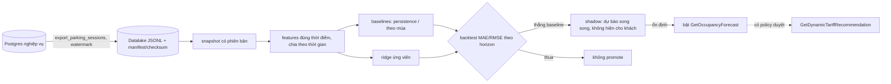

# core/forecast — Dự báo lấp đầy + đề xuất giá động

> Trạng thái (2026-10-14): **phục vụ đã MỞ theo ADR-0037.** Cả hai luồng gRPC và REST Controller `/v1/ai/forecast/*` đã kích hoạt, kết nối dữ liệu viễn trắc ClickHouse Data Marts (`AreaOccupancyTelemetryItem`) dựa trên `day_of_week` và `hour_of_day`.

## Điểm vào (phục vụ)

```text
1. REST API:
   GET /v1/ai/forecast/occupancy/{area_id}
   GET /v1/ai/forecast/surge/{area_id}
   └─ app/api/rest/routes/forecast_controller.py
        └─ services/forecast_service.py

2. gRPC API:
   ForecastService.GetOccupancyForecast / GetDynamicTariffRecommendation
   └─ app/api/grpc/handlers/forecast_handler.py   map proto → query, đẩy sang thread
        └─ services/forecast_service.py
```

Vì sao tắt: bản cũ trả dãy số công thức `min(0.95, 0.40 + (i*0.08) % 0.60)`, `confidence 0.89` cứng và hệ số giá `1.15` cho mọi bãi — hệ số giá nhân vào tiền khách trả. Engine sinh số đó (`engines/occupancy_model.py`) **đã xoá 2026-09-25**; `engines/` hiện trống có chủ đích.

## Luồng dữ liệu + huấn luyện (offline, KHÔNG chạy trong request)

```text
1. app/script/export_parking_sessions.py
     └─ app/infra/datalake/session_exporter.py    PostgreSQL nghiệp vụ → JSONL bất biến + manifest/checksum
          (chỉ khoảng thời gian đỗ + bãi + capacity; KHÔNG user/xe/biển/ảnh), watermark tăng dần
2. app/infra/datalake/occupancy_reader.py          đọc JSONL, khử trùng (session_id+updated_at),
                                                   chia vào slot 30 phút → occupancy
3. python -m training.forecast.run_experiment --as-of <thời điểm>
     ├─ snapshot.py        dựng dataset có phiên bản từ export thô
     ├─ dataset.py         chuẩn hoá lưới thời gian; slot THIẾU vẫn là thiếu (không bịa 0)
     ├─ features.py        đặc trưng đúng thời điểm (không rò tương lai) + chia theo thời gian
     ├─ build_features.py  ghi các split đặc trưng bất biến
     ├─ baselines.py       persistence / theo mùa — mốc phải thắng
     ├─ backtest.py        đánh giá baseline trên export
     ├─ ridge_model.py     ứng viên ridge nhỏ, kiểm tra được
     └─ train.py           huấn luyện ứng viên offline; KHÔNG promote, KHÔNG serve
```

## Khi nào bật lại phục vụ

Theo PROB-039 (Option C): model phải **thắng baseline** trên backtest theo thời gian + chạy shadow; tariff chỉ nối vào forecast sau khi có policy được duyệt. Lúc đó mới dựng `engines/` (dùng lại `training/forecast/features.py`, nạp artifact, predict) và bỏ `FeatureNotImplementedError`.

## Kiểm tra dữ liệu

`python -m app.script.export_parking_sessions --status` · `python training/readiness.py` (chỉ đọc, báo thiếu dữ liệu) · test: `test/test_datalake.py`, `test/test_forecast_training.py`.

## 🎬 Viễn cảnh

**1. Hôm nay — owner mở tab dự báo** → backend gọi `GetOccupancyForecast` → `UNIMPLEMENTED` → HTTP 501 → UI "Chưa có model". Không hiện số giả.

**2. Chu trình đưa model vào phục vụ (mục tiêu PROB-039)**



**3. Dữ liệu thiếu (bãi mới, mất log)** — slot thiếu giữ là thiếu, không điền 0; `training/readiness.py` báo bãi nào chưa đủ dữ liệu để train.

**4. Giá động** — chỉ nối vào dự báo sau khi có policy được duyệt; hệ số giá nhân thẳng vào tiền khách nên không bao giờ dùng số chưa được kiểm.

## 🧰 Công nghệ áp dụng

| Công nghệ | Dùng ở đâu | Vì sao |
|---|---|---|
| JSONL bất biến + manifest checksum + watermark | `app/infra/datalake/session_exporter.py` | Export tăng dần, tái lập được, không PII |
| numpy (ridge dạng đóng) | `training/forecast/ridge_model.py` | Ứng viên nhỏ, kiểm tra tay được — chưa cần thư viện ML nặng |
| Baseline persistence / theo mùa | `training/forecast/baselines.py` | Mốc phải thắng trước khi tin model |
| Backtest theo thời gian (MAE, RMSE theo horizon) | `training/forecast/backtest.py` | Không trộn tương lai vào quá khứ |

## ⚡ Case tối ưu

**Đã áp dụng:** tách hẳn huấn luyện offline khỏi đường phục vụ · export tăng dần theo watermark · khử trùng `session_id+updated_at` · đặc trưng tính đúng thời điểm (không rò) · phục vụ tắt thay vì trả số bịa.

**Nên làm khi có tín hiệu**

| Khi nào | Tối ưu |
|---|---|
| Ridge thắng baseline trên backtest | Tính trước dự báo theo lô mỗi 30 phút cho mọi bãi → phục vụ = đọc cache, không predict trong request |
| Đủ dữ liệu nhiều bãi | Đặc trưng theo bãi (capacity, ngày lễ, thời tiết) hoặc model cây (cần cài thêm — hỏi trước) |
| Sai số lệch theo bãi | Theo dõi MAE theo bãi trong shadow; bãi tệ thì ẩn dự báo riêng bãi đó |
