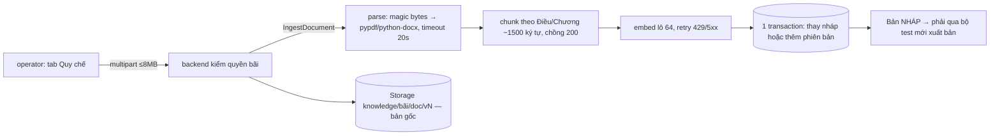

# core/knowledge — Nạp tài liệu quy chế vào kho tri thức (pgvector)

> Trạng thái (2026-09-25): chạy thật; cần `AI_LLM_API_KEY` cho bước embedding. Nạp = **bản nháp** — khách chỉ thấy sau khi scope qua bộ test và được xuất bản ([core/knowledge_eval](../knowledge_eval/README.md), ISSUE-009).

## Luồng nạp một file

```text
backend owner|admin/knowledge-documents (POST, multipart ≤8MB, .pdf/.docx/.txt/.md, kiểm quyền scope)
  └─ grpc KnowledgeService.IngestDocument → app/api/grpc/handlers/knowledge_handler.py
       └─ services/ingestion_service.ingest
            ├─ engines/document_parser.parse_document      (timeout 20s — chặn PDF độc)
            │     đối chiếu magic bytes (%PDF-, PK..) với đuôi file · PDF: pypdf · DOCX: python-docx
            │     rỗng → NoTextLayerError (PDF scan) · sai định dạng → UnsupportedFormatError · >8MB → DocumentTooLargeError
            ├─ engines/chunker.chunk_text
            │     cắt theo "Điều/Chương/Mục/Phần N" hoặc heading Markdown; dài quá mới cắt tiếp
            │     theo đoạn văn; ~1500 ký tự, chồng 200, bỏ đoạn <100
            ├─ guardrails/injection_scan.find_instructions mỗi đoạn: câu ra lệnh cho trợ lý AI (bỏ dấu,
            │     bỏ zero-width) → metadata.injection_flags + cảnh báo trong message; cổng xuất bản chặn (PROB-046)
            ├─ infra/embedding/embedding_client.embed_texts  lô 64, retry 429/5xx
            └─ infra/database/pgvector_client.save_draft_version   MỘT transaction:
                  tài liệu đang có nháp → thay nháp tại chỗ; chưa có → phiên bản mới (max+1)
                  bản PUBLISHED không bị đụng; nạp lại sang bãi khác → chặn
backend lưu bản gốc: Storage knowledge/{bãi|global}/{documentId}/v{n}
```

Trạng thái trả về: `SUCCESS` · `NO_TEXT_LAYER` · `UNSUPPORTED_FORMAT` · `FILE_TOO_LARGE` · `EMBEDDING_FAILED`.

## Dữ liệu (database-vector, schema tự tạo/nâng cấp trong `pgvector_client.ensure_schema`)

`knowledge_documents` (1 dòng/tài liệu, `parking_lot_id` NULL = chung) → `knowledge_document_versions` (DRAFT → TESTED → PUBLISHED → ARCHIVED; tối đa 1 nháp + 1 PUBLISHED, ép bằng unique index) → `knowledge_chunks` (`version_id`, embedding `vector(1536)`, HNSW + GIN full-text).

## Khác

- `ListDocuments` (phiên bản mới nhất + bản khách đang thấy), `DeleteDocument(draft_only)`.
- CLI: `python -m app.script.ingest_knowledge <file> --parking-lot-id <bãi> [--publish]` — `--publish` bỏ qua bộ test, chỉ cho vận hành phía server. Seed demo: `python app/script/seed_regulations.py` (xuất bản luôn).
- File mẫu thử nạp: `data/knowledge/demo-upload/` (MD/TXT/DOCX/PDF + 2 file phải bị từ chối).
- Test: `test_document_parser.py`, `test_chunker.py`, `test_ingestion_service.py`, `test_embedding_client.py`, `test_injection_scan.py`.
- Quét lại tài liệu đã nạp (khi sửa luật quét hoặc dữ liệu cũ): `python -m app.script.rescan_knowledge_injection` (chỉ báo cáo) · `--apply` để ghi cờ; mã thoát 1 nếu còn bản PUBLISHED bị gắn cờ.

## 🎬 Viễn cảnh

**1. Owner nạp quy chế PDF**



**2. PDF scan (ảnh, không có chữ)** → `NO_TEXT_LAYER` — UI báo cần bản có lớp chữ.
**3. File `.exe` đổi đuôi `.pdf`** → magic bytes không khớp → `UNSUPPORTED_FORMAT`.
**4. Sửa quy chế, nạp lại cùng tài liệu** → nháp cũ bị thay tại chỗ; bản PUBLISHED khách đang đọc không đổi cho tới khi xuất bản.
**5. Nhà cung cấp embedding quá tải** → retry có giãn cách; vẫn lỗi → `EMBEDDING_FAILED`, không ghi nửa vời (một transaction).

## 🧰 Công nghệ áp dụng

| Công nghệ | Dùng ở đâu | Vì sao |
|---|---|---|
| pypdf · python-docx | `engines/document_parser.py` | Thuần Python, không cần LibreOffice/OCR trong image |
| Chunker theo cấu trúc pháp lý (regex Điều/Chương/Mục) | `engines/chunker.py` | Một đoạn = một điều khoản → trích nguồn chính xác |
| OpenAI embeddings (lô 64) | `infra/embedding/embedding_client.py` | Giảm số request, chịu rate-limit |
| PostgreSQL + pgvector (HNSW, GIN full-text), psycopg2 | `infra/database/pgvector_client.py` | Vector + phiên bản + transaction trong một DB |
| Unique index một-nháp-một-PUBLISHED | `ensure_schema` | Ép vòng đời phiên bản ở tầng DB, không chỉ ở code |

## ⚡ Case tối ưu

**Đã áp dụng:** timeout parse 20s (chặn PDF độc) · kiểm magic bytes trước khi parse · bỏ đoạn <100 ký tự (rác header/footer) · embed theo lô + retry · ghi một transaction · HNSW cho truy vấn, GIN cho full-text.

**Nên làm khi có tín hiệu**

| Khi nào | Tối ưu |
|---|---|
| Owner nạp lại file y hệt | Băm nội dung; trùng hash với nháp/PUBLISHED → bỏ qua embed (tiết kiệm tiền) |
| Tài liệu lớn làm request chậm | Đưa nạp vào hàng đợi (RabbitMQ) + trả trạng thái, thay vì chờ đồng bộ |
| Nhiều PDF scan | Thêm OCR (cần cài thêm engine — hỏi trước khi cài) |
| Số đoạn > vài trăm nghìn | Chỉnh `ef_search`/`m` của HNSW theo số đo recall/độ trễ |
