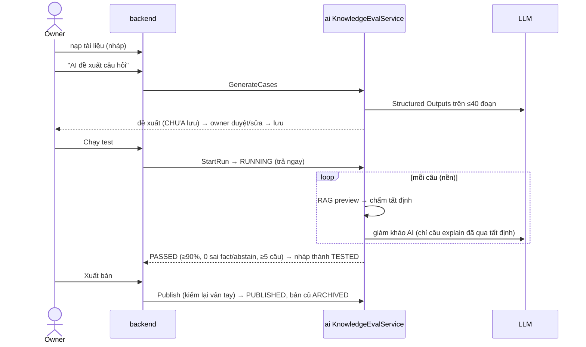

# core/knowledge_eval — Bộ test Copilot + cổng xuất bản (ISSUE-009)

> Trạng thái (2026-09-25): code + test xong, E2E gRPC trên container 14/14; **chưa chạy lượt nào với LLM thật** (thiếu `AI_LLM_API_KEY`).

Scope = ID bãi (`parking_lot_id`) hoặc rỗng = tài liệu chung. Quyền theo scope do backend kiểm trước (owner: bãi mình; admin/moderator: chung, đọc bãi; chỉ admin xuất bản chung).

## Luồng

```text
grpc KnowledgeEvalService → app/api/grpc/handlers/knowledge_eval_handler.py → services/eval_service.py

Bộ test      list/upsert/delete_case → infra/database/knowledge_eval_store (knowledge_test_cases)
             kiểm: loại fact | explain | abstain; fact phải có "thông tin bắt buộc"

AI đề xuất   generate_cases: pgvector.latest_version_ids → store.chunks_for_versions (≤40 đoạn)
             → llm_factory.generate_json (Structured Outputs) → engines/case_generator.clean_proposals
             → TRẢ VỀ ĐỀ XUẤT, KHÔNG LƯU (người duyệt rồi upsert)

Chạy test    start_run: bộ test ≤30 câu · có tài liệu · store.create_run (khoá advisory: 1 lượt/scope,
             ≤3 lượt toàn hệ thống) → trả RUNNING ngay → asyncio task nền:
               mỗi câu: copilot rag_pipeline.query(preview=True)
                     → engines/grader.grade (tất định: tiền/giờ chuẩn hoá, nguồn, từ chối)
                     → câu explain qua tất định → engines/judge (LLM-as-judge, rubric cố định)
                     → store.add_result (+ nhịp tim)
               lỗi hạ tầng (thiếu key, DB/LLM) → lượt FAILED + error, KHÔNG tính câu sai
               xong → engines/gate.run_verdict (≥5 câu, ≥90%, 0 sai fact, 0 sai abstain)
                    → PASSED/FAILED; tài liệu không đổi trong lúc chạy → nháp thành TESTED
             nhịp tim quá 180s (replica chết) → đọc ra ABORTED

Xuất bản     readiness: lượt gần nhất PASSED + vân tay (phiên bản mới nhất, bộ test) khớp + còn nháp
             publish: readiness đạt → pgvector.publish_versions (một transaction, bản cũ → ARCHIVED)
             KHÔNG có đường bỏ qua cổng.
```

## File

| File | Việc |
|---|---|
| `services/eval_service.py` | Điều phối tất cả ở trên |
| `engines/grader.py` | Chấm tất định; `normalize`: `25.000 VNĐ`=`25000đ`, `20k`=`20000`, `22h`=`22:00` |
| `engines/judge.py` | Prompt + schema giám khảo AI (chống prompt injection từ tài liệu) |
| `engines/case_generator.py` | Prompt + schema sinh câu hỏi; lọc đề xuất (bỏ nguồn bịa, câu trùng) |
| `engines/gate.py` | Vân tay, ngưỡng lượt chạy, lý do chưa được xuất bản — thuần, không I/O |
| `app/infra/database/knowledge_eval_store.py` | Bảng `knowledge_test_cases/runs/results` |

Cấu hình `AI_EVAL_*` (`app/config/eval_config.py`): `MAX_CASES_PER_RUN=30`, `MAX_CONCURRENT_RUNS=3`, `MAX_GENERATED_CASES=20`, `MIN_CASES=5`, `MIN_PASS_RATIO=0.9`, `STALE_AFTER_SECONDS=180`, `JUDGE_MODEL`, `JUDGE_ENABLED`. Test: `test/test_knowledge_eval.py`.

Giao diện: operator tab "Quy Chế Cho AI Copilot" và platform "Kho tri thức AI" dùng chung `KnowledgeBaseWorkbench` (`frontend/packages/shared`).

## 🎬 Viễn cảnh

**1. Owner sửa quy chế → test → xuất bản**



**2. Sửa tài liệu trong lúc đang chạy test** → vân tay đổi → lượt PASSED cũ không còn mở khoá xuất bản; phải chạy lại.
**3. Sai một câu `fact` (giá tiền)** → FAILED dù tỉ lệ đạt cao — sai tiền là không được xuất bản.
**4. Replica chạy test bị kill** → nhịp tim quá 180s → đọc ra `ABORTED`, được chạy lại.
**5. Thiếu API key giữa chừng** → lượt `FAILED` + lỗi hạ tầng, **không** tính là câu trả lời sai.

## 🧰 Công nghệ áp dụng

| Công nghệ | Dùng ở đâu | Vì sao |
|---|---|---|
| Chấm tất định (chuẩn hoá tiền/giờ, nguồn, từ chối) | `engines/grader.py` | Rẻ, lặp lại được, không để LLM chấm con số |
| LLM-as-judge với rubric cố định | `engines/judge.py` | Chỉ cho câu giải thích — thứ tất định không chấm nổi |
| Structured Outputs (JSON schema) | `case_generator`, `judge` | Không phải parse văn bản tự do |
| `pg_advisory_xact_lock` | `knowledge_eval_store.py` | 1 lượt/scope, ≤3 lượt toàn hệ thống — đúng cả khi nhiều replica |
| asyncio task + nhịp tim | `eval_service.start_run` | Trả RUNNING ngay; phát hiện lượt mồ côi |

## ⚡ Case tối ưu

**Đã áp dụng:** tất định trước, giám khảo AI sau (chỉ câu explain) · giới hạn 30 câu/lượt, 3 lượt đồng thời · đề xuất câu hỏi không lưu (không rác DB) · vân tay thay cho "chạy lại mọi thứ" để biết lượt còn hiệu lực.

**Nên làm khi có tín hiệu**

| Khi nào | Tối ưu |
|---|---|
| Lượt chạy lâu (30 câu tuần tự) | Chạy song song có semaphore (vd 4) — vẫn giữ giới hạn lượt toàn hệ thống |
| Chạy lại khi chỉ đổi bộ test | Cache kết quả theo (phiên bản tài liệu, câu hỏi) — câu không đổi thì không hỏi lại |
| Chi phí giám khảo | `AI_EVAL_JUDGE_MODEL` rẻ hơn; tắt judge cho scope chỉ có câu fact |
