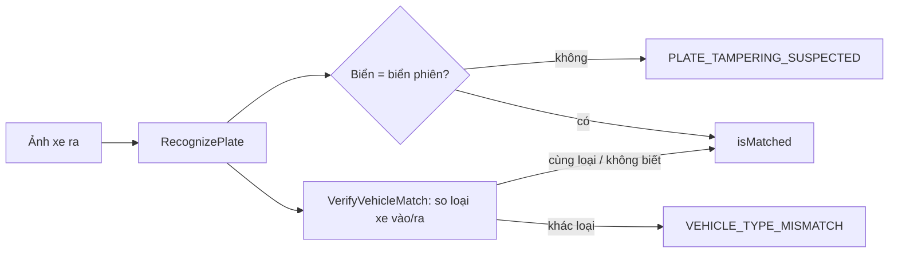

# core/vision — Nhận diện biển số (ANPR) + chống tráo xe

> Trạng thái (2026-09-26): **chạy thật** — YOLO `best.pt` bootstrap + EasyOCR (en, vi). Độ chính xác **chưa đo được** (bộ vàng 0/200, PROB-038). Phân loại loại xe **tắt** khi chưa có checkpoint.

## Điểm vào

| Cổng | File | Ai gọi |
|---|---|---|
| gRPC `VisionService.RecognizePlate` | `app/api/grpc/handlers/vision_handler.py` | Backend: staff check-in/verify check-out (`staff-operation.service.ts`) |
| gRPC `VisionService.VerifyVehicleMatch` | cùng handler | Backend: verify check-out |
| REST `POST /api/anpr/recognize[-many]` | `app/api/rest/routes/anpr_controller.py` | Backend fallback khi gRPC lỗi đường truyền; upload tay |

## Luồng một ảnh (RecognizePlate)

```text
vision_handler.RecognizePlate            map proto → RecognizePlateCommand, đẩy sang thread (CPU-bound)
  └─ services/anpr_service.recognize_bytes
       ├─ engines/anpr_engine.run_anpr   FAÇADE — chỉ điều phối các tầng dưới
       │    ├─ anpr/models.ensure_models_loaded   nạp YOLO + EasyOCR (lazy, khoá luồng)
       │    ├─ anpr/ocr.read_with_confidence      ① OCR CẢ ẢNH → ứng viên "full"
       │    ├─ anpr/detector.detect_plate         ② YOLO → ảnh cắt biển + điểm detector
       │    ├─ anpr/preprocess.is_valid_crop      ③ ảnh cắt ≥220×80, độ sáng ≥80?
       │    │     └─ có → anpr/ocr (ảnh cắt thô) → ứng viên "crop"
       │    ├─ anpr/preprocess.enhance_for_ocr    ④ chỉ khi ③ hỏng hoặc ①② bất đồng:
       │    │     phóng to → xám → khử nhiễu → CLAHE → làm nét → giãn tương phản → OCR → "enhanced"
       │    ├─ anpr/scoring.select_plate_candidate ⑤ chọn: đồng thuận > hình dạng > định dạng mạnh > điểm
       │    └─ trả: biển, confidence, ẢNH CẮT biển (bằng chứng), thời gian
       └─ engines/vehicle_classifier.classify_vehicle   (tuỳ chọn) CNN NetV1/NetV2 → loại xe hoặc None
```

`anti_fraud_service.verify_vehicle_match`: chỉ so **loại xe** lúc vào/ra; `similarity_score` luôn `0.0` = *chưa đo* (so ảnh ReID chưa làm). Backend tự so **biển** vì chỉ backend biết phiên gắn biển nào.

## File

| File | Việc | Sửa khi |
|---|---|---|
| `engines/anpr_engine.py` | Façade `run_anpr`, `warmup` | Đổi thứ tự các bước |
| `engines/anpr/models.py` | Nạp model; `initialized` chỉ bật khi OCR nạp được (bug-006) | Đổi cách nạp/cache |
| `engines/anpr/detector.py` | YOLO chọn box điểm cao nhất, cắt trong biên ảnh | Train lại `best.pt` |
| `engines/anpr/preprocess.py` | Ngưỡng ảnh cắt + chuỗi làm nét (hằng số có tên ở đầu file) | Chỉnh theo camera thật |
| `engines/anpr/ocr.py` | EasyOCR; điểm = trung bình trọng số độ dài; không đọc được → 0.0 | Thay OCR |
| `engines/anpr/plate_text.py` | Chuẩn hoá, hợp lệ (≤11 ký tự, ≥1 chữ cái), khoá so sánh | Thêm định dạng biển |
| `engines/anpr/scoring.py` | `confidence = detector × OCR` (không detector → OCR); chọn ứng viên | Đổi cách chấm |
| `engines/vehicle_classifier.py` | CNN phân loại xe, tắt khi thiếu checkpoint | Có checkpoint mới |
| `services/anpr_service.py` | Gói kết quả; REST mới ghi file vào `static/` | Đổi hợp đồng trả về |
| `services/anti_fraud_service.py` | So loại xe vào/ra | Làm ReID ảnh |

## Cấu hình (`app/config/vision_config.py`, prefix `AI_`)

`AI_YOLO_MODEL_PATH`, `AI_OCR_LANGUAGES=en,vi`, `AI_OCR_MODEL_STORAGE_DIR`, `AI_VISION_WARMUP_ON_START` (true = nạp xong mới mở cổng; false = mở cổng ngay, nạp nền), `AI_VEHICLE_CHECKPOINT`.

## Ảnh ANPR đi đâu? Ngưỡng bao nhiêu %?

- **Bằng chứng phiên đỗ:** mọi ảnh cắt → Storage folder `Sessions` (backend `persistCropImage`), dùng lúc verify check-out.
- **Vòng dữ liệu (ISSUE-010):** sau khi nhân viên **xác nhận** biển ở cổng, ảnh cắt đi qua `DatasetService.EvaluateCapture`; được chọn khi nhân viên sửa biển, điểm **< 75%**, ảnh kém chất lượng, hoặc bốc kiểm ngẫu nhiên **3%** → folder `Dataset` → moderator gán nhãn. Chi tiết: [core/dataset/README.md](../dataset/README.md).
- **Datalake** chỉ chứa phiên đỗ cho forecast, cố ý **không** có biển/ảnh.
- Route cũ `check-in-anpr` (mobile, không có bước xác nhận) **không** đưa ảnh vào vòng dữ liệu. Dự đoán máy không bao giờ tự thành nhãn.

## Test

`test/test_anpr_pipeline.py` (ảnh bằng chứng), `test_confidence.py` (điểm, chọn ứng viên, detector), `test_plate_text.py`, `test_anpr_model_loading.py` (bug-006), `test_vision_mapper.py`. Đo trên container: `python app/script/benchmark_vision_grpc.py`; đo độ chính xác: `training/eval_plates.py` (cần bộ vàng).

## 🎬 Viễn cảnh

**1. Xe vào cổng — luồng chuẩn (preview → confirm, ISSUE-010)**

```mermaid
sequenceDiagram
    actor S as Nhân viên
    participant B as backend
    participant AI as ai VisionService
    participant ST as Storage
    S->>B: ảnh cổng (preview)
    B->>AI: RecognizePlate (deadline 30s)
    AI->>AI: YOLO cắt biển → OCR ảnh cắt → (chưa chắc định dạng) OCR cả ảnh → (làm nét nếu cần) → chọn ứng viên
    AI-->>B: biển, confidence, ảnh cắt (bytes)
    B->>ST: ảnh cắt → Sessions
    B-->>S: gợi ý + ảnh cắt; <75% bắt đối chiếu
    S->>B: xác nhận (có thể sửa)
    B->>B: tạo phiên (checkInMethod=AUTO_ALPR, aiConfidenceIn, gateIn, ảnh)
```

**2. ai chết / timeout** — backend chỉ fallback REST (`AnprProvider`) khi lỗi **đường truyền**; lỗi nhận diện (ảnh mờ, không có biển) trả thẳng cho nhân viên, không chạy lại model lần hai. Nhánh REST không có byte ảnh cắt → lượt đó không vào dataset.

**3. Pod vừa khởi động** — `AI_VISION_WARMUP_ON_START=false`: cổng mở ngay, model nạp nền (~22s từ cache); request đến sớm chờ lượt nạp đó thay vì nạp lần hai (bug-006). OCR nạp hỏng → `FAILED_PRECONDITION`, không "đọc bừa".

**4. Ảnh xấu (đêm, lóa, nghiêng)** — ảnh cắt < 220×80 hoặc tối → bỏ OCR ảnh thô, chạy chuỗi làm nét (phóng to → CLAHE → sharpen); ứng viên "full"/"crop"/"enhanced" bất đồng → ưu tiên đồng thuận, rồi hình dạng biển, rồi định dạng.

**5. Check-out nghi tráo xe**


(`similarity_score` so ảnh = 0.0 — chưa làm ReID.)

## 🧰 Công nghệ áp dụng

| Công nghệ | Dùng ở đâu | Vì sao |
|---|---|---|
| Ultralytics YOLO (`best.pt`) | `anpr/detector.py` | Khoanh vùng biển nhanh trên CPU; train lại được từ dữ liệu ISSUE-010 |
| EasyOCR (en, vi) | `anpr/ocr.py` | OCR đa ngôn ngữ sẵn model, trả điểm từng đoạn |
| OpenCV (resize, CLAHE, bilateral, sharpen) | `anpr/preprocess.py` | Cứu ảnh tối/nhỏ trước OCR, tất định |
| PyTorch CPU wheel 2.5 | YOLO/EasyOCR/CNN phân loại xe | Image nhẹ, chạy không cần GPU |
| gRPC aio + ThreadPoolExecutor(`grpc_max_workers=10`) | `grpc_server.py`, `vision_handler` | Nhận bytes ảnh trực tiếp; inference CPU-bound chạy thread, không chặn event loop |
| FastAPI REST | `api/rest/routes/anpr_controller.py` | Kênh dự phòng + upload tay |

## ⚡ Case tối ưu

**Đã áp dụng**

| Case | Cách làm |
|---|---|
| Không nạp model mỗi request | Nạp lười có khoá luồng + warmup; `initialized` chỉ bật khi OCR thật sự nạp được |
| Không làm nét thừa | Chuỗi enhance chỉ chạy khi ảnh cắt hỏng hoặc hai ứng viên bất đồng |
| Không OCR cả khung hình thừa | Ảnh cắt đã đọc đủ hai dấu phân cách với điểm tốt (`strong_format`) thì bỏ bước OCR cả ảnh |
| OCR chỉ ra ký tự biển số | `allowlist` A–Z, 0–9, `-`, `.`; xếp cụm theo dòng cho biển hai dòng; sửa nhầm chữ↔số ở vị trí mã tỉnh/sê-ri/số cuối (`plate_text.correct_plate_confusions`) |
| Không ghi đĩa pod | gRPC trả **bytes** ảnh cắt; backend đẩy lên Storage bền (URL pod mất khi restart) |
| Không kẹt request | Mọi unary gRPC có deadline (`AI_GRPC_TIMEOUT_MS=30000`) |
| Không retry vô ích | Fallback REST chỉ cho lỗi transport (`isAiTransportError`) |

**Nên làm khi có tín hiệu**

| Khi nào | Tối ưu |
|---|---|
| p95 `benchmark_vision_grpc.py` vượt ngân sách cổng | Xuất YOLO sang ONNX/OpenVINO |
| Nhiều làn quét cùng lúc | Gom batch inference theo cửa sổ vài chục ms; tăng replica ai thay vì tăng thread |
| Có test-golden (≥200 ảnh CONFIRMED từ ISSUE-010) | Đo accuracy bằng `training/eval_plates.py`, chỉnh ngưỡng 0.75 và ngưỡng preprocess theo số đo |
| Đủ ảnh LABELED | Fine-tune `best.pt`/OCR từ snapshot, so với bản cũ trên cùng test-golden trước khi thay |
| Tranh chấp tráo xe tăng | Làm ReID ảnh (embedding xe) để `similarity_score` có nghĩa |
