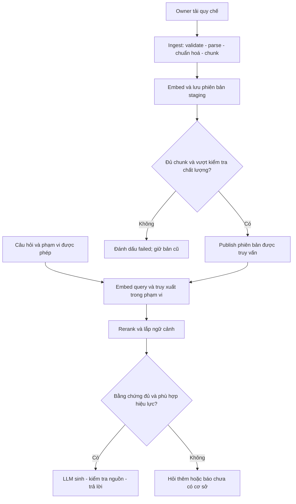
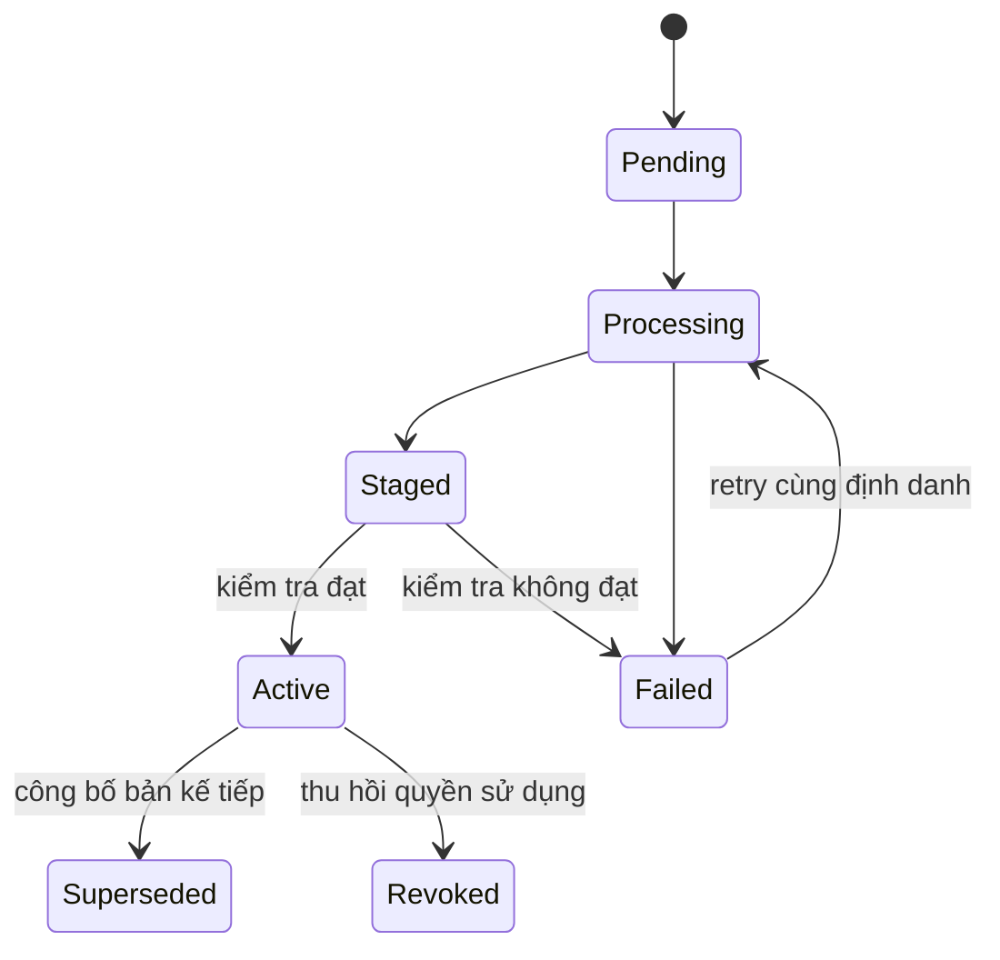

# 📘 [Guide] RAG — lý thuyết, luồng dữ liệu và chiến lược tối ưu

> **Đích:** `ai/docs/guides/02-rag-optimization-strategy.md` · **Template:** [guide-template](../../../docs/templates/guide-template.md)
> [MUST] Phân biệt **hiện trạng** và **đề xuất**. Các luồng hoàn chỉnh dưới đây chưa được triển khai end-to-end.

## 📌 Meta

| | |
|---|---|
| **Trạng thái** | ⚠️ Chưa kiểm chứng runtime; đối chiếu source 2026-09-19 |
| **Phạm vi** | ai — knowledge, copilot, embedding, pgvector, LLM |
| **Ngày cập nhật** | 2026-09-19 |
| **Người viết** | Codex |

## 🎯 Dành cho ai, đọc xong làm được gì

Dev cần hiểu RAG từ lúc chủ bãi tải quy chế đến lúc khách nhận câu trả lời. Đọc xong biết mỗi bước tạo dữ liệu gì, tối ưu chỗ nào trước, và dùng phép đo nào để quyết định thay đổi.

RAG giống người tra sổ tay: **tìm đúng trang → đọc đúng điều kiện → giải thích và chỉ nguồn**. Embedding giúp tìm đoạn có nghĩa gần câu hỏi; LLM diễn đạt câu trả lời. RAG không huấn luyện lại LLM và không tự bảo đảm câu trả lời đúng.

## ☑️ Điều kiện trước khi bắt đầu (Prerequisites)

- [ ] Đọc [ba pipeline](./01-three-ai-pipelines-architecture.md).
- [ ] Có quy chế được phép sử dụng, biết bãi áp dụng và thời gian hiệu lực.
- [ ] Chuẩn bị câu hỏi có đáp án và đoạn nguồn đúng, cả câu không có đáp án.
- [ ] Khi triển khai: có embedding provider, DB thật, LLM thật; hiện các phần này còn thiếu.

## 🗺️ Bức tranh tổng quan



**Hiện trạng có bằng chứng:**

| Thành phần | Hiện trạng | Điểm đọc source |
|---|---|---|
| Parser | Có validate, PDF/DOCX/TXT/MD; PDF scan không có text bị từ chối | [document_parser.py](../../app/core/knowledge/engines/document_parser.py), `parse_document` |
| Chunker | Có chia heading/đoạn, overlap theo ký tự | [chunker.py](../../app/core/knowledge/engines/chunker.py), `chunk_text` |
| Knowledge service | Chưa có điều phối ingest | `ai/app/core/knowledge/services/` chỉ có `__init__.py` khi rà |
| Embedding | Chưa có provider thực | `ai/app/infra/embedding/__init__.py` |
| Vector store | `connect` chỉ đổi cờ, search/insert trả mẫu | [pgvector_client.py](../../app/infra/database/pgvector_client.py), `connect`, `insert_chunk` |
| RAG engine | Vector 0, confidence 0.95 viết cứng | [rag_pipeline.py](../../app/core/copilot/engines/rag_pipeline.py), `query` |
| Public service | Ném `FeatureNotImplementedError` | [copilot_service.py](../../app/core/copilot/services/copilot_service.py), `ask_question`, `stream_answer` |

Các tên trạng thái, metadata và response đề xuất trong guide là thiết kế cần triển khai, không phải hợp đồng DTO hiện có.

## 🪜 Các bước

### Bước 1: Hiểu các khái niệm trước khi tối ưu

| Khái niệm | Ý nghĩa | Điều dễ nhầm |
|---|---|---|
| Chunk | Đơn vị văn bản có thể truy xuất riêng | Quá ngắn mất điều kiện; quá dài lẫn nhiều chủ đề |
| Embedding | Vector biểu diễn văn bản trong không gian của một model | Cùng số chiều chưa chắc cùng không gian; đổi model phải re-embed |
| Cosine similarity | Độ gần theo hướng vector: dot(a,b)/(norm(a)×norm(b)) | Không phải xác suất đáp án đúng; vector 0 không có cosine xác định |
| Retrieval | Chọn ứng viên từ kho | Tìm đúng chủ đề nhưng sai phiên bản vẫn là sai |
| Reranking | Chấm lại các ứng viên bằng query và nội dung | Không cứu được nguồn đúng đã bị bỏ ở vòng retrieval |
| Grounding | Gắn từng khẳng định với bằng chứng | Có link nguồn chưa chứng minh câu trả lời được nguồn hỗ trợ |
| Abstention | Từ chối kết luận khi thiếu cơ sở | Là kết quả hợp lệ, cần đưa vào bộ đánh giá |

**Kết quả mong đợi:** tách được lỗi không tìm thấy nguồn khỏi lỗi LLM diễn giải sai nguồn. Không đổi LLM trước khi biết lỗi ở tầng nào.

### Bước 2: Xây ingest — 8 bước từ file đến phiên bản sử dụng được

| Bước | Đầu vào → đầu ra | Xử lý và lý do | Khi lỗi |
|---|---|---|---|
| I1. Xác thực và validate | File + owner → yêu cầu hợp lệ | Backend xác minh quyền theo bãi; parser hiện có trần 8 MiB và chữ ký PDF/ZIP | Từ chối, không tạo phiên bản active |
| I2. Parse | Bytes → text + warnings | Giữ bảng phí, tiêu đề, trang/vị trí để truy vết | File scan cần OCR tài liệu riêng hoặc yêu cầu bản có text |
| I3. Chuẩn hoá | Text → nội dung chuẩn + metadata | Dọn khoảng trắng, giữ số tiền, đơn vị, dấu tiếng Việt và thời gian | Ký tự thay thế trong điều khoản quan trọng cần kiểm tra |
| I4. Chunk | Text → mảnh có section và thứ tự | Chia theo điều khoản trước, chỉ chia nhỏ khi quá dài | Kiểm tra mất điều kiện, mất dòng bảng, mảnh bị loại |
| I5. Embed | Các mảnh → vectors | Batch theo giới hạn token/provider, kiểm tra chiều và giá trị hữu hạn | Retry có giới hạn; không ghi vector 0 thay lỗi |
| I6. Lưu staging | Chunks + vectors → version chưa công bố | Gắn document_id, version, ordinal và hash để retry không nhân đôi | Giữ trạng thái failed/pending; không lộ dữ liệu dở dang |
| I7. Kiểm tra | Version → báo cáo chất lượng | Đếm chunk; tra thử câu vàng; phát hiện trang scan bị thiếu | Chưa đạt thì không publish |
| I8. Publish | Version đạt → active | Chuyển version nhất quán, vô hiệu cache; giữ bản lịch sử để tra tranh chấp | Giữ bản cũ nếu publish thất bại |

**Hiện có và giới hạn:** parser ghép text PDF nên chưa giữ mapping trang cho từng chunk. DOCX lấy paragraphs trước rồi tables nên chưa bảo toàn thứ tự xen kẽ. `errors="replace"` không chuyển mã cp1258; nó thay byte UTF-8 lỗi. Magic bytes ZIP chỉ là kiểm tra ban đầu, không đủ chứng minh ZIP là DOCX hợp lệ. Hằng timeout 20 giây chưa phải timeout đã được thực thi vì thiếu service điều phối.

[MUST] Với tài liệu lẫn text và trang scan, text không rỗng chưa có nghĩa tài liệu đầy đủ. Đề xuất kiểm tra theo trang trước publish. OCR tài liệu cần giữ layout/bảng; không dùng pipeline OCR biển số cho quy chế.

**Metadata đề xuất:** `document_id`, `version`, `parking_lot_id`, `visibility`, `effective_from`, `effective_to`, `source_location`, `section_title`, `ordinal`, `content_hash`, `embedding_model`, `embedding_dimension`, `chunker_version`, `status`. Backend quyết định phạm vi được phép; không tin lot ID do client tự khai.



**Kết quả mong đợi:** retry cùng file/version không tạo bản trùng; lỗi giữa chừng không làm mất phiên bản đang phục vụ. Đây là tiêu chí nghiệm thu tương lai.

### Bước 3: Thiết kế chunking bằng ví dụ

Giả sử Điều 3 ghi “Ô tô gửi 22:00–06:00 phụ thu 30.000đ/lượt”, kế tiếp là “Miễn phụ thu với vé tháng”. Nếu chỉ lấy câu đầu thì câu trả lời cho khách vé tháng sẽ sai dù retrieval tìm đúng phí.

Giữ điều khoản và ngoại lệ chung một chunk nếu vừa ngân sách. Nếu quá dài, gắn quan hệ cha/con và mở rộng sang mảnh lân cận có ngoại lệ khi dựng context; phải đo chi phí token thêm.

Hiện code dùng target **1500 ký tự**, overlap **200 ký tự**, min **100 ký tự** (`ai/app/core/constants.py`). Đây không phải số token. `section_title` giữ ở metadata mỗi mảnh, nhưng `_pack` chưa tự chèn lại heading vào content mọi mảnh sau. Khi embed có thể đề xuất ghép heading với content, đồng thời tính lại ngân sách token.

[GOTCHA] Overlap chỉ giảm mất ngữ cảnh ở ranh giới, không bảo đảm mọi câu đều nguyên vẹn. Lọc mảnh <100 ký tự có thể bỏ một điều miễn phí ngắn nhưng quan trọng khi tài liệu còn mảnh dài khác. Cần kiểm thử bằng nội dung nghiệp vụ, không chỉ kiểm chiều dài.

**Thí nghiệm đề xuất:** cố định dữ liệu/query/model; thử target 1000/1500/2000 ký tự và overlap 0/100/200. Đo recall nguồn đúng, tỷ lệ mất điều kiện, token/context, p95. Chọn bằng kết quả; semantic chunking không mặc nhiên tốt nhất.

### Bước 4: Query — 9 bước từ câu hỏi đến câu trả lời

| Bước | Đầu vào → đầu ra | Điều kiện kiểm tra |
|---|---|---|
| Q1. Quyền và phạm vi | User + câu hỏi → scope, thời điểm áp dụng | Thiếu bãi/thời điểm cần thiết thì hỏi thêm |
| Q2. Chuẩn hoá query | Query → query chuẩn | Giữ số điều, giờ, loại xe, biển số khi cần; không tự thêm giả định |
| Q3. Embed query | Text → vector | Cùng model/version không gian với kho được chọn |
| Q4. Retrieve | Vector + scope → ứng viên | Lọc quyền, bãi, hiệu lực; không chỉ lọc sau khi đã gửi cho LLM |
| Q5. Rerank và loại trùng | Ứng viên → danh sách xếp hạng | Giữ điều khoản và ngoại lệ; ngưỡng được chọn trên validation |
| Q6. Lắp context | Mảnh chọn → evidence có ID | Ngân sách token gồm prompt, history, query, output dự phòng |
| Q7. Kiểm tra đủ cơ sở | Evidence → đủ/thiếu/mâu thuẫn | Không bằng chứng thì trả chưa tìm thấy, không gọi LLM để đoán |
| Q8. Generate | Query + evidence → bản nháp | Prompt yêu cầu trích ID nguồn; văn bản truy xuất là dữ liệu, không phải chỉ dẫn |
| Q9. Validate và trả | Nháp → answer + citations hoặc abstain | ID nguồn phải tồn tại và nội dung thực sự hỗ trợ câu trả lời |

Ví dụ giả lập: user hỏi “Tôi có vé tháng, qua đêm có phụ thu không?”. Q4 tìm cả phí và miễn phí; Q6 giữ cả hai; Q8 trả “Theo Điều 3 của bản áp dụng, vé tháng được miễn phụ thu”. Nếu chỉ có phí, Q7 cần tìm thêm điều kiện vé tháng trước khi kết luận. Con số 30.000đ ở đây là dữ liệu minh hoạ, không phải biểu phí xác minh của một bãi thật.

Với streaming, phần đã phát không thể thu hồi. Đề xuất kiểm chứng evidence trước stream và không hiển thị bản nháp như kết luận cuối; nguồn/kết quả chỉ được chốt sau validate. Không tự triển khai streaming sớm hơn luồng unary có kiểm chứng.

### Bước 5: Tối ưu retrieval theo đúng thứ tự

1. **Đo baseline exact search trước.** Dữ liệu nhỏ chưa cần ANN; lấy kết quả exact làm mốc kiểm mất recall do index.
2. **Kiểm scope và version.** Sai bãi/sai hiệu lực phải sửa trước tốc độ. Quy chế chung chỉ được phép truy xuất nếu policy cho phép; `parking_lot_id IS NULL` không tự đồng nghĩa công khai.
3. **Cải thiện candidate recall.** Câu chứa mã điều, loại vé hoặc số giờ có thể cần keyword bên cạnh semantic.
4. **Hợp nhất thứ hạng.** RRF cộng `1/(k + rank)` trên các danh sách có tài liệu đó; rank bắt đầu từ 1, không có thì đóng góp 0. `k=60` là cấu hình thử nghiệm, không phải mặc định bắt buộc.
5. **Rerank và chọn evidence.** Cross-encoder chấm cặp query–chunk; MMR ưu tiên liên quan và đa dạng. Hai cơ chế có mục tiêu khác nhau, không coi là cùng một bước bắt buộc.
6. **Sau đó mới tối ưu index.** HNSW/IVFFlat đổi recall lấy tốc độ; đo với bộ lọc bãi giống production. Không hứa recall 95% hay 99% chỉ từ tên index.

pgvector dùng `<=>` cho cosine distance; similarity = `1 - distance`. ANN có thể trả thiếu ứng viên sau lọc; cần đo và cân nhắc tăng ngân sách tìm kiếm, iterative scan khi phiên bản hỗ trợ, hoặc exact search trong phạm vi nhỏ. `ORDER BY distance LIMIT k` là mẫu để planner cân nhắc index; thêm CASE ưu tiên bãi lên đầu có thể đổi kế hoạch. Kiểm bằng `EXPLAIN (ANALYZE, BUFFERS)` trên dữ liệu thử. [Nguồn: pgvector](https://github.com/pgvector/pgvector#filtering).

PostgreSQL full-text search là một cách tìm lexical, không mặc nhiên là BM25. Chọn bộ tách từ tiếng Việt và cách xếp hạng dựa trên tập query của dự án.

### Bước 6: Chọn embedding và quản lý chi phí

Không chốt model chỉ vì code mẫu có 1536 chiều. So sánh các ứng viên trên cùng dữ liệu tiếng Việt, câu không dấu, viết tắt, bảng phí và query song ngữ. Ghi model/version, số chiều, giới hạn token, latency, chi phí đo được và phương án vận hành.

[MUST] Query/document dùng đúng hướng dẫn encode của model được chọn, kể cả prefix khác nhau nếu model yêu cầu. Không trộn vectors từ hai model cùng số chiều. Đổi model → tạo index/version mới → re-embed → đánh giá → chuyển traffic, giữ khả năng quay lại.

Batch theo cả số phần tử và token thực tế. Retry lỗi tạm thời có backoff và giới hạn; idempotency tránh tạo trùng. Cache embedding theo hash nội dung + model/version + cách chuẩn hoá. Cache câu trả lời phải chứa scope/quyền, phiên bản corpus và thời điểm áp dụng; vô hiệu khi quy chế đổi hoặc bị thu hồi.

**Kết quả mong đợi:** cùng một bộ câu hỏi có bảng so sánh chất lượng, p95, token và chi phí mỗi lượt, thay vì xếp model “tốt/rất tốt” không có số đo.

### Bước 7: Đánh giá trước khi mở tính năng

Bộ vàng đề xuất ban đầu: 30–50 câu mỗi bãi để tìm lỗi, chưa đủ chứng minh chất lượng production. Mỗi record giữ question, scope, effective time, nguồn/điều đúng, đáp án hoặc expected abstention. Chia tập chỉnh cấu hình và tập test giữ riêng; không chọn threshold trên tập test cuối.

| Phép đo | Định nghĩa thực hành | Dùng để quyết định |
|---|---|---|
| Recall@k | Số nguồn liên quan tìm được / tổng nguồn liên quan gán nhãn cho query | Retrieval có bỏ nguồn đúng? |
| Hit@k | Tỷ lệ query có ít nhất một nguồn đúng trong top-k | Hữu ích khi mỗi câu chỉ có một nguồn chính |
| Citation support | Tỷ lệ khẳng định được nguồn trích hỗ trợ | LLM có diễn giải vượt bằng chứng? |
| Correct abstention | Tỷ lệ câu không đủ nguồn được từ chối đúng | Có bịa khi không tìm thấy? |
| Scope/version violation | Đếm kết quả dùng sai quyền, bãi hoặc hiệu lực | Phải bằng 0 trên bộ kiểm tra trước rollout |
| Latency và cost | p50/p95 từng bước, tổng request; token và chi phí thực | Tối ưu đúng chỗ nghẽn |

Các ca bắt buộc: hai bãi có biểu phí khác nhau, quy chế mới thay bản cũ, file scan, tài liệu lỗi encoding, điều miễn trừ ngắn, bảng qua trang, query không có đáp án, nguồn chứa chỉ dẫn “bỏ qua quy chế”, retry ingest và thu hồi tài liệu.

[NEVER] Dùng trung bình similarity làm xác suất câu trả lời đúng. Có thể ghi retrieval score nội bộ; confidence cho người dùng chỉ có ý nghĩa khi định nghĩa và hiệu chuẩn trên dữ liệu có nhãn. LLM chấm LLM chỉ hỗ trợ sàng lọc, vẫn cần con người kiểm các ca quan trọng.

### Bước 8: Roadmap xây thật, có điều kiện qua chặng

| Chặng | Việc cần làm | Chỉ qua chặng khi |
|---|---|---|
| 1. Dữ liệu | Chốt nguồn, scope, bộ vàng và schema/version | Truy vết được điều khoản và đáp án |
| 2. Ingest | Service, provider, DB thật, timeout, idempotency, publish | Nạp lại không trùng; lỗi không phá bản cũ |
| 3. Retrieval | Exact baseline, scope/hiệu lực, đánh giá độc lập | Nguồn đúng được tìm; không lẫn quyền |
| 4. Answer | LLM thật, citation validation, abstention, unary | Câu trả lời đạt tiêu chí đã chốt trên test giữ riêng |
| 5. Tối ưu | Hybrid/rerank/index/cache/stream khi có nhu cầu đo được | Chất lượng không giảm ngoài mức cho phép; p95/cost cải thiện |
| 6. Tranh chấp | Ghép evidence phiên + quy chế tại thời điểm phát sinh | Thiếu log thì chuyển nhân viên; phép tính tiền do backend xử lý |

Trọng tài AI nên tạo **đề xuất có bằng chứng** cho quy trình xử lý. Refund/đổi phí vẫn qua quyền và policy backend; prompt không được trao quyền tự thực hiện giao dịch. Chỉ bỏ chặn `FeatureNotImplementedError` sau khi kiểm chứng chuỗi thật.

## ✅ Kiểm chứng cuối (làm sao biết đã xong ĐÚNG)

| Kiểm tra | Thao tác | Kỳ vọng |
|---|---|---|
| Đọc hiện trạng | Đối chiếu các hàm trong bảng source | Không nhầm placeholder là chạy thật |
| Parser/chunker | Từ thư mục `ai`, chạy lệnh dưới khi đã có dependencies | Test báo OK; không chứng minh RAG end-to-end |
| Retrieval/answer tương lai | Chạy bộ vàng với version/model cố định | Có báo cáo theo từng bước và từng loại lỗi |
| Lifecycle tương lai | Lỗi ingest, retry, publish, revoke | Không query bản dở dang hoặc bản đã thu hồi |

```powershell
# Chạy từ thư mục ai/ sau khi setup môi trường theo README
python -m unittest tests.test_document_parser tests.test_chunker
```

Lần chỉnh guide này chỉ đối chiếu source và cấu trúc tài liệu; chưa gọi embedding/LLM hay benchmark retrieval.

## 🔥 Troubleshooting

| Triệu chứng | Nguyên nhân thường gặp | Cách xử lý |
|---|---|---|
| Không tìm được đoạn đúng | Parse mất bảng, chunk mất điều kiện, sai filter | Xem text/chunks trước khi đổi model |
| Tìm đúng chủ đề, trả sai phí | Sai hiệu lực/loại vé, context thiếu ngoại lệ | Kiểm metadata và mở rộng evidence có kiểm soát |
| HNSW nhanh nhưng recall thấp | ANN + filter loại nhiều ứng viên | So với exact baseline trong cùng scope |
| Confidence cao nhưng sai | Nhầm similarity với correctness | Tách hai chỉ số; kiểm claim–source |
| Quy chế đổi nhưng trả bản cũ | Cache thiếu version hoặc invalidation | Đưa version/quyền vào key và vô hiệu khi publish/revoke |
| Nạp thành công nhưng thiếu nội dung | PDF có cả scan/text hoặc cảnh báo bị bỏ qua | Gate chất lượng theo trang trước publish |

## 🔗 Liên quan

- [Ba pipeline](./01-three-ai-pipelines-architecture.md) · [Xử lý ảnh](./03-image-processing-pipeline.md) · [Forecast](./04-forecast-training-strategy.md)
- [Worker, storage và vòng đời dữ liệu AI](./05-ai-workers-storage-and-training-lifecycle.md)
- [SUGGESTION-008: nạp tri thức](../../../docs/suggestions/09-2026/SUGGESTION-008-knowledge-ingestion-pipeline.md)
- [ISSUE-004](../../../docs/projects/issues/09-2026/ISSUE-004-nap-lieu-tri-thuc-rag/issue.md)
- [pgvector: index và filtering](https://github.com/pgvector/pgvector) — tài liệu tham chiếu; cần kiểm phiên bản thực tế trước áp dụng.
