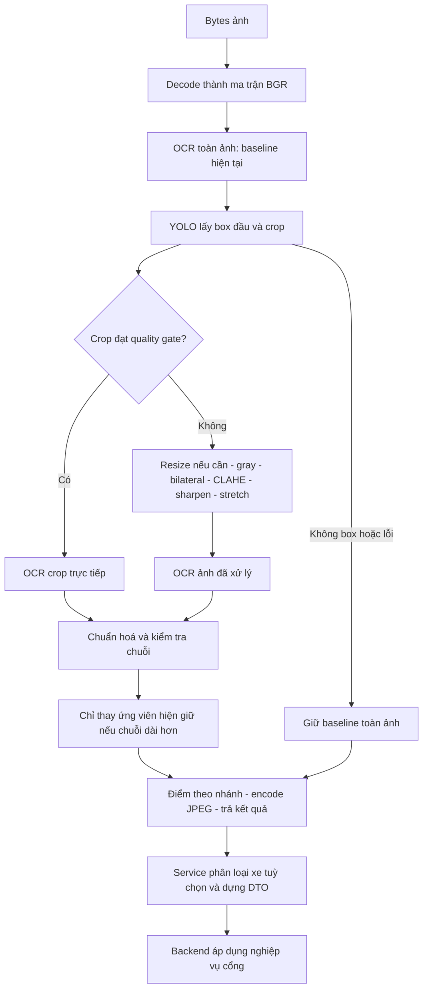
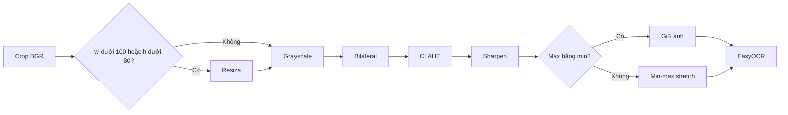
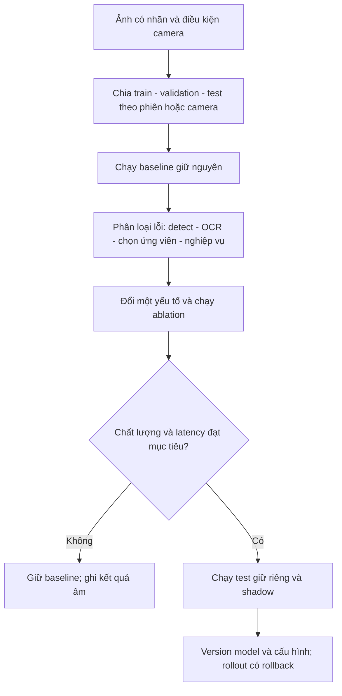

# 📘 [Guide] Xử lý ảnh ANPR — từ pixel đến biển số và vòng cải thiện model

> **Đích:** `ai/docs/guides/03-image-processing-pipeline.md` · **Template:** [guide-template](../../../docs/templates/guide-template.md)
> [GOTCHA] 8 bước ANPR là luồng tổng; 6 phép tiền xử lý chỉ nằm trong nhánh enhanced OCR. Không phải ảnh nào cũng đi qua mọi phép lọc.

## 📌 Meta

| | |
|---|---|
| **Trạng thái** | ⚠️ Chưa kiểm chứng runtime; đối chiếu mã nguồn 2026-09-19 |
| **Phạm vi** | ai — vision, ANPR, tiền xử lý và đánh giá |
| **Ngày cập nhật** | 2026-09-19 |
| **Người viết** | Codex |

## 🎯 Dành cho ai, đọc xong làm được gì

Dev muốn hiểu ảnh được xử lý bao nhiêu bước, vì sao phải crop/lọc/tăng tương phản, và lúc nào cần sửa dữ liệu thay vì đổi model. Đọc xong có thể lần theo một ảnh qua pipeline, xác định tầng gây lỗi và lập thí nghiệm cải thiện có đối chứng.

Có thể hình dung: detector tìm đúng tờ giấy trong bức ảnh; tiền xử lý làm chữ dễ nhìn hơn; OCR đọc chữ; hậu xử lý kiểm tra chuỗi. Làm chữ đậm hơn không cứu được trường hợp detector cắt nhầm vùng.

## ☑️ Điều kiện trước khi bắt đầu (Prerequisites)

- [ ] Đọc [tổng quan ba pipeline](./01-three-ai-pipelines-architecture.md) và [AI README](../../README.md).
- [ ] Biết ảnh số là ma trận pixel; BGR có ba kênh, grayscale một kênh.
- [ ] Khi thử nghiệm: có ảnh gốc, nhãn biển số đúng và quyền sử dụng dữ liệu.
- [ ] Kiểm weights/thiết bị và môi trường theo README; ghi phiên bản model, thư viện và cấu hình trong báo cáo.

## 🗺️ Bức tranh tổng quan



Nguồn chính: [anpr_engine.py](../../app/core/vision/engines/anpr_engine.py), `run_anpr:203`; [anpr_service.py](../../app/core/vision/services/anpr_service.py), `recognize_bytes`. Mô tả **hiện tại** bên dưới dựa trên các hàm này; chiến lược sửa được ghi **đề xuất**.

## 🪜 Các bước

### Bước 1: Decode và kiểm đầu vào

**Hiện tại:** `np.frombuffer` đọc bytes thành mảng uint8; `cv2.imdecode(..., IMREAD_COLOR)` tạo ảnh BGR. Bytes rỗng hoặc decode trả None → `InvalidImageError`. Model được yêu cầu nạp trước bước kiểm bytes trong `run_anpr`.

**Đầu vào → đầu ra:** JPEG/PNG bytes → ma trận H×W×3 hoặc lỗi rõ ràng. Decode không phải tăng chất lượng và không phải phân loại xe.

**Đề xuất:** giới hạn cả bytes lẫn kích thước pixel sau decode, xác định hướng ảnh, ghi lý do ảnh hỏng. Không sửa ảnh gốc dùng làm bằng chứng; biến thể xử lý là dữ liệu dẫn xuất có cấu hình đi kèm.

### Bước 2: Hiểu detection và crop

Detection trả vị trí vùng nghi là biển số, chưa trả chuỗi biển số. OCR mới đọc nội dung vùng đó.

**Hiện tại:** `detect_plate_yolo:132` đổi BGR → RGB để gọi model, lấy `xyxy[0]` rồi crop trên ảnh BGR gốc. Không có YOLO → trả ảnh đầy đủ và `det_conf=None`; có YOLO nhưng không box → `PlateRecognitionError`, được nhánh gọi giữ lại kết quả OCR toàn ảnh.

**Đầu vào → đầu ra:** ảnh → crop + detector score hoặc fallback. Không coi box đầu là biển số đúng lane trong cảnh nhiều xe.

**Đề xuất:** kiểm tọa độ trong biên, crop không rỗng, chọn box theo vùng lane/diện tích/chất lượng có đo. Nếu phối cảnh nghiêng nặng, thử chỉnh hình học sau khi có góc/điểm đủ tin cậy; chưa có deskew hay perspective correction trong nhánh hiện tại.

### Bước 3: Quality gate — có cần enhanced OCR không?

`is_valid_crop:179` yêu cầu width ≥220, height ≥80 và độ sáng grayscale trung bình ≥80. Đây là heuristic, không phải model đánh giá chất lượng. Ảnh đủ sáng vẫn có thể loá hoặc mờ; ảnh nhỏ vẫn có thể đọc được.

[GOTCHA] Gate width 220 khác điều kiện resize width 100. Crop 150×90 tối có thể đi vào enhanced nhưng không được phóng to. Hai ngưỡng làm hai việc khác nhau.

**Đề xuất:** ghi width/height, brightness, tỷ lệ pixel cháy sáng, chỉ số mờ để phân tích lỗi; threshold phải chọn bằng bộ validation theo camera. Không thêm gate mới chỉ vì chỉ số dễ tính.

### Bước 4: Sáu phép tiền xử lý trong enhanced OCR

Nguồn: `anpr_engine.py:154` (`enhanced_ocr`). Sau sáu phép biến đổi mới gọi OCR; upscale là phép có điều kiện.

| Thứ tự | Biến đổi và tham số hiện tại | Lý thuyết/mục đích | Rủi ro cần kiểm tra |
|---|---|---|---|
| 1 | Nếu w<100 hoặc h<80: scale=max(150/w,100/h,2), Lanczos4 | Nội suy thêm mẫu pixel để chữ có kích thước thuận lợi | Không khôi phục nét đã mất; có thể sinh viền giả |
| 2 | `BGR → GRAY` | Giảm thông tin màu, giữ độ sáng để xử lý tương phản | Mất khác biệt chỉ thể hiện bằng màu |
| 3 | Bilateral: d=7, sigmaColor=60, sigmaSpace=60 | Làm mượt theo khoảng cách vị trí và độ giống màu, hạn chế trộn qua biên | Có thể làm mất nét mảnh; tốn thời gian |
| 4 | CLAHE: clipLimit=1.8, tileGridSize=(8,8) | Điều chỉnh tương phản cục bộ, giới hạn khuếch đại histogram | Clip quá mạnh/ô không phù hợp làm nổi noise |
| 5 | Kernel [[0,-1,0],[-1,5,-1],[0,-1,0]] | Tăng tương phản cạnh bằng lọc tuyến tính làm nét | Halo, noise và bão hoà pixel có thể làm OCR kém hơn |
| 6 | `(x-min)/(max-min)*255`, cast uint8 | Kéo dải cường độ về miền 0–255 | Không thêm thông tin; max=min phải bỏ phép chia |

Bilateral và convolution được giải thích trong [OpenCV filtering](https://docs.opencv.org/4.x/d4/d13/tutorial_py_filtering.html). CLAHE chia ảnh thành vùng và giới hạn độ tương phản để tránh khuếch đại nhiễu quá mức; xem [OpenCV CLAHE](https://docs.opencv.org/4.x/d5/daf/tutorial_py_histogram_equalization.html). Các tham số trên lấy từ code IPLMS, không phải cấu hình tối ưu chung.

**Ví dụ theo dõi, chưa phải benchmark:** crop 80×30 có scale=max(1.875,3.333,2)=3.333, thành xấp xỉ 267×100. Sau gray còn một kênh. Bilateral giảm dao động cục bộ; CLAHE tăng khác biệt chữ/nền; sharpen làm nét biên; stretch mở dải sáng nếu ảnh không đồng nhất. Chỉ so OCR với nhãn thật mới biết biến đổi có ích.



[MUST] Khi thử cấu hình mới, lưu ảnh ở từng bước trên tập mẫu được phép dùng. Nếu chữ bị dính sau sharpen thì sửa nhánh đó, không mặc định tăng contrast tiếp. Threshold nhị phân, morphology, deskew và super-resolution đều **chưa có trong luồng này**; chỉ thêm khi nhóm lỗi cụ thể và phép đo ủng hộ.

### Bước 5: OCR và hậu xử lý chuỗi

`_read_with_confidence:105` gọi `reader.readtext`, nối text theo thứ tự kết quả trả về, chuẩn hoá bằng `sanitize_plate_text:89`: viết hoa và giữ A–Z, 0–9, dấu gạch ngang/dấu chấm. Code chưa tự sắp xếp dòng biển hai hàng theo hình học.

`_is_valid_plate:95` chỉ yêu cầu dài ≤11 và ít nhất một chữ cái. Chuỗi “A” cũng có thể qua phép kiểm này, nên gọi đây là **heuristic**, không phải xác thực đầy đủ biển số hợp pháp.

**Đề xuất:** tách chuỗi quan sát nguyên bản và chuỗi chuẩn dùng so khớp, giữ lý do sửa; không đổi mọi O thành 0 hoặc mọi B thành 8. Nếu dùng quy tắc vị trí/ký tự, cần hỗ trợ kiểu biển mục tiêu và đo tỷ lệ sửa sai.

**Kết quả mong đợi:** có trace “OCR thô → chuỗi chuẩn → hợp lệ theo tiêu chí nào”, đủ để truy nguyên sai sót.

### Bước 6: Chọn ứng viên và hiểu confidence

**Hiện tại:** OCR toàn ảnh chạy trước; chỉ thay bằng crop/enhanced khi chuỗi mới hợp lệ và **dài hơn** chuỗi đang giữ. Không có xếp hạng tất cả ứng viên theo accuracy hay score.

| Điểm | Công thức hiện tại | Cách hiểu đúng |
|---|---|---|
| OCR | sum(score_i × len(text_i))/sum(len(text_i)) | Trung bình có trọng số số ký tự OCR thô |
| Nhánh crop có detector | detector_score × ocr_score | Điểm heuristic kết hợp, không phải xác suất đúng đã calibration |
| Không detector/toàn ảnh | OCR score | Chưa có phép đo chất lượng localization |
| UNKNOWN | 0 | Không có kết quả đọc dùng được |

Ví dụ detector=0.30, OCR=0.95 → điểm 0.285. Phép nhân làm giảm điểm khi một tầng yếu, nhưng hai score chưa được chứng minh là các xác suất độc lập; không diễn giải thành “đúng 28.5%”.

**Giới hạn nhìn thấy trong source:**

- `UNKNOWN` có 7 ký tự; ứng viên dài ≤7 không thay được nó theo phép so hiện tại.
- OCR toàn ảnh có thể đọc chữ nền; ứng viên cùng độ dài nhưng tốt hơn vẫn không thay được.
- Lỗi crop/enhanced được bắt và giữ baseline; cần log/metric riêng để không che lỗi lặp lại.
- `processed_image` khởi tạo bằng ảnh đầy đủ; `crop_bytes` không luôn là crop biển số.

**Đề xuất thứ tự sửa:** xử lý sentinel riêng → giữ danh sách ứng viên với provenance (full/crop/enhanced) → kiểm chất lượng và cấu trúc → chọn/rút lui theo validation. Đây là hướng sửa cho đợt code sau; guide này không thay engine.

### Bước 7: Trả kết quả và nối nghiệp vụ

Engine encode ảnh được chọn thành JPEG; lỗi encode → `PlateRecognitionError`. Service bổ sung event/time/lane và gọi classifier trên ảnh gốc nếu yêu cầu phân loại xe. REST lưu file để trả URL; đường gRPC mặc định trả bytes cho backend lưu.

`process_time` trong engine bắt đầu sau nạp model và kết thúc sau encode. Nó không bao gồm toàn bộ thời gian service, classifier, storage hay network; cần đo thêm latency end-to-end và cold start.

Anti-fraud hiện so chuỗi `vehicle_type`; chưa có ReID so ảnh. Khi thiếu loại xe, service có thể trả `is_matched=True`; điều này không chứng minh cùng xe. `similarity_score=0` là sentinel chưa đo. Nguồn: [anti_fraud_service.py](../../app/core/vision/services/anti_fraud_service.py), `verify_vehicle_match`.

[MUST] Backend đối chiếu phiên/booking/lane và policy trước hành động cổng. Điểm OCR cao chưa đủ làm điều kiện duy nhất.

### Bước 8: Xây vòng dữ liệu → đánh giá → cải thiện



**Không trộn các bài toán train:** detector học bounding box biển số; OCR học đọc ký tự; classifier học loại xe; ReID học độ tương đồng xe. Script CNN hiện có không tự trở thành pipeline train YOLO/EasyOCR. Đọc [training README](../../training/README.md) trước khi chọn tác vụ.

| Chặng | Việc làm | Bằng chứng trước khi đi tiếp |
|---|---|---|
| A. Baseline | Ảnh ban ngày/đêm, mờ, nghiêng, loá, biển hai hàng, không biển | Nhãn kiểm tra được, không trùng phiên giữa train/test |
| B. Quan sát | Lưu trace crop/OCR/ứng viên và latency từng bước | Xác định lỗi nằm ở tầng nào |
| C. Ablation | Baseline, bỏ từng phép lọc, thử detector-first so full-first | So sánh trên cùng ảnh và thiết bị; ghi exact match/p95 |
| D. Model | Chỉ fine-tune tầng gây lỗi khi có dữ liệu phù hợp | Validation cải thiện, test giữ riêng không suy giảm đáng kể |
| E. Vận hành | Warmup, concurrency, timeout, shadow và rollback | Đo cold/warm; quan sát nhóm camera khó và đường fallback |

Detector-first có thể bớt OCR toàn ảnh, nhưng có thể mất fallback khi detector bỏ sót. Phải đo cả tốc độ và tỷ lệ không đọc được trước khi thay luồng.

## ✅ Kiểm chứng cuối (làm sao biết đã xong ĐÚNG)

| Kiểm tra | Cách đo/thao tác | Kỳ vọng |
|---|---|---|
| Hiểu hiện trạng | Đối chiếu các hàm/line trong guide | Sơ đồ đúng nhánh có/không detector và enhanced |
| Plate exact match | Số biển khớp hoàn toàn / số ảnh có nhãn | Báo cáo cả tổng và từng điều kiện camera |
| CER | (thay + xoá + chèn ký tự)/số ký tự nhãn | Thấy lỗi OCR ngay cả khi sai một ký tự |
| Detection recall | Số biển được detect theo tiêu chí IoU đã chốt / số biển có nhãn | Tách lỗi detector khỏi OCR |
| Đọc sai nhưng chấp nhận | Số kết quả sai qua ngưỡng / tổng kết quả được chấp nhận | Không chỉ tối ưu tỷ lệ đọc được |
| Latency | p50/p95 engine và end-to-end, cold/warm riêng | Không dùng `process_time` thay mọi độ trễ |
| Regression | Các test hiện có từ thư mục ai | Báo OK khi môi trường đã có dependencies |

```powershell
python -m unittest test.test_plate_text test.test_confidence test.test_plate_metrics
```

Trong lần biên soạn này chưa chạy model trên camera hay chứng nhận accuracy. Ngưỡng chấp nhận phải được thống nhất trên validation và mục tiêu nghiệp vụ trước test cuối.

## 🔥 Troubleshooting

| Triệu chứng | Tầng cần xem trước | Cách xử lý đề xuất |
|---|---|---|
| Chữ nét hơn nhưng OCR sai hơn | Sharpen/CLAHE | So ảnh và ablation từng phép, tránh đánh giá bằng mắt đơn thuần |
| Không đọc được ban đêm | Thu ảnh và quality gate | Kiểm exposure/loá trước khi tăng contrast |
| Đọc chữ trên phông nền | Detection/chọn ứng viên | Kiểm ROI lane và provenance kết quả full-image |
| Sai thứ tự biển hai hàng | Ghép text OCR | Thử sắp xếp bbox theo dòng, kiểm bằng nhãn thật |
| Crop trống hoặc ra ảnh đầy đủ | Tọa độ/fallback/selection | Kiểm box, lý do fallback, nhánh thắng |
| Request đầu chậm | Load/warmup | Đo riêng cold start; kiểm readiness trước traffic |
| Điểm cao nhưng nhầm xe | Giới hạn của OCR/type comparison | Đối chiếu nghiệp vụ; không coi type-match là ReID |

## 🔗 Liên quan

- [Ba pipeline](./01-three-ai-pipelines-architecture.md) · [RAG](./02-rag-optimization-strategy.md)
- [Worker, storage và vòng đời dữ liệu AI](./05-ai-workers-storage-and-training-lifecycle.md)
- [SUGGESTION-007: Vision roadmap](../../../docs/suggestions/09-2026/SUGGESTION-007-vision-deep-dive-roadmap.md)
- [Bộ vàng biển số](../../data/golden/plates/README.md) · [Training CNN](../../training/README.md)
- [OpenCV filtering](https://docs.opencv.org/4.x/d4/d13/tutorial_py_filtering.html) · [OpenCV CLAHE](https://docs.opencv.org/4.x/d5/daf/tutorial_py_histogram_equalization.html)
