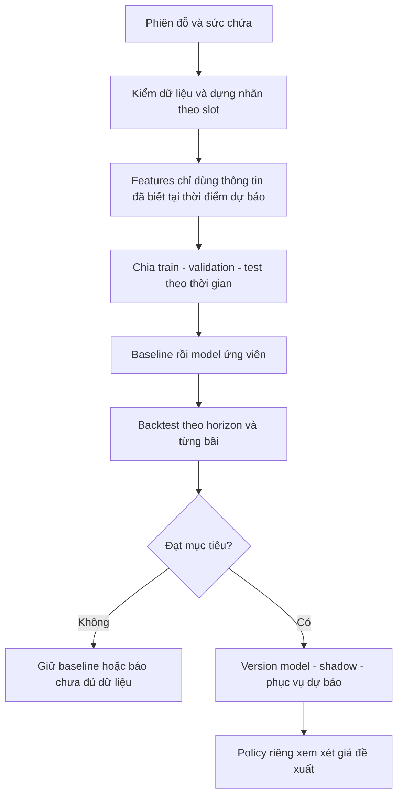
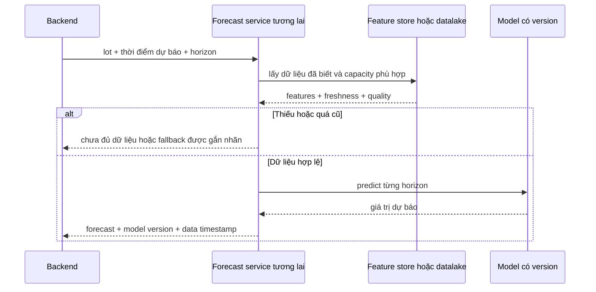

# 📘 [Guide] Forecast — dữ liệu thời gian, huấn luyện và chiến lược xây dựng

> **Đích:** `ai/docs/guides/04-forecast-training-strategy.md` · **Template:** [guide-template](../../../docs/templates/guide-template.md)
> [MUST] Toàn bộ luồng học máy dưới đây là thiết kế đề xuất; service hiện chặn bằng `FeatureNotImplementedError`.

## 📌 Meta

| | |
|---|---|
| **Trạng thái** | ⚠️ Chưa kiểm chứng runtime; đối chiếu source 2026-09-19 |
| **Phạm vi** | ai — forecast và dữ liệu occupancy |
| **Ngày cập nhật** | 2026-09-19 |
| **Người viết** | Codex |

## 🎯 Dành cho ai, đọc xong làm được gì

Dev cần xây pipeline AI thứ ba: dự báo bãi sẽ đầy đến mức nào. Đọc xong biết tạo nhãn từ phiên đỗ, tránh nhìn trộm tương lai, so model với baseline và tách dự báo khỏi quyết định giá.

Forecast học quan hệ giữa lịch sử và giá trị tương lai. RAG tìm bằng chứng có sẵn; Vision suy luận từ ảnh hiện tại; vì vậy dữ liệu, lỗi và phép đo của ba pipeline khác nhau.

## ☑️ Điều kiện trước khi bắt đầu (Prerequisites)

- [ ] Có dữ liệu phiên vào/ra và sức chứa có hiệu lực theo thời gian.
- [ ] Chốt timezone, khoảng thời gian dự báo, và occupancy tại một thời điểm hay trung bình một khoảng.
- [ ] Có tập lịch sử đủ để đánh giá các khung giờ phục vụ; không mặc định vài ngày đủ cho mùa vụ tuần.
- [ ] Đọc [ba pipeline](./01-three-ai-pipelines-architecture.md).

## 🗺️ Bức tranh tổng quan

Hiện trạng: [forecast_service.py](../../app/core/forecast/services/forecast_service.py):35 vẫn chặn dự báo; [occupancy_model.py](../../app/core/forecast/engines/occupancy_model.py) vẫn là công thức mô phỏng và không được phục vụ ra ngoài. Đường dữ liệu thật đã có bước đầu: `session_exporter.py` xuất incremental JSONL + manifest/checksum từ PostgreSQL, còn `occupancy_reader.py` dedup session và tính nhãn slot 30 phút theo khoảng nửa mở. Chưa có model/backtest nên không dùng dãy placeholder làm baseline chất lượng.

## 🪜 Các bước

### Bước 1: Chốt bài toán và nhãn

Đề xuất dự báo tỷ lệ chiếm chỗ trung bình mỗi slot 30 phút, horizon 4 giờ → 8 slot, khớp khoảng thời gian trong `ai/app/core/constants.py`. Đây là lựa chọn nhãn cần chốt trước triển khai, không suy ra từ tên field hiện tại.

Với capacity không đổi trong slot: occupancy trung bình = tổng thời gian mỗi xe chiếm chỗ trong slot / (độ dài slot × capacity). Phiên dùng khoảng nửa mở [check-in, check-out) để không đếm xe ở hai phía ranh giới. Nếu capacity thay đổi, chia nhỏ theo mốc thay đổi trước khi tổng hợp; không dùng sức chứa hôm nay cho toàn lịch sử.

Ví dụ giả lập: bãi 100 chỗ, trung bình 80 xe → occupancy 80%. Bãi 20 chỗ, trung bình 16 xe cũng 80%, nhưng chỗ trống kỳ vọng khác nhau. Số chỗ trống trung bình không bảo đảm còn chỗ tại đúng lúc khách đến.

**Kết quả:** mỗi hàng nhãn có lot, slot_start/end, timezone quy ước, occupied/capacity, chất lượng dữ liệu và định nghĩa nhãn.

### Bước 2: Làm sạch và tổng hợp

**Đầu vào:** các sự kiện/phiên đỗ → **đầu ra:** chuỗi slot đều có cờ chất lượng. Loại trùng theo định danh, rà checkout trước checkin, phiên chưa đóng, sự kiện đến muộn, slot thiếu và khoảng bãi đóng cửa.

Thiếu dữ liệu không đồng nghĩa không có xe. Giữ missing flag; không tự điền 0. Lưu thời gian sự kiện và thời gian hệ thống nhận được để mô phỏng thông tin thật sự có sẵn khi dự báo.

### Bước 3: Xây features không rò rỉ tương lai

| Nhóm | Ví dụ đề xuất | Điều kiện sử dụng |
|---|---|---|
| Lịch | Giờ, thứ, ngày nghỉ đã biết | Đồng nhất timezone |
| Lag | Occupancy slot trước, cùng giờ hôm trước/tuần trước | Chỉ lấy quan sát đã có tại forecast origin |
| Rolling | Trung bình các slot trước | Dịch cửa sổ về quá khứ, không bao gồm target |
| Booking | Booking đang biết tại thời điểm dự báo | Không dùng booking tạo sau thời điểm đó |
| Ngoại sinh | Dự báo thời tiết/sự kiện | Dùng bản dự báo đã phát hành lúc đó, không dùng thời tiết thực tương lai |

Nếu dự báo nhiều bước, lag nằm trong tương lai chưa quan sát phải được xử lý bằng chiến lược direct hoặc recursive đã chốt. Recursive dùng dự báo bước trước nên có thể tích luỹ lỗi; direct học theo từng horizon, cần quản lý nhiều đầu ra.

### Bước 4: Chia theo thời gian và tạo baseline

Đề xuất: train giai đoạn cũ → validation giai đoạn tiếp → test giai đoạn mới nhất. Backtest nhiều forecast origin bằng cửa sổ mở rộng/trượt. Preprocessing chỉ fit trên train. Nếu target horizon của train chạm vùng validation, chừa gap phù hợp để tránh nhãn chồng lấn.

Không shuffle ngẫu nhiên chuỗi thời gian để đánh giá khả năng dự báo tương lai. [scikit-learn: time series split](https://scikit-learn.org/stable/modules/cross_validation.html#time-series-split) mô tả cách đánh giá giữ thứ tự thời gian; cần tự điều chỉnh gap/window theo horizon của IPLMS.

Baseline 1: giữ mức occupancy gần nhất. Baseline 2: dùng cùng slot tuần trước nếu có dữ liệu hợp lệ. Báo riêng từng baseline; bãi mới không có lịch sử cần fallback rõ ràng.

### Bước 5: Thử model theo vấn đề quan sát được

Bắt đầu bằng baseline. Sau đó thử mô hình hồi quy dùng lag/lịch hoặc mô hình chuỗi thời gian có mùa vụ nếu dữ liệu cho thấy cần. Không chọn Prophet/LightGBM chỉ vì tên đã xuất hiện trong comment code.

**Đầu ra:** model artifact + feature schema + data window + version + báo cáo validation. Chỉ thêm độ phức tạp khi cải thiện metric theo bãi/horizon đủ để bù latency và vận hành.

### Bước 6: Đánh giá cả sai số và giới hạn

| Chỉ số | Cách đọc | Chú ý |
|---|---|---|
| MAE occupancy | Trung bình abs(pred-true), đơn vị điểm phần trăm | Dễ diễn giải: 80% so 75% là sai 5 điểm phần trăm |
| RMSE | Căn trung bình bình phương sai số | Nhạy với lỗi lớn, xem cùng MAE |
| Sai số theo horizon | Báo riêng +30 phút, +60 phút… | Trung bình chung dễ che lỗi dự báo xa |
| Theo bãi/giờ cao điểm | Báo metric từng nhóm | Bãi nhiều dữ liệu không che bãi ít dữ liệu |
| Interval coverage | Tỷ lệ nhãn nằm trong khoảng dự báo | Chỉ ghi khi đã xây và đo khoảng dự báo thật |

Không ưu tiên MAPE khi occupancy có thể bằng 0. Điểm 0.89 viết cứng không phải confidence. Mức đạt cần được chốt trước test cuối; guide này không tự đặt SLA production.

### Bước 7: Phục vụ và giám sát

Đề xuất giám sát freshness, missing rate, sai số khi nhãn thật đến, thay đổi camera/quy mô bãi và thời gian suy luận. Giới hạn đầu ra [0,100] chỉ giữ miền hợp lệ; không sửa được model sai. Rollback cả model và feature schema tương thích.

### Bước 8: Tách policy giá và rollout

Forecast trả dự báo; policy giá quyết định có sử dụng không, với trần/sàn, thời gian áp dụng và quy tắc nghiệp vụ được phê duyệt. Occupancy cao không tự chứng minh tăng giá là tối ưu doanh thu hoặc điều tiết được nhu cầu.

Đề xuất rollout: offline backtest → shadow chỉ ghi kết quả → hiển thị tham khảo → policy sử dụng sau khi đạt tiêu chí. Dữ liệu lỗi/stale không được âm thầm áp một hệ số tăng giá cố định. Giữ phiên bản policy để truy vết khi cần giải thích.

## ✅ Kiểm chứng cuối (làm sao biết đã xong ĐÚNG)

| Kiểm tra | Thao tác | Kỳ vọng |
|---|---|---|
| Hiện trạng | Đọc source nêu trên | Service vẫn báo chưa triển khai; chưa gọi số mô phỏng là dự báo thật |
| Nhãn | Tính tay vài phiên qua ranh giới slot | Khớp định nghĩa occupancy đã chốt |
| Không leakage | Rà thời gian khả dụng của từng feature và target | Không có dữ liệu tương lai tại forecast origin |
| Chất lượng tương lai | Backtest cùng tập với baseline | Có metric theo bãi và horizon, test giữ riêng |
| Vận hành tương lai | Mô phỏng stale/missing/model lỗi | Có fallback rõ ràng, không tạo đề xuất giá giả |

Chưa huấn luyện hoặc benchmark model trong lần viết guide này. Các bước trên là tiêu chí xây dựng, không phải báo cáo đã đạt.

## 🔥 Troubleshooting

| Triệu chứng | Nguyên nhân thường gặp | Cách xử lý |
|---|---|---|
| Offline rất tốt nhưng online sai | Feature leakage hoặc dữ liệu đến muộn | Backtest theo thời gian khả dụng thực |
| Dự báo chỗ trống vô lý | Dùng capacity cố định/sai thời điểm | Version sức chứa và định nghĩa slot |
| MAPE tăng vô hạn | Nhãn bằng/gần 0 | Dùng MAE/RMSE và xem phân phối nhãn |
| Bãi mới dự báo kém | Thiếu lịch sử | Báo thiếu dữ liệu; đánh giá fallback riêng |
| Số dự báo cứ tăng đều | Gọi placeholder engine | Giữ service chặn cho đến khi có model và kiểm chứng |

## 🔗 Liên quan

- [Ba pipeline](./01-three-ai-pipelines-architecture.md) · [RAG](./02-rag-optimization-strategy.md) · [Vision](./03-image-processing-pipeline.md)
- [Worker, storage và vòng đời dữ liệu AI](./05-ai-workers-storage-and-training-lifecycle.md)
- [scikit-learn: đánh giá chuỗi thời gian](https://scikit-learn.org/stable/modules/cross_validation.html#time-series-split)
