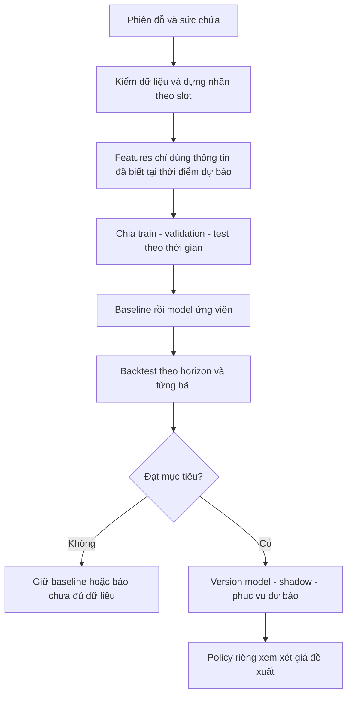
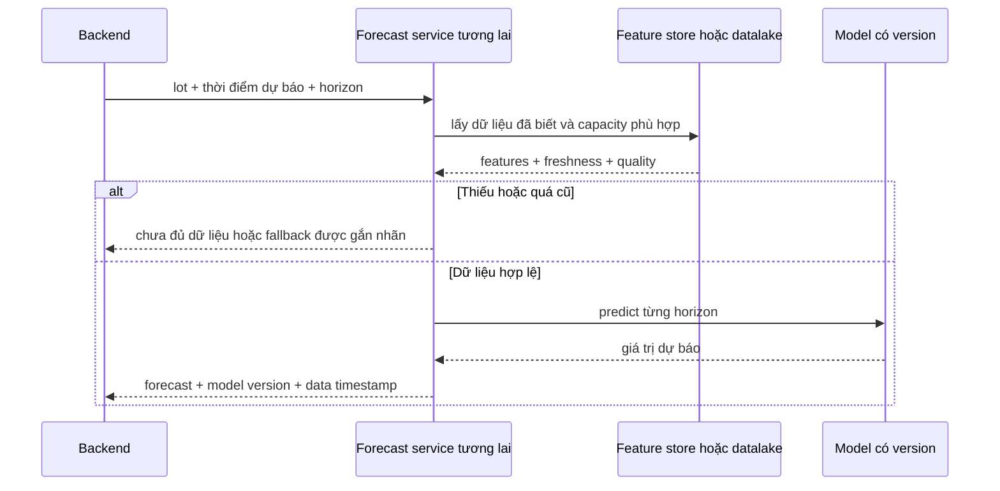

# 📘 [Guide] Forecast — dữ liệu thời gian, huấn luyện và chiến lược xây dựng

> **Đích:** `ai/docs/guides/04-forecast-training-strategy.md` · **Template:** [guide-template](../../../docs/templates/guide-template.md)
> [MUST] Toàn bộ luồng học máy dưới đây là thiết kế đề xuất; service hiện chặn bằng `FeatureNotImplementedError`.

## 📌 Meta

| | |
|---|---|
| **Trạng thái** | ✅ Đã đối chiếu source và test data path 2026-09-20; model forecast chưa triển khai |
| **Phạm vi** | ai — forecast và dữ liệu occupancy |
| **Ngày cập nhật** | 2026-09-21 |
| **Người viết** | Codex |

## 🎯 Dành cho ai, đọc xong làm được gì

Dev cần xây pipeline AI thứ ba: dự báo bãi sẽ đầy đến mức nào. Đọc xong biết tạo nhãn từ phiên đỗ, tránh nhìn trộm tương lai, so model với baseline và tách dự báo khỏi quyết định giá.

Forecast học quan hệ giữa lịch sử và giá trị tương lai. RAG tìm bằng chứng có sẵn; Vision suy luận từ ảnh hiện tại; vì vậy dữ liệu, lỗi và phép đo của ba pipeline khác nhau.

## ☑️ Điều kiện trước khi bắt đầu (Prerequisites)

- [ ] Có dữ liệu phiên vào/ra và sức chứa có hiệu lực theo thời gian.
- [ ] Chốt timezone, khoảng thời gian dự báo, và occupancy tại một thời điểm hay trung bình một khoảng.
- [ ] Có tập lịch sử đủ để đánh giá các khung giờ phục vụ; không mặc định vài ngày đủ cho mùa vụ tuần.
- [ ] Đọc [ba pipeline](./01-three-ai-pipelines-architecture.md).

## 🗺️ Bức tranh tổng quan



Hiện trạng: [forecast_service.py](../../app/core/forecast/services/forecast_service.py):35 vẫn chặn dự báo; [occupancy_model.py](../../app/core/forecast/engines/occupancy_model.py) vẫn là công thức mô phỏng và không được phục vụ ra ngoài. Đường dữ liệu thật đã có bước đầu: `session_exporter.py` xuất incremental JSONL + manifest/checksum từ PostgreSQL, còn `occupancy_reader.py` dedup session và tính nhãn slot 30 phút theo khoảng nửa mở. Chưa có model/backtest nên không dùng dãy placeholder làm baseline chất lượng.

### Hiện trạng runtime và dữ liệu 2026-09-20

```mermaid
flowchart LR
    PG[(PostgreSQL)] -->|parking_sessions + parking_slots| EX[ParkingSessionExporter]
    EX -->|incremental JSONL| RAW[data/datalake/raw/parking_sessions]
    EX -->|manifest + SHA-256 + watermark| RAW
    RAW --> RD[OccupancyHistoryReader]
    RD -->|dedup latest session| SLOT[Slot 30 phút]
    SLOT -->|avg_occupancy + capacity + quality| FUTURE[Feature builder/model tương lai]
    FUTURE -.->|chưa nối| SVC[ForecastService]
    SVC -->|hiện tại| STOP[UNIMPLEMENTED]

    style STOP fill:#ffebee,stroke:#b71c1c
```



Nguồn dữ liệu export thật:

| Nguồn | Field dùng | Mục đích |
|---|---|---|
| `booking.parking_sessions` | `id`, `slot_id`, `status`, `start_time`, `end_time`, method/confidence, `updated_at` | Khoảng thời gian xe chiếm chỗ và incremental watermark |
| `parking.parking_slots` | `parking_lot_id`, số slot chưa xoá và không `INACTIVE` | Gán session vào lot và chụp `capacity_at_export` |
| Không export | user, vehicle, plate, image URL | Forecast occupancy không cần PII |

Reader giữ bản `updated_at` mới nhất của mỗi session, cắt overlap của `[start_time, end_time)` vào slot 30 phút, rồi tính:

```text
occupied_equivalent = tổng số giây chiếm chỗ trong slot / 1800
avg_occupancy       = occupied_equivalent / capacity
```

Kết quả kiểm tra local:

- `44/44` unit test Vision/metric/data-lake pass; test data-lake khóa dedup và phân bổ overlap theo khoảng nửa mở.
- `python -m app.script.export_parking_sessions --status` xác nhận đích `data/datalake`, batch `1000`.
- Chưa có `raw/parking_sessions` hay export watermark local, nghĩa là chưa kéo lịch sử thật từ PostgreSQL.
- Có file `silver/parking_sessions/historical_occupancy_30d.json` gồm `4320` dòng của 3 bãi, nhưng đây là dữ liệu **random do `seed_datalake_logs.py` sinh**. Nó không cùng input contract với `OccupancyHistoryReader` và không được dùng để tuyên bố model accuracy.
- `occupancy_model.py` có gọi reader và gán vào biến `history`, nhưng không dùng biến đó; output vẫn là công thức giả. `ForecastService` đã chặn đúng để backend không nhận con số bịa.

Hai biên dữ liệu phải giải quyết trước khi train:

1. `capacity_at_export` là snapshot lúc export, không phải lịch sử capacity có hiệu lực tại thời gian của session. Bãi thêm/bớt slot sẽ làm nhãn quá khứ sai nếu không version capacity.
2. Reader cố ý không sinh hàng cho slot không có session, vì vắng mặt có thể là 0 xe hoặc export bị thiếu. Training table phải regularize timeline và mang `missing/data_quality` tường minh.

## 🪜 Các bước

### Bước 1: Chốt bài toán và nhãn

Đề xuất dự báo tỷ lệ chiếm chỗ trung bình mỗi slot 30 phút, horizon 4 giờ → 8 slot, khớp khoảng thời gian trong `ai/app/core/constants.py`. Đây là lựa chọn nhãn cần chốt trước triển khai, không suy ra từ tên field hiện tại.

Với capacity không đổi trong slot: occupancy trung bình = tổng thời gian mỗi xe chiếm chỗ trong slot / (độ dài slot × capacity). Phiên dùng khoảng nửa mở [check-in, check-out) để không đếm xe ở hai phía ranh giới. Nếu capacity thay đổi, chia nhỏ theo mốc thay đổi trước khi tổng hợp; không dùng sức chứa hôm nay cho toàn lịch sử.

Ví dụ giả lập: bãi 100 chỗ, trung bình 80 xe → occupancy 80%. Bãi 20 chỗ, trung bình 16 xe cũng 80%, nhưng chỗ trống kỳ vọng khác nhau. Số chỗ trống trung bình không bảo đảm còn chỗ tại đúng lúc khách đến.

**Kết quả:** mỗi hàng nhãn có lot, slot_start/end, timezone quy ước, occupied/capacity, chất lượng dữ liệu và định nghĩa nhãn.

### Bước 2: Làm sạch và tổng hợp

**Đầu vào:** các sự kiện/phiên đỗ → **đầu ra:** chuỗi slot đều có cờ chất lượng. Loại trùng theo định danh, rà checkout trước checkin, phiên chưa đóng, sự kiện đến muộn, slot thiếu và khoảng bãi đóng cửa.

Thiếu dữ liệu không đồng nghĩa không có xe. Giữ missing flag; không tự điền 0. Lưu thời gian sự kiện và thời gian hệ thống nhận được để mô phỏng thông tin thật sự có sẵn khi dự báo.

### Bước 3: Xây features không rò rỉ tương lai

| Nhóm | Ví dụ đề xuất | Điều kiện sử dụng |
|---|---|---|
| Lịch | Giờ, thứ, ngày nghỉ đã biết | Đồng nhất timezone |
| Lag | Occupancy slot trước, cùng giờ hôm trước/tuần trước | Chỉ lấy quan sát đã có tại forecast origin |
| Rolling | Trung bình các slot trước | Dịch cửa sổ về quá khứ, không bao gồm target |
| Booking | Booking đang biết tại thời điểm dự báo | Không dùng booking tạo sau thời điểm đó |
| Ngoại sinh | Dự báo thời tiết/sự kiện | Dùng bản dự báo đã phát hành lúc đó, không dùng thời tiết thực tương lai |

Nếu dự báo nhiều bước, lag nằm trong tương lai chưa quan sát phải được xử lý bằng chiến lược direct hoặc recursive đã chốt. Recursive dùng dự báo bước trước nên có thể tích luỹ lỗi; direct học theo từng horizon, cần quản lý nhiều đầu ra.

### Bước 4: Chia theo thời gian và tạo baseline

Đề xuất: train giai đoạn cũ → validation giai đoạn tiếp → test giai đoạn mới nhất. Backtest nhiều forecast origin bằng cửa sổ mở rộng/trượt. Preprocessing chỉ fit trên train. Nếu target horizon của train chạm vùng validation, chừa gap phù hợp để tránh nhãn chồng lấn.

Không shuffle ngẫu nhiên chuỗi thời gian để đánh giá khả năng dự báo tương lai. [scikit-learn: time series split](https://scikit-learn.org/stable/modules/cross_validation.html#time-series-split) mô tả cách đánh giá giữ thứ tự thời gian; cần tự điều chỉnh gap/window theo horizon của IPLMS.

Baseline 1: giữ mức occupancy gần nhất. Baseline 2: dùng cùng slot tuần trước nếu có dữ liệu hợp lệ. Báo riêng từng baseline; bãi mới không có lịch sử cần fallback rõ ràng.

Nền triển khai hiện có từ 2026-09-21:

- `training/forecast/dataset.py` regularize từng lot về slot đều; slot vắng có
  `target_occupancy=None`, `is_missing=True`, tuyệt đối không biến thành 0.
- `training/forecast/baselines.py` backtest persistence và weekly seasonal-naive.
  Mọi `source_timestamp` bị khóa không lớn hơn `origin_timestamp` để chặn leakage.
- `training/forecast/backtest.py` đọc đúng raw export qua
  `OccupancyHistoryReader`, in MAE/RMSE theo lot/horizon và có thể lưu JSON report.
- `training/forecast/snapshot.py` khóa một cửa sổ dữ liệu bằng `--as-of`, ghi
  JSONL bất biến + manifest/hash/lineage và công khai giới hạn capacity snapshot.
- `training/forecast/features.py` tạo lag/rolling/calendar tại đúng forecast
  origin; `build_features.py` chia train/validation/test và purge target cắt qua
  ranh giới thời gian.
- `training/forecast/train.py` fit ridge riêng từng horizon chỉ trên train,
  đánh giá validation/test và so persistence. Artifact JSON luôn là candidate,
  không dùng pickle, không tự promote và không mở `ForecastService`.

### Bước 5: Thử model theo vấn đề quan sát được

Bắt đầu bằng baseline. Sau đó thử mô hình hồi quy dùng lag/lịch hoặc mô hình chuỗi thời gian có mùa vụ nếu dữ liệu cho thấy cần. Không chọn Prophet/LightGBM chỉ vì tên đã xuất hiện trong comment code.

**Đầu ra:** model artifact + feature schema + data window + version + báo cáo validation. Chỉ thêm độ phức tạp khi cải thiện metric theo bãi/horizon đủ để bù latency và vận hành.

### Bước 6: Đánh giá cả sai số và giới hạn

| Chỉ số | Cách đọc | Chú ý |
|---|---|---|
| MAE occupancy | Trung bình abs(pred-true), đơn vị điểm phần trăm | Dễ diễn giải: 80% so 75% là sai 5 điểm phần trăm |
| RMSE | Căn trung bình bình phương sai số | Nhạy với lỗi lớn, xem cùng MAE |
| Sai số theo horizon | Báo riêng +30 phút, +60 phút… | Trung bình chung dễ che lỗi dự báo xa |
| Theo bãi/giờ cao điểm | Báo metric từng nhóm | Bãi nhiều dữ liệu không che bãi ít dữ liệu |
| Interval coverage | Tỷ lệ nhãn nằm trong khoảng dự báo | Chỉ ghi khi đã xây và đo khoảng dự báo thật |

Không ưu tiên MAPE khi occupancy có thể bằng 0. Điểm 0.89 viết cứng không phải confidence. Mức đạt cần được chốt trước test cuối; guide này không tự đặt SLA production.

### Bước 7: Phục vụ và giám sát



Đề xuất giám sát freshness, missing rate, sai số khi nhãn thật đến, thay đổi camera/quy mô bãi và thời gian suy luận. Giới hạn đầu ra [0,100] chỉ giữ miền hợp lệ; không sửa được model sai. Rollback cả model và feature schema tương thích.

### Bước 8: Tách policy giá và rollout

Forecast trả dự báo; policy giá quyết định có sử dụng không, với trần/sàn, thời gian áp dụng và quy tắc nghiệp vụ được phê duyệt. Occupancy cao không tự chứng minh tăng giá là tối ưu doanh thu hoặc điều tiết được nhu cầu.

Đề xuất rollout: offline backtest → shadow chỉ ghi kết quả → hiển thị tham khảo → policy sử dụng sau khi đạt tiêu chí. Dữ liệu lỗi/stale không được âm thầm áp một hệ số tăng giá cố định. Giữ phiên bản policy để truy vết khi cần giải thích.

## 🎓 Lộ trình học và nâng cấp Forecast

| Chặng | Học/làm | Definition of done |
|---|---|---|
| F0 — SQL & data contract | Interval, timezone, late update, watermark, capacity history, missingness | Export được dữ liệu thật; kiểm tay 10 session/slot; dataset versioned |
| F1 — Time-series evaluation | Forecast origin, horizon, leakage, expanding/rolling backtest | Split theo thời gian; baseline persistence và same-slot-last-week có MAE theo horizon/lot |
| F2 — Feature engineering | Lag, rolling, cyclical hour/day, booking known-at-time, holiday | Feature table tái tạo được và không đọc tương lai |
| F3 — Tabular forecasting | `HistGradientBoostingRegressor` hoặc LightGBM, direct multi-horizon, quantile | Candidate thắng baseline trên test giữ riêng và có interval coverage nếu trả uncertainty |
| F4 — Serving | Artifact/version, feature schema, freshness, data-as-of, fallback | Shadow response có `model_version`, `data_as_of`, không ảnh hưởng giá |
| F5 — Policy & monitoring | Forecast error sau khi truth đến, drift, tariff guardrail/A-B test | Policy giá tách model, có cap/floor/rollback và audit trail |

Khuyến nghị model đầu tiên:

1. Persistence: slot kế tiếp giống slot gần nhất.
2. Seasonal naive: cùng slot hôm qua/cùng thứ tuần trước.
3. Gradient boosting trên lag + calendar, dự báo trực tiếp cho từng horizon.
4. Chỉ thử deep sequence model/TFT khi có nhiều bãi, lịch sử đủ dài và boosting thực sự chạm trần. Dataset 30 ngày random không phải lý do để dùng deep learning.

Tài liệu nên học:

- [scikit-learn: lagged features for forecasting](https://scikit-learn.org/stable/auto_examples/applications/plot_time_series_lagged_features.html) — feature lag, split theo thời gian và quantile prediction.
- [scikit-learn: TimeSeriesSplit](https://scikit-learn.org/stable/modules/generated/sklearn.model_selection.TimeSeriesSplit.html) — validation giữ thứ tự thời gian; vẫn phải chỉnh `gap` theo horizon.
- [LightGBM Python API](https://lightgbm.readthedocs.io/en/latest/Python-API.html) — candidate sau baseline, không phải điểm bắt đầu.

### Quy trình chạy thật từ PostgreSQL đến baseline report

```powershell
cd ai

# 1. Kiểm trạng thái hiện tại. Exit 1 là đúng nếu chưa có dữ liệu thật.
.\.venv\Scripts\python.exe -m training.readiness --scope forecast

# 2. Xem cấu hình output mà chưa kết nối DB.
.\.venv\Scripts\python.exe -m app.script.export_parking_sessions --status

# 3. Export thật. Cần AI_DATABASE_URL đúng; lần đầu chốt --since tường minh.
.\.venv\Scripts\python.exe -m app.script.export_parking_sessions `
  --since 2026-01-01T00:00:00Z

# 4. Kiểm JSONL ↔ manifest ↔ SHA-256 ↔ watermark và độ dài lịch sử.
.\.venv\Scripts\python.exe -m training.readiness --scope forecast

# 5. Khóa snapshot tái lập được. Luôn ghi --as-of trong báo cáo/thí nghiệm.
$snapshot = .\.venv\Scripts\python.exe -m training.forecast.snapshot `
  --days 365 `
  --as-of 2026-09-21T00:00:00+07:00 | ConvertFrom-Json

# 6. Backtest trên đúng snapshot, không đọc một cửa sổ dữ liệu đang trôi.
.\.venv\Scripts\python.exe -m training.forecast.backtest `
  --snapshot-manifest $snapshot.manifest_file `
  --horizons 1,2,4,8 `
  --report data\datalake\reports\forecast-baseline.json

# 7. Tạo feature + temporal split có purge. Đây chưa phải bước train model.
$features = .\.venv\Scripts\python.exe -m training.forecast.build_features `
  --snapshot-manifest $snapshot.manifest_file `
  --horizons 1,2,4,8 `
  --lags 1,2,48,336 `
  --rolling-windows 4,48 | ConvertFrom-Json
$features

# 8. Train candidate offline. Exit 1 nghĩa là không thắng persistence trên mọi
# horizon validation; artifact vẫn được giữ để audit kết quả âm.
$candidate = .\.venv\Scripts\python.exe -m training.forecast.train `
  --feature-manifest $features.manifest `
  --alpha 1.0 `
  --min-train-rows-per-horizon 100 | ConvertFrom-Json
$candidate

# 9. Regression test không cần DB thật.
.\.venv\Scripts\python.exe -m unittest test.test_datalake
.\.venv\Scripts\python.exe -m unittest test.test_forecast_training test.test_training_readiness
```

Readiness mặc định đòi ít nhất một lot có 30 ngày lịch sử, watermark tồn tại và
toàn bộ manifest/checksum hợp lệ. Có thể xuất JSON cho CI bằng `--json`. Gate
không khẳng định nhãn đúng về mặt nghiệp vụ; vẫn phải kiểm tay session/slot và
giải quyết capacity history trước khi gọi dataset là production-ready.

Trạng thái local ngày 2026-09-21: `raw files=0`, `records=0`, `eligible lots=0`,
không có watermark. File silver synthetic được báo riêng và không được backtest
CLI đọc làm bằng chứng production. Vì vậy chưa có MAE/RMSE thật để công bố.
Lần export thật tới `host.docker.internal:5433` bị timeout; exporter đã dọn file
partition tạm, không để lại JSONL/manifest/watermark nửa chừng.

Exporter hiện đã loại slot `INACTIVE` khỏi `capacity_at_export`. Đây chỉ sửa
snapshot hiện tại; nó không khôi phục được sức chứa quá khứ trước ngày có cơ chế
effective-dated capacity. Snapshot/manifest vì vậy vẫn ghi rõ giới hạn này.

> **[NEVER]** Chạy `seed_datalake_logs.py`, train trên dữ liệu random đó rồi gọi metric thu được là chất lượng production. Seed chỉ dùng minh hoạ schema/UI hoặc smoke test.

## ✅ Kiểm chứng cuối (làm sao biết đã xong ĐÚNG)

| Kiểm tra | Thao tác | Kỳ vọng |
|---|---|---|
| Hiện trạng | Đọc source nêu trên | Service vẫn báo chưa triển khai; chưa gọi số mô phỏng là dự báo thật |
| Nhãn | Tính tay vài phiên qua ranh giới slot | Khớp định nghĩa occupancy đã chốt |
| Không leakage | Rà thời gian khả dụng của từng feature và target | Không có dữ liệu tương lai tại forecast origin |
| Chất lượng tương lai | Backtest cùng tập với baseline | Có metric theo bãi và horizon, test giữ riêng |
| Vận hành tương lai | Mô phỏng stale/missing/model lỗi | Có fallback rõ ràng, không tạo đề xuất giá giả |

Chưa huấn luyện model trên dữ liệu production trong lần cập nhật này. Đã triển khai regularization,
snapshot/lineage, point-in-time features, temporal split có purge,
ridge candidate offline, leakage-safe baseline/backtest và readiness gate; toàn AI suite chạy `173` test
pass (`2` skip optional) ngày 2026-09-21. Chưa có raw data thật nên chưa có báo
cáo baseline production và service vẫn phải trả `UNIMPLEMENTED`.

## 🔥 Troubleshooting

| Triệu chứng | Nguyên nhân thường gặp | Cách xử lý |
|---|---|---|
| Offline rất tốt nhưng online sai | Feature leakage hoặc dữ liệu đến muộn | Backtest theo thời gian khả dụng thực |
| Dự báo chỗ trống vô lý | Dùng capacity cố định/sai thời điểm | Version sức chứa và định nghĩa slot |
| MAPE tăng vô hạn | Nhãn bằng/gần 0 | Dùng MAE/RMSE và xem phân phối nhãn |
| Bãi mới dự báo kém | Thiếu lịch sử | Báo thiếu dữ liệu; đánh giá fallback riêng |
| Số dự báo cứ tăng đều | Gọi placeholder engine | Giữ service chặn cho đến khi có model và kiểm chứng |

## 🔗 Liên quan

- [PROB-039: Forecast từ session đến model thật](../../../docs/problems/09-2026/PROB-039-forecast-tu-session-den-model-that.md)
- [Ba pipeline](./01-three-ai-pipelines-architecture.md) · [RAG](./02-rag-optimization-strategy.md) · [Vision](./03-image-processing-pipeline.md)
- [Worker, storage và vòng đời dữ liệu AI](./05-ai-workers-storage-and-training-lifecycle.md)
- [scikit-learn: đánh giá chuỗi thời gian](https://scikit-learn.org/stable/modules/cross_validation.html#time-series-split)
