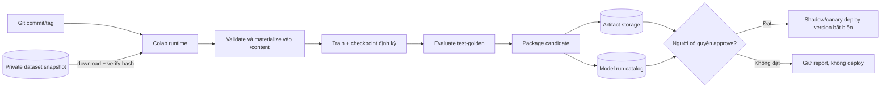

# 📘 [Guide] Google Colab — train, resume và đưa model candidate về IPLMS

> **Đích:** `ai/docs/guides/06-google-colab-training-runbook.md` · **Template:** [guide-template](../../../docs/templates/guide-template.md)
> **Loại nội dung:** runbook mục tiêu. Model artifact resolver đã triển khai; các script publish/materialize vẫn chưa có.

## 📌 Meta

| | |
|---|---|
| **Trạng thái** | ⚠️ Chưa kiểm chứng end-to-end; đối chiếu source và tài liệu Colab 2026-09-19 |
| **Phạm vi** | ai — training, dataset snapshot, checkpoint và model serving |
| **Ngày cập nhật** | 2026-09-19 |
| **Người viết** | Codex |

## 🎯 Dành cho ai, đọc xong làm được gì

Dev muốn dùng GPU Colab để train model IPLMS mà vẫn giữ dữ liệu, checkpoint và
khả năng tái lập ngoài runtime tạm thời. Đọc xong biết dữ liệu đi lên bằng cách
nào, model đi về đâu, cần lưu metadata gì và vì sao model train xong chưa được
đưa thẳng vào production.

Colab là **compute runner**. Object storage + catalog giữ dataset/model; Git giữ
code và cấu hình không nhạy cảm; backend/AI runtime chỉ dùng model version đã
được duyệt.

## ☑️ Điều kiện trước khi bắt đầu (Prerequisites)

- [ ] Đọc [bản đồ `model/`](../../model/README.md) và [vòng đời dữ liệu AI](./05-ai-workers-storage-and-training-lifecycle.md).
- [ ] Có dataset snapshot đã duyệt, lock hash và private manifest; chưa dùng raw bucket đang thay đổi.
- [ ] Sửa `train_imagefolder.py` để model lấy đúng 4 lớp/class mapping trước khi train `vehicle-cls`.
- [ ] Có bucket/prefix riêng cho input snapshot, resumable checkpoint và model candidate.
- [ ] Credential cấp cho run chỉ có quyền tối thiểu, thời hạn ngắn và không được ghi vào notebook/output.

## 🗺️ Bức tranh tổng quan



Không truyền dataset hay checkpoint qua RabbitMQ. Queue chỉ mang `run_id`,
snapshot/model reference và trạng thái nhỏ nếu sau này tự động hoá; bytes nằm
trong object storage.

## 🪜 Các bước

### Bước 1: Chọn mức tích hợp

| Cách | Dùng khi | Đánh đổi |
|---|---|---|
| Upload tay ZIP + download model | Demo đầu tiên, dữ liệu không nhạy cảm | Khó tái lập, dễ nhầm phiên bản; không dùng làm pipeline chính |
| Google Drive làm cầu nối | Đồ án cá nhân, snapshot nhỏ | Mount có thể chậm/quota; quyền Drive rộng nếu notebook được cấp |
| Private S3/object storage | Khuyến nghị cho IPLMS | Cần credential ngắn hạn hoặc signed access, catalog và lifecycle |
| Runtime riêng/GCP | Run dài hoặc cần tài nguyên ổn định | Có chi phí/vận hành; thích hợp khi Colab free không còn đủ |

Colab VM bị xoá khi idle và có giới hạn vòng đời; GPU/TPU thay đổi theo thời
điểm. Google cũng ghi nhận `drive.mount()` có thể chậm và vướng quota khi thao
tác nhiều file. Vì vậy notebook phải giả định runtime sẽ mất giữa chừng và không
train trực tiếp trên hàng nghìn file qua Drive. [Nguồn: Google Colab FAQ](https://research.google.com/colaboratory/faq.html).

### Bước 2: Giữ notebook mỏng

Notebook mục tiêu chỉ làm sáu việc:

1. Chọn GPU và in thông tin runtime.
2. Checkout đúng Git commit/tag của `ai`.
3. Cài dependency được pin.
4. Nhận credential lúc chạy và materialize snapshot.
5. Gọi CLI validate/train/evaluate/package.
6. Upload artifact/report và in `run_id`, tuyệt đối không in secret/signed URL.

Không copy class model, augmentation, loss hay vòng train vào cell. Nếu logic
chỉ sống trong notebook, local/CI/Colab sẽ cho ba kết quả khác nhau.

Các entrypoint đã được tạo dưới dạng scaffold có `--status`; nghiệp vụ bên trong
vẫn phải triển khai và kiểm chứng theo từng phase:

```text
notebook/colab/train_vehicle_classifier.ipynb   # đã có: giao diện chạy, rất mỏng
training/materialize_dataset.py                 # snapshot → /content/dataset
training/validate_dataset.py                    # hash/schema/leakage
training/eval_vehicle_classifier.py             # metric test-golden
training/package_model.py                       # model package + manifest
training/publish_model.py                       # upload candidate, idempotent
```

Scaffold cố ý không giả lập thành công: chạy không có `--status` sẽ dừng với
thông báo chưa triển khai. Khi làm từng phase, thay phần scaffold bằng logic thật
và giữ notebook chỉ gọi CLI.

### Bước 3: Chuẩn bị dataset snapshot

Backend/curation pipeline đóng băng một `dataset_id`. Private manifest ánh xạ
object bucket/key/version tới label; public lock chỉ giữ hash/label/split/group
hash đã làm sạch. Notebook tải đúng manifest version, kiểm lock hash rồi mới tải
ảnh.

Để giảm thời gian:

- Đóng gói snapshot thành archive có checksum hoặc tải song song có giới hạn.
- Extract một lần vào `/content/dataset`; DataLoader đọc disk local.
- Không download lại giữa các epoch.
- Cache chỉ để tăng tốc; luôn kiểm hash trước dùng.
- Cùng vehicle/session/capture burst phải nằm một split duy nhất.

Ảnh biển số là dữ liệu nhạy cảm. Notebook không hiển thị grid ảnh thật trong
output được lưu/chia sẻ. Khi cần debug, dùng một số mẫu đã được phép và xoá output
trước khi share notebook.

### Bước 4: Khởi tạo run có thể tái lập

Tạo `run_id` trước train và ghi:

| Thuộc tính | Ví dụ ý nghĩa |
|---|---|
| `source_commit` | Commit code thật sự chạy |
| `dataset_id` + `dataset_lock_sha256` | Snapshot nào |
| `label_schema` + `class_to_idx` | Output index nghĩa là gì |
| `preprocessing_version` | Resize/normalize/augmentation |
| `seed` + split policy | Điều kiện tái lập |
| Accelerator/runtime | GPU, Python, PyTorch/CUDA versions |
| Hyperparameters | Batch, LR, epoch, optimizer |

Pin dependency của dự án trong run manifest. Colab cập nhật runtime thường
xuyên; Google khuyến nghị dùng runtime mới và tự cài phiên bản dependency cần
thiết, còn runtime cũ chỉ được cung cấp trong một khoảng thời gian. [Nguồn: Colab runtime versions](https://research.google.com/colaboratory/runtime-version-faq.html).

### Bước 5: Train và chống mất runtime

Checkpoint sau mỗi epoch hoặc theo khoảng thời gian đo được. Giữ hai lớp:

- `/content/run/`: ghi nhanh trong runtime.
- `s3://.../runs/<run_id>/resume/`: đồng bộ định kỳ checkpoint, optimizer,
  scheduler, epoch và random states để resume.

Upload theo file tạm/key tạm rồi hoàn tất bằng manifest/checksum để worker khác
không đọc checkpoint đang ghi dở. Nếu Colab ngắt, notebook mới nhận `run_id`, tải
resume checkpoint và kiểm dataset/source/config vẫn khớp trước khi tiếp tục.

Google Drive có thể giữ resume checkpoint trong bản demo. Không move file quan
trọng giữa các folder Drive như một transaction: Colab cảnh báo thao tác bị ngắt
có thể làm mất dữ liệu đang di chuyển. [Nguồn: Google Colab FAQ](https://research.google.com/colaboratory/faq.html).

### Bước 6: Evaluate trước khi đóng gói

Model tốt nhất theo validation mới chỉ là candidate. Chạy test-golden đúng một
lần sau khi chốt cấu hình; báo accuracy tổng, per-class precision/recall/F1,
confusion matrix, latency và kích thước artifact. Với lớp hiếm, accuracy tổng dễ
che việc model không nhận ra lớp đó.

[NEVER] dùng test-golden để chọn epoch, augmentation hoặc learning rate. Nếu đã
nhìn test để chỉnh cấu hình, nó không còn là test cuối và cần một holdout khác.

### Bước 7: Đóng gói “model mang về”

Không chỉ lấy một file `.pth`. Package candidate tối thiểu:

```text
vehicle-cls/<model_version>/
├── model.pth
├── model-manifest.json       model class, class_to_idx, preprocessing, dimensions
├── dataset.lock.json         bản đúng của run
├── metrics.json              validation + test-golden + latency
├── environment.txt           Python/PyTorch/CUDA/dependency versions
└── checksums.sha256
```

`model_version` bất biến; upload lại cùng version chỉ được phép nếu checksum
giống hệt. Source of truth là artifact storage + catalog. Download về laptop là
bản sao; không chép tay đè `model/artifacts/bootstrap/anpr/best.pt` rồi mất lịch sử.

### Bước 8: Đưa model vào service

Service hỗ trợ hai nguồn mà không đổi engine:

- Local/read-only volume qua `AI_VEHICLE_CHECKPOINT` để giữ tương thích.
- Signed HTTPS GET URL qua `AI_VEHICLE_ARTIFACT_URL`, kèm version và SHA-256.

Artifact remote được tải theo luồng, giới hạn dung lượng, kiểm hash rồi mới đổi
tên nguyên tử vào `var/model-cache/<model>/<version>/`. Signed URL không được ghi
log. Cùng version + hash dùng lại cache; MinIO, S3 và R2 đều dùng được nếu hạ
tầng cấp signed URL.

Code thực tế:

```text
app/infra/model_registry/artifact_store.py    # local path hoặc URL → verified cache
app/infra/storage/object_store.py             # signed URL download + SHA-256 + size limit
app/config/model_registry_config.py           # cache directory
app/config/object_storage_config.py           # timeout, size limit, HTTPS policy
```

ANPR warmup tải hoặc xác nhận detector trước khi gRPC mở cổng. Vehicle classifier
vẫn optional và lazy-load khi được gọi; deployment production nên prefetch/kiểm
accepted version trước readiness nếu bật classifier. Rollout shadow/canary, quan
sát metric rồi mới chuyển version accepted; giữ version trước để rollback.

### Bước 9: Colab phù hợp train gì trong IPLMS?

| Bài toán | Dùng Colab? | Điều kiện |
|---|---|---|
| Vehicle classifier | Có, nên làm đầu tiên | Sửa class count/mapping và có snapshot 4 lớp |
| Fine-tune detector YOLO | Có sau | Có bounding boxes/negative images và baseline detector |
| Fine-tune OCR | Có sau | Có plate crops + text/layout labels và evaluation riêng |
| Vehicle ReID | Có sau | Có identity/cặp cùng-khác xe đáng tin cậy |
| Forecast | Có thể | Dùng Parquet/time split; không dùng ImageFolder |
| RAG ingest | Thường không cần train | Chủ yếu parse/embed/index/evaluate; Colab không phải thành phần serving |

Colab phù hợp experimentation và đồ án. Khi run cần lịch, SLA, dữ liệu rất lớn
hoặc tài nguyên bảo đảm, chuyển cùng CLI/manifest sang batch runner có quản lý;
không viết lại pipeline từ đầu.

## ✅ Kiểm chứng cuối (làm sao biết đã xong ĐÚNG)

| Kiểm tra | Kỳ vọng |
|---|---|
| Runtime bị xoá giữa epoch | Resume được từ artifact bền, không đổi dataset/config |
| Chạy lại cùng run input | Có cùng manifest/fingerprint; sai khác được giải thích |
| Đổi thứ tự folder lớp | Validator chặn hoặc checkpoint lưu mapping mới rõ ràng |
| Model upload | Checksum khớp; cùng version không bị ghi đè bằng bytes khác |
| Deploy | Chỉ accepted version; readiness sau khi load/verify; rollback được |
| Chia sẻ notebook | Không có raw image output, secret, signed URL hay token |
| Train/serve preprocessing | Cùng kích thước, normalize và class order |

Guide này chưa chạy một training job Colab thật. Khi triển khai notebook, phải
thực hiện một lượt nhỏ 1–2 epoch để kiểm cả download → resume → package → upload,
trước khi tốn GPU cho run dài.

## 🔥 Troubleshooting

| Triệu chứng | Nguyên nhân thường gặp | Cách xử lý |
|---|---|---|
| Epoch đọc dữ liệu rất chậm | Train trực tiếp từ Drive hoặc nhiều file nhỏ | Copy/archive vào `/content`, verify rồi extract |
| Runtime mất, mất checkpoint | Chỉ lưu disk tạm | Sync resume checkpoint theo chu kỳ tới kho bền |
| Model nạp được nhưng nhãn sai | `class_to_idx` khác `AI_VEHICLE_LABELS` | Lưu mapping trong manifest và validate lúc load |
| Local tốt, service sai | Preprocessing train/serve khác nhau | Version transform và dùng cùng manifest |
| Không tải được private data | Credential hết hạn/quyền prefix sai | Cấp lại credential ngắn hạn đúng snapshot, không hardcode key |
| Notebook chạy lại ra môi trường khác | Colab runtime/dependency thay đổi | Ghi runtime, pin dependency, lưu environment manifest |
| Model bị đè mất | Dùng tên `best.pt` cố định | Version bất biến + checksum + accepted alias |

## 🔗 Liên quan

- [Bản đồ `model/`](../../model/README.md) · [Dataset local](../../model/dataset/README.md)
- [Worker, storage và lifecycle](./05-ai-workers-storage-and-training-lifecycle.md)
- [Vision](./03-image-processing-pipeline.md) · [Forecast](./04-forecast-training-strategy.md)
- [Google Colab FAQ](https://research.google.com/colaboratory/faq.html) · [Runtime versions](https://research.google.com/colaboratory/runtime-version-faq.html)
