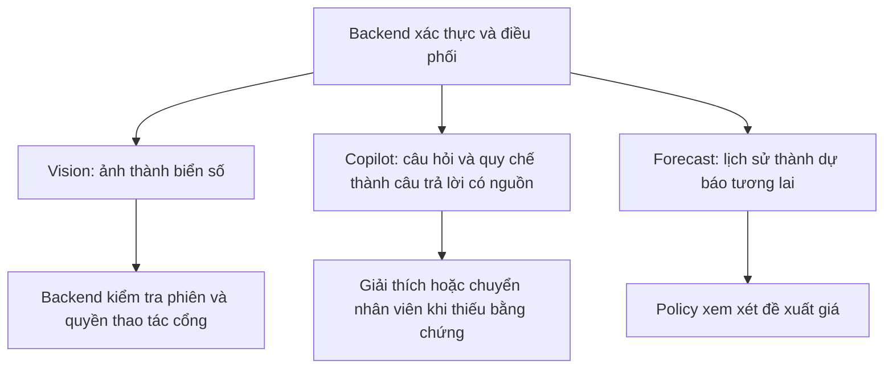
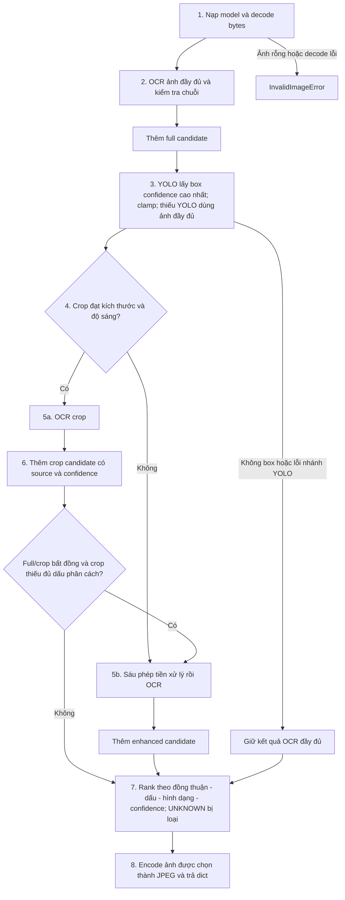
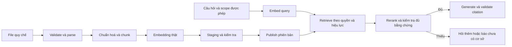

# 🧠 Ba Quy Trình AI Trong IPLMS — Kiến Trúc & Luồng Xử Lý Chi Tiết

> **Đích:** `ai/docs/guides/01-three-ai-pipelines-architecture.md`
> **Áp dụng cho:** `ai/app/core/{vision, copilot, forecast}` — 3 domain AI engine
> **Đọc trước khi sửa:** [`AI_CONVENTIONS.md`](../../standards/AI_CONVENTIONS.md) · [`README.md`](../../../README.md)
> **Đối chiếu source:** 2026-09-19; chưa kiểm chứng runtime/benchmark.

---

## 📌 Meta

| | |
|---|---|
| **Trạng thái** | ⚠️ Chưa kiểm chứng runtime; đã đối chiếu mã nguồn 2026-09-19 |
| **Phạm vi** | ai — Vision, Copilot/RAG, Forecast |
| **Ngày cập nhật** | 2026-09-19 |
| **Người viết** | Codex |

## 🎯 Dành cho ai, đọc xong làm được gì

Dev học hoặc xây AI cho IPLMS. Đọc xong phân biệt ba nghiệp vụ, lần theo dữ liệu qua các tầng và biết phần nào đã có code, phần nào cần triển khai. Giữ đường dẫn hai guide cũ theo yêu cầu; bố cục theo [guide-template](../../../../docs/templates/guide/guide-template.md).

## ☑️ Điều kiện trước khi bắt đầu (Prerequisites)

- [ ] Hiểu request/response và phân biệt huấn luyện với suy luận.
- [ ] Đọc [AI conventions](../../standards/AI_CONVENTIONS.md); chưa cần GPU để học luồng.
- [ ] Khi chạy thật: chuẩn bị môi trường theo [AI README](../../../README.md), weights và dữ liệu kiểm chứng.

## 🗺️ Bức tranh tổng quan



**Ba pipeline** ở đây là Vision, Copilot/RAG và Forecast. Ingest/query là hai nhánh của RAG; enhanced OCR là một nhánh con của Vision, không phải pipeline nghiệp vụ thứ tư.

## 🪜 Các bước

Đọc Vision → RAG → Forecast bên dưới. Các sơ đồ ghi **mục tiêu** mô tả thiết kế đề xuất, không chứng minh tính năng đã chạy.

## 1. Tổng Quan 3 Pipeline

IPLMS AI Service là một **microservice Python độc lập** (ngang hàng `frontend/` và `backend/`), phục vụ 3 nghiệp vụ AI thông qua **gRPC (đường nóng)** và **REST (đường phụ)**:

```
┌─────────────────────────────────────────────────────────────────┐
│                    IPLMS AI Service                             │
│                                                                 │
│  ┌─────────────────┐  ┌─────────────────┐  ┌────────────────┐  │
│  │ 🔍 VISION/ANPR  │  │ 💬 COPILOT/RAG  │  │ 📈 FORECAST/ML │  │
│  │                 │  │                 │  │                │  │
│  │ • Nhận diện     │  │ • Hỏi đáp quy  │  │ • Dự báo tỷ lệ│  │
│  │   biển số xe    │  │   chế bãi xe    │  │   lấp đầy bãi │  │
│  │ • Phân loại xe  │  │ • Phân xử tranh │  │ • Đề xuất giá  │  │
│  │ • Chống gian lận│  │   chấp AI       │  │   động (tariff)│  │
│  │                 │  │                 │  │                │  │
│  │ ✅ ENGINE THẬT   │  │ 🚧 CHƯA TRIỂN  │  │ 🚧 CHƯA TRIỂN │  │
│  │    CẦN ĐO        │  │    KHAI         │  │    KHAI        │  │
│  └─────────────────┘  └─────────────────┘  └────────────────┘  │
│                                                                 │
│  Entrypoints:  gRPC :50051  ·  REST :8000                      │
└─────────────────────────────────────────────────────────────────┘
```

### Nguyên tắc thiết kế chung

| Nguyên tắc | Giải thích |
|---|---|
| **Engine ≠ Service** | Engine = "tính cái này ra sao?" (thuật toán thuần). Service = "một lượt nghiệp vụ gồm bước nào?" (điều phối). |
| **Hai cổng, một đường** | gRPC handler và REST route CÙNG gọi chung service — KHÔNG viết lại logic. |
| **Lazy-load model** | Model nặng (YOLO, EasyOCR) chỉ nạp lần đầu gọi, khoá bằng `threading.Lock()`, bật cờ SAU khi xong. |
| **Thà lỗi hơn bịa** | Feature chưa triển khai ném `FeatureNotImplementedError` → gRPC `UNIMPLEMENTED`, KHÔNG trả số giả. |

---

## 2. Pipeline 1 — Vision / ANPR

### 2.1. Tổng quan

**Trạng thái:** Có engine ANPR thật, weights `best.pt` bên thứ ba. Chưa có benchmark trong lần rà tài liệu này để kết luận sẵn sàng production.

**Chức năng:**
- **ANPR** (Automatic Number Plate Recognition): Nhận diện biển số xe từ ảnh camera cổng
- **Vehicle Classifier** (tuỳ chọn): Phân loại loại xe (sedan, SUV, motorbike, truck) bằng CNN
- **Anti-Fraud Gatekeeper**: So khớp loại xe check-in vs check-out để phát hiện tráo xe

### 2.2. Kiến trúc files

```
app/core/vision/
├── dtos/
│   └── vision_dto.py          # PlateResult, RecognizePlateCommand, VehicleMatchQuery/Result
├── engines/
│   ├── anpr/engine.py         # 🔥 façade run_anpr — phối hợp các tầng trong anpr/
│   ├── anpr/                  # models · detector · preprocess · ocr · plate_text · scoring
│   └── vehicle_classifier.py  # CNN NetV1/NetV2 phân loại xe (optional)
└── services/
    ├── anpr_service.py        # Điều phối: ANPR → classify → persist → PlateResult
    └── anti_fraud_service.py  # So khớp vehicle type check-in ↔ check-out
```

### 2.3. Luồng ANPR hiện tại — 8 bước logic



Nguồn: `ai/app/core/vision/engines/anpr/engine.py` (`run_anpr`). Đây là tám nhóm để học; kiểm tra hợp lệ thực tế diễn ra ngay sau mỗi lượt OCR. Điểm nhánh ảnh đầy đủ chỉ là OCR; chỉ nhánh crop/enhanced được chọn mới kết hợp detector × OCR.

[GOTCHA] Selection không còn dùng độ dài. Dấu phân cách OCR quan sát được là bằng chứng, không phải ký tự engine tự chèn; đồng thuận giữa các nhánh cũng chưa phải xác suất đã calibration. `crop_bytes` vẫn có thể chứa ảnh đầy đủ khi nhánh full thắng. Xem [guide ảnh](03-image-processing-pipeline.md) để hiểu giới hạn và phép đo before/after.

### 2.4. Bảng tham số kỹ thuật

| Tham số | Giá trị | Giải thích |
|---|---|---|
| `PLATE_MAX_LENGTH` | 11 ký tự | Giới hạn heuristic trong code, không phải bộ kiểm tra đầy đủ biển số VN |
| `PLATE_MIN_ALPHA` | 1 chữ cái | Phải có ít nhất 1 ký tự chữ |
| YOLO model | `model/artifacts/bootstrap/anpr/best.pt` | Bootstrap weights bên thứ ba, KHÔNG train trong repo |
| EasyOCR languages | `['en', 'vi']` | Hỗ trợ tiếng Việt cho ký tự đặc biệt |
| Crop tối thiểu | 220×80 px | `is_valid_crop()` — dưới ngưỡng → enhanced OCR |
| Min brightness | 80 (grayscale) | Ảnh quá tối → enhanced pipeline |
| Thời gian nạp model | Phải đo trên máy triển khai | Tách cold start khỏi thời gian inference |
| Timeout gRPC | Xem cấu hình triển khai thực tế | Đặt theo latency đo được và ngân sách toàn request |

### 2.5. Enhanced OCR — Tiền Xử Lý Ảnh Nâng Cao

Khi crop quá nhỏ hoặc tối, `enhanced_ocr()` chạy pipeline 6 bước tiền xử lý:

```python
# Bước 1: Upscale — phóng to ảnh nhỏ
if w < 100 or h < 80:
    scale_factor = max(150/w, 100/h, 2.0)
    plate_crop = cv2.resize(..., interpolation=cv2.INTER_LANCZOS4)

# Bước 2: Grayscale
gray = cv2.cvtColor(plate_crop, cv2.COLOR_BGR2GRAY)

# Bước 3: Bilateral Filter — khử noise giữ cạnh
filtered = cv2.bilateralFilter(gray, d=7, sigmaColor=60, sigmaSpace=60)

# Bước 4: CLAHE — cân bằng histogram cục bộ
clahe = cv2.createCLAHE(clipLimit=1.8, tileGridSize=(8, 8))
contrast = clahe.apply(filtered)

# Bước 5: Sharpening — làm nét bằng kernel Laplacian
kernel = [[0, -1, 0], [-1, 5, -1], [0, -1, 0]]
sharpened = cv2.filter2D(contrast, -1, kernel)

# Bước 6: Histogram Stretching — kéo dãn dải sáng
stretched = ((sharpened - min) / (max - min) * 255).astype(uint8)
```

| Bước | Kỹ thuật | Mục đích |
|---|---|---|
| 1. Upscale | `INTER_LANCZOS4` | Phóng to ảnh nhỏ, giữ chất lượng ký tự |
| 2. Grayscale | `BGR → GRAY` | Giảm chiều dữ liệu, nhánh enhanced dùng 1 kênh; không phải mọi OCR đều bắt buộc |
| 3. Bilateral Filter | `d=7, σ=60` | Giảm noise mà hạn chế làm mờ cạnh chữ; vẫn cần đo |
| 4. CLAHE | `clip=1.8, tile=8×8` | Cân bằng sáng cục bộ — ảnh ban đêm, bóng đổ |
| 5. Laplacian Sharpen | Kernel 3×3 | Tăng tương phản cạnh → OCR nhận diện tốt hơn |
| 6. Histogram Stretch | Min-max normalize | Kéo dãn dải sáng về [0, 255] đầy đủ |

### 2.6. Cách tính Confidence Score

> **Quy tắc vàng:** Confidence là điểm THẬT, KHÔNG bao giờ bịa.

```python
def _combine_confidence(det_conf, ocr_conf):
    """NHÂN chứ không trung bình cộng."""
    if det_conf is None:      # Không có YOLO → chỉ dùng điểm OCR
        return ocr_conf
    return det_conf * ocr_conf  # Cả hai tầng đều phải tự tin
```

**Vì sao nhân?** Đọc chữ rất chắc (OCR 0.95) trên một vùng mà detector chỉ 30% tin là biển số (det 0.30) thì điểm cuối phải là `0.285` — đáng ngờ. Trung bình cộng sẽ cho `0.625` — trông ổn nhưng che giấu sự yếu kém của detector.

**OCR weighted confidence:**
```python
# EasyOCR trả [(bbox, text, conf), ...] cho từng cụm chữ
# Gộp theo TRỌNG SỐ ĐỘ DÀI, không trung bình thô:
weighted = sum(conf_i * len(text_i) for each result)
avg_conf = weighted / total_chars
```

Cụm 1 ký tự đọc chắc chắn KHÔNG được kéo điểm cả biển lên.

### 2.7. Anti-Fraud — Chống Gian Lận

**Trạng thái hiện tại:** Chỉ so khớp `vehicle_type` (chuỗi ký tự). Phép so ẢNH CROP (ReID/Siamese) **chưa triển khai**.

```
Check-in: expected_vehicle_type = "car_sedan"
Check-out: current_vehicle_type = "motorbike"
→ is_matched = false, mismatch_reason = VEHICLE_TYPE_MISMATCH
→ similarity_score = 0.0 (CHƯA ĐO, không phải "giống 0%")
```

> ⚠️ **GOTCHA:** `similarity_score = 0.0` nghĩa là "chưa đo", KHÔNG phải "đo ra 0%". Không trình bày sentinel này như độ tương đồng đã đo.

---

## 3. Pipeline 2 — Copilot / RAG

### 3.1. Tổng quan

**Trạng thái:** 🟢 Q&A + streaming + ingestion core đã triển khai; 🟡 API quản trị tài liệu/eval còn thiếu; `ArbitrateDispute` vẫn chủ động `UNIMPLEMENTED`.

**Chức năng mục tiêu:**
- **Trợ lý Hỏi Đáp RAG**: Trả lời câu hỏi về quy chế, biểu phí bãi xe dựa trên tài liệu quy chế đã nạp
- **Trọng Tài Tranh Chấp AI**: Phân xử khiếu nại tự động dựa trên log phiên + quy chế

### 3.2. Kiến trúc files

```
app/core/
├── knowledge/                       # Domain: Nạp & cắt tài liệu
│   ├── dtos/knowledge_dto.py        # IngestDocumentCommand, TextChunk, KnowledgeChunk, IngestResult
│   ├── engines/
│   │   ├── document_parser.py       # ✅ Tách text từ PDF/DOCX/TXT/MD (185 dòng)
│   │   └── chunker.py              # ✅ Cắt đoạn thông minh theo điều khoản (156 dòng)
│   └── services/ingestion_service.py # ✅ Parse → chunk → embed → transaction
│
├── copilot/                         # Domain: Hỏi đáp & Tranh chấp
│   ├── dtos/copilot_dto.py          # AskQuestionRequest, CopilotAnswer, DisputeVerdict
│   ├── engines/
│   │   └── rag_pipeline.py          # ✅ Hybrid retrieval + grounded generation
│   └── services/
│       └── copilot_service.py       # ✅ Q&A; tranh chấp vẫn bị chặn an toàn
│
app/infra/
├── database/pgvector_client.py      # ✅ pgvector + full-text Hybrid Search/RRF
├── embedding/embedding_client.py    # ✅ OpenAI embedding, batch/retry/timeout
└── llm/llm_factory.py              # ✅ OpenAI Responses API + typed deltas
```

### 3.3. Hai luồng RAG mục tiêu



Bản hiện tại đã có timeout/retry, transaction và kiểm tra source; còn nợ quản lý
phiên bản tài liệu, idempotency theo nội dung và eval retrieval. Số chiều 1536
được khóa với `text-embedding-3-small`; đổi model/số chiều phải migration và
re-index toàn bộ. [Guide RAG](02-rag-optimization-strategy.md) chia chi tiết
**8 bước ingest và 9 bước query**, kèm chiến lược tối ưu và nghiệm thu.

### 3.4. Chi tiết Chunker — Thuật Toán Cắt Đoạn Thông Minh

**Vì sao không cắt cứng theo số ký tự?**

Quy chế bãi xe viết theo **điều khoản**: "Điều 5 — Quy trình xử lý khiếu nại", "Điều 8 — Xử phạt vi phạm". Cắt cứng sẽ chặt đôi một điều khoản → Copilot trích thiếu vế → trả lời sai.

**Thuật toán 2 tầng:**

```
Tầng 1: Nhận ra ranh giới điều khoản (regex)
─────────────────────────────────────────────
  Pattern: ^(Điều|ĐIỀU|Chương|CHƯƠNG|Mục|MỤC|Phần|PHẦN) \d+
           hoặc Markdown heading: #{1,6} ...
  → Mỗi điều khoản = 1 đoạn trọn vẹn

Tầng 2: Điều khoản dài quá ngưỡng → cắt tiếp
─────────────────────────────────────────────
  2a. Ưu tiên ranh giới đoạn văn (dòng trống)
  2b. Metadata section_title giữ tiêu đề; content mảnh sau chưa chắc có heading
  2c. Overlap 200 ký tự giữa 2 mảnh liền kề
  2d. Fallback: cắt cứng nếu 1 đoạn văn quá dài

Tầng 3: Lọc mảnh quá ngắn
─────────────────────────────────────────────
  < 100 ký tự (CHUNK_MIN_CHARS) → bỏ
  (trừ khi lọc xong không còn gì → giữ mảnh dài nhất)
```

**Tham số chunking:**

| Hằng số | Giá trị | Giải thích |
|---|---|---|
| `CHUNK_TARGET_CHARS` | 1500 | Đếm ký tự; token phải đo theo tokenizer model |
| `CHUNK_OVERLAP_CHARS` | 200 | Giảm mất ngữ cảnh, không bảo đảm giữ mọi câu nguyên vẹn |
| `CHUNK_MIN_CHARS` | 100 | Heuristic; có thể bỏ điều khoản ngắn quan trọng |
| `KNOWLEDGE_MAX_FILE_BYTES` | 8 MB | PHẢI < `grpc_max_message_length` (10MB) |
| `DOCUMENT_PARSE_TIMEOUT_SECONDS` | 20s | Hằng số dự kiến; service timeout chưa được triển khai |

### 3.5. Document Parser — Tách Văn Bản An Toàn

| Định dạng | Magic Bytes | Cách tách | Lưu ý |
|---|---|---|---|
| PDF | `%PDF-` | `pypdf.PdfReader` | Bảo vệ chống PDF mã hoá (thử `decrypt("")`) |
| DOCX | `PK\x03\x04` | `python-docx` | **Phải tách cả bảng** — bảng biểu phí là phần đáng giá nhất |
| TXT | *(không có)* | `utf-8 decode` | Byte sai UTF-8 bị thay bằng ký tự thay thế; không chuyển mã cp1258/latin-1 |
| MD | *(không có)* | `utf-8 decode` | Heading được chunker nhận diện tự động |

> ⚠️ **KHÔNG tin phần mở rộng file.** Đối chiếu magic bytes: file khai `.pdf` nhưng không bắt đầu bằng `%PDF-` → từ chối.

---

## 4. Pipeline 3 — Forecast / ML

### 4.1. Tổng quan

**Trạng thái:** 🚧 CHƯA TRIỂN KHAI — tất cả method ném `FeatureNotImplementedError`.

**Chức năng mục tiêu:**
- **Occupancy Forecast**: Dự báo tỷ lệ lấp đầy theo khung giờ
- **Dynamic Tariff**: Đề xuất hệ số giá dựa trên dự báo cung-cầu

### 4.2. Kiến trúc files

```
app/core/forecast/
├── dtos/forecast_dto.py             # OccupancyForecastQuery, TariffRecommendationQuery
├── engines/
│   └── (trống)                      # occupancy_model.py (công thức giả) đã xoá 2026-09-25
└── services/
    └── forecast_service.py          # 🚧 Ném FeatureNotImplementedError

app/infra/datalake/
└── (parquet_reader.py đã xoá 2026-09-25 — dùng occupancy_reader.py)
```

### 4.3. Luồng xử lý mục tiêu

```
┌─────────────────────────────────────────────────────────────────┐
│              GIAI ĐOẠN 1: THU THẬP DỮ LIỆU                     │
│                                                                 │
│  parking_sessions (DB) ──► ETL ──► Parquet files (Data Lake)    │
│                                                                 │
│  Mỗi record gồm:                                               │
│  • parking_lot_id, timestamp, vehicle_count, capacity           │
│  • day_of_week, hour, is_holiday, weather_code                  │
│  • Aggregate: avg_occupancy theo slot 30 phút                   │
└─────────────────────────────────────────────────────────────────┘
                              │
┌─────────────────────────────▼───────────────────────────────────┐
│           GIAI ĐOẠN 2: HUẤN LUYỆN MODEL                         │
│                                                                 │
│  Lựa chọn model:                                                │
│  • Mô hình mùa vụ — ứng viên cần kiểm bằng baseline      │
│  • Hồi quy theo features — ứng viên cần backtest   │
│                                                                 │
│  Features đề xuất:                                               │
│  ┌────────────────┬──────────────────────────────────┐          │
│  │ Temporal       │ hour, day_of_week, month, is_hol │          │
│  │ Lag features   │ occ_1h_ago, occ_same_hour_yester │          │
│  │ Rolling stats  │ avg_7d, std_7d, max_7d           │          │
│  │ External       │ weather, events, holidays        │          │
│  └────────────────┴──────────────────────────────────┘          │
│                                                                 │
│  Output: predicted_occupancy_percent (0–100%)                   │
│  Slots: mỗi 30 phút (FORECAST_SLOT_SECONDS = 1800)             │
│  Horizon: 4 giờ mặc định (DEFAULT_FORECAST_HOURS = 4)          │
└─────────────────────────────────────────────────────────────────┘
                              │
┌─────────────────────────────▼───────────────────────────────────┐
│          GIAI ĐOẠN 3: SUY LUẬN (Inference)                      │
│                                                                 │
│  Input: parking_lot_id + target_timestamp                       │
│  Output cho mỗi slot 30 phút:                                   │
│  {                                                               │
│    "timestamp": 1726730400,                                     │
│    "predicted_occupancy_percent": 85.2,                         │
│    "estimated_free_spots": 15,                                  │
│    "status_level": "HIGH"  // LOW|MEDIUM|HIGH|CRITICAL          │
│  }                                                               │
│                                                                 │
│  Phân loại trạng thái:                                           │
│  • LOW:      ≤ 50% — xanh lá                                   │
│  • MEDIUM:   >50–70% — vàng                                      │
│  • HIGH:     >70–85% — cam                                       │
│  • CRITICAL: > 85% — đỏ                                        │
└─────────────────────────────────────────────────────────────────┘
```

### 4.4. Dynamic Tariff — Đề Xuất Giá Động

**Thiết kế minh hoạ, chưa triển khai; các hệ số dưới đây chưa được phê duyệt thành policy.** Khi dự báo bãi sắp đầy → tăng hệ số giá để điều tiết cung-cầu, giảm tải giờ cao điểm.

```
predicted_occupancy → tariff_multiplier:
  ≤ 50%  → 1.00× (giá gốc)
  60%    → 1.05×
  70%    → 1.10×
  80%    → 1.15×
  90%+   → 1.25× (trần)
```

> ⚠️ **Hệ số giá nhân vào tiền khách trả.** Số bịa ở đây đi thẳng vào hoá đơn. PHẢI có model thật trước khi mở.

---

## 5. Bảng So Sánh Trạng Thái

| Tiêu chí | 🔍 Vision/ANPR | 💬 Copilot/RAG | 📈 Forecast/ML |
|---|---|---|---|
| **Trạng thái** | Có engine, cần benchmark | 🟢 Q&A thật; cần data/eval production | 🚧 Chưa triển khai |
| **Engine** | YOLO + EasyOCR (thật) | embedding + Hybrid Search + Responses API | chưa có (service trả UNIMPLEMENTED) |
| **Confidence** | Điểm OCR hoặc det × OCR; chưa calibration | Retrieval score bảo thủ; không phải xác suất LLM đúng | Service chặn, chưa có độ tin cậy đo được |
| **Dữ liệu** | Ảnh camera cổng | Tài liệu thật đã ingest, scope theo bãi | Công thức `0.40+(i*0.08)%0.60` |
| **Infra** | Không cần DB | PostgreSQL + pgvector + OpenAI | Parquet (placeholder) |
| **Gọi từ backend** | `VisionAiProvider` | `CopilotAiProvider` | `ForecastAiProvider` |
| **gRPC response** | PlateResult thật | Unary + server stream thật | `UNIMPLEMENTED` |

---

## 6. Kiến Trúc Phân Tầng Chung

```
api/          ⟶  core/           ⟶  infra/
(vào/ra)         (nghiệp vụ)        (hệ thống ngoài)

┌──────────────────┐   ┌──────────────────────┐   ┌─────────────────┐
│ api/grpc/        │   │ core/vision/         │   │ infra/          │
│   handlers/      │──►│   services/          │──►│   database/     │
│   mappers/       │   │   engines/           │   │     pgvector    │
│   interceptors/  │   │   dtos/              │   │   datalake/     │
│                  │   │                      │   │     parquet     │
│ api/rest/        │   │ core/copilot/        │   │   embedding/    │
│   routes/        │──►│   services/          │──►│   llm/          │
│   schemas/       │   │   engines/           │   │     llm_factory │
│                  │   │   dtos/              │   │                 │
│                  │   │                      │   │                 │
│                  │   │ core/knowledge/      │   │                 │
│                  │   │   engines/           │   │                 │
│                  │   │   dtos/              │   │                 │
│                  │   │                      │   │                 │
│                  │   │ core/forecast/       │   │                 │
│                  │   │   services/          │   │                 │
│                  │   │   engines/           │   │                 │
│                  │   │   dtos/              │   │                 │
└──────────────────┘   └──────────────────────┘   └─────────────────┘

Luật hướng phụ thuộc:
  api/  → core/  ✅    core/ → api/   ❌ NEVER
  core/ → infra/ ✅    infra/ → core/ ❌ NEVER
  api/  → infra/ ❌    (gọi qua core/)
```

---

## ✅ Kiểm chứng cuối (làm sao biết đã xong ĐÚNG)

| Kiểm tra | Thao tác | Kỳ vọng |
|---|---|---|
| Vision có phép đo thật? | Đọc `anpr/ocr.py` (`read_with_confidence`), `anpr/scoring.py` (`combine_confidence`, `select_plate_candidate`) | Có OCR score; phân biệt nhánh không detector |
| RAG có phục vụ thật? | Đọc `copilot_service.py` và `rag_pipeline.py`; chạy test + pgvector smoke | Q&A dùng embedding/DB/LLM thật; tranh chấp vẫn bị chặn |
| Forecast có model thật? | Đọc `forecast_service.py` và `core/forecast/README.md` | Service chặn; chưa có engine phục vụ |
| Quyền quyết định | Lần theo response về backend | Kết quả AI cần policy nghiệp vụ trước hành động |

Đã kiểm chứng bằng đọc source, chưa chạy end-to-end hay đo accuracy trong lượt chỉnh tài liệu này.

## 🔥 Troubleshooting

| Triệu chứng | Nguyên nhân thường gặp | Cách xử lý |
|---|---|---|
| Nhầm có DTO là có AI thật | Hợp đồng có trước implementation | Đọc service rồi engine/infra |
| Q&A RAG trả UNAVAILABLE | Thiếu API key, pgvector hoặc tài liệu/schema | Kiểm `AI_LLM_API_KEY`, `AI_DATABASE_URL`, extension `vector` và ingestion |
| Forecast/ArbitrateDispute trả UNIMPLEMENTED | Service cố ý chặn dữ liệu mẫu/thiếu evidence | Hoàn thiện pipeline riêng và kiểm chứng trước khi bật |
| Có biển số nhưng ảnh trả về chưa crop | OCR đầy đủ được giữ lại | Xem logic chọn ứng viên trong guide ảnh |
| Dự báo đẹp nhưng không có benchmark | Nhầm mô phỏng với học máy | Xem guide Forecast và baseline theo thời gian |

## 🔗 Tài Liệu Liên Quan

- [`02-rag-optimization-strategy.md`](02-rag-optimization-strategy.md) — Chiến lược tối ưu RAG chi tiết
- [`03-image-processing-pipeline.md`](03-image-processing-pipeline.md) — Lý thuyết xử lý ảnh ANPR
- [`../AI_CONVENTIONS.md`](../../standards/AI_CONVENTIONS.md) — Luật viết code AI
- [`../../README.md`](../../../README.md) — Hướng dẫn chạy
- [`../../../docs/guides/backend/grpc-nest-python-ai-integration.md`](../../../../docs/guides/09-2026/grpc-nest-python-ai-integration.md) — Nối NestJS ⇄ Python

- [Forecast: dữ liệu, huấn luyện và kiểm chứng](04-forecast-training-strategy.md)
- [Worker, storage và vòng đời dữ liệu AI](05-ai-workers-storage-and-training-lifecycle.md)
