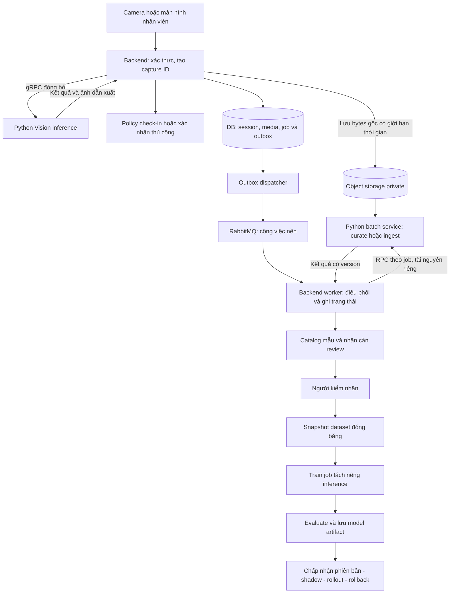
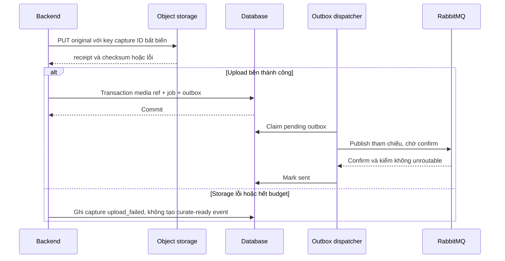
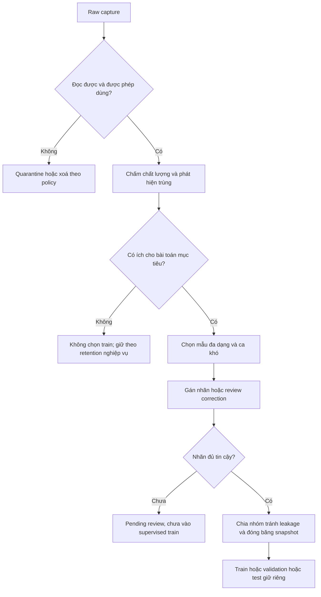

# 📘 [Guide] Tách module AI, RabbitMQ worker và vòng đời ảnh tới model

> **Đích:** `ai/docs/guides/05-ai-workers-storage-and-training-lifecycle.md` · **Template:** [guide-template](../../../../docs/templates/guide/guide-template.md)
> **Loại nội dung:** phân tích hiện trạng và thiết kế triển khai từng phần. Đã có stable object reference cho ảnh ANPR và incremental data-lake export local; queue/job catalog end-to-end vẫn là bước sau.

## 📌 Meta

| | |
|---|---|
| **Trạng thái** | ⚠️ Object ref + data-lake export/curation primitives đã có test; cloud sync và queue end-to-end chưa triển khai |
| **Phạm vi** | ai, backend Message/Storage, dữ liệu huấn luyện |
| **Ngày cập nhật** | 2026-09-21 |
| **Người viết** | Codex |

## 🎯 Dành cho ai, đọc xong làm được gì

Dev cần biến các pipeline lý thuyết thành cấu trúc file và luồng vận hành: phần nào giữ đồng bộ, phần nào vào worker, lưu ảnh ở đâu, chọn dữ liệu thế nào và dùng để train model gì.

**Đề xuất cho IPLMS:** giữ nhận diện cổng qua gRPC; dùng RabbitMQ cho việc nền; giữ ảnh gốc trong object storage private theo giao diện S3; xây catalog, nhãn và dataset manifest trước khi tự động hoá train. MinIO/Cloudinary là lựa chọn hạ tầng lưu trữ, không thay thế quy trình quản trị dữ liệu.

Ảnh đẹp chưa chắc có nhãn đúng. Ảnh khó nhưng đọc được bằng mắt, đặc biệt ca nhân viên sửa sai, có thể có giá trị học cao hơn nhiều ảnh dễ trùng nhau.

## ☑️ Điều kiện trước khi bắt đầu (Prerequisites)

- [ ] Đọc [Vision](03-image-processing-pipeline.md), [RAG](02-rag-optimization-strategy.md), [Forecast](04-forecast-training-strategy.md).
- [ ] Giữ quy tắc tầng trong [AI conventions](../../standards/AI_CONVENTIONS.md).
- [ ] Dùng [ADR-0003](../../../../docs/projects/adrs/09-2026/0003-duong-du-lieu-vision-tu-phien-do-toi-checkpoint.md) làm nền cho nhãn phân loại xe, test-golden và checkpoint có version.
- [ ] Trước triển khai, chốt lưu lượng ảnh, dung lượng trung bình, thời hạn giữ, hạ tầng production và tài nguyên train. Chưa có số này thì chưa chốt dung lượng/chi phí.

## 🗺️ Bức tranh tổng quan



Đây là **phương án MVP đề xuất**: tái sử dụng consumer Node/NestJS; Python thực hiện thuật toán qua service. Chưa cần thêm RabbitMQ client vào Python chỉ để nhận rồi gửi lại cùng một dữ liệu. Khi ingest/batch quá dài hoặc nhiều bước độc lập, có thể chuyển consumer sang Python theo điều kiện ở Bước 4; không vận hành hai consumer khác giao thức trên cùng queue.

### Ranh giới dữ liệu đã chốt

- **[MUST] PostgreSQL là nguồn sự thật nghiệp vụ.** `pgvector` là extension và các bảng `knowledge_*` nằm ngay trong PostgreSQL này, không phải một database thứ hai phải đồng bộ.
- **[NEVER] thêm MongoDB chỉ để chứa metadata AI.** PostgreSQL `jsonb` đã đáp ứng metadata linh hoạt; thêm Mongo sẽ tạo hai nguồn sự thật và một luồng CDC/reconcile chưa có nhu cầu.
- **[MUST] object storage giữ bytes; DB giữ `provider + object_key` và URL delivery nếu UI cần.** Signed/delivery URL không phải định danh bền.
- **[MUST] data lake nhận bản xuất bất biến theo watermark.** Nó phục vụ analytics/train/backtest, không tham gia transaction check-in và không ghi ngược vào bảng nghiệp vụ.
- **[NEVER] Copilot hoặc worker nối database-to-database.** Service gọi adapter/API, truyền ID/reference nhỏ; bytes đi qua object storage.

## 🪜 Các bước

### Bước 1: Nhận diện phần đã có và phần còn thiếu

Đường dẫn dưới đây tính từ root repo. Dùng tên class/hàm làm mốc vì số dòng sẽ
thay đổi sau mỗi refactor; trạng thái “có” chỉ nói code tồn tại/test được, không
phải bằng chứng đã chạy production.

| Bằng chứng trong source | Hiện trạng | Hệ quả thiết kế |
|---|---|---|
| `backend/src/modules/Parking/services/staff/staff-operation.service.ts` | Gọi gRPC, lưu ảnh và giữ cả URL + provider/key | Worker dùng key bền; UI vẫn dùng URL |
| Cùng file, `staffCheckInFromImage()` | REST fallback lấy URL AI; upload lỗi dùng fallback | Không bảo đảm ảnh luôn bền; cần trạng thái media rõ ràng |
| Cùng file, `persistCropImage()` | Lưu ảnh bằng `StorageProvider.upload` | Có thể bị tối ưu ảnh; không coi là bản gốc train |
| `backend/src/infrastructures/Storage/storage.provider.ts`, `StorageProvider` | Có upload tối ưu và `uploadRaw` giữ bytes | Tái sử dụng raw path sau khi hoàn thiện metadata/MIME |
| `backend/src/infrastructures/Storage/adapters/s3.adapter.ts`, `S3Adapter` | Có S3 client, endpoint tuỳ chỉnh, presigned PUT | Có nền S3-compatible; chưa phải data-lake publisher |
| `backend/src/infrastructures/Storage/adapters/cloudinary.adapter.ts`, `upload` | Upload và trả secure_url, chưa đặt authenticated type | URL HTTPS không tự chứng minh media private |
| `backend/src/infrastructures/Message/adapters/rabbitmq.adapter.ts`, `RabbitMQAdapter` | Durable exchange/queue, persistent message, ACK khi handler xong; lỗi vào DLQ | Có consumer nền, chưa phải job framework hoàn chỉnh |
| Cùng class, `connect()` | Dùng `createChannel`; chưa thấy confirm/prefetch/reconnect trong adapter | Cần tăng độ tin cậy và giới hạn concurrency trước job AI |
| `backend/src/infrastructures/Message/messaging.provider.ts`, `publish()` | Publish bắt lỗi rồi chỉ log | Không dùng như xác nhận giao việc bền vững |
| `staff-operation.service.ts`, `parking-session.entity.ts` | Session đã lưu key/provider; check-in event hiện chưa mang object ref | Bước kế tiếp là capture/outbox event bền |
| `ai/app/core/vision/services/anpr_service.py`, `recognize_bytes()` | gRPC mặc định không lưu file; REST lưu local | Python inference không nên thành nơi giữ ảnh dài hạn |
| `ai/app/core/knowledge/services/ingestion_service.py` | Parse → chunk → embed → transaction đã có | Giữ một đường nghiệp vụ cho REST/gRPC |
| `ai/training/train_imagefolder.py`, `ai/training/eval_plates.py` | Có code train CNN và đo ANPR | Tái sử dụng có kiểm chứng, không tạo một framework train song song |

Tìm `outbox/Outbox` trong `backend/src` chưa thấy implementation. [PAT-001](../../../../docs/practices/07-2026/PAT-001-transactional-outbox.md) mô tả MassTransit/.NET, không phải chứng cứ NestJS hiện đã có outbox; cần thiết kế transaction TypeORM thực tế.

### Bước 2: Tách file theo trách nhiệm, không theo mỗi phép toán

**Engine:** tính toán/thuật toán. **Service:** điều phối use case. **Infra:** đọc bucket, gọi embedding/LLM, đọc/ghi kho kỹ thuật. **Worker/handler:** nhận công việc, chuyển DTO, gọi service, kiểm trạng thái/ACK. **Training script:** huấn luyện và đánh giá offline.

Một hàm grayscale không cần một service, một queue hay một microservice riêng. Ban đầu giữ sáu phép tiền xử lý chung một module; chỉ tách khi cần test độc lập, tái sử dụng hoặc thay chiến lược.

#### 2.1. Vision — tách có mục đích

| File hiện có/đề xuất | Thao tác và trách nhiệm | Đầu vào → đầu ra |
|---|---|---|
| `core/vision/engines/anpr/engine.py` — có | Giữ façade `run_anpr`, phối hợp engine nhỏ; không đổi transport chỉ vì refactor | Bytes → kết quả nhận diện |
| `core/vision/engines/image_preprocessor.py` — đề xuất | Chuyển enhanced transforms sang module có cấu hình; dùng chung online/evaluation | Crop → ảnh dẫn xuất + pipeline version |
| `core/dataset/engines/image_quality.py` — có | Tính kích thước, sáng, blur, lỗi decode; không tự gán nhãn ground truth | Ảnh → quality report |
| `core/vision/engines/anpr/scoring.py` — có (tách 2026-09-25) | Candidate/provenance/ranking; chưa tách parser hai dòng riêng | OCR candidates → kết quả hiện tại |
| `core/vision/services/anpr_service.py` — có | Giữ nghiệp vụ nhận diện/DTO; không train hoặc ghi dataset ở đây | Command → PlateResult |
| `core/vision/dtos/vision_dto.py` — có | Bổ sung model/preprocess version, loại ảnh dẫn xuất khi cần; đồng bộ proto | DTO không phụ thuộc gRPC |

Chưa cần tách YOLO/EasyOCR thành process riêng. Có thể tách `plate_detector.py` và `plate_reader.py` sau khi cần thay provider/model độc lập; tránh đồng thời đổi thuật toán và cấu trúc khiến khó so regression.

#### 2.2. RAG — bổ sung chỗ thiếu trước

| File | Việc cần làm |
|---|---|
| `core/knowledge/services/ingestion_service.py` — có | Điều phối parse → chunk → embed → transaction |
| `core/knowledge/engines/document_parser.py`, `chunker.py` — có | Sửa bảo toàn bảng/trang/điều kiện; giữ thuật toán test được |
| `infra/embedding/embedding_client.py` — có | Embed query/doc, batch, timeout, retry, kiểm model/dimension |
| `infra/database/pgvector_client.py` — có | PostgreSQL/pgvector thật, scope theo bãi, hybrid vector + full-text |
| `infra/llm/llm_factory.py` — có | Responses API adapter, streaming, timeout; không dựng đáp án cứng |
| `core/copilot/engines/rag_pipeline.py` — có | Retrieval/grounding thật; chưa cần xé từng bước thành graph |
| `core/copilot/services/copilot_service.py` — có | Quyết định trả lời, abstain và DTO; chỉ bỏ chặn sau nghiệm thu |

Ingest chạy nền phù hợp; hỏi đáp tương tác vẫn request/response hoặc streaming. Không gửi từng chunk qua RabbitMQ ngay từ đầu: một job tài liệu có checkpoint theo batch đủ đơn giản và dễ quản lý publish nguyên phiên bản.

#### 2.3. Forecast — phân biệt chuẩn bị dữ liệu, train và serving

| File đề xuất/có sẵn | Trách nhiệm |
|---|---|
| `core/forecast/engines/occupancy_features.py` — mới | Tạo features chỉ từ dữ liệu có sẵn tại forecast origin |
| `core/forecast/services/forecast_service.py` — có | Kiểm freshness/horizon và điều phối dự báo |
| `core/forecast/engines/` — trống (placeholder đã xoá 2026-09-25) | Nạp artifact và predict thật, không gọi train trong request |
| `infra/datalake/session_exporter.py` — có | Export tăng dần bằng watermark, stream theo batch, JSONL bất biến + manifest/SHA-256 |
| `infra/datalake/occupancy_reader.py` — có | Dedup bản incremental và tổng hợp khoảng nửa mở thành slot 30 phút |
| `infra/datalake/occupancy_reader.py` — có (`parquet_reader.py` alias đã xoá 2026-09-25) | Parquet thật chờ duyệt dependency `pyarrow` |
| `training/forecast/{snapshot,build_features,backtest,train}.py` — có | Snapshot, feature split, baseline và ridge candidate offline |

Occupancy lấy từ phiên và capacity, không mặc định lấy ảnh ANPR để train Forecast. Nếu sau này đếm occupancy bằng camera, đó là một bài toán Vision riêng, cần nhãn/đánh giá riêng.

#### 2.4. Thu thập dataset — domain riêng khi bắt đầu triển khai

Tạo `core/dataset/{dtos,engines,services}` theo conventions, vì curated data được nhiều model dùng, không phải tác dụng phụ của `run_anpr`.

```text
ai/app/
  core/dataset/
    dtos/sample_dto.py                 # capture ref, quality, label provenance
    engines/sample_selector.py         # chọn mẫu, quota, exact/near duplicate
    services/curation_service.py       # đọc raw, chấm chất lượng, đề xuất review
    services/dataset_snapshot_service.py # tạo snapshot từ nhãn được duyệt
  infra/storage/object_store.py        # đã có: tải signed URL, giới hạn size, kiểm SHA-256
  config/storage_config.py            # endpoint/bucket theo workload
  api/grpc/handlers/dataset_handler.py # vỏ gọi service cho batch deployment
  api/grpc/mappers/dataset_mapper.py   # DTO và proto
```

`core/dataset/{dtos,engines,services}` đã có DTO quality/snapshot, quality
inspection, sample selection, `CurationService.evaluate()` và
`SnapshotService.build_lock()`. Chúng là primitives thuần, chưa có persistence,
review UI hay transport end-to-end. `infra/storage/object_store.py` hiện chỉ
phục vụ tải model bằng signed URL, chưa phải client get/head/put cho dataset.
Các file transport/worker còn lại trong cây là đề xuất và chỉ tạo khi xây use
case thật. Consumer Node giữ job lifecycle trong phương án
MVP; Python service trả báo cáo, không sửa bảng session của backend. Engine/infra
không import ngược handler hoặc DTO core từ infra.

### Bước 3: Chọn đúng việc cho RabbitMQ

| Công việc | Cách chạy đề xuất | Vì sao |
|---|---|---|
| ANPR tại cổng | gRPC đồng bộ, deadline và fallback nghiệp vụ | Nhân viên cần kết quả ngay; backlog train không được kéo dài check-in |
| Chấm/chuẩn bị mẫu dataset | RabbitMQ worker | Có thể retry và xử lý sau; không ảnh hưởng quyết định cổng |
| Nạp quy chế RAG | Job nền trả job_id | Parse/embed có thể dài, cần trạng thái và retry |
| Hỏi đáp RAG | Request/stream | Không có lợi khi thêm hàng đợi trước mọi câu hỏi |
| Export lịch sử thành Parquet | Scheduler tạo job nền | Gom theo khoảng thời gian/watermark, không tạo file mỗi event |
| Dự báo tương tác | Đọc forecast cache còn mới hoặc inference nhanh | Ghi model version và freshness |
| Train/fine-tune | Job batch riêng, ban đầu chủ động chạy | Tốn tài nguyên, không train mỗi khi một ảnh được duyệt |
| Evaluate/publish model | Pipeline sau train có gate | Không tự thay model production chỉ vì train exit 0 |

RabbitMQ mang **lệnh/sự kiện nhỏ**, object storage mang bytes. Không truyền base64 ảnh, checkpoint hay cả file PDF trong message. Worker dùng key + version/hash để tải bản chính xác, không dùng URL signed hết hạn làm định danh.

### Bước 4: Worker thực sự vận hành như thế nào?

#### MVP: Node consumer gọi Python batch service

1. Backend tạo job và outbox trong cùng transaction metadata. Trả job_id cho tác vụ nền.
2. Dispatcher claim outbox bằng lease/lock có hạn, publish có confirm; chưa xác nhận thì còn pending để retry.
3. Node consumer nhận message, kiểm schema và job_id, claim job bằng lease có attempt token.
4. Gọi Python batch service với object ref + job_id + version. Python đọc storage và gọi core service; dùng deployment riêng để không tranh CPU/GPU với Vision cổng.
5. Python trả báo cáo hoặc ghi artifact bằng key xác định trước rồi trả artifact ref. Node chỉ ghi kết quả khi attempt token còn hợp lệ, chuyển job terminal và tạo outbox thông báo nếu cần.
6. ACK sau ghi trạng thái bền. Redelivery gặp job đã hoàn tất thì ACK không làm lại; job đang chạy cần xét lease thay vì khởi động hai bản.

MVP dành cho **đơn vị việc có thời lượng giới hạn**, ví dụ curate một capture hoặc một batch embedding. Timeout RPC không chứng minh Python đã dừng: cần cancellation/cooperative timeout, lease và thao tác idempotent; kết quả attempt cũ không ghi đè attempt mới. Parse có nguy cơ treo cần process isolation và giới hạn thực, không chỉ `wait_for` quanh một thread.

Training dài không giữ một RPC/ACK mở hàng giờ. Train runner ghi run_id/checkpoint vào storage, job controller theo dõi trạng thái/heartbeat, có timeout và resume theo artifact được xác nhận.

#### Khi nào mới thêm Python consumer?

Khi ingest/batch thường xuyên vượt budget RPC, cần checkpoint nhiều giai đoạn, hoặc muốn Python tự scale theo queue, bổ sung:

- `app/worker.py`: entrypoint compose các dependencies, chạy riêng `grpc_server.py`.
- `app/api/message/handlers/knowledge_handler.py`, `dataset_handler.py`: nhận envelope → DTO → core service.
- `app/infra/messaging/rabbitmq_client.py`: connection, prefetch, ack/nack, reconnect; không chứa thuật toán ảnh.
- `app/infra/jobs/job_client.py`: gọi API nội bộ claim/heartbeat/complete của backend; backend vẫn là chủ job/catalog, tránh hai nguồn trạng thái.
- `app/config/messaging_config.py`: cấu hình theo `get_config()`.

Đây là **phương án nâng cấp**, không phải yêu cầu phải cài Rabbit client/Celery ngay. Python consumer dùng cùng hợp đồng JSON đã version và backend job API; khi cắt chuyển phải dừng/drain consumer Node của queue đó. Celery có giao thức task riêng, không coi JSON đang publish từ NestJS là Celery task hợp lệ.

#### Các bảo đảm cần bổ sung cho RabbitMQ hiện tại

Publisher confirm và consumer ACK giải quyết hai đoạn giao nhận khác nhau; confirm không có nghĩa worker đã xử lý xong. Prefetch giới hạn số message đang xử lý, phù hợp khi tác vụ nặng. [Nguồn RabbitMQ](https://www.rabbitmq.com/docs/confirms).

- Outbox dispatcher cần đường publish **báo lỗi**, không dùng `MessagingProvider.publish` đang nuốt lỗi để đánh dấu sent.
- Dùng confirm channel, xử lý unroutable/mandatory return và backpressure; dựng binding trước khi gửi. Confirm một message không có queue nhận vẫn chưa đáp ứng nhu cầu giao việc.
- Queue bền, persistent messages, giới hạn prefetch/concurrency; không hiểu durable là đã có replication/HA.
- Retry có delay, số lần tối đa, lỗi permanent vào DLQ; adapter hiện tại lỗi là đi DLQ ngay, chưa có retry có lịch.
- Nếu republish sang retry queue, phải xác nhận bản retry bền trước khi ACK bản cũ; dùng cùng job ID vì vẫn có thể trùng.
- Reconnect và khai báo lại consumer/binding; theo dõi queue age, pending outbox, lease hết hạn và DLQ.
- Mỗi nhóm việc dùng queue riêng để ingest không chặn curate; consumer train không dùng chung worker pool phục vụ cổng.

[MUST] Thiết kế theo at-least-once + idempotency, không hứa exactly-once. Ghi output bằng key/job/version ổn định, unique constraint ở catalog và trạng thái job có lease.

**Envelope đề xuất** — chưa phải payload hiện tại:

```json
{
  "schema_version": 1,
  "event_id": "event-opaque-id",
  "job_id": "job-opaque-id",
  "kind": "vision.sample.curate.requested",
  "capture_id": "capture-opaque-id",
  "parking_lot_id": "lot-id",
  "object": {
    "provider": "s3",
    "bucket": "iplms-ai-raw",
    "key": "vision/2026/09/19/capture-id/original.jpg",
    "version_id": "object-version-if-supported",
    "sha256": "verified-sha256"
  },
  "pipeline_version": "curation-v1",
  "occurred_at": "2026-09-19T03:00:00Z",
  "trace_id": "trace-opaque-id"
}
```

Capture ID do backend tạo trước inference, không phụ thuộc việc nhận diện thành công. Session ID có thể chưa có; không chỉ thu các ca đã check-in, vì sẽ bỏ mất ca OCR thất bại. Label review dùng event/version riêng; correction mới không ghi đè mất nhãn máy và lịch sử nhãn cũ.

### Bước 5: MinIO, S3 hay Cloudinary?

| Tiêu chí | Object storage S3-compatible | Cloudinary |
|---|---|---|
| Bytes gốc, dataset, Parquet, checkpoint | Phù hợp làm kho chính cho pipeline này | Có thể lưu asset nhưng không phải giao diện S3 để mọi công cụ dùng trực tiếp |
| Biến thể ảnh và delivery UI | Tự làm hoặc thêm tầng delivery | Phù hợp khi cần transformation/media delivery |
| Private và quyền đọc | Bucket private, IAM/role và signed GET theo quyền | Có authenticated assets và cơ chế kiểm soát truy cập; adapter hiện chưa cấu hình |
| Lifecycle | Thiết lập theo bucket/prefix/version của nhà cung cấp | Cần kiểm tính năng và gói sử dụng trước thiết kế retention |
| Vận hành | S3 managed hoặc tự vận hành storage tương thích | Managed service |
| Tích hợp repo | Đã có S3 adapter/endpoint config | Đã có Cloudinary adapter cho upload media |

**Đề xuất theo bối cảnh repo:** dùng private S3 làm kho AI production nếu tiếp tục hướng AWS; giữ Cloudinary cho media giao diện đang dùng nếu có nhu cầu. Cần chọn provider theo workload/bucket, không đổi biến global `STORAGE_DRIVER` khiến mọi ảnh UI chuyển kho ngoài ý muốn. Một object storage có thể chứa raw/curated/artifacts ở các bucket/prefix với quyền và lifecycle khác nhau; không bắt buộc dựng ba hệ thống storage.

**Lưu ý MinIO khi chốt mới:** repository `minio/minio` Community đã bị chủ sở hữu archive ngày **2026-04-25**, hiện read-only. Vì vậy không mặc định chọn Community làm nền production mới chỉ vì tương thích S3; môi trường học/demo cô lập có thể tái sử dụng bản đã kiểm soát, còn production cần phương án có duy trì/hỗ trợ hoặc dịch vụ managed. Điều này không đồng nghĩa mọi sản phẩm thương mại MinIO đều ngừng hoạt động. [Nguồn repository chính thức](https://github.com/minio/minio).

Cloudinary hỗ trợ authenticated assets bảo vệ cả bản gốc và bản dẫn xuất; signed delivery URL không tự đồng nghĩa URL có thời hạn. Cần chọn cơ chế truy cập/thời hạn phù hợp và kiểm gói trước áp dụng. [Nguồn Cloudinary](https://cloudinary.com/documentation/control_access_to_media).

S3 lifecycle quản lý chuyển lớp lưu trữ và hết hạn đối tượng. Cần cấu hình cả noncurrent versions nếu bật versioning và đồng bộ catalog khi dữ liệu hết hạn; không coi lifecycle của bản current là đã xoá mọi bản lịch sử. [Nguồn AWS](https://docs.aws.amazon.com/AmazonS3/latest/userguide/object-lifecycle-mgmt.html).

Không chốt chi phí khi chưa có lưu lượng. Ước lượng dung lượng gốc = captures/ngày × bytes/capture × số ngày giữ; cộng crop/preview, versions, dataset snapshot vật lý nếu copy, checkpoint, request và egress. Giữ manifest tham chiếu object có thể tránh copy nhiều lần nhưng retention phải bảo vệ object còn được dataset dùng.

### Bước 6: Lưu ảnh bền trước khi gửi tham chiếu cho worker

**Ba bản khác nhau:** original giữ bytes nhận từ camera; derived là crop/preprocess có version; preview phục vụ màn hình có thể resize/nén. Không dùng preview thay original. Hiện `crop_bytes` có thể là ảnh toàn khung nếu nhánh OCR toàn ảnh thắng, nên cần `image_kind`/crop bbox thay vì đoán từ tên field.

`StorageProvider.uploadRaw` là nền sẵn có để tránh resize/WebP, nhưng `S3Adapter` hiện gán image thành `image/jpeg`. Khi triển khai cần truyền MIME thực, byte size, checksum, object version; không để PNG/WebP mang MIME JPEG. Đề xuất lưu DB bằng provider/bucket/key/version/hash; URL hiển thị sinh ngắn hạn sau kiểm quyền, không lưu signed URL làm định danh dataset.

**Thứ tự đảm bảo dữ liệu đề xuất:**



Transaction DB không bao trùm S3. Upload xong nhưng commit lỗi tạo orphan → cleanup sau grace period bằng đối chiếu catalog; không xoá object đang có reference/job. Publish xong rồi dispatcher chết trước mark-sent sẽ gửi lại → consumer phải idempotent.

**Giới hạn cần nói rõ:** muốn không mất bytes thì phải có một điểm ghi bền trước khi bộ nhớ request biến mất. Không thể vừa bỏ mọi lưu bền khỏi đường request, vừa bảo đảm worker lấy lại được ảnh sau crash. MVP upload với timeout có hạn, lưu trạng thái thất bại và tiếp tục nghiệp vụ theo policy hiện tại; không hứa retry được bytes đã mất. Nếu cần bảo đảm thu ảnh mà không tăng latency cổng, phải bổ sung gateway/camera spool bền hoặc direct-to-storage có xác nhận; spool local chỉ có ích nếu volume bền và có quota/recovery.

REST fallback cũng phải qua bước đăng ký media bền; URL `static/` trên pod không đủ. Không cho worker fetch URL tuỳ ý từ payload: dùng bucket/key cho phép, service credential giới hạn prefix và xác minh checksum trước xử lý.

### Bước 7: Datalake không chỉ là một folder chứa ảnh đẹp

**Object storage** là nơi chứa bytes. **Datalake** ở đây là cách tổ chức raw, metadata, nhãn, version và snapshot để có thể tìm, tái lập và quản lý dữ liệu. Không bắt buộc sao chép ảnh sang một hệ thống khác tên “datalake”.

| Tầng đề xuất | Chứa gì | Ai ghi/đọc |
|---|---|---|
| Raw/capture | Original private, capture time, camera, inference provenance | Backend ghi; worker được đọc phạm vi cho phép |
| Curated/review | Quality report, dedup group, nhãn machine/human tách riêng | Worker đề xuất; reviewer xác nhận |
| Dataset snapshot | Manifest cố định, split, label version, object version/hash | Snapshot job; training chỉ đọc |
| Analytics | Parquet metadata/occupancy theo thời gian và bãi | Export job; forecast/data analysis đọc |
| Model artifacts | Checkpoint, config, metrics, dataset hash, code version | Train ghi; evaluation và serving đọc phiên bản được chấp nhận |

Ảnh thường giữ dạng object JPEG/PNG; Parquet chứa metadata/nhãn/tham chiếu, không cần nhét toàn bytes ảnh vào mỗi hàng. Bắt đầu bằng catalog DB + object storage + manifest, chưa cần Spark, Airflow, Kafka hay lakehouse chỉ để có tên công nghệ.

MVP hiện xuất `raw/parking_sessions/export_date=YYYY-MM-DD/*.jsonl` kèm `*.manifest.json` và watermark ở `_state/parking_sessions.json`. JSONL được chọn để chạy bằng thư viện sẵn có; exporter stream theo batch nên không giữ toàn bộ lịch sử trong RAM. Khi có số liệu chứng minh cần Parquet, duyệt `pyarrow`, giữ nguyên schema/manifest và thay adapter vật lý.

```bash
python -m app.script.export_parking_sessions --status
python -m app.script.export_parking_sessions --since 2026-09-01T00:00:00Z
```

Export forecast cố ý không chứa `user_id`, `vehicle_id`, biển số hoặc URL ảnh. Những trường đó không cần để tính occupancy và chỉ làm rộng phạm vi PII.

**Catalog backend đề xuất, chưa phải schema đang có:**

- `media_captures`: capture ID, session nullable, lot/camera/time, object refs, hashes, storage status, retention policy, model/preprocess version và dự đoán gốc.
- `sample_reviews`: capture ID, task (detector/OCR/classifier/ReID), quality, selection reason, label source/version, reviewer và thời gian duyệt.
- `ai_jobs` + `outbox_events`: state, attempts, lease, input/output ref, errors; unique idempotency key theo capture/task/pipeline version.
- `dataset_snapshots`: manifest ref/hash, task, label schema, split rule, số mẫu từng lớp, source cutoff và quyền sử dụng.
- `model_runs`: dataset snapshot ID, code/config version, checkpoint ref/hash, metrics, trạng thái candidate/accepted/deployed/retired.

Python không cần quyền ghi bảng session/payment. Với MVP, backend quản lý catalog và job state; Python được đọc object và ghi artifact vào prefix job được cấp. Manifest chứa biển số/nhãn nhạy cảm không đưa vào repository công khai; Git chỉ giữ schema, script và metadata không nhạy cảm theo chính sách repo.

### Bước 8: “Ảnh oke” được xác định theo tác vụ và nhãn



- Quality gate loại file hỏng/không phù hợp; không tự loại hết ảnh tối/mờ vừa phải nếu môi trường phục vụ có chúng.
- Dùng checksum tìm trùng bytes; near-duplicate/frame burst cần nhóm theo capture/session và kiểm tương đồng. Quota theo camera, ngày/đêm, loại xe tránh một camera lấn hết dataset.
- Chọn cả ca confidence thấp, nhân viên sửa, trường hợp bất đồng và mẫu ngẫu nhiên từ ca dễ; không dùng chỉ ảnh confidence cao để tự xác nhận model.
- Nhãn máy là pseudo-label; chưa reviewed thì tách khỏi ground truth. Nhân viên sửa cũng cần lưu provenance và rà lỗi nhập/thiếu bằng chứng.
- Freeze test-golden trước train; cùng phiên/xe hoặc burst gần nhau không trải ra train/test. Nếu cần đánh giá camera mới, hold out camera riêng.
- Không tự huấn luyện mỗi ảnh mới. Tạo snapshot khi có đủ coverage và nhãn được duyệt; đánh giá trên tập chưa dùng chọn cấu hình.

### Bước 9: Ảnh đó train model gì?

| Mục tiêu | Ảnh cần | Nhãn bắt buộc | Mức ưu tiên đề xuất |
|---|---|---|---|
| Vehicle classifier NetV1/NetV2 | Toàn xe hoặc vehicle crop nhìn được hình dáng | `motorbike/car/truck/bicycle` theo ADR-0003 | Trước, vì repo đã có nền CNN; xác minh script train/eval phù hợp |
| Plate detector YOLO | Ảnh camera gốc và ví dụ không có biển | Bounding boxes biển số; empty label có kiểm chứng cho negative | Khi metric chỉ ra detector là điểm yếu |
| OCR biển số | Crop biển đủ nội dung, có cả biển hai dòng | Chuỗi đúng + thông tin layout khi cần | Khi OCR là điểm yếu; cần pipeline train OCR riêng |
| Vehicle ReID | Crop toàn xe nhiều thời điểm/góc | Identity hoặc cặp cùng/khác xe đã xác nhận | Sau; không train ReID từ loại xe hay plate crop đơn thuần |
| Forecast occupancy | Chuỗi thời gian sessions/capacity | Occupancy theo slot và dữ liệu biết tại forecast origin | Pipeline dữ liệu riêng, không lấy nhãn OCR thay occupancy |
| RAG | Quy chế, metadata hiệu lực/quyền và câu hỏi vàng | Evidence/relevance labels để đánh giá retrieval | Ingest + indexing trước; không tự fine-tune LLM từ ảnh cổng |

Chỉ lưu crop biển sẽ thiếu thông tin train classifier/ReID. Chỉ lưu toàn ảnh nhưng không bounding box thì chưa có dataset supervised cho detector. Đổi preprocessing/class order/image size phải version cùng checkpoint để train và inference đồng nhất.

Với classifier, tái sử dụng `training/train_imagefolder.py` sau khi rà đường dẫn mặc định dataset, mapping lớp của ImageFolder, transforms và định dạng checkpoint loader. `eval_plates.py` đánh giá ANPR, không thay bộ đánh giá classifier. Chưa có lý do train YOLO/EasyOCR từ đầu nếu chưa có benchmark chỉ ra cần thiết.

### Bước 10: Rollout theo chặng, tránh dựng tất cả cùng lúc

| Chặng | Việc cụ thể | Điều kiện xong |
|---|---|---|
| 1. Thu dữ liệu đúng | Capture ID độc lập, original/raw storage, object refs, private read, model provenance | Download kiểm hash khớp raw; lỗi lưu có trạng thái rõ; không dùng URL pod làm nguồn train |
| 2. Giao việc bền | TypeORM outbox + confirm publish + job lease/idempotency + queue curator | Kill/retry không mất job và không tạo mẫu trùng |
| 3. Curation tối thiểu | Quality engine, Node consumer → Python batch service, review nhãn | Có mẫu approved đủ loại/điều kiện; không đánh đồng score với nhãn đúng |
| 4. Snapshot và classifier | Manifest freeze, split theo nhóm, rà script CNN, baseline/eval | Artifact gắn dataset/config; rollback được; test không leakage |
| 5. Ingest RAG thật | Reuse job substrate; knowledge service và infra thật | Không publish version dở dang; scope/citation đạt kiểm tra |
| 6. Forecast | Export Parquet metadata/sessions, feature/train/eval | Backtest tốt hơn baseline theo tiêu chí đã chốt |
| 7. Scale khi có số đo | Python consumer nếu cần, train controller/GPU job riêng | Queue age/p95/memory đáp ứng mục tiêu; cổng không bị batch chiếm tài nguyên |

**Ưu tiên kế tiếp:** chặng 1 và 2 tạo nền lưu ảnh/giao việc; chọn một consumer curator nhỏ để kiểm chứng trước khi nhân sang RAG/Forecast. Không tạo hàng loạt file `.py` rỗng để đánh dấu đã có kiến trúc.

## ✅ Kiểm chứng cuối (làm sao biết đã xong ĐÚNG)

Đây là tiêu chí nghiệm thu cho đợt triển khai sau; lượt này chỉ rà source và viết thiết kế.

| Thử nghiệm | Kỳ vọng |
|---|---|
| Gửi JPEG/PNG, download original | Hash đúng, MIME đúng, preview không ghi đè raw |
| Đọc object không có quyền hoặc khác bãi | Bị từ chối; URL public không lộ original |
| RabbitMQ tắt lúc tạo job | Outbox còn pending; không báo hoàn tất giả |
| Dispatcher chết sau publish trước mark-sent | Có thể giao lại nhưng một job/kết quả nghiệp vụ |
| Worker chết trước/sau lưu kết quả | Lease phục hồi; ACK không xảy ra trước ghi bền; không trùng mẫu |
| RPC timeout nhưng attempt cũ còn chạy | Attempt token cũ không được ghi đè trạng thái/output đã chọn |
| Upload thành công nhưng DB rollback | Orphan được phát hiện và dọn theo grace period |
| Upload thất bại, bytes request mất | Ghi capture mất ảnh, không báo retry thành công giả |
| Ảnh confidence thấp, nhân viên sửa | Vào review có nhãn máy/nhãn người riêng và lịch sử version |
| Revoke/xoá dữ liệu | Ngừng chọn vào snapshot mới; cập nhật manifest/catalog và version/copy theo policy |
| Train candidate | Có class mapping, preprocessing, metrics, dataset hash; không tự bật production |
| Batch và cổng chạy đồng thời | CPU/GPU/concurrency tách; đo latency cổng trước/sau |

Xoá ảnh nguồn không tự xoá ảnh hưởng đã học trong checkpoint. Cần đánh dấu lineage/model liên quan và quyết định xử lý theo chính sách dữ liệu; không quảng bá “đã xoá khỏi model” khi chỉ xoá object.

## 🔥 Troubleshooting

| Triệu chứng | Khả năng | Cách rà |
|---|---|---|
| Job báo queued nhưng không ai nhận | Publish best-effort hoặc thiếu binding | Outbox, confirm, mandatory return, queue binding |
| Train tốt nhưng cổng kém | Preview thay raw, leakage, lệch preprocessing | Object hashes, split groups, train/serve transform |
| Worker không tải được ảnh | Signed URL hết hạn hoặc ảnh pod đã mất | Dùng object ref bền và quyền read theo workload |
| Có ảnh nhưng không train detector được | Không có box label | Tạo annotation task đúng loại, không suy ra box từ plate text |
| Ảnh đẹp chiếm hết dataset | Lọc chỉ confidence cao | Chọn mẫu theo độ đa dạng, ca khó và correction |
| Storage đầy | Giữ raw/versions/copies không có lifecycle | Kiểm manifest reference, retention từng zone, checkpoint cũ |
| Cổng chậm khi ingest/train | Dùng chung process hoặc quota tài nguyên | Tách runtime pool, giới hạn worker concurrency |

## 🔗 Liên quan

- [Mục lục AI](../README.md) · [Ba pipeline](01-three-ai-pipelines-architecture.md)
- [RAG](02-rag-optimization-strategy.md) · [Vision](03-image-processing-pipeline.md) · [Forecast](04-forecast-training-strategy.md)
- [ADR-0003: từ phiên đỗ tới checkpoint](../../../../docs/projects/adrs/09-2026/0003-duong-du-lieu-vision-tu-phien-do-toi-checkpoint.md)
- [IDEA-007: active learning và Vision roadmap](../../../../docs/ideas/09-2026/IDEA-007-vision-deep-dive-roadmap.md)
- [RabbitMQ confirms/ACK](https://www.rabbitmq.com/docs/confirms) · [MinIO repository](https://github.com/minio/minio)
- [Cloudinary access control](https://cloudinary.com/documentation/control_access_to_media) · [S3 lifecycle](https://docs.aws.amazon.com/AmazonS3/latest/userguide/object-lifecycle-mgmt.html)
- [Bản đồ vòng đời `model/`](../../../model/README.md) · [Quy ước dataset local](../../../model/dataset/README.md)
- [Google Colab training](06-google-colab-training-runbook.md)
- [Source map seed → data lake → cloud](07-seed-datalake-cloud-source-map.md)
