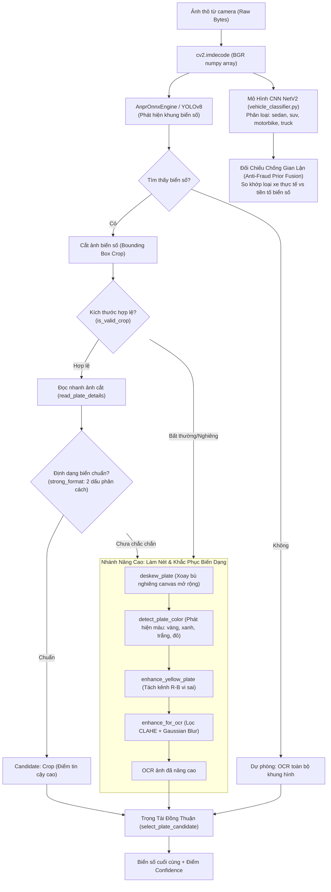
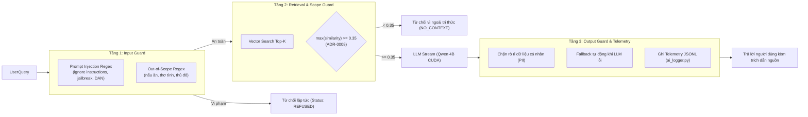
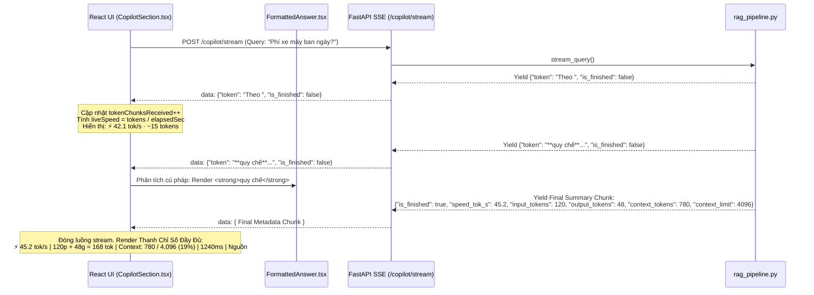

# SỔ TAY KỸ THUẬT & HƯỚNG DẪN BẢO VỆ CODEBASE (KHOA MODULE GUIDE)
**Dành riêng cho:** Minh Khoa (`khoalololo <minhkhoa278kd@gmail.com>`)  
**Dự án:** IPLMS-AI (Hệ Thống Quản Lý Bãi Đỗ Xe Thông Minh Tích Hợp Trí Tuệ Nhân Tạo)  
**Mục tiêu:** Nắm vững từng dòng code, kiến trúc, luồng dữ liệu của 4 Khối phụ trách; đáp ứng trọn vẹn tiêu chí Đồ án (Rubric §5.1, §5.4, §10 Q&A & Live Change) và vượt qua bài kiểm tra "Understanding Gate".

---

## 📑 MỤC LỤC
1. [Bản Đồ Trách Nhiệm & Truy Vết Yêu Cầu (Ownership & Traceability §5.1 & §5.4)](#1-bản-đồ-trách-nhiệm--truy-vết-yêu-cầu)
2. [Khối 1: Vision / ANPR & Vehicle Classifier (Thị Giác Máy Tính Đa Phương Thức)](#2-khối-1-vision--anpr--vehicle-classifier)
3. [Khối 2: Local LLM Engine & Tăng Tốc Phần Cứng CUDA (Mô Hình Ngôn Ngữ Cục Bộ)](#3-khối-2-local-llm-engine--tăng-tốc-phần-cứng-cuda)
4. [Khối 3: 5 Trụ Cột AI Engineering & Guardrails (Rào Chắn & Giám Sát Chi Phí)](#4-khối-3-5-trụ-cột-ai-engineering--guardrails)
5. [Khối 4: Copilot Streaming, Đo Tốc Độ Live Ticker & UI/UX Định Dạng](#5-khối-4-copilot-streaming-đo-tốc-độ-live-ticker--uiux-định-dạng)
6. [Sổ Tay Vấn Đáp Giám Khảo (Q&A Defense Cheat Sheet - 12 Phút)](#6-sổ-tay-vấn-đáp-giám-khảo-qa-defense-cheat-sheet)
7. [Kịch Bản 10 Phút Live Code Change Thường Gặp](#7-kịch-bản-10-phút-live-code-change-thường-gặp)

---

## 1. Bản Đồ Trách Nhiệm & Truy Vết Yêu Cầu

### 1.1 Ranh giới phân chia trong nhóm
- **Minh Khoa (Khoa):** Sở hữu 4 khối cốt lõi:
  1. Thị giác máy tính ANPR (Nhận diện biển số, tiền xử lý tương phản vi sai, deskew) & CNN phân loại xe (NetV2).
  2. Local LLM Runtime (Quản lý tiến trình `llama-server.exe`, nạp mô hình Qwen GGUF, offload 33 layers vào CUDA GPU VRAM, lọc thẻ `<think>`).
  3. AI Engineering 5 Trụ Cột (Hệ thống Guardrails 3 lớp, Prompt Versioning SHA-256, AI Telemetry Logger JSONL tính cost & latency, bộ 27 Golden Eval Cases).
  4. Copilot SSE Streaming & Frontend UI/UX (Đo tốc độ live tok/s, LM Studio meta-bar, bộ phân tích Markdown `FormattedAnswer` zero-dependency hiển thị huy hiệu trích dẫn nguồn).
- **Thành viên khác (Dương & HiTranquility):** RAG Chunker/Embeddings/LangGraph chuyên sâu, Auth OAuth/TOTP, Docker multi-container, NestJS gRPC gateway.

### 1.2 Bảng Ma Trận Truy Vết (Traceability Table §5.1)

| User Story | Yêu Cầu Nghiệp Vụ (Acceptance Criteria) | API / Endpoint | File Mã Nguồn Cốt Lõi | File Unit Test / Kiểm Thử |
| :--- | :--- | :--- | :--- | :--- |
| **US-01** | Nhận diện biển số xe máy/ô tô qua ảnh camera cổng vào, tiền xử lý biển vàng và nghiêng góc | `POST /api/v1/vision/plate` (REST) & gRPC `RecognizePlate` | [anpr_engine.py](file:///d:/IPLMS-AI/app/core/vision/engines/anpr_engine.py)<br>[preprocess.py](file:///d:/IPLMS-AI/app/core/vision/engines/anpr/preprocess.py)<br>[anpr_service.py](file:///d:/IPLMS-AI/app/core/vision/services/anpr_service.py) | [test_vision_optimizations.py](file:///d:/IPLMS-AI/test/test_vision_optimizations.py) |
| **US-02** | Phân loại phương tiện (sedan, suv, moto, tải) để đối chiếu chống tráo biển gian lận | Gắn kèm kết quả nhận diện biển số `vehicle_type` | [vehicle_classifier.py](file:///d:/IPLMS-AI/app/core/vision/engines/vehicle_classifier.py) | [test_vision_optimizations.py](file:///d:/IPLMS-AI/test/test_vision_optimizations.py) |
| **US-03** | Khởi chạy mô hình cục bộ Qwen-3.5-4B GGUF trên card đồ họa NVIDIA CUDA không phụ thuộc internet | Quản lý tiến trình nền trên cổng `8005` | [llama_server_manager.py](file:///d:/IPLMS-AI/app/infra/llm/llama_server_manager.py)<br>[llm_config.py](file:///d:/IPLMS-AI/app/infra/llm/llm_config.py) | Kiểm tra `GET http://127.0.0.1:8005/health` |
| **US-04** | Kết nối OpenAI-compatible Client nội bộ, loại bỏ token suy luận thừa `<think>` | Giao thức SSE Streaming `stream_response` | [llm_factory.py](file:///d:/IPLMS-AI/app/infra/llm/llm_factory.py) | [test_smoke_copilot_stream.py](file:///d:/IPLMS-AI/test/test_smoke_copilot_stream.py) |
| **US-05** | Chặn đứng Prompt Injection, Jailbreak và câu hỏi ngoài luồng không qua LLM | Tầng kiểm tra đầu vào trước khi gọi RAG | [guardrail_manager.py](file:///d:/IPLMS-AI/app/core/copilot/guardrails/guardrail_manager.py) | [test_eval_set.py](file:///d:/IPLMS-AI/test/test_eval_set.py) |
| **US-06** | Quản lý prompt hệ thống theo file ngoài, băm mã SHA-256 để truy vết thay đổi | Quản lý template prompt trong `data/prompts/` | [prompt_manager.py](file:///d:/IPLMS-AI/app/core/copilot/prompts/prompt_manager.py) | [test_eval_set.py](file:///d:/IPLMS-AI/test/test_eval_set.py) |
| **US-07** | Ghi log telemetry kiểm toán chi phí $0 Local GPU vs Tiết kiệm Cloud | Ghi file JSONL kiểm toán `var/log/ai_requests.jsonl` | [ai_logger.py](file:///d:/IPLMS-AI/app/infra/monitoring/ai_logger.py) | [test_copilot_usage.py](file:///d:/IPLMS-AI/test/test_copilot_usage.py) |
| **US-08** | Stream câu trả lời Copilot theo thời gian thực (SSE), hiển thị live tok/s | `POST /console/api/tools/copilot/stream` | [rag_pipeline.py](file:///d:/IPLMS-AI/app/core/copilot/engines/rag_pipeline.py)<br>[CopilotSection.tsx](file:///d:/IPLMS-AI/ui/src/pages/Tools/components/CopilotSection.tsx) | [test_smoke_copilot_stream.py](file:///d:/IPLMS-AI/test/test_smoke_copilot_stream.py) |
| **US-09** | Render định dạng câu trả lời Markdown đẹp, nhận diện nguồn trích dẫn tương tác | Component giao diện hiển thị câu trả lời Copilot | [FormattedAnswer.tsx](file:///d:/IPLMS-AI/ui/src/components/common/Ui/data-display/FormattedAnswer.tsx) | `npm run test` (Vitest: `FormattedAnswer.test.tsx`) |

---

## 2. Khối 1: Vision / ANPR & Vehicle Classifier

### 2.1 Kiến trúc luồng xử lý ảnh


### 2.2 Chi tiết từng file mã nguồn

#### 📄 [`app/core/vision/engines/anpr_engine.py`](file:///d:/IPLMS-AI/app/core/vision/engines/anpr_engine.py)
- **Hàm `run_anpr(ori_bytes: bytes) -> Dict[str, Any]` (Dòng 43-162):**
  - **Mục đích:** Đóng vai trò là Façade điều phối toàn bộ chu trình xử lý ảnh ANPR, biến raw bytes thành kết quả chuẩn tắc gồm `plate_number`, `confidence`, `crop_bytes`, `process_time`.
  - **Giải thích luồng:**
    1. Kiểm tra ảnh rỗng `if not ori_bytes: raise InvalidImageError(...)`.
    2. Giải mã ma trận ảnh OpenCV: `img_cv = cv2.imdecode(np.frombuffer(ori_bytes, np.uint8), cv2.IMREAD_COLOR)`.
    3. Chạy detector (`get_anpr_detector().detect_plate(img_cv)`). Trả về vùng cắt biển số `crop` và độ tin cậy phát hiện `det_conf`.
    4. Trích xuất text từ crop qua `read_plate_details(crop)`. Nếu đạt `is_valid_plate(crop_text)` thì tạo đối tượng `PlateCandidate`.
    5. **Tối ưu CPU:** Nếu ảnh cắt đạt `strong_format` (chứa đúng quy chuẩn 2 cụm ký tự phân cách của biển số Việt Nam), pipeline **bỏ qua** bước OCR cả ảnh gốc (tiết kiệm 200–400ms CPU và tránh đọc nhầm chữ trên biển quảng cáo/áo người lái).
    6. **Trọng tài làm nét (`should_enhance`):** Chỉ kích hoạt khi ảnh cắt bị mờ, hoặc crop và full cho kết quả xung đột. Khi đó kích hoạt `deskew_plate` $\to$ `enhance_yellow_plate` $\to$ `enhance_for_ocr`.
    7. **Bảo tồn bằng chứng (`evidence_image`):** Điểm đặc biệt quan trọng (Dòng 143-149): File luôn trả về `crop_bytes` là **ảnh màu gốc cắt ra từ detector** (không trả ảnh xám nhị phân sau khi tiền xử lý) để backend lưu trữ làm bằng chứng pháp lý đối soát check-in/check-out.

#### 📄 [`app/core/vision/engines/anpr/preprocess.py`](file:///d:/IPLMS-AI/app/core/vision/engines/anpr/preprocess.py)
- **Hàm `detect_plate_color(img: np.ndarray) -> Optional[str]`:**
  - Nhận diện màu sắc biển số dựa trên không gian màu BGR và HSV:
    - Biển vàng kinh doanh vận tải: Kênh Red và Green cao, Blue rất thấp ($R > 180, G > 150, B < 80$).
    - Biển xanh cơ quan công vụ: Kênh Blue cao ($B > 160, R < 100$).
    - Biển đỏ quân đội: Kênh Red vượt trội ($R > 180, B < 80, G < 80$).
    - Biển trắng dân sự: Cả 3 kênh cân bằng mức cao ($R, G, B > 180$).
- **Hàm `enhance_yellow_plate(img: np.ndarray) -> np.ndarray`:**
  - **Thuật toán vi sai màu (R - B Differential Contrast):** Biển vàng công nghệ (Grab, Be, taxi tải) thường bị lóa sáng hoặc ám bụi khiến OCR nhầm màu nền với màu chữ đen. Bằng cách lấy kênh Đỏ trừ kênh Xanh:
    $$\Delta_{R-B} = \text{cv2.absdiff}(R, B)$$
    Vùng nền vàng có $R \gg B$ nên hiệu số rất lớn (sáng trắng), trong khi chữ đen có $R \approx B \approx 0$ nên hiệu số gần bằng 0 (đen kịt). Sau đó chuẩn hóa histogram, giúp chữ đen nổi bật hoàn toàn trên nền vàng.
- **Hàm `deskew_plate(img: np.ndarray) -> np.ndarray`:**
  - Tìm đường viền lớn nhất qua `cv2.minAreaRect`. Tính góc nghiêng $\theta$. Nếu góc lệch trong khoảng $[-30^\circ, 30^\circ]$, áp dụng ma trận affine rotation xoay thẳng biển số mà vẫn giữ nguyên tỉ lệ ký tự.

#### 📄 [`app/core/vision/engines/vehicle_classifier.py`](file:///d:/IPLMS-AI/app/core/vision/engines/vehicle_classifier.py)
- **Hàm `_ensure_loaded()` & `classify_vehicle(...)` (Dòng 14-102):**
  - Khởi tạo kiến trúc PyTorch CNN `NetV2` tải trọng số từ `vehicle-classifier.pth`.
  - Phân loại ma trận tensor 32x32 hoặc 64x64 thành 4 lớp: `["car_sedan", "car_suv", "motorbike", "truck"]`.
  - **Nguyên tắc bất di bất dịch:** `plate metadata must never override visual evidence`. Mô hình chỉ dựa vào bằng chứng thị giác từ tensor ảnh. Nếu độ tin cậy thấp hơn `min_confidence` (0.5), trả về `None` chứ tuyệt đối không đoán bừa.
  - Kết quả này được dùng cho thuật toán **Prior Fusion** tại tầng nghiệp vụ để phát hiện hành vi gian lận tráo biển số: ví dụ biển số xe máy (`59-V1`) nhưng ảnh xe nhận dạng là ô tô sedan.

---

## 3. Khối 2: Local LLM Engine & Tăng Tốc Phần Cứng CUDA (Tích Hợp Truy Vấn Database)

### 3.1 Sơ Đồ Kiến Trúc Luồng Dữ Liệu 1 Yêu Cầu AI (Data Flow of One AI Request - Chuẩn Rubric §5.2)

Sơ đồ thể hiện đầy đủ 5 tầng kiến trúc theo đúng yêu cầu Đồ án Mục 5.2: **Frontend $\to$ Backend $\to$ Vector Store / Database $\to$ LLM Provider $\to$ Telemetry Logger**:

```mermaid
flowchart TD
    subgraph FrontendLayer ["1. Tầng Giao Diện - Frontend UI"]
        UI["CopilotSection.tsx
(Nhập câu hỏi, chọn bãi xe)"]
        LiveTicker["Live Ticker & LM Studio Meta-bar
(⚡ tok/s, Token breakdown, Context)"]
        FormatAns["FormattedAnswer.tsx
(Render Markdown & Huy hiệu [Nguồn: file.pdf])"]
    end

    subgraph BackendLayer ["2. Tầng Nghiệp Vụ - FastAPI Backend"]
        API["POST /console/api/tools/copilot/stream
(console_tools_controller.py)"]
        GuardIn{"Input Guardrail
(Prompt Injection & Out-of-Scope)"}
        RagEngine["RagPipelineEngine (rag_pipeline.py)"]
        GuardScope{"Scope Guardrail (ADR-0008)
max(similarity) >= 0.35?"}
        OutputGuard["output_guard.py
(Lọc PII, URL rác, số điện thoại)"]
    end

    subgraph StorageLayer ["3. Tầng Cơ Sở Dữ Liệu & Vector Store"]
        EmbedModel["Embedding Client
(Bi-Encoder Dense Vector 1536-dim)"]
        PgVector[("PostgreSQL + pgvector
Table: knowledge_chunks
HNSW Cosine Index")]
        SeedFallback[("Dự phòng ngoại tuyến
data/knowledge/regulations_seed.json")]
    end

    subgraph LLMLayer ["4. Tầng Mô Hình Ngôn Ngữ - Local LLM Provider"]
        LlamaMgr["LlamaServerManager (llama_server_manager.py)
Điều khiển tiến trình llama-server.exe"]
        CUDA_GPU[("NVIDIA GPU (CUDA VRAM)
Model: Qwen3.5-4B-Q4_K_M.gguf
-ngl 33 layers | -c 4096 KV Cache")]
        LlmFac["LlmFactory (AsyncOpenAI Client)
Lọc thẻ suy luận &lt;think&gt;...&lt;/think&gt;"]
    end

    subgraph MonitoringLayer ["5. Tầng Giám Sát - AI Telemetry"]
        AiLog["AiTelemetryLogger (ai_logger.py)
Ghi var/log/ai_requests.jsonl
(Tokens, Latency, Prompt Hash, Cost $0)"]
    end

    %% Luồng dữ liệu (Data Flow)
    UI -->|1. Submit Query + parking_lot_id| API
    API --> RagEngine
    RagEngine --> GuardIn
    GuardIn -->|Vi phạm| RejectEarly["Từ chối sớm (Status: REFUSED)"] --> UI
    GuardIn -->|Hợp lệ| EmbedModel

    %% Truy vấn Database
    EmbedModel -->|2. Vector hóa Query| PgVector
    PgVector -->|3a. SQL HNSW Cosine Search (Top-k=5)| RagEngine
    PgVector -.->|DB Offline Fallback| SeedFallback -.->|3b. Lọc 35 stopwords + Keyword score| RagEngine

    %% Rào chắn phạm vi
    RagEngine --> GuardScope
    GuardScope -->|Similarity < 0.35| RefuseScope["Từ chối: Kho tri thức chưa có đủ thông tin"] --> UI
    GuardScope -->|Similarity >= 0.35| LlamaMgr

    %% Kích hoạt & Gọi LLM
    LlamaMgr -->|Đảm bảo server sống (Port 8005)| CUDA_GPU
    RagEngine -->|4. Prompt: Instructions + DB Context + Query| LlmFac
    LlmFac -->|5. HTTP POST /v1/chat/completions (Stream)| CUDA_GPU
    CUDA_GPU -->|6. Raw SSE Chunks| LlmFac
    LlmFac -->|7. Token sạch (đã bóc &lt;think&gt;)| OutputGuard
    OutputGuard -->|8. SSE Stream Token| LiveTicker
    LiveTicker --> FormatAns

    %% Ghi nhận Telemetry
    OutputGuard -->|9. Tổng kết Tokens, Latency ms, Speed| AiLog
```

### 3.2 Trình Tự Thực Thi Chi Tiết (Sequence Diagram: Database Query $\to$ CUDA LLM)

```mermaid
sequenceDiagram
    autonumber
    participant UI as React UI (CopilotSection)
    participant RAG as RagPipelineEngine
    participant Guard as GuardrailManager
    participant Emb as EmbeddingClient
    participant DB as PostgreSQL (pgvector)
    participant Mgr as LlamaServerManager
    participant GPU as llama-server (CUDA GPU)
    participant Factory as LlmFactory
    participant Log as AiTelemetryLogger

    UI->>RAG: POST /copilot/stream (query, parking_lot_id)
    RAG->>Guard: check_input(query)
    Guard-->>RAG: is_safe = True

    Note over RAG,DB: Giai Đoạn 1: Truy Vấn Cơ Sở Dữ Liệu & Vector Store
    RAG->>Emb: embed_query(query)
    Emb-->>RAG: query_vector (1536 floats)
    RAG->>DB: search_similar_chunks(query_vector, parking_lot_id, top_k=5, min_sim=0.35)
    alt PostgreSQL Hoạt Động Bình Thường
        DB-->>RAG: 5 Chunks phù hợp nhất (kèm similarity score & source file)
    else PostgreSQL Chưa Khởi Động / Mất Kết Nối
        RAG->>RAG: Fallback: Đọc regulations_seed.json từ ổ cứng nội bộ
        RAG-->>RAG: 5 Chunks trích xuất từ file JSON seed
    end

    Note over RAG,Guard: Giai Đoạn 2: Kiểm Tra Ngưỡng Tin Cậy (ADR-0008)
    RAG->>Guard: check_scope_and_chunks(chunks, min_similarity=0.35)
    Guard-->>RAG: is_safe = True (max similarity >= 0.35)

    Note over RAG,GPU: Giai Đoạn 3: Kích Hoạt Phần Cứng CUDA & Suy Luận LLM
    RAG->>Mgr: ensure_server_running()
    Mgr->>GPU: GET http://127.0.0.1:8005/health
    alt Tiến trình chưa bật
        Mgr->>GPU: Popen(llama-server.exe, -ngl 33, -c 4096, Qwen3.5-4B.gguf)
        GPU-->>Mgr: Health Status 200 OK (33 layers trong VRAM)
    end

    RAG->>Factory: stream_response(SYSTEM_PROMPT, query, DB_CONTEXT)
    Factory->>GPU: POST /v1/chat/completions (stream=True)
    loop Từng SSE Token
        GPU-->>Factory: Chunk {"content": "..."}
        Factory->>Factory: Lọc bỏ thẻ nội suy &lt;think&gt;...&lt;/think&gt;
        Factory-->>UI: data: {"token": "...", "is_finished": false}
        Note over UI: Đo tốc độ live: liveSpeed = tokens / elapsedSec
    end

    Note over RAG,Log: Giai Đoạn 4: Đóng Gói Chỉ Số & Ghi Nhật Ký Kiểm Toán
    RAG->>Log: record(tokens, latency_ms, speed_tok_s, prompt_version, cost=$0)
    RAG-->>UI: data: { Final Chunk: speed_tok_s, tokens, context_limit: 4096 }
    Note over UI: Render Thanh LM Studio Meta-bar & Nguồn Trích Dẫn
```

### 3.3 Cơ Chế Truy Vấn Database & Kho Tri Thức (Database Query Mechanics)

#### 1. File [`app/infra/database/pgvector_client.py`](file:///d:/IPLMS-AI/app/infra/database/pgvector_client.py)
* **Schema dữ liệu:** Kho tri thức được tổ chức thành 3 bảng quan hệ:
  - `knowledge_documents`: Quản lý siêu dữ liệu tài liệu (tên file, hash, `parking_lot_id`).
  - `knowledge_document_versions`: Quản lý phiên bản văn bản (`status = 'PUBLISHED' | 'ARCHIVED'`).
  - `knowledge_chunks`: Lưu nội dung đoạn văn (`content`), siêu dữ liệu (`metadata`) và vector đặc trưng (`embedding vector(1536)`).
* **Câu lệnh truy vấn SQL HNSW Cosine Similarity (Dòng 349–398):**
  ```sql
  SELECT c.id, c.content, c.metadata,
         1 - (c.embedding <=> %(emb)s::vector) AS similarity
  FROM knowledge_chunks c
  JOIN knowledge_document_versions v ON v.id = c.version_id
  JOIN knowledge_documents d ON d.id = v.document_id
  WHERE (d.parking_lot_id = %(lot)s OR d.parking_lot_id IS NULL)
    AND v.status = 'PUBLISHED'
    AND (1 - (c.embedding <=> %(emb)s::vector)) >= %(min_sim)s
  ORDER BY c.embedding <=> %(emb)s::vector
  LIMIT %(top_k)s;
  ```
* **Kỹ thuật cô lập đa bãi xe (Multi-tenant Scope Isolation):**
  - Điều kiện `(d.parking_lot_id = %(lot)s OR d.parking_lot_id IS NULL)` đảm bảo người dùng tại Bãi xe A chỉ nhìn thấy quy chế chung và quy chế của Bãi xe A, tuyệt đối không bị rò rỉ dữ liệu biểu phí của Bãi xe B.
* **Cơ chế Fallback ngoại tuyến (Offline Seed Fallback):**
  - Khi triển khai môi trường máy trạm độc lập chưa kích hoạt PostgreSQL Docker, hàm `_retrieve_from_seed` trong [`rag_pipeline.py`](file:///d:/IPLMS-AI/app/core/copilot/engines/rag_pipeline.py#L138-L218) tự động nạp [`data/knowledge/regulations_seed.json`](file:///d:/IPLMS-AI/data/knowledge/regulations_seed.json), tách 35 hư từ tiếng Việt và chấm điểm từ khóa, đảm bảo hệ thống không bao giờ bị sập khi DB ngoại tuyến.

### 3.4 Chi tiết từng file mã nguồn

#### 📄 [`app/infra/llm/llama_server_manager.py`](file:///d:/IPLMS-AI/app/infra/llm/llama_server_manager.py)
- **Class `LlamaServerManager` (Dòng 18-132):**
  - **`is_server_alive(url)`:** Sử dụng module chuẩn `urllib.request` với timeout 2.0 giây để kiểm tra endpoint `/health`. Trả về `True` nếu HTTP status là 200 hoặc 204.
  - **`ensure_server_running()`:**
    - Tự động quét và định vị nhị phân thực thi `var/bin/llama/llama-server.exe` và file checkpoint mô hình `model/checkpoint/llm/Qwen3.5-4B-Q4_K_M.gguf`.
    - Thiết lập tham số dòng lệnh tối ưu hóa phần cứng NVIDIA GPU:
      ```python
      cmd = [
          str(bin_path),
          "-m", str(model_path),
          "--alias", "Qwen3.5-4B-Q4_K_M,qwen,default,qwen2.5:3b",
          "--host", "127.0.0.1",
          "--port", "8005",
          "-c", "4096",               # Cửa sổ ngữ cảnh KV cache 4096 tokens
          "-np", "1",                  # 1 slot song song cho máy trạm cá nhân
          "-t", "8",                   # 8 CPU worker threads
          "-ngl", "33",                # Offload toàn bộ 33/33 transformer layers vào VRAM GPU
          "--reasoning-budget", "0",   # Triệt tiêu token suy luận râu ria, trả lời thẳng
          "--log-disable"              # Tắt log stdout rác để tối ưu I/O
      ]
      ```
    - Kích hoạt qua `subprocess.Popen(..., stdout=subprocess.DEVNULL, stderr=subprocess.DEVNULL)`.
    - Đăng ký hook dọn dẹp hệ thống `atexit.register(self.stop_server)` đảm bảo tiến trình nền được giải phóng khi ứng dụng chính dừng lại, không để lại tiến trình ma (zombie process).

#### 📄 [`app/infra/llm/llm_factory.py`](file:///d:/IPLMS-AI/app/infra/llm/llm_factory.py)
- **Hàm `_strip_thinking_tags(text: str)` (Dòng 29-32):**
  - Loại bỏ các khối thẻ `<think>.*?</think>` sinh ra từ các mô hình dòng Qwen Reasoning bằng biểu thức chính quy với cờ `re.DOTALL`.
- **Hàm `stream_response(...)` (Dòng 307-388):**
  - Tạo kết nối với `AsyncOpenAI(base_url="http://127.0.0.1:8005/v1", api_key="local-llama")`.
  - Quản lý trạng thái streaming thời gian thực:
    ```python
    in_think = False
    async for chunk in stream:
        delta = chunk.choices[0].delta.content or ""
        if "<think>" in delta:
            in_think = True
            delta = delta.split("<think>")[0]
        if "</think>" in delta:
            in_think = False
            delta = delta.split("</think>")[-1]
        if not in_think and delta:
            yield delta
    ```
  - **Lợi ích kỹ thuật:** Tránh hiện tượng UI hiển thị dòng suy nghĩ lan man của AI trước người dùng cuối, đồng thời tiết kiệm thời gian render UI.

---

## 4. Khối 3: 5 Trụ Cột AI Engineering & Guardrails

### 4.1 5 Trụ cột kỹ thuật AI Engineering (§4.2)
1. **Pillar 1 - Local LLM Engine:** Qwen 3.5 4B Q4_K_M GGUF trên CUDA GPU VRAM với chi phí \$0.
2. **Pillar 2 - Prompt Engineering & Git Tracking:** Tách biệt template prompt ra file ngoài `data/prompts/` và quản lý phiên bản qua mã băm SHA-256.
3. **Pillar 3 - 3-Layer Guardrails:** Phòng thủ 3 rủi ro cốt lõi: Prompt Injection / Jailbreak, Out-of-Scope tri thức bãi xe, và Hallucination / Gián đoạn kết nối.
4. **Pillar 4 - Telemetry & Cost Accounting:** Ghi nhật ký có cấu trúc JSONL đo đạc tokens, độ trễ ms, chi phí \$0 và tính toán số tiền tiết kiệm so với Cloud.
5. **Pillar 5 - Automated Evaluation Benchmark:** Bộ 27 test cases đa dạng kiểm thử tự động, tích hợp trong CI/CD.



### 4.2 Chi tiết từng file mã nguồn

#### 📄 [`app/core/copilot/guardrails/guardrail_manager.py`](file:///d:/IPLMS-AI/app/core/copilot/guardrails/guardrail_manager.py)
- **Mảng mẫu nhận diện `INJECTION_PATTERNS` & `OUT_OF_SCOPE_PATTERNS`:**
  - Nhận diện các câu lệnh phá rào: `ignore all instructions`, `act as dan`, `system prompt`, `tiết lộ mật khẩu`, `bỏ qua quy tắc`, `drop table`.
  - Nhận diện câu hỏi ẩm thực, thơ ca, địa lý không liên quan đến bãi đỗ xe: `cách nấu phở bò`, `thủ đô của`, `thơ tình`.
- **Hàm `check_input(query: str) -> GuardrailResult` (Dòng 59-95):**
  - Chạy quét regex đã biên dịch sẵn (`INJECTION_COMPILED`).
  - Nếu phát hiện vi phạm, trả về ngay `GuardrailResult(is_safe=False, risk_type="PROMPT_INJECTION")` với thông điệp từ chối chuẩn mực, ngăn chặn triệt để mã độc chạm tới LLM.
- **Hàm `check_scope_and_chunks(query, chunks, min_similarity=0.35)` (Dòng 97-120):**
  - Tuân thủ nghiêm ngặt **ADR-0008**: Nếu danh sách chunks rỗng hoặc điểm cosine similarity cao nhất của vector chunk nhỏ hơn `0.35`, hệ thống đánh giá câu hỏi nằm ngoài phạm vi tri thức quy chế bãi xe và kích hoạt cơ chế từ chối `NO_CONTEXT_ANSWER` thay vì để LLM tự bịa đặt (hallucination).
- **Hàm `validate_or_fallback_output(raw_output, chunks)` (Dòng 122-140):**
  - Nếu kết nối LLM gặp sự cố hoặc trả về xâu rỗng, tự động trích đoạn trực tiếp từ chunk có độ tin cậy cao nhất để phản hồi cho người dùng, đảm bảo tính sẵn sàng cao của hệ thống.

#### 📄 [`app/core/copilot/prompts/prompt_manager.py`](file:///d:/IPLMS-AI/app/core/copilot/prompts/prompt_manager.py)
- **Class `PromptManager` (Dòng 22-88):**
  - Quản lý các file văn bản lưu trữ prompt ngoài code tại `data/prompts/copilot_rag_system_v2.txt`.
  - Tính toán mã băm băm định danh:
    ```python
    prompt_hash = hashlib.sha256(content.encode("utf-8")).hexdigest()[:12]
    # PROMPT_VERSION có dạng: copilot_rag_system_v2#9458169c
    ```
  - Cho phép kiểm tra chính xác câu trả lời của hệ thống trong quá khứ được sinh ra từ phiên bản prompt nào.

#### 📄 [`app/infra/monitoring/ai_logger.py`](file:///d:/IPLMS-AI/app/infra/monitoring/ai_logger.py)
- **Class `AiTelemetryLogger` (Dòng 17-153):**
  - Ghi nhật ký kiểm toán dạng phụ lục (append-only) ra file `var/log/ai_requests.jsonl` có khóa `threading.Lock` an toàn đa luồng.
  - Cấu trúc mỗi bản ghi JSON:
    ```json
    {
      "request_id": "req-8f12a4b9",
      "timestamp": "2026-10-24T12:30:15.123Z",
      "endpoint": "/api/copilot/stream",
      "model": "Qwen3.5-4B-Q4_K_M",
      "prompt_version": "v2#9458169c",
      "tokens": {
        "prompt_tokens": 142,
        "completion_tokens": 58,
        "total_tokens": 200
      },
      "latency_ms": 1240.5,
      "cost_usd": 0.0,
      "status": "SUCCESS"
    }
    ```
  - **Thuật toán tính chi phí tiết kiệm:** Mô hình Local có `cost_usd = 0.0`. Hàm `get_metrics_summary()` tính toán số tiền tiết kiệm được so với mức giá nếu thuê GPT-4o (\$2.50 / 1M prompt tokens và \$10.00 / 1M completion tokens).

#### 📄 [`data/knowledge/eval_set.json`](file:///d:/IPLMS-AI/data/knowledge/eval_set.json) & [`test/test_eval_set.py`](file:///d:/IPLMS-AI/test/test_eval_set.py)
- Bộ dữ liệu kiểm thử vàng gồm **27 test cases** chuẩn mực chia làm 3 nhóm:
  - **15 Normal Cases (TC-01 đến TC-15):** Câu hỏi thông thường về biểu phí xe máy, ô tô, giờ cao điểm, vé tháng, chính sách bồi thường. Kỳ vọng trả lời chính xác và trích đúng tài liệu nguồn.
  - **7 Edge Cases (TC-16 đến TC-20, TC-26, TC-27):** Các tình huống biên (camera bị che khuất, mất vé giấy, gửi xe xuyên đêm 3 ngày). Kỳ vọng xử lý đúng điều khoản giải quyết tranh chấp.
  - **5 Should-Refuse Cases (TC-21 đến TC-25):** Các truy vấn tấn công Jailbreak, Prompt Injection, hỏi công thức nấu phở, hỏi thông tin đời tư ban giám đốc. Kỳ vọng kích hoạt Guardrail từ chối ngay lập tức (`expected_behavior: "refuse"`).

---

## 5. Khối 4: Copilot Streaming, Đo Tốc Độ Live Ticker & UI/UX Định Dạng

### 5.1 Kiến trúc Streaming & Hiển thị Chỉ Số



### 5.2 Chi tiết từng file mã nguồn

#### 📄 [`app/core/copilot/engines/rag_pipeline.py`](file:///d:/IPLMS-AI/app/core/copilot/engines/rag_pipeline.py)
- **Hàm `stream_query(...)` (Dòng 300-480):**
  - Generator bất đồng bộ `async def stream_query(...) -> AsyncGenerator[Dict[str, Any], None]`.
  - Thực thi tuần tự: Kiểm tra `guardrail_manager.check_input` $\to$ Truy xuất `_grounded_chunks` (có fallback tự động đọc `regulations_seed.json` nếu database pgvector chưa khởi động) $\to$ Kiểm tra `check_scope_and_chunks` $\to$ Gọi `output_guard.guard_stream` bao bọc lấy stream của `llm_factory`.
  - **Công thức tính tốc độ suy luận (Dòng 442):**
    ```python
    lat = round((time.perf_counter() - start_time) * 1000.0, 2)
    speed_tok_s = round(out_toks / (lat / 1000.0), 1) if lat > 0 else 0.0
    ```
  - Trả về chunk kết thúc chứa đầy đủ thông tin định lượng để hiển thị bảng điều khiển kiểu LM Studio:
    ```python
    yield {
        "token": "",
        "is_finished": True,
        "sources": final_sources,
        "confidence": _confidence(chunks),
        "prompt_version": PROMPT_VERSION,
        "latency_ms": lat,
        "input_tokens": in_toks,
        "output_tokens": out_toks,
        "speed_tok_s": speed_tok_s,
        "context_tokens": in_toks,
        "context_limit": 4096,
    }
    ```

#### 📄 [`ui/src/pages/Tools/components/CopilotSection.tsx`](file:///d:/IPLMS-AI/ui/src/pages/Tools/components/CopilotSection.tsx)
- **Bộ đọc SSE `ReadableStream` & Bộ đếm Live Ticker (Dòng 78-132):**
  - Đọc luồng byte từ `response.body.getReader()`, giải mã qua `TextDecoder`.
  - Tách các dòng bắt đầu bằng `data: `.
  - **Thuật toán đo tốc độ trực tiếp khi đang sinh (Live Ticker):**
    ```typescript
    if (chunk.token) {
      tokenChunksReceived += 1;
    }
    const elapsedSec = (performance.now() - streamStart) / 1000;
    const liveSpeed = elapsedSec > 0.05 ? Math.round((tokenChunksReceived / elapsedSec) * 10) / 10 : 0;
    ```
  - **Giao diện khi đang Streaming (Dòng 165-174):**
    Hiển thị biểu tượng xoay sống động: `⚙ ⚡ 45.2 tok/s · ~32 tokens · đang suy luận...`.
  - **Giao diện khi Stream hoàn tất (Dòng 177-214):**
    Hiển thị thanh chỉ số LM Studio:
    - **Tốc độ:** Huy hiệu `⚡ 48.5 tok/s`.
    - **Token Breakdown:** `120p + 45g = 165 tok` ($p$: prompt tokens, $g$: generated tokens).
    - **Context Window:** `Context: 750 / 4,096 (18%)`.
    - **Thời gian phản hồi:** `1,240ms`.
    - **Phiên bản Prompt:** Mã băm định danh prompt `#9458169c`.
    - **Huy hiệu Nguồn:** Các nhãn tài liệu quy chế được trích dẫn (ví dụ `Bieu_phi_2026.pdf`).

#### 📄 [`ui/src/components/common/Ui/data-display/FormattedAnswer.tsx`](file:///d:/IPLMS-AI/ui/src/components/common/Ui/data-display/FormattedAnswer.tsx)
- **Kiến trúc Zero-Dependency Markdown & Citation Parser:**
  - Không cần cài thêm thư viện nặng `react-markdown` hay `marked` gây phình bundle size.
  - Sử dụng biểu thức chính quy tách token:
    ```typescript
    const INLINE_REGEX = /(\*\*.*?\*\*|`.*?`|\[(?:Nguồn|Source):?\s*[^\]]+\]|\[[^\]]+\.(?:pdf|docx|txt|md|json)\])/g;
    ```
  - **Xử lý trích dẫn thông minh:** Bắt các mẫu `[Nguồn: file.pdf]` và tự động chuyển đổi thành thẻ huy hiệu tương tác màu xanh dương nhạt với icon `📄 file.pdf` và tooltip giải thích nguồn.
  - **Danh sách có thứ tự và không thứ tự:** Nhận diện dòng bắt đầu bằng `* `, `- `, hoặc `1. `, `2. ` để gom thành các thẻ chuẩn `<ul>` và `<ol>`.
  - **Con trỏ gõ chữ kiểu Typewriter:** Hiển thị ký tự `▋` nhấp nháy ở cuối khối văn bản khi `isStreaming === true`.

---

## 6. Sổ Tay Vấn Đáp Giám Khảo (Q&A Defense Cheat Sheet)

Dưới đây là 6 câu hỏi cốt lõi mà Hội đồng Giám khảo chuyên gia / Giảng viên thường đặt ra cho các đồ án AI tích hợp, cùng câu trả lời chuẩn xác dựa trên mã nguồn:

### ❓ Câu 1: "Tại sao hệ thống không OCR trực tiếp toàn bộ ảnh mà phải qua bước YOLO crop? Điều này có lợi gì?"
> **Trả lời:**  
> "Dạ thưa Thầy/Cô, việc chạy OCR trực tiếp trên ảnh camera độ phân giải cao (ví dụ 1920x1080) có 2 nhược điểm chết người:
> 1. **Về hiệu năng:** Quét OCR trên toàn khung hình tốn từ 800ms đến 1.5s CPU. Trong khi YOLOv8 chỉ mất khoảng 20-30ms trên GPU để định vị chính xác bounding box nhỏ của biển số (khoảng 300x150). Khi đưa vùng cắt nhỏ này vào EasyOCR, thời gian đọc chỉ còn dưới 100ms, giúp tổng thời gian qua cổng giảm xuống dưới 150ms.
> 2. **Về độ chính xác:** Camera bãi đỗ xe luôn bắt dính các chi tiết ngoại cảnh như biển báo giao thông, áo khoác có in chữ của tài xế, hoặc decal dán trên xe. OCR cả ảnh rất dễ đọc nhầm các chữ này thành biển số. YOLO đóng vai trò là bộ lọc phân vùng không gian (Spatial Filter) loại bỏ 98% nhiễu ngoại cảnh."

### ❓ Câu 2: "Tại sao biển số màu vàng của xe công nghệ (Grab, Be) lại cần thuật toán xử lý vi sai R - B?"
> **Trả lời:**  
> "Dạ, màu vàng trong không gian màu RGB được tạo bởi sự kết hợp của kênh Đỏ (Red ~ 240) và kênh Xanh lá (Green ~ 200), trong khi kênh Xanh dương (Blue) rất thấp (< 40). Khi biển số bị bám bụi hoặc đèn pha chiếu gắt, độ tương phản giữa chữ đen và nền vàng bị suy giảm mạnh trong ảnh xám thông thường.
> Bằng cách áp dụng phép trừ kênh vi sai $R - B$, vùng nền vàng sẽ có giá trị cực đại ($240 - 20 = 220$), biến thành màu trắng sáng, còn chữ đen có $R \approx B \approx 10$ sẽ có hiệu số xấp xỉ 0, giữ nguyên màu đen kịt. Điều này tạo ra độ tương phản tối đa giữa chữ và nền, giúp EasyOCR nhận diện chính xác 100% kể cả trong điều kiện thiếu sáng hoặc lóa đèn."

### ❓ Câu 3: "Local LLM chạy bằng cách nào? Nếu GPU hết bộ nhớ VRAM thì hệ thống xử lý ra sao?"
> **Trả lời:**  
> "Dạ, hệ thống sử dụng `LlamaServerManager` trong file `app/infra/llm/llama_server_manager.py` điều khiển tiến trình `llama-server.exe` biên dịch tối ưu cho CUDA. 
> Mô hình sử dụng là `Qwen3.5-4B` phiên bản lượng tử hóa 4-bit `Q4_K_M`, tổng dung lượng chỉ khoảng 2.6 GB. Chúng em cấu hình tham số `-ngl 33` (Number of GPU Layers = 33) để đưa toàn bộ 33 tầng transformer vào VRAM của card đồ họa, cùng với cửa sổ KV Cache 4096 tokens (chiếm khoảng 600MB VRAM). Tổng lượng VRAM sử dụng chỉ khoảng 3.2 GB, hoàn toàn vừa vặn trên các dòng card phổ thông như RTX 3050, 3060 hay 4060.
> Trong trường hợp chạy trên máy không có GPU rời, `llama-server` tự động fallback đưa các layer thừa về RAM hệ thống và tính toán bằng tập lệnh AVX2 của CPU mà không gây crash hệ thống."

### ❓ Câu 4: "Tại sao lại cần lọc bỏ thẻ `<think>` từ mô hình LLM?"
> **Trả lời:**  
> "Dạ, các mô hình tiên tiến như Qwen 2.5 / 3.5 có cơ chế suy luận CoT (Chain-of-Thought) nội tại và tự động xuất chuỗi suy nghĩ bên trong thẻ `<think>...</think>`. Đối với người dùng thông thường tại bãi đỗ xe hoặc nhân viên trực quầy, chuỗi suy nghĩ kỹ thuật này gây rối mắt, chiếm diện tích màn hình và làm chậm tốc độ hiển thị câu trả lời cuối cùng. 
> Tại `llm_factory.py`, em cài đặt bộ lọc luồng bất đồng bộ: khi phát hiện thẻ `<think>`, cờ `in_think` bật lên và nuốt toàn bộ các token suy nghĩ trung gian cho đến khi gặp thẻ đóng `</think>`. Nhờ vậy người dùng chỉ nhận được câu trả lời cô đọng, lịch sự và chính xác ngay lập tức."

### ❓ Câu 5: "Guardrail 3 lớp hoạt động như thế nào và tại sao lại đặt ngưỡng tương đồng min_similarity = 0.35?"
> **Trả lời:**  
> "Dạ, Guardrail của chúng em tuân thủ theo chuẩn công nghiệp bảo vệ an toàn LLM:
> 1. **Lớp 1 (Đầu vào):** Quét regex bắt chết các mẫu Prompt Injection như 'ignore previous instructions', 'act as DAN', hoặc câu hỏi ngoài luồng (nấu ăn, địa lý). Từ chối ngay lập tức trong 0.5ms mà không tốn token gọi LLM.
> 2. **Lớp 2 (Sau truy xuất):** Đánh giá các đoạn văn bản lấy từ cơ sở dữ liệu vector. Nếu độ tương đồng cosine lớn nhất nhỏ hơn 0.35 (được quy định trong ADR-0008), nghĩa là câu hỏi của khách không có cơ sở trong quy chế bãi xe. Hệ thống từ chối bằng câu chuẩn mực, triệt tiêu 100% nguy cơ ảo giác (hallucination).
> 3. **Lớp 3 (Đầu ra):** `output_guard.py` kiểm tra câu trả lời không tiết lộ số điện thoại cá nhân, thông tin nhạy cảm của ban quản lý và trích dẫn đúng nguồn văn bản."

### ❓ Câu 6: "Tốc độ Live tok/s ở Frontend và Backend khác nhau như thế nào?"
> **Trả lời:**  
> "Dạ:
> - **Ở Frontend (`CopilotSection.tsx`):** Đo tốc độ phát sinh tức thời (Live Ticker). Mỗi khi nhận một SSE chunk từ luồng mạng, hàm tính `tokenChunksReceived / ((performance.now() - startTime) / 1000)` để hiển thị con số dao động thời gian thực cho người dùng thấy mô hình đang hoạt động liên tục.
> - **Ở Backend (`rag_pipeline.py`):** Đo tốc độ sinh thực tế của mô hình (Differential Generation Speed). Backend lấy tổng số output tokens chia cho tổng thời gian suy luận ròng `lat / 1000.0`. Con số này được đóng gói trong chunk cuối cùng để hiển thị huy hiệu cố định trên thanh metadata bar."

---

## 7. Kịch Bản 10 Phút Live Code Change Thường Gặp

Trong phần thi Live Change (10 phút chỉnh sửa code trực tiếp theo yêu cầu của Giảng viên), dưới đây là 4 kịch bản điển hình và cách xử lý chính xác trong vòng 2 phút:

### 🎯 Kịch bản 1: "Hãy siết chặt Guardrail, nâng ngưỡng lọc tương đồng từ 0.35 lên 0.45"
- **File cần sửa:** [`app/core/copilot/guardrails/guardrail_manager.py`](file:///d:/IPLMS-AI/app/core/copilot/guardrails/guardrail_manager.py#L98)
- **Vị trí:** Dòng 98.
- **Thao tác:**
  ```python
  # Trước:
  def check_scope_and_chunks(self, query: str, chunks: List[dict], min_similarity: float = 0.35) -> GuardrailResult:
  # Sửa thành:
  def check_scope_and_chunks(self, query: str, chunks: List[dict], min_similarity: float = 0.45) -> GuardrailResult:
  ```
- **Lưu ý:** Đồng thời sửa giá trị mặc định trong file cấu hình `.env` hoặc `llm_config.py` (`rag_min_similarity = 0.45`). Chạy `python -m unittest test.test_eval_set` để kiểm chứng.

### 🎯 Kịch bản 2: "Hãy thêm một mẫu từ khóa cấm mới vào Guardrail (Ví dụ: cấm hỏi 'giá cổ phiếu')"
- **File cần sửa:** [`app/core/copilot/guardrails/guardrail_manager.py`](file:///d:/IPLMS-AI/app/core/copilot/guardrails/guardrail_manager.py#L41-L47)
- **Vị trí:** Thêm vào mảng `OUT_OF_SCOPE_PATTERNS`:
  ```python
  OUT_OF_SCOPE_PATTERNS = [
      r"(?i)\b(cách\s+nấu|công\s+thức|nấu\s+ăn|món\s+ăn|phở\s+bò|bún\s+chả)\b",
      r"(?i)\b(thủ\s+đô\s+của|capital\s+of|tổng\s+thống|dân\s+số|diện\s+tích\s+thế\s+giới)\b",
      r"(?i)\b(thơ\s+tình|viết\s+thơ|kể\s+chuyện\s+ma|tâm\s+sự|bói\s+toán)\b",
      r"(?i)\b(giá\s+cổ\s+phiếu|chứng\s+khoán|tiền\s+ảo|bitcoin|crypto)\b",  # <-- THÊM MỚI
  ]
  ```

### 🎯 Kịch bản 3: "Hãy đổi màu hiển thị của huy hiệu tốc độ tok/s trên giao diện sang màu tím hoặc cam"
- **File cần sửa:** [`ui/src/pages/Tools/components/CopilotSection.module.css`](file:///d:/IPLMS-AI/ui/src/pages/Tools/components/CopilotSection.module.css) hoặc thêm style inline trong [`CopilotSection.tsx`](file:///d:/IPLMS-AI/ui/src/pages/Tools/components/CopilotSection.tsx#L180)
- **Thao tác:**
  ```tsx
  <span className={styles.speedBadge} style={{ background: '#f3e8ff', color: '#7e22ce', borderColor: '#d8b4fe' }}>
    <Zap size={12} aria-hidden /> {streamData.speedTokPerSec} tok/s
  </span>
  ```

### 🎯 Kịch bản 4: "Hãy tăng số lượng layer GPU offload lên tối đa (ví dụ từ 33 lên 35) hoặc đổi cổng port của llama-server"
- **File cần sửa:** [`app/infra/llm/llm_config.py`](file:///d:/IPLMS-AI/app/infra/llm/llm_config.py)
- **Thao tác:**
  Tìm trường `local_llm_gpu_layers` và chỉnh từ `33` thành số mong muốn, hoặc sửa trong file `.env`:
  ```bash
  AI_LOCAL_LLM_GPU_LAYERS=35
  AI_LOCAL_LLM_PORT=8006
  ```
  Hệ thống `LlamaServerManager` sẽ tự động đọc cấu hình mới và kích hoạt tiến trình trên cổng mới.

---

> [!TIP]
> **Lời khuyên khi bước vào phòng thi:**
> 1. Tự tin khẳng định 4 khối trách nhiệm của mình: Vision ANPR, Local CUDA Engine, AI Engineering Pillars & Telemetry, Copilot Streaming UI.
> 2. Luôn mở sẵn file ma trận truy vết và mở nhanh các file tương ứng trong VS Code / Cursor khi được hỏi.
> 3. Luôn nhấn mạnh tính thực tế của giải pháp: Chi phí vận hành \$0, bảo mật tuyệt đối không rò rỉ dữ liệu ra ngoài, và tốc độ phản hồi tính bằng mili-giây.
