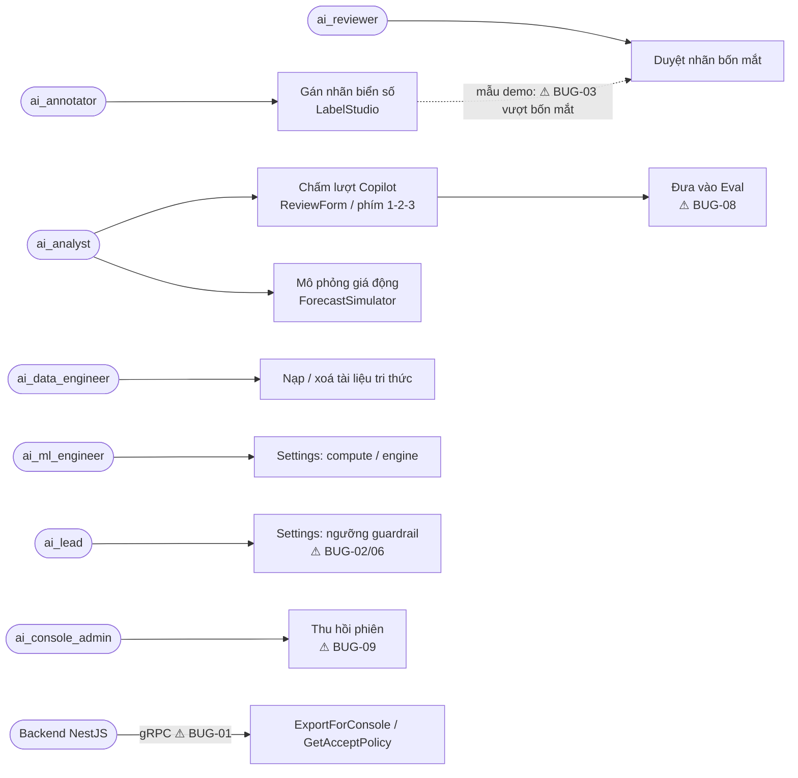
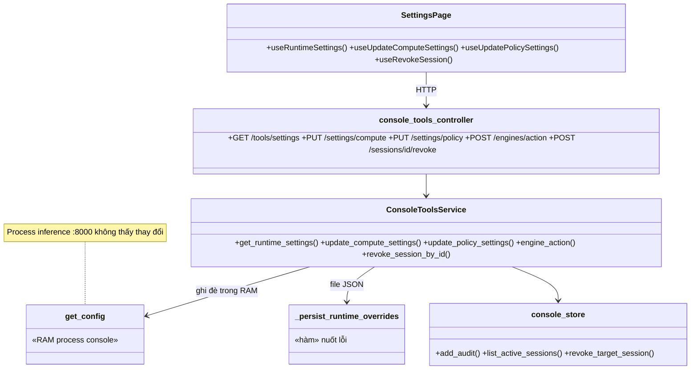

# 🔎 AUDIT-006: Audit WIP AI Console ngày 25/10/2026 và đề xuất UX/chức năng

> **Đích:** `docs/projects/audits/10-2026/AUDIT-006-console-wip-2026-10-25.md` · **Luật chung:** [templates/README](../../../templates/README.md)
> **Chi tiết finding:** vòng 1 (`AUDIT-006-audit-1.md`) đã mất · vòng 2: [ISSUE-019 review/audit-2.md](../../issues/10-2026/ISSUE-019-console-settings-va-don-audit-006/review/audit-2.md) · vòng 3: [ISSUE-019 review/audit-3.md](../../issues/10-2026/ISSUE-019-console-settings-va-don-audit-006/review/audit-3.md)

## 📌 Meta

| | |
|---|---|
| **ID** | AUDIT-006 |
| **Trạng thái** | ⛔ Dừng sau 3 vòng: hết P0/P1. Còn P2 (A-7 metrics seed, A-11/12, A-23, A-25, A-37, A-40, A-41) chờ người dùng chọn Deferred hoặc sửa tiếp; A-22 chờ quyết. Lộ trình: [SUGGESTION-006](../../suggestions/10-2026/SUGGESTION-006-lo-trinh-hoan-thien-ai-console.md) |
| **Ngày** | 2026-10-25 |
| **Người thực hiện** | Claude Code (điều phối + kiểm UX) · subagent auditor độc lập (convention) |
| **Phạm vi** | WIP chưa commit trên `develop` của `ai/`: 94 file, +4657/−493, cộng 3 mục untracked (`app/dependencies.py`, `app/script/seed_console_demo.py`, `ui/src/pages/Settings/`). Các file sửa trong khoảng 13:54–14:44 và **chưa có hồ sơ ISSUE**; ISSUE-011 đã merge qua PR #71. |
| **Không làm** | Không sửa mã, không stage, không commit, không mở `bug-NNN`, không sửa BOARD. Người giữ WIP quyết bước tiếp. |

## 1. Kết quả chạy kiểm

| Lớp | Lệnh | Kết quả |
|---|---|---|
| Máy quét convention | `python -X utf8 script/audit/check_diff.py`, chạy từ gốc IPLMS | `ai/`: 0 FAIL, 0 WARN. Máy quét **bỏ lọt** A-1, A-14, A-15. |
| Typecheck UI | `npx tsc --noEmit` (ai/ui) | ✅ PASS |
| Test UI | `npx vitest run` | Chạy song song: 13 worker crash (exit 134, thiếu RAM). Chạy tuần tự (`--maxWorkers=1 --no-file-parallelism`): ✅ 19 file, 93 test pass |
| Test backend | `.venv python -m unittest discover -s test` | ✅ 546 test OK, 34 skip. **Không có test nào** gọi 8 endpoint mới hay gRPC handler (A-25). |
| Browser | Console có sẵn ở `127.0.0.1:8090`, `dist` build lúc 15:51 (sau WIP) | Đã kiểm trang đăng nhập ở 375px và 1024px, theme dark: không tràn ngang, không có control thiếu tên accessible, không có vùng chạm < 24px. **Các màn sau đăng nhập chưa chạy được** (xem §5). |

## 2. Bug đề xuất mở (đã tự kiểm lại từ code các bug đánh dấu ✔)

| Mã | Mức | Finding | Mô tả ngắn | Bằng chứng |
|---|---|---|---|---|
| BUG-01 ✔ | 🔴 P0 | A-1 | Refactor xoá inline import của `console_vision_import_service` và `console_accept_policy_service` nhưng không thêm import ở đầu file. Kết quả: `ExportForConsole` (kênh A2) và `GetAcceptPolicy` (ADR-0051) ném `NameError` ở **mọi** lời gọi từ backend. | `app/api/grpc/handlers/dataset_handler.py:74`, `:85`; `git diff` chỉ có dòng `-from …` |
| BUG-02 ✔ | 🟠 P1 | A-2 | `/tools/settings/policy` luôn trả 400, vì `require_any_permission(…, "ai:policy:threshold")` đi qua `authorize_any`, mà hàm này cấm quyền cần step-up. | `console_tools_controller.py:296`, `auth_service.py:187-188`, `access_policy.py:41-43` |
| BUG-03 | 🟠 P1 | A-3 | Khi gán nhãn mẫu demo (tiền tố `a0000000-…`), nhãn được ghi dưới UUID thành viên cứng `4444…`. Người gán tự duyệt được nhãn của chính mình, tức là vượt luật bốn mắt. | `console_vision_store.py:347-366` |
| BUG-04 ✔ | 🟠 P1 | A-4 | Log in nguyên URL DB kèm mật khẩu khi tự tạo database thất bại. | `db_connection.py:115` |
| BUG-05 | 🟠 P1 | A-5 | Trang Settings báo "Đã lưu" nhưng chỉ đổi cấu hình trong RAM của process console. Process inference (8000) không đổi. `var/runtime_settings.json` không được đọc ở đâu, và lỗi ghi bị `except Exception: pass` nuốt. Đây là báo thành công giả. | `tools_service.py:192-205`, `:518-640` |
| BUG-06 | 🟠 P1 | A-6 | Ngưỡng RAG/vision, bật/tắt telemetry, retention và `llm_provider="openai"` đổi được chỉ với `ai:prompt:edit`: không step-up, không lý do, không duyệt hai người. | `console_tools_controller.py:252-305` |
| BUG-07 | 🟠 P1 | A-7 | Script seed không chặn theo môi trường. Nó `DELETE` mọi phiên bản tài liệu ARCHIVED và chèn lượt chat giả đã chấm CORRECT, làm sai số "tỉ lệ đúng". | `seed_console_demo.py:158`, `:193-260` |
| BUG-08 | 🟡 P2 | A-8 | Nút "Đưa vào Eval" gửi **câu trả lời của bot** vào trường `query`. | `ChatMessageBubble.tsx:58-66` |
| BUG-09 | 🟡 P2 | A-9/A-10 | `is_current` luôn false nên người dùng thu hồi được cả phiên đang dùng. Thêm nữa, vai `ai:task:label` cũng gọi được endpoint thu hồi. | `tools_service.py:648`, `console_tools_controller.py:320-324` |
| BUG-10 ✔ | 🟡 P2 | A-17 | Phím `1` toàn cục ghi verdict CORRECT ngay lập tức: không xác nhận, không bỏ qua phím bổ trợ (Ctrl+1 để đổi tab trình duyệt cũng chấm), và ghi đè được lượt đã chấm. | `ReviewForm.tsx:31-55` |
| BUG-11 | 🟡 P2 | A-23 | Thứ tự thử cổng 5432 chạy trước 5435, cộng thêm việc tự `CREATE DATABASE`, nên có thể ghi dữ liệu sang một Postgres khác trên máy dev. | `db_connection.py:47`, `:63-72` |
| BUG-12 | 🟡 P2 | A-11/A-12 | Kiểu của ForecastSimulator lệch field so với dict BE. `model_version "lightgbm-prophet-v1.4"` và số 168 bản ghi là hằng bịa, còn lý do giá động luôn là chuỗi cứng. | `ForecastSimulator.tsx:50-66`, `tools_service.py:450-482` |

Danh sách đủ 37 finding (1 P0, 6 P1, 20 P2, 10 P3) nằm trong file vòng 1 `AUDIT-006-audit-1.md` (đã mất; các finding còn hiệu lực được chép lại ở ISSUE-019 review/audit-2.md). Ba finding cần người dùng hoặc ADR quyết trước khi sửa:

- **A-20:** `router.py` kéo mã console vào process inference, trái ADR-0048 §1.
- **A-21:** `app/dependencies.py` phá bảng tầng.
- **A-22:** đổi lược đồ pgvector mà chưa qua cổng schema.

## 3. Đề xuất UX / chức năng (xếp theo ưu tiên)

| # | Đề xuất | Được | Mất / chi phí |
|---|---|---|---|
| **S1** | **Ngưỡng guardrail đổi qua luồng "đề xuất → duyệt bốn mắt"**, dùng lại mô hình `accept_policy` của ADR-0051. Trước khi duyệt, chạy tập held-out (ISSUE-007) ở ngưỡng mới và hiện **tỉ lệ từ chối đúng / từ chối nhầm trước-sau**. Sửa được tận gốc BUG-02 và BUG-06. | Đổi ngưỡng có số đo, có người duyệt, có audit. Đúng văn hoá bốn mắt của Console. | Thêm 1 bảng có version và 1 màn duyệt. Cần cổng schema. |
| **S2** | **Settings nói thật trạng thái áp dụng:** lưu cấu hình vào DB console có version và audit, thay cho file JSON. Mỗi mục hiển thị một trong ba trạng thái "Đã áp cho console", "Chờ inference nạp lại" hoặc "Cần khởi động lại", kèm diff trước-sau và nút hoàn tác về version trước. Sửa BUG-05. | Hết báo lưu giả. Dễ truy vết ai đổi gì. | Process inference cần cơ chế đọc lại cấu hình (poll hoặc RPC). |
| **S3** | **Phím tắt chấm lượt an toàn:** bỏ qua khi có Ctrl/Meta/Alt; chỉ nhận phím khi focus nằm trong panel review; khoá khi `isPending`; lượt đã chấm thì hỏi xác nhận; thêm toast "Hoàn tác (5 giây)". Sửa BUG-10. | Không chấm nhầm, nên số "tỉ lệ đúng" sạch. | Nhỏ, khoảng nửa ngày. |
| **S4** | **"Đưa vào Eval" thành hộp thoại xác nhận** gồm câu hỏi gốc, câu trả lời kỳ vọng (sửa được) và nguồn trích. Nối vào SUGGESTION-005 (bộ hồi quy và so A/B). Sửa BUG-08. | Bộ eval sạch từ đầu. | Nhỏ đến vừa. |
| **S5** | **Forecast Simulator ghi rõ nguồn số liệu:** khi dữ liệu thật dưới `min_records` (log hiện báo "Tự động bổ sung baseline telemetry"), hiện nhãn "Dữ liệu mô phỏng". `model_version` lấy từ artifact thật, không hardcode. | Đúng Hallmark #2 "không bịa số". Demo không gây hiểu lầm. | Nhỏ. |
| **S6** | **Phiên đăng nhập rõ ràng:** đánh dấu "Phiên này" (không cho tự thu hồi, hoặc cảnh báo là sẽ đăng xuất); hiện thiết bị, IP rút gọn, lần hoạt động cuối; xác nhận trước khi thu hồi. Chỉ admin/lead thấy phiên của người khác. Sửa BUG-09. | An toàn, dễ hiểu. | Nhỏ. |
| **S7** | **Đăng nhập giữ deep link:** truyền `returnTo` qua OAuth state, để mở `/console/settings` khi chưa đăng nhập thì sau login quay về đúng trang thay vì trang mặc định theo vai. Form khẩn cấp cần nhãn hiển thị, vì placeholder `admin@iplms.internal` không thay được label. | Ít thao tác, đạt a11y. | Nhỏ. |
| **S8** | **Một nguồn danh sách bãi đỗ:** lấy danh sách bãi từ API thay cho 3 danh sách cứng đang lệch nhau (ChatInput, Ingest/CopilotSection, Forecast). Liên quan A-33. | Hết lệch dữ liệu giữa màn. | Cần endpoint hoặc fixture chung. |
| **S9** | **Command palette Ctrl+K toàn cục**, lọc theo quyền: nhảy giữa 10 màn và chạy hành động nhanh như "nạp tài liệu" hay "mở lượt chưa chấm". Hiện Ctrl+K chỉ focus ô chat của ChatStudio. | Thao tác nhanh cho người dùng nội bộ dùng hằng ngày. | Vừa. Cần tránh trùng phím với ChatStudio. |
| **S10** | **Vitest không crash trên máy 16 GB:** đặt `maxWorkers` (ví dụ 2) trong `vitest.config`. | Lệnh `pnpm test` mặc định chạy được, AI agent khỏi báo đỏ giả. | Suite chậm hơn vài giây. |

## 4. Sơ đồ

### 4.1 Use case: các thao tác WIP chạm tới



### 4.2 ERD: dữ liệu WIP đọc và ghi (gồm cả phần đang ngoài DB)

```mermaid
erDiagram
  console_member ||--o{ console_session : "có"
  console_member ||--o{ audit_event : "thực hiện"
  console_member ||--o{ vision_label : "gán (annotator)"
  console_member ||--o{ vision_label : "duyệt (reviewer khác người)"
  vision_sample ||--o{ vision_label : "được gán"
  knowledge_document ||--o{ knowledge_document_versions : "phiên bản"
  knowledge_document_versions ||--o{ knowledge_chunk : "chunk pgvector"
  copilot_turn ||--o| turn_review : "được chấm"
  RUNTIME_SETTINGS_JSON {
    string note "var/runtime_settings.json — không ai đọc lại (BUG-05)"
  }
  EVAL_CANDIDATES_JSON {
    string note "var/eval_candidates.json — chứa câu hỏi người dùng (A-37)"
  }
  console_session { uuid session_id PK; uuid member_id FK; timestamptz revoked_at }
  audit_event { bigint id PK; string action; string target_type; string summary }
```

### 4.3 Class / module: luồng Settings hiện tại



## 5. Gap: những gì chưa kiểm được

- **Các màn sau đăng nhập trong browser** (Settings, Copilot Lab, LabelStudio filmstrip, Forecast, rail thu gọn, theme sáng): đăng nhập cần Google hoặc admin khẩn cấp có TOTP. Việc tạo tài khoản test cục bộ đã **bị từ chối quyền** nên không làm. Tương phản `#fff` trên nền accent và a11y của phím tắt toàn cục vì vậy chưa đo.
- **DB thật:** 6 test skip. Chưa chạy nhánh thu hồi phiên, nhãn demo, fallback `DOUBLE PRECISION[]` và quyền CREATEDB.
- **gRPC qua backend:** BUG-01 mới xác nhận bằng đọc code và AST, chưa gọi thật.
- **Hai process 8000 + 8090 chạy cùng lúc:** cần để chứng minh BUG-05 bằng runtime.
- **Hiệu năng `GET /tools/settings`** (A-26: import torch và chạy `nvidia-smi` trong event loop): chưa đo.

## 6. Bước tiếp đề xuất

1. Người giữ WIP mở hồ sơ ISSUE cho đợt này (theo `iplms-doc-flow`), rồi mở BUG-01 → BUG-12 sau khi tra trùng trong `docs/projects/bugs/`.
2. Fixer làm theo thứ tự A-1 → A-2/A-6 → A-3, A-4 → A-5 → A-7, rồi viết test cho route và handler (A-25). Auditor soát vòng 2 trên delta.
3. Chủ dự án quyết A-20, A-21, A-22, và chọn chấp nhận S1/S2 (đổi thiết kế Settings) trước khi fixer sửa BUG-05/06, để tránh sửa hai lần.
