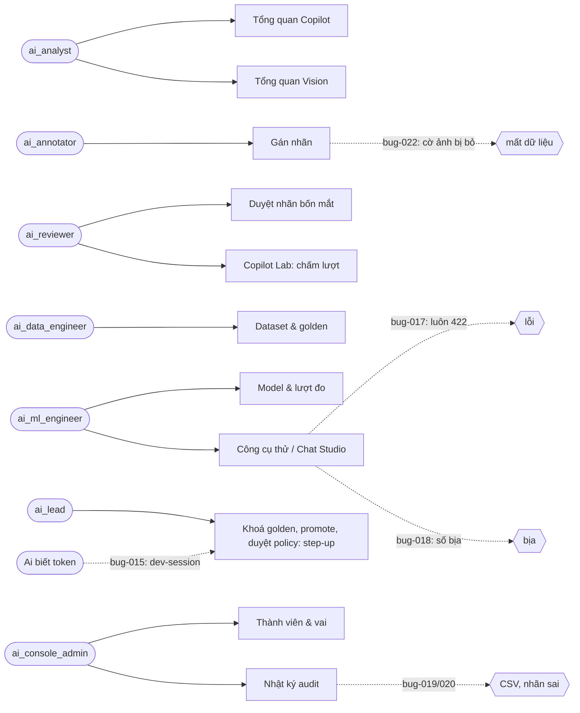
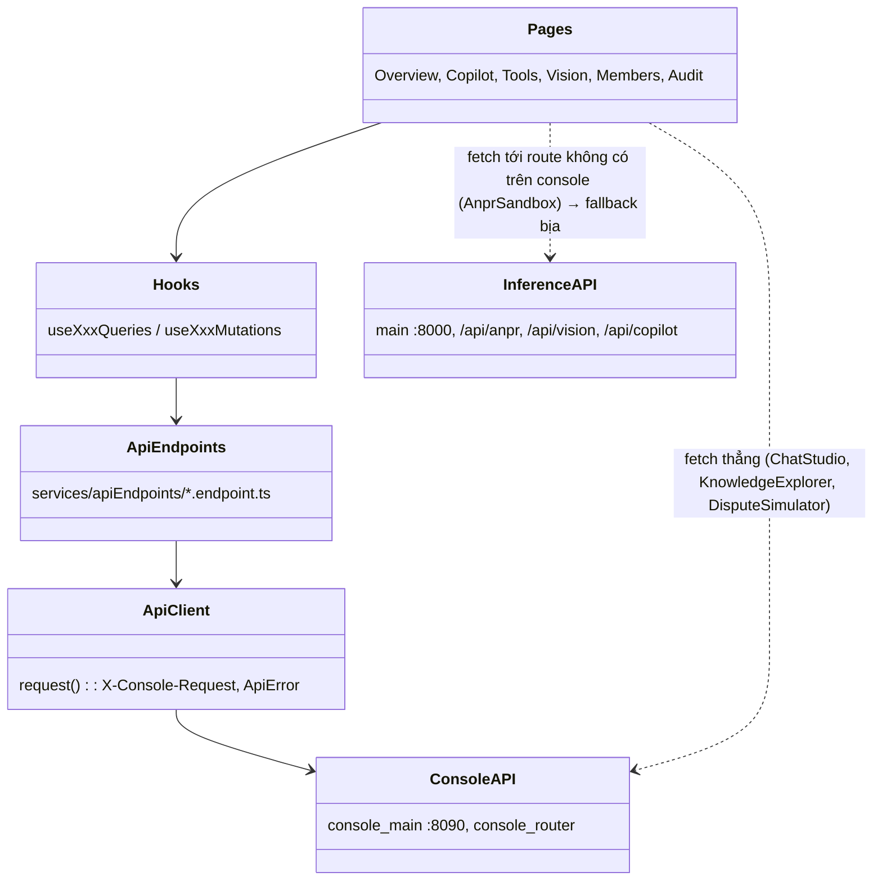
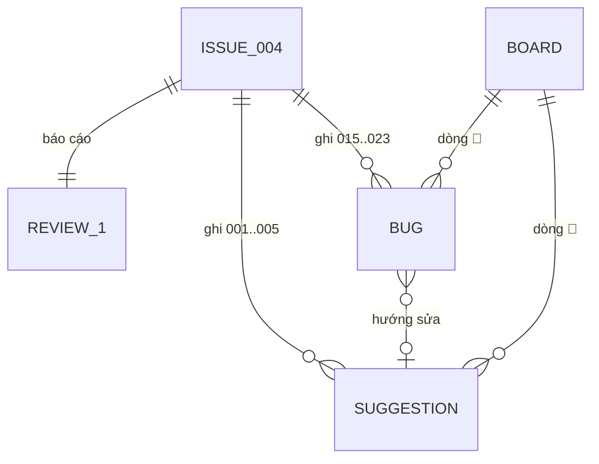

# review-1 — Rà AI Console `ai/ui` (REA + browser), 2026-10-23

> Hồ sơ cha: [ISSUE-004](../issue.md) · Revision rà: `ai@5f8e753` (develop) · Người rà: Claude Code · Ảnh: [`../evidence/`](../evidence/)

## Kết quả

Phần lõi console (Tổng quan, Copilot Lab dạng nhật ký, Thành viên, Nhật ký, các trang Vision) dựng gọn và có nền RBAC tốt. Nhưng có **4 bug 🔴 cần xử lý trước buổi bảo vệ**:

- cửa hậu đăng nhập [bug-015](../../../../bugs/bug-015-dev-session-cua-hau-dang-nhap/bug.md);
- mật khẩu DB console viết thẳng trong code, [bug-016](../../../../bugs/bug-016-mat-khau-db-console-mac-dinh-trong-code/bug.md);
- Chat Studio luôn nhận 422, [bug-017](../../../../bugs/bug-017-chat-studio-luon-422/bug.md);
- bảy chỗ UI bịa kết quả khi API lỗi, [bug-018](../../../../bugs/bug-018-ui-bia-ket-qua-khi-api-loi/bug.md).

Phần lớn số này đến từ đợt "studio" của ISSUE-003. Suite test UI vẫn xanh (48/48) vì các test mock `fetch` nên không bắt được những lỗi trên.

## Sơ đồ

### Use case: 7 vai và màn hình console

### Module: tầng UI và chỗ đi vòng

### ERD: hồ sơ sinh ra từ lượt rà

Dữ liệu ở đây là file và frontmatter, không phải DB.

## Bug

| Mã | Mức | Tóm tắt | Bằng chứng | Trạng thái |
|---|---|---|---|---|
| BUG-01 → [bug-015](../../../../bugs/bug-015-dev-session-cua-hau-dang-nhap/bug.md) | 🔴 | `/auth/dev-session` cấp phiên bằng token cố định, không cần Google hay TOTP, có nút trên trang đăng nhập | `console_auth_controller.py:138-142`, `LoginPage.tsx:108-113`, `evidence/01-login.png` | 🆕 ghi hồ sơ |
| BUG-02 → [bug-016](../../../../bugs/bug-016-mat-khau-db-console-mac-dinh-trong-code/bug.md) | 🔴 | Mật khẩu mặc định của role `ai_console` nằm trong code | `app/script/harden_console_db.py:72` | 🆕 |
| BUG-03 → [bug-017](../../../../bugs/bug-017-chat-studio-luon-422/bug.md) | 🔴 | Chat Studio gửi `min_similarity/top_k/temperature`, `AskIn` cấm trường thừa → 422 | Tái hiện bằng `AskIn.model_validate`; `ChatStudio.tsx:128-154` | 🆕 |
| BUG-04 → [bug-018](../../../../bugs/bug-018-ui-bia-ket-qua-khi-api-loi/bug.md) | 🔴 | 7 chỗ hiện kết quả bịa: ANPR 0.985, refund giả, diagnostics hằng số, "Kiểm tra kết nối" giả, forecast hằng số… | Bảng `file:line` trong bug; `evidence/04-tools.png` | 🆕 |
| BUG-05 → [bug-019](../../../../bugs/bug-019-audit-xuat-csv-khong-escape/bug.md) | 🟠 | Xuất CSV audit không escape: vỡ cột, dính formula injection | `AuditPage.tsx:100-113` | 🆕 |
| BUG-06 → [bug-020](../../../../bugs/bug-020-audit-tu-dien-hanh-dong-lech-server/bug.md) | 🟡 | Từ điển hành động `ai:…` không khớp mã server → nhãn thô, nhóm và số đếm sai | `AuditActionBadge.tsx:12-127`; `evidence/06-audit.png` | 🆕 |
| BUG-07 → [bug-021](../../../../bugs/bug-021-bieu-do-xu-huong-cat-nhan-ngay/bug.md) | 🟡 | Trục ngày `slice(0,5)` → "Thứ 7", "CN, 1" | `TrendChart.tsx:196`; `evidence/02-overview.png` | 🆕 |
| BUG-08 → [bug-022](../../../../bugs/bug-022-thuoc-tinh-anh-gan-nhan-khong-luu/bug.md) | 🟡 | Cờ thuộc tính ảnh khi gán nhãn không được gửi lên server | `LabelWorkspace.tsx:56-70` | 🆕 |
| BUG-09 → [bug-023](../../../../bugs/bug-023-che-do-en-tron-tieng-viet/bug.md) | 🟡 | EN trộn tiếng Việt: 419 dòng viết cứng / 47 file | Đếm bằng script; kiểm browser `/vision/label` | 🆕 |

### Cần người quyết

| Mã | Câu hỏi | Ai quyết |
|---|---|---|
| OPEN-01 | bug-017: backend nhận tham số Playground (a), hay UI bỏ chúng (b)? | Techlead + Khoa (Copilot/M2) |
| OPEN-02 | bug-022: lưu cờ ảnh (SUGGESTION-004) hay gỡ khối này khỏi UI? | Khoa (ANPR) + techlead |
| OPEN-03 | Các studio mô phỏng (Forecast, Dispute, ANPR Sandbox, Knowledge Explorer): giữ làm demo có nhãn **MÔ PHỎNG** cố định, hay gỡ tới khi có API thật? | Chủ dự án |
| OPEN-04 | bug-015/016 là bảo mật và hạ tầng DB, nằm ngoài phần UI của Phát và phần AI của Khoa/Dương. Đề xuất HiTranquility (người giữ M1, auth) nhận; chủ dự án xác nhận | Chủ dự án |
| OPEN-05 | AUDIT-005 ghi "0 vi phạm" sau khi `9ec3afc` đã thêm dev-session. Cần đính chính và rà lại cổng I-2 | Chủ dự án / người review độc lập |

## Đánh giá UI/UX từng tính năng

Ảnh chụp bằng REA ở 1424×805, theme tối, VI, với API giả. Theme sáng chưa chụp.

| Màn hình | Ổn | Chưa ổn | Đánh giá |
|---|---|---|---|
| Đăng nhập ([ảnh](../evidence/01-login.png)) | Thẻ gọn, VI/EN, nút Google rõ | Nút "Truy cập nhanh … Full 7 Roles" (bug-015); nền sao động và quầng sáng trái luật "không gradient/glow" (`ui/DESIGN.md:72`); chữ trên thẻ không qua i18n; badge "Gateway Online" luôn xanh dù `/me` trả 401 | 🟠 |
| Tổng quan Copilot ([ảnh](../evidence/02-overview.png)) | 4 KPI rõ, có mẫu số ("trên 40 lượt đã chấm"), chọn 7/30/90 ngày | Trục ngày hỏng (bug-021); dòng tóm tắt gọi lượt `SUCCESS` là "đúng", dễ lẫn với tỉ lệ đúng do người chấm | 🟡 |
| Copilot Lab, nhật ký ([ảnh](../evidence/03-copilot.png)) | Lọc theo trạng thái và phản hồi, PII đã che, danh sách hai cột | Thời gian hiện trước ngày ("07:15:00 20/10/26"), khó quét; chưa có nút "gom vào bộ eval" như mô tả trang hứa (SUGGESTION-005) | 🟢 |
| Copilot Lab, Chat Studio | Bố cục 3 cột, có Inspector telemetry | Mọi câu hỏi đều 422 (bug-017); Dispute Simulator và Knowledge Explorer hiện dữ liệu bịa (bug-018) | 🔴 |
| Công cụ thử ([ảnh](../evidence/04-tools.png)) | Gom chẩn đoán, dự báo, hỏi thử, nạp tri thức về một chỗ | Chẩn đoán là hằng số (bug-018); thẻ "Quy chuẩn kiến trúc" là nội dung tài liệu tĩnh, không có giá trị vận hành, **nên bớt**; dự báo bịa | 🔴 |
| Thành viên ([ảnh](../evidence/05-members.png)) | KPI, tìm kiếm, mời kèm vai, bắt buộc nhập lý do 3-500 ký tự | Nút "Phân vai trò" bị xuống dòng trong cột hẹp; ngày mời có cả giây | 🟢 |
| Nhật ký ([ảnh](../evidence/06-audit.png)) | Tìm kiếm, lọc, modal chi tiết, xuất CSV/JSON | Nhãn và nhóm sai (bug-020); CSV không an toàn (bug-019) | 🟠 |
| Tổng quan Vision ([ảnh](../evidence/07-vision.png)) | Chỉ số có khoảng tin cậy 95%, ngưỡng đề xuất có lý do, tách nguồn console và moderator: điểm mạnh | Có **hai chú giải mâu thuẫn màu**: chú giải trên ghi xanh = độ chính xác, vàng = tỉ lệ tự nhận (`AccuracySection.tsx:87-95`); chú giải dưới của `ThresholdCurve` ghi vàng = đúng, xanh chấm = mục tiêu. Biểu đồ chỉ chiếm khoảng 60% chiều rộng thẻ | 🟡 |
| Gán nhãn ([ảnh](../evidence/08-label.png)) | Phím 1/2/3, zoom, đảo màu, tương phản, đếm hàng đợi | Cờ ảnh bị bỏ (bug-022); ID bị cắt "cap-0..."; phím tắt của nút "Đúng 100%" hiện ô vuông trống; khi ảnh lỗi, khung fallback là một dải dọc hẹp | 🟡 |
| Duyệt nhãn ([ảnh](../evidence/09-review.png)) | Bốn mắt rõ, lọc "Khớp 100% / Đã sửa", nút Duyệt và Trả lại | Ảnh lỗi chỉ có icon, thiếu chữ thay thế; "cổng xác nhận —" không giải thích lý do trống | 🟢 |
| Dataset & golden ([ảnh](../evidence/10-datasets.png)) | Mô tả rõ luật chống rò rỉ train/test, nút khoá golden nổi bật | KPI "Ảnh biển số đã gom cụm" cộng dồn mẫu của mọi snapshot, nên một mẫu nằm ở nhiều snapshot bị đếm nhiều lần | 🟢 |
| Model & lượt đo ([ảnh](../evidence/11-models.png)) | Luồng đăng ký → đo → đề xuất → promote đúng ADR | Preset và "Kiểm tra kết nối" bịa (bug-018); ô `artifact_key` lệch hàng so với các ô khác | 🟠 |
| Mobile 375px | Không tràn ngang, bảng cuộn trong khung | Sidebar chiếm trọn màn đầu (`main.top = 812px`), xem SUGGESTION-003 | 🟡 |

## Độ khớp với quy chuẩn và quy trình

| Chuẩn | Khớp? | Ghi chú |
|---|---|---|
| `ui/DESIGN.md` §Luật 2 "Không bịa số" | ❌ | bug-018: 7 chỗ |
| `ui/DESIGN.md` §Luật 3 "Không gradient/glow", §Luật 8 "Màu chỉ qua token" | ❌ | 161 màu hex/rgb viết thẳng trong 25 file `*.module.css` (nhiều nhất `RoleBadge` 44, `LoginPage` 22, `AuditActionBadge` 15); 95 object `style={{…}}` trong TSX; 5 gradient. ISSUE-003 ghi "100% token CSS, 0 pixel cứng", điều đó không đúng |
| `ui/DESIGN.md` §Ngôn ngữ, quality-gate L6 | ❌ | bug-023 |
| AI_CONVENTIONS §Console: mọi request ghi gửi `X-Console-Request`, gọi qua `apiClient` | ⚠️ | Có gửi header, nhưng 5 component `fetch` thẳng với `apiBase` tự đoán theo `location.pathname`, bỏ qua `ApiError`/i18n lỗi và hook React Query (ChatStudio, KnowledgeExplorer, DisputeSimulator, AnprSandbox ×2) |
| IPLMS ADR-0048 (đăng nhập Google + TOTP, không lộ bề mặt) | ❌ | bug-015; `console_router` gắn ở cả `/console/api` lẫn `/api` (`console_main.py:75-76`), tức gấp đôi bề mặt API |
| Quality-gate L5 (viewport × theme × role, console 0 lỗi) | ⚠️ | Desktop dark 11 màn: không lỗi console ngoài log của Vite. Theme sáng và 768px: **chưa chạy**. Role: chỉ admin, chưa thử annotator |
| L7 bảo mật | ❌ | bug-015, bug-016, bug-019 |
| L8 quan sát và phục hồi | ❌ | Fallback im lặng thay vì báo lỗi (bug-018) |
| Quy trình: test bắt lệch hợp đồng | ❌ | Test mock `fetch` không có test hợp đồng UI↔Pydantic (SUGGESTION-002) |
| Quy trình: review độc lập | ❌ | AUDIT-005 đóng "0 vi phạm" sau commit dev-session; ISSUE-003 tự check tiêu chí "100% token" mà không có số đo |
| Test UI | ✅/⚠️ | `pnpm typecheck` pass; `vitest` 12 file / 48 test pass với `--maxWorkers=1`, còn chạy mặc định thì 11 lỗi timeout khởi động worker trên máy dev |

## Nên thêm / nên bớt

| # | Đề xuất | Được | Mất |
|---|---|---|---|
| S1 | **Bớt** fallback bịa; studio nào giữ thì gắn nhãn MÔ PHỎNG cố định (bug-018, OPEN-03) | Số trên console đáng tin, đúng ADR | Demo bớt "mượt" khi chưa có API thật |
| S2 | **Thêm** đăng nhập dev theo vai, an toàn ([SUGGESTION-001](../../../../suggestions/10-2026/SUGGESTION-001-dang-nhap-dev-cuc-bo-an-toan.md)) | Gỡ chặn demo I-3 của Dương, đóng cửa hậu | Một CLI và cờ môi trường phải bảo trì |
| S3 | **Thêm** API giả có hợp đồng và smoke 7 vai × viewport × theme ([SUGGESTION-002](../../../../suggestions/10-2026/SUGGESTION-002-mock-api-va-ma-tran-browser-cho-ui.md)) | Bắt được loại lỗi như bug-017 và 018 trước khi merge | Có thể cần cài Playwright (phải hỏi trước khi cài) |
| S4 | **Thêm** sidebar thu gọn trên màn hẹp ([SUGGESTION-003](../../../../suggestions/10-2026/SUGGESTION-003-rail-thu-gon-tren-man-hep.md)) | Gán nhãn được trên tablet | Thêm một trạng thái layout |
| S5 | **Thêm** lưu cờ ảnh ([SUGGESTION-004](../../../../suggestions/10-2026/SUGGESTION-004-luu-thuoc-tinh-anh-khi-gan-nhan.md)) | Đo ANPR theo điều kiện ảnh | Đổi schema |
| S6 | **Thêm** ca hồi quy và so A/B prompt ([SUGGESTION-005](../../../../suggestions/10-2026/SUGGESTION-005-gom-luot-chat-vao-bo-eval.md)) | Một công cụ chung cho Khoa và Dương | API, bảng và job chạy eval |
| S7 | **Bớt** thẻ "Quy chuẩn kiến trúc" ở Công cụ thử, một trong hai chú giải ở Vision, mount `/api` trùng của console | Gọn hơn, bề mặt nhỏ hơn | Phải sửa link cũ nếu có chỗ nào dùng `/api` |

## Giao việc đề xuất

Theo chỉ đạo, **toàn bộ UI/UX giao Phát**. Khoa và Dương nhận phần AI, test và hợp đồng, đúng phạm vi đã chốt ở BOARD. Các bug bảo mật đề xuất giao HiTranquility (OPEN-04). Mọi dòng đã ghi vào [BOARD](../../../../BOARD.md) mục 🙋, chưa ai nhận.

| Người | Việc | Hồ sơ | Ưu tiên |
|---|---|---|---|
| **Phát** | Gỡ hoặc gắn nhãn MÔ PHỎNG cho 7 chỗ bịa; chuyển 5 `fetch` thẳng sang `apiEndpoints` + hook | bug-018 | 🔴 |
| **Phát** | Phần UI của Chat Studio sau khi chốt OPEN-01 | bug-017 | 🔴 |
| **Phát** | Sửa nhật ký audit: escape CSV, từ điển mã hành động, nhãn EN | bug-019, bug-020 | 🟠 |
| **Phát** | Bóc i18n còn sót, kèm kiểm tự động cho chữ tiếng Việt viết cứng | bug-023 | 🟡 |
| **Phát** | Trục ngày biểu đồ, hai chú giải ở Vision, các lỗi nhỏ ở trang gán nhãn | bug-021, bug-022 (phần UI) | 🟡 |
| **Phát** | Sidebar trên màn hẹp; smoke test browser theo ma trận (phối hợp Dương) | SUGGESTION-003, SUGGESTION-002 | 🟡 |
| **Phát** | Đưa màu viết cứng về token (161 chỗ), bỏ glow ở trang đăng nhập | review-1 §Độ khớp | 🟢 |
| **Dương** | Test hợp đồng body UI ↔ Pydantic cho `/tools/copilot/stream` và các route console | bug-017, SUGGESTION-002 | 🔴 |
| **Dương** | Chốt có mở endpoint mô phỏng tranh chấp thật trên console từ LangGraph workflow hay gỡ Dispute Simulator | bug-018 mục 3, ai ISSUE-001 | 🟠 |
| **Dương** | Định dạng ca hồi quy Copilot (cùng Khoa) | SUGGESTION-005 | 🟢 |
| **Khoa** | Quyết OPEN-01 (tham số Playground) về phía model và RAG | bug-017 | 🔴 |
| **Khoa** | Route ANPR thật cho Sandbox trên console (qua engine, không dùng route inference), hoặc gỡ Sandbox; thay preset model bịa bằng model có thật | bug-018 mục 1, 2, 6 | 🟠 |
| **Khoa** | Xác nhận bộ cờ ảnh cho calibration (OPEN-02) | SUGGESTION-004, bug-022 | 🟢 |
| HiTranquility *(đề xuất)* | Gỡ dev-session, đổi mật khẩu DB console, đính chính AUDIT-005 | bug-015, bug-016 | 🔴 |

## Đã kiểm thế nào

| Bước | Lệnh / công cụ | Kết quả |
|---|---|---|
| Typecheck UI | `pnpm --dir ui typecheck` | PASS |
| Test UI | `npx vitest run --maxWorkers=1` (trong `ui/`) | PASS 12 file / 48 test. Chạy mặc định thì 11 lỗi "Timeout waiting for worker", do môi trường |
| Chạy UI | `npx vite` (5190) + API giả `evidence/mock_console_api.py` (8090) ở chế độ anon và admin | Render 11 màn hình |
| REA | Chrome headless có CDP (Windows) ↔ REA trong WSL qua đường hầm TCP ngược (WSL ở chế độ NAT nên không thấy loopback của Windows) → `inspect_web_page` (a11y, console, network) và `capture_web_screenshot` × 11 | OK; ảnh trong `evidence/` |
| Browser pane | 375×812 trên `/vision/label`, `/audit`; đổi EN trên `/vision/label` | Đo `main.top`, `scrollWidth`; xác nhận EN trộn VI |
| Hợp đồng API | `.venv` của `ai/`: `AskIn.model_validate({...5 trường})` | `extra_forbidden` × 3 (bug-017) |
| Đọc code | grep và đọc `file:line` cho từng bug | Ghi trong từng hồ sơ |
| Theme sáng, 768px, đăng nhập thật, DB thật | — | **NOT RUN**. Không có tài khoản test hay DB cục bộ được phép đọc (`.env` bị cấm), nên đăng nhập thật ghi BLOCKED |
| Parse mermaid | `npx -y @mermaid-js/mermaid-cli …` | **NOT RUN**. Ổ C còn khoảng 200 MB, không đủ cho Chromium của mermaid-cli, và lệnh này sẽ tải package mới |
