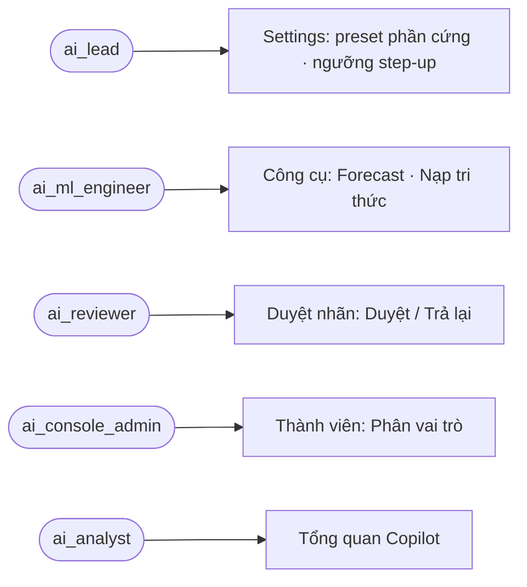
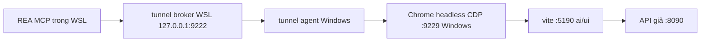

# review-1: Rà UI AI Console bằng REA và browser (ISSUE-019 chặng 3)

> Hồ sơ cha: [ISSUE-019](../issue.md) · Cách dựng lặp lại [ISSUE-004 review-1](../../ISSUE-004-ai-console-ui-review/review/review-1.md) §Đã kiểm thế nào.

**Kết quả một dòng:** 11 màn không có lỗi console và không có control thiếu tên accessible. Lượt rà tìm ra 6 lỗi UI và đã sửa hết: 4 lỗi a11y, 1 lỗi tràn ngang ở 375px (`/tools`, `/settings`), 1 lỗi preset hiện loading cả 3 nút. tsc PASS, vitest 93/93.

## Sơ đồ

### Use case các màn đã rà

### Dựng môi trường rà

ERD và class diagram không áp dụng: lượt này chỉ sửa giao diện, không đổi dữ liệu hay module.

## Bug

| Mã | Mức | Màn | Bằng chứng | Trạng thái |
|---|---|---|---|---|
| BUG-01 | 🟠 | `/tools` @375px | `scrollWidth` 681px, gây ra bởi `.mainGrid` `1fr` (min-content của SVG và tiêu đề biểu đồ) và hàng 7 ngày `repeat(7, 1fr)` | ✅ `ForecastSimulator.module.css` `minmax(0, 1fr)`, tiêu đề `flex-wrap`; hàng tuần `auto-fill minmax(4.5rem, 1fr)`. Đo lại: 375 |
| BUG-02 | 🟡 | `/settings` @375px | `scrollWidth` 383px, do `.formGrid` `1fr` ở ≤900px | ✅ `minmax(0, 1fr)`. Đo lại: 375 |
| BUG-03 | 🟡 | `/settings` | 3 nút cùng tên "Áp dụng cấu hình này" (REA a11y); bấm 1 preset thì cả 3 nút hiện loading | ✅ `aria-label` kèm tên preset; loading theo `pendingPreset` |
| BUG-04 | 🟡 | `/` Tổng quan | Heading nhảy cấp h1 → h3/h4 | ✅ h2/h3 (`TrendChart`, `DistributionSection`, `OverviewPage`) |
| BUG-05 | 🟡 | `/vision/review` | Mỗi dòng có "Duyệt", "Trả lại…" trùng tên | ✅ tên kèm biển số (`ReviewRow`); test `CrossRoleDemoLoop` tìm theo `/^Duyệt: /` |
| BUG-06 | 🟡 | `/members`, `/tools` | "Phân vai trò" trùng tên (`title` không thành tên accessible khi đã có chữ); nút làm mới tài liệu trùng "Làm mới"; nút lọc danh mục không có `aria-pressed` | ✅ `aria-label` kèm tên người; `t.tools.refreshDocs`; `aria-pressed` |

## Đề xuất (chưa làm)

| # | Đề xuất | Được | Mất |
|---|---|---|---|
| S1 | Mô tả các bước Forecast vẫn ghi "LightGBM & Prophet" dù chưa có model nào được nạp (chặng 2 đã đổi `model_version`). Nên sửa nội dung i18n thành "chuẩn bị đặc trưng cho LightGBM/Prophet". | Không còn gây hiểu nhầm. | Nhỏ: chỉ đổi chữ. |
| S2 | Đưa bộ dựng REA (mock API, đường hầm, `summarize.py`) vào `script/` để lần sau rà chỉ cần một lệnh. | Lặp lại được, không phải dựng lại tay. | Phải bảo trì script; đường hầm phụ thuộc chế độ mạng của WSL. |
| S3 | Nhãn nút chip danh mục đang cắt chữ bằng `.split(' ')[0]` (`IngestSection.tsx`). Nên có khoá i18n ngắn riêng. | Bản EN không bị cụt chữ. | Nhỏ. |

## Đã kiểm thế nào

| Bước | Lệnh / công cụ | Kết quả |
|---|---|---|
| Chạy UI | `.claude/launch.json` (gốc): `ai-ui` (vite 5190) + `ai-ui-mock` (bản mở rộng của mock ISSUE-004, thêm `/tools/settings`, `/tools/sessions`, `/copilot/eval-candidates`, forecast; giữ ở scratchpad) | 11 màn render |
| REA | Chrome headless CDP 9229 ↔ broker trong WSL 127.0.0.1:9222. WSL NAT phản chiếu 9222 ra Windows, nên Chrome dùng cổng khác. Chạy `list_browser_targets`, rồi `inspect_web_page` (bật a11y text + console) × 11 | 0 lỗi console, 0 control thiếu tên; phát hiện tên trùng và heading nhảy cấp |
| Bố cục 375px | Browser pane, mobile preset, đo `scrollWidth`, bỏ qua phần tử nằm trong vùng cuộn ngang | Trước: `/tools` 681, `/settings` 383. Sau: 9/9 màn = 375 |
| Tương phản theme sáng | Browser pane, tính tỉ lệ WCAG cho mọi node chữ trong `/settings` | 0 node dưới ngưỡng |
| Test | `npx tsc --noEmit`; `npx vitest run --maxWorkers=1 --no-file-parallelism` | PASS; 93/93 (1 test sửa theo tên nút mới) |
| Đăng nhập thật, DB thật | — | **NOT RUN**: dùng API giả |
