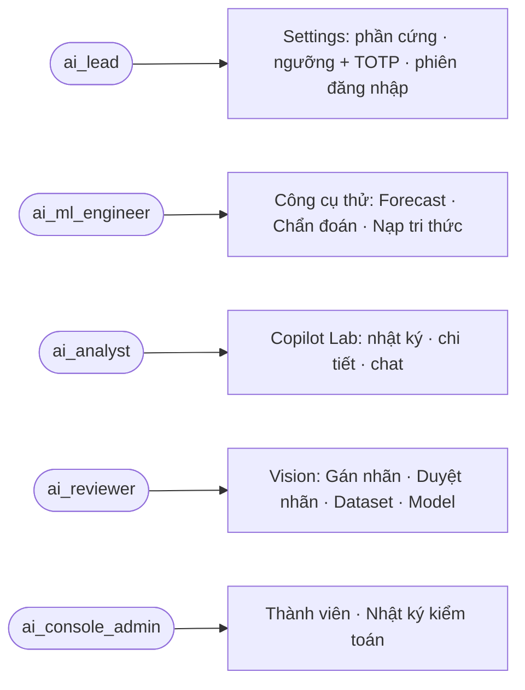
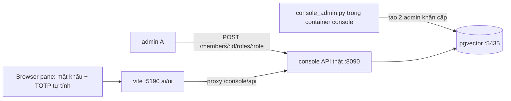

# review-2: Rà UI AI Console sau đăng nhập trên console thật (ISSUE-019)

> Hồ sơ cha: [ISSUE-019](../issue.md) · Lượt trước: [review-1](review-1.md) (chỉ rà trên API giả, chưa đăng nhập).

**Kết quả một dòng:** Đã đăng nhập console thật bằng mật khẩu và TOTP. Đi qua 11 màn và các tab con ở 375/1024 px, mỗi cỡ cả sáng lẫn tối. Luồng đổi ngưỡng (lý do → `STEP_UP_REQUIRED` → mã TOTP → lưu) chạy đúng. Lượt rà tìm ra 6 lỗi UI và đã sửa hết. Sau khi sửa, mọi màn có `scrollWidth` bằng viewport, 0 node chữ dưới ngưỡng WCAG, 0 control thiếu tên, 0 lỗi console, 0 lỗi 4xx/5xx sau đăng nhập. tsc PASS, vitest 94/94. **REA: BLOCKED** vì ổ C: chỉ còn dưới 3 GB.

## Sơ đồ

### Use case các màn đã rà

### Dựng môi trường rà

Không vẽ ERD và class diagram: lượt này chỉ sửa giao diện, không đổi dữ liệu hay module.

## Bug

| Mã | Mức | Màn | Bằng chứng | Trạng thái |
|---|---|---|---|---|
| BUG-01 | 🟠 | `/vision/label` @1024 (sáng + tối) | `scrollWidth` 1094 > 1009. Nút "Ảnh hỏng [3]" tràn khỏi màn vì `.primaryActions` cố định `repeat(3, 1fr)` trong cột form chỉ rộng ~336px. Ảnh: `evidence/review-2-label-1024-dark-before.jpg` | ✅ `LabelStudio.module.css:481` đổi sang `repeat(auto-fit, minmax(min(100%, 10rem), 1fr))`, bỏ media 600px. Đo lại: 1009/1009. Ảnh: `…-after.jpg` |
| BUG-02 | 🟠 | `/vision/label` (tối) | Link "Chuyển sang Duyệt nhãn →" có tương phản 1.80:1. Nguyên nhân: `color: var(--color-on-primary)` là token không tồn tại, nên chữ lấy màu sáng kế thừa trên nền amber | ✅ `LabelStudio.module.css:597` → `--color-accent-ink`. Đo lại: đạt |
| BUG-03 | 🟠 | `/tools` › Dự báo (sáng 3.19, tối 2.15) | Nút ngày đang chọn ("Thứ 6") và nút "Chạy Pipeline 3 Trên Backend" có `#fff` cứng trên `--color-accent` | ✅ `ForecastSimulator.tsx:391`, `:482` → `var(--color-accent-ink)` (5.79 sáng / 8.59 tối) |
| BUG-04 | 🟠 | `/vision/review` (sáng 3.19, tối 2.15) | Link "Sang Dataset & Golden →" có `#fff` cứng trên nền accent | ✅ `ReviewPage.tsx:111` → `var(--color-accent-ink)` |
| BUG-05 | 🟡 | `/tools` › Dự báo @1024 | Hàng KPI `repeat(3, 1fr)` bật theo viewport ≥ 40rem, nhưng cột thật chỉ rộng ~359px. Ô thứ 3 bị ép còn 92px, mỗi dòng chỉ một chữ ("chưa / có / mô / hình…"). Ảnh: `evidence/review-2-forecast-1024-dark-before.jpg` | ✅ `ForecastSimulator.module.css:214` đổi sang `auto-fit minmax(min(100%, 9rem), 1fr)`; `.kpiValueRow` thêm `flex-wrap`. Đo lại: 2 cột × 173px |
| BUG-06 | 🟡 | `/settings` › Phiên; `/tools`; `/audit` (sáng) | (a) 29 nút cùng tên "Thu hồi phiên". (b) Hai nhóm "Tất cả" (bộ lọc chế độ xem và bộ lọc danh mục tài liệu) không có ngữ cảnh nhóm. (c) Huy hiệu `info` ("Mời thành viên") đo 4.497:1, sát ngưỡng | ✅ (a) `SettingsPage.tsx:770` thêm `aria-label` gồm số thứ tự, tên người và giờ đăng nhập (khoá i18n `revokeSessionFor` VI+EN). (b) `IngestSection.tsx:376` thêm `role="group"` + `aria-label={t.tools.category}`. (c) `AuditActionBadge.module.css:27` `#2563eb` → `#1d4ed8` (5.83:1) |

Phát hiện thêm, đã kiểm và **không phải lỗi**:
- `/copilot` › Chat có 4 cặp tên trùng ("Đoạn chat mới", và chip câu hỏi mẫu ở hero lẫn ở thanh gợi ý). Mỗi cặp làm cùng một việc nên không gây nhầm cho trình đọc màn hình.
- Theme sáng đo ra rail 2.52:1 chỉ vì pane bị ẩn: tab chạy nền làm `transition: color 0.12s` đứng giữa chừng. Tắt transition khi đo thì đạt.
- Ô email và mật khẩu ở trang đăng nhập đã gắn `<label for>` qua `TextField`.

Ngoài `ai/ui`, chưa sửa (một agent khác đang sửa `app/`):
- Không có lỗi API: mọi request sau đăng nhập trả 200, gồm `POST /tools/forecast/simulate` và luồng step-up ngưỡng. Chỉ có `GET /me` trả 401 trước khi đăng nhập, đúng thiết kế.
- Quan sát: mỗi lần nhập sai hoặc dùng lại mã TOTP, phiên "chờ MFA" vẫn nằm trong danh sách Phiên (tài khoản QA A có 3 phiên trong cùng một phút). Không chặn rà, nhưng làm danh sách phiên phình ra. Nên xem phía `console_auth_service` có cần dọn phiên MFA chưa xong không.

## Đề xuất (chưa làm)

| # | Đề xuất | Được | Mất |
|---|---|---|---|
| S1 | Gợi ý GPU offload ở Settings ghi "33 = đẩy 100% mô hình Qwen3.5-4B", trong khi model đang cấu hình là `qwen2.5:3b`. Nên lấy tên model từ cấu hình hoặc bỏ tên cụ thể khỏi chuỗi i18n. | Không gây hiểu nhầm. | Nhỏ: chỉ đổi chữ. |
| S2 | Rà `#fff` / `#ffffff` cứng còn sót trong `ai/ui/src`, rồi thêm một test kiểu `noHardcodedVi.test.ts` cấm màu cứng ngoài các ngoại lệ DESIGN cho phép (nút Google, `AnprSandbox` mô phỏng màu biển số). | BUG-02/03/04 không lặp lại. | Phải giữ danh sách ngoại lệ. |
| S3 | Đưa script đo (`audit.js`: tràn ngang, WCAG, tên trùng, heading) và helper đăng nhập TOTP vào `script/` như S2 của review-1. | Lần rà sau chỉ cần một lệnh. | Phải bảo trì script. |
| S4 | Chạy lại REA `inspect_web_page` cho các màn sau đăng nhập khi ổ C: còn ≥ 3 GB: đặt cookie `ai_console_session` qua CDP `Network.setCookie`. | Có thêm cây a11y độc lập với Browser pane. | Chrome headless tốn đĩa. |

## Đã kiểm thế nào

| Bước | Lệnh / công cụ | Kết quả |
|---|---|---|
| Tài khoản test | `docker exec -i iplms-ai-dev-console-1 python -m app.script.console_admin` × 2, mật khẩu sinh ngẫu nhiên. Admin A cấp `ai_lead`, `ai_ml_engineer`, `ai_reviewer`, `ai_analyst` cho admin B qua `POST /members/{id}/roles/{role}` (luật bốn mắt không cho tự cấp). Mã TOTP tự tính theo RFC 6238 (hmac). Thông tin đăng nhập nằm trong scratchpad, không vào repo | PASS |
| Đăng nhập | Browser pane, `ai-ui` (vite 5190 proxy sang console thật 8090): mật khẩu → màn TOTP → vào Tổng quan | PASS |
| Đổi ngưỡng | Settings › Ngưỡng: nhập lý do → server trả `STEP_UP_REQUIRED` → hiện ô "Mã 6 số" → nhập TOTP mới → "Đã lưu ngưỡng…". Lưu nguyên giá trị cũ, không đổi cấu hình | PASS |
| Forecast | Công cụ thử › Dự báo: "Chạy Pipeline 3 Trên Backend" → `POST /tools/forecast/simulate` 200 | PASS |
| Đo tự động | Script chèn vào trang: `scrollWidth`, phần tử tràn mép phải (bỏ qua phần tử trong vùng cuộn ngang), tỉ lệ WCAG cho mọi node chữ (trộn nền nhiều lớp), tên accessible và tên trùng theo nhóm, heading nhảy cấp, `console.error`. Chạy trên 11 màn, 3 tab Settings, 4 chế độ Công cụ thử, Copilot (nhật ký, chi tiết, chat) × 375/1024 × sáng/tối | Trước: 6 lỗi như bảng Bug. Sau: 0 tràn, 0 tương phản thấp, 0 thiếu tên, 0 lỗi console |
| Mạng | `read_network_requests` lọc `/console/api` | 0 lỗi 4xx/5xx sau đăng nhập |
| Test | `npx tsc --noEmit`; `npx vitest run --maxWorkers=1 --no-file-parallelism` | PASS; 94/94 |
| REA | — | **BLOCKED**: `df` cho ổ C: còn 2.76–2.98 GB, dưới ngưỡng an toàn 3 GB, nên không bật Chrome headless và đường hầm CDP. Đã kiểm: không còn tiến trình Chrome headless, không còn cổng 9222/9229 nào đang nghe |
