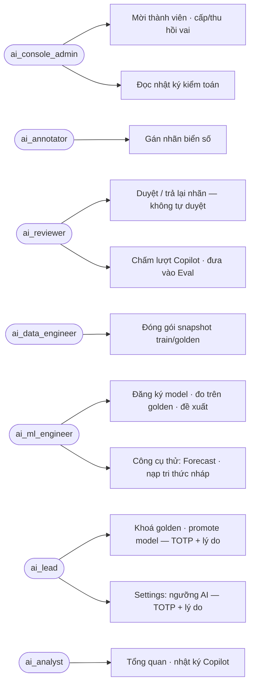

# 🏷️ ISSUE-020: Kế hoạch demo AI Console cho bên ngoài audit, nhận phản hồi rồi sửa

> **Đích:** `docs/projects/issues/10-2026/ISSUE-020-ke-hoach-demo-audit-ai-console/issue.md` · **Luật chung:** [templates/README](../../../../templates/README.md)

| | |
|---|---|
| **Trạng thái** | 📝 Draft |
| **Người nhận** | @HiTranquility |
| **Hạn** | — |
| **Ưu tiên** | 🟠 |
| **Ngày đóng** | — |
| **Người phụ trách** | HiTranquility (chuẩn bị môi trường, nhận phản hồi); Claude Code viết kế hoạch và sửa theo phản hồi |
| **Phạm vi** | `ai/`: AI Console (`ui/`, `app/console_main.py`, `app/api/rest/routes/console_*`) |
| **Ngày tạo** | 2026-10-26 |

> BOARD sinh từ Meta và bảng `📋 Việc trên BOARD` dưới đây (IPLMS ADR-0060). **[NEVER]** sửa `BOARD.md`.

## Mục tiêu

Đưa AI Console cho một bên ngoài (người chưa code phần này) tự đi demo theo từng vai và audit. Đầu ra là danh sách phản hồi có bằng chứng (màn, thao tác, thấy gì, mong gì). Đội nhận phản hồi rồi phân loại: sửa nhỏ, bug, hay SUGGESTION. Phần sửa UI và các phần khác đi theo vòng sau.

Phạm vi chỉ gồm AI Console (chủ dự án chốt 2026-10-26). Luồng sản phẩm client/operator/platform không nằm trong lượt này.

Phiếu đưa cho bên audit: [handoff/phieu-audit-1.md](handoff/phieu-audit-1.md).

## Sơ đồ

### Use case theo vai (đối chiếu `app/core/console/engines/access_policy.py:20-36`)



### Chuỗi liên vai chính (luật bốn mắt)

```mermaid
sequenceDiagram
  participant A as Annotator
  participant R as Reviewer
  participant D as Data Engineer
  participant M as ML Engineer
  participant L as AI Lead
  A->>R: nhãn chờ duyệt
  R-->>A: Trả lại (lý do ≥ 3 ký tự) hoặc Duyệt
  R->>D: mẫu đã duyệt
  D->>L: snapshot golden chờ khoá
  L->>L: Khoá golden (TOTP + lý do)
  M->>M: đo model trên golden đã khoá
  M->>L: Đề xuất model
  L->>L: Promote (TOTP + lý do; người đề xuất ≠ người promote)
```

Không vẽ ERD: lượt này không đổi dữ liệu. Không vẽ class diagram: chỉ là kế hoạch kiểm, không đổi module.

## Tiêu chí chấp nhận

- [ ] Môi trường demo dựng được theo §Chuẩn bị, và kiểm lại bằng mục "Sẵn sàng" của phiếu (mọi dòng ✅).
- [ ] Có đủ tài khoản test tách vai để thử luật bốn mắt: annotator ≠ reviewer; người đề xuất ≠ người promote (2 tài khoản `ai_lead`).
- [ ] Bên audit đi hết 9 kịch bản trong phiếu (K1…K9). Mỗi bước có kết quả ✅/⚠️/❌/BLOCKED.
- [ ] Mỗi phản hồi ⚠️/❌ được phân loại (sửa nhỏ / bug / SUGGESTION). Sửa nhỏ xong có bằng chứng trước/sau; bug có hồ sơ `bug-NNN`.
- [ ] Sau khi sửa, chạy lại đúng các bước từng ⚠️/❌ và ghi cột "Vòng 2".

## Kế hoạch

1. **Chuẩn bị môi trường** (HiTranquility, khoảng 30 phút):
   - Stack `iplms-ai-dev` chạy: `docker ps` thấy `api` (2 bản), `console`, `database-vector`, `gateway` đều healthy.
   - Build lại UI để console phục vụ bản mới nhất: `cd ai/ui && npx tsc --noEmit && npx vite build`. Bản `ui/dist` hiện có là của 2026-10-25, cũ hơn các sửa UI của ISSUE-019.
   - Mở `http://127.0.0.1:8090/console/`.
   - Kiểm: trang đăng nhập hiện, không có lỗi console.
2. **Tài khoản test** (không ghi mật khẩu vào repo):
   - Tạo 6 tài khoản bằng `docker exec -i iplms-ai-dev-console-1 python -m app.script.console_admin --email qa-<vai>@iplms.test --display-name "QA <vai>"`: annotator, reviewer, data, ml, lead1, lead2. Mỗi lần chạy in URI TOTP đúng một lần; thêm URI này vào app xác thực của bên audit.
   - Script tạo tài khoản kèm vai `ai_console_admin`. Đăng nhập bằng một tài khoản admin, vào **Thành viên** để cấp đúng vai cho từng tài khoản, rồi thu hồi vai admin ở các tài khoản không phải admin.
   - Kiểm: đăng nhập từng tài khoản, thanh điều hướng chỉ hiện đúng mục của vai đó.
   - Hai tài khoản `qa-a-*`/`qa-b-*` của lượt rà ISSUE-019 đang có trong DB dev. Có thể dùng lại làm admin.
3. **Dữ liệu demo**:
   - `docker exec iplms-ai-dev-console-1 python -m app.script.seed_console_demo` (compose dev đã bật `AI_CONSOLE_DEMO_SEED_ENABLED`).
   - Seed nạp mẫu nhãn, lượt chat, eval nhãn `[DEMO]`.
   - Kiểm: Vision › Gán nhãn có mẫu chờ; Copilot Lab có lượt.
   - Lưu ý: A-71 còn mở (lý do đề xuất ngưỡng trong seed có số tự đặt), nên bên audit sẽ thấy dòng đó.
4. **Giao phiếu** [handoff/phieu-audit-1.md](handoff/phieu-audit-1.md) cho bên audit. Họ điền cột kết quả và bảng phản hồi ngay trong phiếu, hoặc gửi lại file.
5. **Nhận phản hồi → phân loại → sửa → chạy lại** (Claude Code):
   - Sửa nhỏ làm trên nhánh của hồ sơ này, sau convention audit.
   - Bug mở `bug-NNN`.
   - Việc đổi thiết kế mở SUGGESTION, chờ techlead duyệt.
   - Kiểm: tsc, vitest, `check_diff`, rồi chạy lại đúng các bước có phản hồi.
6. Dọn: thu hồi phiên test, xoá hoặc khoá tài khoản `qa-*` sau đợt audit.

## 📋 Việc trên BOARD

| Việc | Người nhận | Hạn | Ưu tiên | Trạng thái | Ghi chú |
|---|---|---|---|---|---|
| Dựng môi trường demo + 6 tài khoản tách vai, giao phiếu audit AI Console | HiTranquility | — | 🟠 | 📝 Dự kiến — chưa bắt đầu | Kế hoạch bước 1–4 |
| Nhận phản hồi audit, phân loại và sửa UI/khác | Claude Code (qua HiTranquility) | — | 🟠 | 📝 Dự kiến — chưa bắt đầu | Kế hoạch bước 5 |

## Rủi ro đã biết khi demo

- **Đăng nhập theo vai:** chỉ tài khoản tạo bằng `console_admin` (mật khẩu + TOTP) dùng được. Google OAuth cho từng vai và [SUGGESTION-001](../../../suggestions/10-2026/SUGGESTION-001-dang-nhap-dev-cuc-bo-an-toan.md) (đăng nhập dev) chưa bật.
- **Phiên "chờ MFA" tồn đọng** ([bug-030](../../../bugs/bug-030-phien-cho-mfa-ton-dong-trong-danh-sach/bug.md)): nhập sai TOTP vài lần thì danh sách phiên ở Settings dài ra. Bên audit sẽ thấy; đây là lỗi đã biết.
- **Forecast:** id bãi trên UI lệch `area_key` ([bug-028](../../../bugs/bug-028-forecast-id-bai-lech-area-key/bug.md)), nên Forecast có thể chạy baseline.
- **P3 a11y còn mở:** A-77…A-79 của [ISSUE-019](../ISSUE-019-console-settings-va-don-audit-006/issue.md) (tablist chưa có `aria-label`, `aria-controls` lúc đang tải).
- **Ổ C: còn khoảng 6 GB:** không chạy REA hay Chrome headless trong đợt demo nếu ổ dưới 5 GB.

## Hồ sơ liên quan

- [review-1](review/review-1.md): vòng agent trên browser pane (K1–K4.3) + runner nhiều context `ui/e2e/demos/console-roles.demo.mjs`; mở [bug-033](../../../bugs/bug-033-dang-nhap-tu-goc-console-roi-vao-trang-404/bug.md).

- [ISSUE-010](../ISSUE-010-console-cross-role-demo-loop/issue.md): kịch bản 5 vai Vision (mới kiểm bằng vitest mock). Lượt này đi live.
- [ISSUE-019](../ISSUE-019-console-settings-va-don-audit-006/issue.md): Settings/TOTP, review-2 (rà browser) và các P3 còn mở.
- [ISSUE-018](../ISSUE-018-ke-hoach-theo-thanh-vien/issue.md): Dương soát PR / UI-UX / conventions có thể làm người audit nội bộ song song.
- IPLMS ADR-0048 (quyền console, step-up), ADR-0051 (accept policy), ADR-0041 (cổng chất lượng L1–L8).
