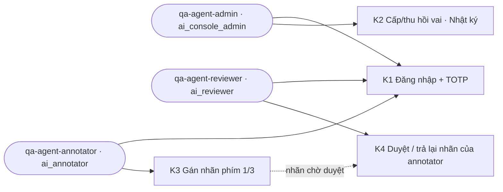

# Review 1 — Vòng agent: đăng nhập và tương tác AI Console trên browser pane + runner nhiều context

> Hồ sơ cha: [ISSUE-020](../issue.md) · Phiếu người audit: [phieu-audit-1.md](../handoff/phieu-audit-1.md) · Bản cùng kiểu cho 3 app sản phẩm: IPLMS DEM-043 (`docs/demos/10-2026/DEM-043-dang-nhap-sau-vai-tren-browser-pane.md` ở repo gốc)
>
> Ngày 2026-10-26 · Người chạy: Claude Code (phiên của @HiTranquility) · ai `6c52707` (`docs/ISSUE-020-2026-10-ai-console-demo-audit-plan`) · console `127.0.0.1:8090`, `ui/dist` build 2026-10-26 19:13

**Kết quả:** K1 (đăng nhập + TOTP), K2 (thành viên), K3 (gán nhãn), K4.1–4.3 (duyệt) chạy được trên browser pane; phát hiện 1 lỗi 🟠 mới ([bug-033](../../../../bugs/bug-033-dang-nhap-tu-goc-console-roi-vao-trang-404/bug.md)) và 1 lệch quy tắc kiểm toán 🟠 (OPEN-01). Runner nhiều context: 3 vai song song, 18/18 kiểm quyền đạt, 2 lần chạy cho kết quả giống hệt.

## Sơ đồ

Phạm vi vòng này (đối chiếu `app/core/console/engines/access_policy.py:20-36`):



Không vẽ ERD/class: vòng này không đổi dữ liệu hay module, chỉ thêm runner đọc.

## Bước, kết quả và phán đoán người dùng

✅ đúng mong đợi · ⚠️ chạy nhưng thiếu/lệch · ❌ đứt luồng · NOT RUN chưa chạy. Cột **Phán đoán** là góp ý như người dùng thật, không tự thành bug.

| # | Vai | Thao tác | Kết quả | Phán đoán người dùng |
|---|---|---|---|---|
| K1.1 | admin | Email + sai mật khẩu | ✅ "Email hoặc mật khẩu không đúng." + mã `UNAUTHENTICATED` | Rõ ràng — tốt hơn hẳn client/operator ở DEM-043 (im lặng) |
| K1.1 | admin | Đúng mật khẩu | ✅ Sang bước TOTP "Bước 2/2" | Form khẩn cấp nằm trong mục thu gọn; người không biết sẽ chỉ thấy nút Google |
| K1.2 | admin | Sai TOTP | ✅ "Mã xác thực không đúng." + `TOTP_INVALID` | Mã sai vẫn nằm trong ô, phải tự xoá mới nhập lại |
| K1.3 | admin | Đúng TOTP, vào từ `/console/` | ❌ URL `/console/console/`, trang "Không có trang này" → [bug-033](../../../../bugs/bug-033-dang-nhap-tu-goc-console-roi-vao-trang-404/bug.md) | Vừa đăng nhập thành công đã thấy trang lỗi — người mới sẽ nghĩ hệ thống hỏng |
| K1.3 | admin | Thanh trái | ✅ Chỉ "Thành viên", "Nhật ký" | — |
| K1.4 | admin | Đăng xuất → mở `/console/settings` | ✅ Hiện trang đăng nhập | — |
| K1.3 | annotator | Đăng nhập tại URL admin vừa để lại (`/console/settings`) | ⚠️ Vào được, thanh trái chỉ "Gán nhãn", nhưng trang đầu là "Vai trò của bạn không mở được mục này" | Người sau bị đưa tới trang của người trước trên cùng máy — giống `returnUrl` ở DEM-043 |
| K2.2 | admin | Cấp `annotator`/`reviewer` cho 2 tài khoản, có lý do | ✅ Nút cấp khoá tới khi có lý do; toast "Đã cấp thành công 1 vai trò mới."; danh sách cập nhật | — |
| K2.2 | admin | Thu hồi `console_admin` (icon ✕ trên badge) | ⚠️ Một click là thu hồi ngay, không xác nhận, không hỏi lý do → OPEN-01 | Bấm nhầm là mất quyền của người khác, không có bước "chắc chưa?" |
| K2.3 | admin | Nhật ký | ✅ Đủ 4 sự kiện, người làm, giờ | Dòng thu hồi chỉ ghi "Thu hồi trực tiếp từ bảng quản trị thành viên" — đọc lại không biết vì sao |
| K2.4 | admin | Mở `/console/vision/label` | ✅ "Vai trò của bạn không mở được mục này" | — |
| — | admin | Danh sách thành viên | ⚠️ Tài khoản tạo bằng `console_admin` (mật khẩu + TOTP) vẫn hiện "Đã mời", thống kê ghi "Chờ đăng nhập Google" | Nhãn sai với tài khoản khẩn cấp — admin tưởng chưa ai kích hoạt |
| K3.1 | annotator | Phím `1` | ✅ Gửi nhãn 200, hàng đợi 2→1, tự sang mẫu kế | Không có xác nhận nhỏ nào ("đã lưu") — chỉ thấy số đổi |
| K3.3 | annotator | Phím `3` (ảnh hỏng) | ✅ Gửi nhãn 200, hàng đợi 0, hiện gợi ý nạp mẫu thực hành | — |
| K3.4 | annotator | Mở `/console/vision/review` | ✅ Bị chặn | Trang Gán nhãn vẫn có nút "Chuyển sang Duyệt nhãn →" cho annotator — bấm vào là gặp trang bị chặn |
| K4.1 | reviewer | Duyệt nhãn 30E-123.45 của annotator | ✅ Thẻ biến mất, hàng chờ 9→8 | Không toast, không hoàn tác — thẻ "biến mất" khó biết đã duyệt hay lỗi |
| K4.2 | reviewer | Trả lại với lý do 2 ký tự | ⚠️ Nút khoá, không có chữ nhắc (đã có PH-02 / SUGGESTION-007) | Như PH-02 |
| K4.3 | reviewer | Trả lại với lý do đủ dài | ✅ `decision` 200, hàng chờ 8→7 | Chưa kiểm phía annotator thấy lại nhãn bị trả |
| — | reviewer | Thẻ "Ảnh hỏng" | ⚠️ Vẫn gắn chip "Khớp 100%" | Ảnh hỏng mà "khớp 100%" — mâu thuẫn, dễ duyệt nhầm |
| K4.4 | reviewer | Tự gán rồi tự duyệt | NOT RUN — hàng đợi A2 hết mẫu; cần nạp mẫu thực hành | — |
| K5–K9 | — | — | NOT RUN — chưa có tài khoản data/ml/lead1/lead2 cho agent | — |

## Runner nhiều context

[`ui/e2e/demos/console-roles.demo.mjs`](../../../../../../ui/e2e/demos/console-roles.demo.mjs): mỗi tài khoản một cookie jar riêng, các vai chạy **song song** nên không đá phiên nhau (điều browser pane không làm được vì mọi tab chung cookie). Mỗi vai: sai mật khẩu → đúng → sai TOTP → đúng → `/me` → 6 endpoint đọc, so mã HTTP với `permissions` mà `/me` trả về → đăng xuất → `/me` phải 401. Không gán/duyệt/đổi vai, nhưng mỗi lần chạy có tạo phiên và ghi audit `auth.login`/`auth.mfa`/đăng xuất — các dòng này sẽ hiện ở trang Nhật ký mà người audit soát. Vai thiếu biến hoặc console tắt → dòng `BLOCKED` của riêng vai đó, các vai khác vẫn chạy. Không cần cài package (Node 22 `fetch`).

```bash
# trong ai/, console đang chạy; tài khoản qua env AI_QA_<ROLE>_EMAIL/_PASSWORD/_TOTP_SECRET (không ghi vào repo)
node ui/e2e/demos/console-roles.demo.mjs
```

| Lần | Kết quả |
|---|---|
| 1 | Runner đọc sai envelope (`payload` thay vì `data`) → ❌ giả; sửa runner, không phải lỗi app |
| 2 | 3 vai · 18/18 ✅ |
| 3 và 4 | 18/18 ✅, output giống hệt nhau (bỏ dòng giờ) — chạy lại được |

Giới hạn: runner kiểm **quyền ở API**, không bấm giao diện. Muốn runner bấm UI như `frontend/e2e/demos/` thì cần thêm `@playwright/test` vào `ai/ui` — phải hỏi trước theo luật cài package.

## Bug và việc cần quyết

| # | Mức | Nội dung | Bằng chứng | Trạng thái |
|---|---|---|---|---|
| BUG-01 | 🟠 | Đăng nhập từ `/console/` rơi vào 404 | [bug-033](../../../../bugs/bug-033-dang-nhap-tu-goc-console-roi-vao-trang-404/bug.md), `ui/src/pages/Auth/LoginPage.tsx:46-49` | 🆕 Ghi hồ sơ, chưa sửa |
| OPEN-01 | 🟠 | Thu hồi vai không hỏi lý do, ghi lý do cố định vào nhật ký; README màn Thành viên ghi "bắt buộc lý do" | `ui/src/pages/Members/components/RoleForm.tsx:77` dùng `t.members.quickRevokeReason`; `ui/README.md` bảng Màn hình | Chờ chọn: bắt lý do khi thu hồi nhanh, hay bỏ nút thu hồi nhanh |
| BUG-02 | 🟡 | Tài khoản khẩn cấp hiện "Đã mời / Chờ đăng nhập Google" | Trang Thành viên, 3 tài khoản `qa-agent-*` | Chưa ghi hồ sơ — chờ xác nhận có phải ý đồ |
| BUG-03 | 🟡 | Thẻ "Ảnh hỏng" vẫn có chip "Khớp 100%" | Trang Duyệt nhãn, mẫu `a0000000-…0004` | Chưa ghi hồ sơ |
| BUG-04 | 🟡 | Tài khoản chỉ có `ai_console_admin` (2 quyền) vẫn thấy không gian "Toàn quyền (All-in-One) · LEAD DECK"; không gian đang chọn lưu ở `localStorage['iplms_active_workspace']` dùng chung mọi tài khoản trên một trình duyệt, nên người đăng nhập sau thừa hưởng không gian của người trước. Chỉ sai nhãn/điều hướng: menu vẫn lọc theo `permissions`, API chặn đúng (runner 18/18) | `ui/src/components/layout/navigation.ts:99` (`isSuper` gồm `ai_console_admin`), `ui/src/stores/useWorkspaceStore.ts:4-13` | Chờ quyết hướng sửa |
| OPEN-02 | 🟡 | Console đã chạy ở gốc `/` từ [ISSUE-003](../../ISSUE-003-console-root-routing-copilot-studio/issue.md), `/console/` chỉ còn tương thích ngược (`app/console_main.py:111-114`), nhưng `ui/README.md` và phiếu audit vẫn hướng dẫn mở `/console/` — đúng đường dính bug-033 | `ui/README.md` mục Chạy/Màn hình, `handoff/phieu-audit-1.md` "Cách dùng phiếu" | Chờ chọn: đổi tài liệu sang `/`, hay bỏ hẳn `/console/` |

## Đề xuất

| # | Đề xuất | Được | Mất |
|---|---|---|---|
| S1 | Sửa bug-033 trước khi giao phiếu cho người audit tiếp | Người audit không gặp trang lỗi ngay bước đầu | Một sửa nhỏ + vitest |
| S2 | Chốt OPEN-01 | Nhật ký kiểm toán có lý do thật | Thêm một bước khi thu hồi |
| S3 | Đưa runner vào checklist "Sẵn sàng" của phiếu | Kiểm quyền 3+ vai trong ~3 giây trước mỗi đợt audit | Phải giữ bảng endpoint → permission khớp controller |
| S4 | Ẩn nút "Chuyển sang Duyệt nhãn" với vai không có `ai:label:approve`; thêm toast khi duyệt/trả lại | Bớt ngõ cụt, thấy phản hồi | Sửa UI nhỏ |

## Đã kiểm thế nào

- Browser pane của Claude desktop, tab `127.0.0.1:8090/console/`, viewport 1280×900; đọc bằng `get_page_text`/`find`, thao tác bằng click/phím thật, kiểm `read_network_requests` sau mỗi bước. Không sửa DOM hay gọi handler.
- Tài khoản: tạo 3 tài khoản `qa-agent-{admin,annotator,reviewer}@iplms.test` bằng `python -m app.script.console_admin` (bước 2 của ISSUE-020); mật khẩu và secret TOTP chỉ nằm trong scratchpad của phiên, không vào repo. Vai được tách qua trang Thành viên (chính là K2).
- **Dữ liệu dev đã đổi:** 3 tài khoản mới; 4 sự kiện cấp/thu hồi vai; 2 nhãn của mẫu demo `a0000000-…0003` (đúng) và `…0004` (ảnh hỏng); 1 duyệt, 1 trả lại. Dọn theo bước 6 của ISSUE-020 (khoá/xoá `qa-*`).
- Runner chạy 4 lần như bảng trên.
