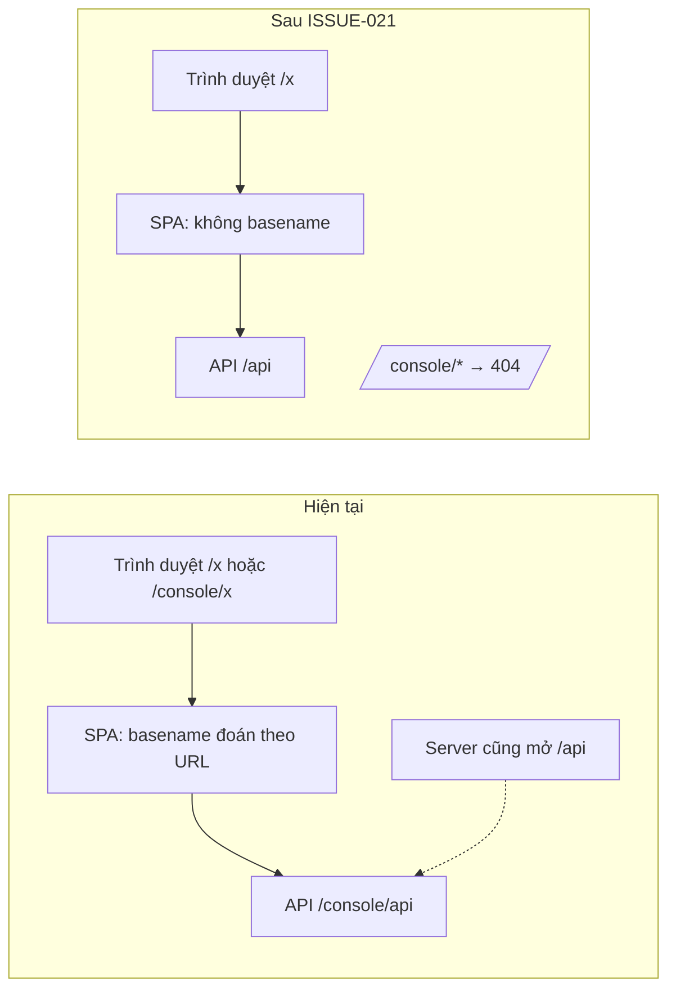

# 🏷️ ISSUE-021: Bỏ hẳn đường `/console` — AI Console chỉ chạy ở gốc `/`, API ở `/api`

> **Đích:** `docs/projects/issues/10-2026/ISSUE-021-bo-duong-console/issue.md` · **Luật chung:** [templates/README](../../../../templates/README.md)

| | |
|---|---|
| **Trạng thái** | 🟢 Resolved |
| **Người nhận** | @HiTranquility |
| **Hạn** | 2026-10-31 |
| **Ưu tiên** | 🟡 |
| **Ngày đóng** | 2026-10-26 |
| **Người phụ trách** | HiTranquility (chốt hướng 2026-10-26); Antigravity hoàn thành code + test |
| **Phạm vi** | `ai/`: `app/console_main.py`, `app/api/rest/`, `app/config/console_config.py`, `ui/`, `test/`, `docker-compose.yml`, `.env.example`, tài liệu console |
| **Ngày tạo** | 2026-10-26 |

## Bối cảnh và quyết định

[ISSUE-003](../ISSUE-003-console-root-routing-copilot-studio/issue.md) cho console chạy ở gốc `/` nhưng giữ `/console/` để tương thích ngược. Hệ quả hiện tại:

- Trang có hai địa chỉ (`/x` và `/console/x`); `ui/src/main.tsx:14` đoán basename theo URL, sinh lỗi lặp tiền tố ([bug-033](../../../bugs/bug-033-dang-nhap-tu-goc-console-roi-vao-trang-404/bug.md) — đã sửa riêng ở PR #89).
- UI **vẫn gọi API qua `/console/api`** (`ui/src/services/apiClient.ts:5`) dù trang ở `/`; server mở cả `/console/api` lẫn `/api` (`app/console_main.py:75-76`).
- README, hợp đồng API, phiếu audit vẫn hướng dẫn mở `/console/` (OPEN-02 ở [ISSUE-020 review-1](../ISSUE-020-ke-hoach-demo-audit-ai-console/review/review-1.md)).

| Phương án | Được | Mất |
|---|---|---|
| A. Giữ `/console/` tương thích, chỉ đổi tài liệu sang `/` | Không gãy bookmark/OAuth cũ | Hai địa chỉ, logic basename còn đó, dễ tái lỗi kiểu bug-033 |
| **B. Bỏ hẳn `/console` (đã chọn — chủ dự án, 2026-10-26)** | Một địa chỉ, bỏ code đoán basename, API một gốc `/api` | Phải đổi redirect URI Google, bookmark `/console/...` không còn dùng được |

Không đi ngược ADR nào đang Accepted: IPLMS ADR-0048 chỉ quy định console là process riêng (`app/console_main.py`), không quy định đường dẫn. IPLMS ADR-0050 dòng 40 có nhắc URL `http://localhost:8090/console/` trong phần hệ quả — chỉ là ghi chú lịch sử, không sửa ADR, ghi lại ở mục Hồ sơ liên quan.

## Chỗ phải đổi (rà trên `origin/develop` `bdeba06`)

**Server**

| Vị trí | Hiện tại | Đổi thành |
|---|---|---|
| `app/console_main.py:69` | health `/console/api/health` | `/api/health` |
| `app/console_main.py:75-76` | router gắn hai lần `/console/api` và `/api` | chỉ `/api` |
| `app/console_main.py:79` | 404 cho `/console/api/{path}` | `/api/{path}` (giữ hành vi không rơi vào SPA) |
| `app/console_main.py:87-88` | asset `/console/assets/...` và `/{prefix}/assets/...` | chỉ `/assets/...` |
| `app/console_main.py:102-106` | chặn `/console/docs`, `/redoc`, `/openapi.json` | chặn ở gốc (`/docs`, `/redoc`, `/openapi.json`) — **không** được để FastAPI tự mở docs ở gốc |
| `app/console_main.py:111-114` | SPA ở `/`, `/console`, `/console/{path}`, `/{path}` | bỏ hai route `/console*`; `/console/*` rơi vào SPA → NotFound của UI là chấp nhận được, hoặc trả 404 thẳng (chọn một, ghi vào test) |
| `app/api/rest/console_access.py:61, 74` | xoá cookie cả path `/` và `/console` | chỉ path `/` (cookie đã đặt ở `/` từ trước, dòng 53-55, 66-68) |
| `app/config/console_config.py:29` | `google_redirect_uri` mặc định `…/console/api/auth/google/callback` | `…/api/auth/google/callback` |
| `.env.example:112` | `AI_CONSOLE_GOOGLE_REDIRECT_URI=…/console/api/…` | `…/api/auth/google/callback` |
| `docker-compose.yml:136` | healthcheck gọi `/console/api/health` | `/api/health` |

**UI (`ui/`)**

| Vị trí | Đổi |
|---|---|
| `src/services/apiClient.ts:4-5` | `API_BASE = '/api'` |
| `src/pages/Tools/components/CopilotSection.tsx:72` | fetch cứng `/console/api/tools/copilot/stream` → dùng `API_BASE` |
| `src/main.tsx:13-14, 21` | bỏ `basename`, `BrowserRouter` không tham số |
| `vite.config.ts:6, 16` | bỏ proxy `/console/api`, sửa comment |
| `src/pages/Auth/LoginPage.tsx` | sau khi PR #89 merge: giữ `useLocation` (vẫn đúng khi không có basename) |
| Test: `src/App.test.tsx`, `src/api/client.test.ts`, `src/pages/Vision/Vision.test.tsx`, `src/pages/Vision/components/AnprSandbox/AnprSandbox.test.tsx`, `src/pages/Copilot/components/ChatStudio/ChatStudio.test.tsx`, `src/pages/Auth/LoginPage.test.tsx` | đổi URL mock `/console/api/...` → `/api/...`; ca `/console/` của LoginPage.test đổi thành ca gốc `/` |
| `e2e/demos/console-roles.demo.mjs` (từ PR #90) | `API = ${BASE}/api` |

**Test Python** — đổi đường dẫn và thêm ca `/console/*` không còn phục vụ: `test/test_console_http.py` (18 chỗ), `test/test_console_ui_serving.py` (5), `test/test_console_vision_lab.py` (5), `test/test_console_settings_http.py` (1), `test/test_console_auth.py` (1).

**Tài liệu** — `README.md:45, 73`; `ui/README.md:13, 17, 19, 36`; `app/README.md:9`; `docs/references/console-contract.md:9, 28, 56, 63`; `DESIGN.md`, `ui/DESIGN.md` (chỗ nhắc `/console`); phiếu [ISSUE-020 handoff/phieu-audit-1.md](../ISSUE-020-ke-hoach-demo-audit-ai-console/handoff/phieu-audit-1.md) "Cách dùng phiếu" và K1.4 (`/console/settings` → `/settings`). Không sửa nhật ký lịch sử `AI_USAGE.md` (dòng 218-238 mô tả sự cố cũ) và hồ sơ đã đóng.

**Ngoài repo `ai`** — đã rà `frontend/packages`, `backend/src`, `deployment`: không có chỗ trỏ tới `/console`. Repo gốc chỉ có hồ sơ lịch sử (IPLMS ISSUE-126, PROB-049, ADR-0048/0050) — không sửa.

## Tiêu chí chấp nhận

- [x] `GET /`, `/members`, `/vision/label` (refresh trực tiếp) trả SPA; `GET /console/` và `/console/members` **không** còn trả SPA (404 thẳng từ server).
- [x] Mọi request của UI đi `/api/...`; `GET /console/api/me` trả 404. Không còn chuỗi `/console` trong `ui/src` và `app/` (trừ tên thư mục/module `console_*`): `grep -rn "/console" ui/src app` rỗng.
- [x] `/docs`, `/redoc`, `/openapi.json` ở process console trả 404.
- [x] Đăng nhập mật khẩu + TOTP từ `/`, từ `/settings` (trang con) và đăng xuất; cookie phiên path `/`.
- [ ] Đăng nhập Google chạy với redirect URI mới (cần bước 6: đổi Google Cloud).
- [x] `python -m unittest test.test_console_http test.test_console_ui_serving test.test_console_vision_lab test.test_console_settings_http test.test_console_auth` pass; `pnpm --dir ui typecheck && pnpm --dir ui test && pnpm --dir ui build` pass.
- [x] Healthcheck container `console` cấu hình `/api/health` trong `docker-compose.yml`.
- [ ] `node ui/e2e/demos/console-roles.demo.mjs` (biến `AI_QA_*` theo ISSUE-020 sau khi merge PR #90).
- [x] Tài liệu ở mục trên không còn hướng dẫn mở `/console/`.

## Kế hoạch

1. **Server** — sửa `console_main.py`, `console_access.py`, `console_config.py`, `.env.example`, `docker-compose.yml` theo bảng trên → kiểm: các test Python ở tiêu chí; `curl -s -o /dev/null -w '%{http_code}' http://127.0.0.1:8090/api/health` = 200, `/console/api/health` = 404.
2. **UI** — `apiClient.ts`, `CopilotSection.tsx`, `main.tsx`, `vite.config.ts` → kiểm: `pnpm --dir ui typecheck`; `grep -rn "/console" ui/src` rỗng.
3. **Test UI + runner** — đổi URL mock, ca LoginPage, runner demo → kiểm: `pnpm --dir ui test`; runner 18/18.
4. **Build + chạy thật** — `pnpm --dir ui build`, khởi động lại container `console` (mount `ui/dist`) → kiểm trên browser: đăng nhập từ `/` và `/settings`, refresh trang con, đăng xuất; `/console/` không còn vào được app.
5. **Tài liệu** — README, `ui/README.md`, `app/README.md`, `console-contract.md`, DESIGN, phiếu ISSUE-020 → kiểm: `grep -rn "8090/console\|/console/api\|/console/" README.md ui/README.md app/README.md docs/references` rỗng.
6. **Google OAuth (người có quyền Google Cloud)** — trong OAuth client của console, thêm redirect URI `http://localhost:8090/api/auth/google/callback`; cập nhật `AI_CONSOLE_GOOGLE_REDIRECT_URI` trong `.env.dev` của từng máy dev (file này không nằm trong repo); sau khi xác nhận chạy được thì gỡ URI cũ `/console/api/...` → kiểm: đăng nhập Google một lần.
7. **Báo cáo** — `review/review-1.md` trong thư mục hồ sơ này + convention audit (ADR-0052) trước commit; PR vào `develop`.

## Rủi ro

- **Thứ tự merge:** PR #89 (bug-033) và #90 (ISSUE-020, có runner) nên merge trước để nhánh này rebase một lần; nếu không, hai PR đó sẽ đụng `LoginPage.test.tsx` và `console-roles.demo.mjs`.
- **Google OAuth:** đổi code trước khi thêm redirect URI mới vào Google Cloud thì đăng nhập Google hỏng (mật khẩu + TOTP khẩn cấp vẫn dùng được). Làm bước 6 trước hoặc cùng lúc deploy.
- **Bookmark / phiếu cũ:** `/console/...` không còn vào được app. Chủ dự án chọn bỏ hẳn, không redirect.
- **Cookie cũ path `/console`:** phiên mới đã đặt ở `/`; cookie cũ chỉ còn ở trình duyệt chưa đăng xuất từ trước khi đổi path, sẽ hết hạn theo TTL (≤ 8 giờ). Không cần migration.

## Hồ sơ liên quan

- [ISSUE-003](../ISSUE-003-console-root-routing-copilot-studio/issue.md): thêm chạy ở gốc, giữ `/console/` tương thích — hồ sơ này bỏ phần tương thích.
- [bug-033](../../../bugs/bug-033-dang-nhap-tu-goc-console-roi-vao-trang-404/bug.md) (PR #89) và [ISSUE-020 review-1](../ISSUE-020-ke-hoach-demo-audit-ai-console/review/review-1.md) OPEN-02 (PR #90): nơi phát hiện.
- IPLMS ADR-0048 (console là process riêng), ADR-0050 dòng 40 (URL `/console/` trong phần hệ quả — lịch sử, không sửa).
