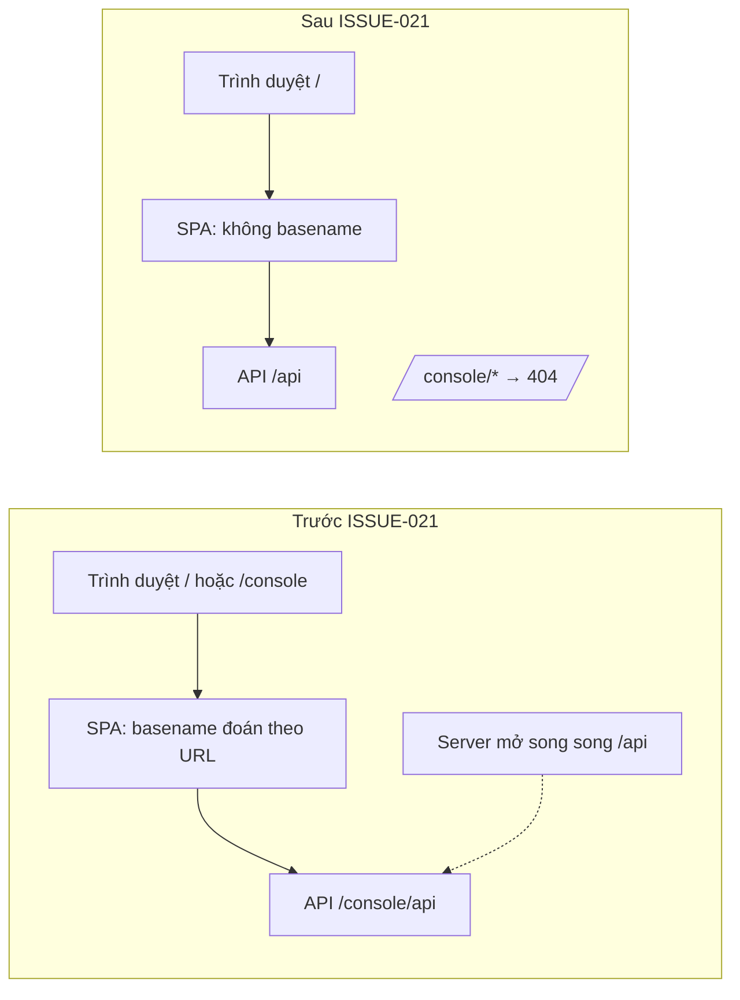

# review-1: Bỏ hẳn đường `/console` — AI Console chỉ chạy ở gốc `/`, API ở `/api`

> Hồ sơ cha: [ISSUE-021](../issue.md) · Quy ước nhánh & commit: [ADR-0043](../../../../adrs/10-2026/0043-ten-nhanh-theo-ho-so-va-thang-tao.md), [ADR-0052](../../../../adrs/10-2026/0052-kiem-toan-tuan-thu-quy-chuan-truoc-commit.md).

**Kết quả một dòng:** Hoàn tất chuyển đổi AI Console sang duy nhất đường dẫn gốc `/` và API `/api`. Bỏ hoàn toàn logic `basename`, toàn bộ request UI hướng về `/api`, các route cũ `/console` và `/console/*` trả 404 HTTP. Tất cả 49 tests Python và 97 tests Vitest (21 suites) đều PASS.

## Sơ đồ chuyển đổi kiến trúc



## Bảng thay đổi chi tiết

| Thành phần | File đã sửa | Nội dung thay đổi |
|---|---|---|
| **Server** | `app/console_main.py` | Health `/api/health`; gắn router tại `/api`; asset tại `/assets/{path}`; disabled docs ở `/docs`, `/redoc`, `/openapi.json`; route `/console` & `/console/{path}` trả 404 trực tiếp |
| **Auth & Config** | `app/api/rest/console_access.py` | Xoá xoá cookie thừa ở path `/console`, chỉ giữ path `/` |
| | `app/config/console_config.py` | Redirect URI mặc định `http://localhost:8090/api/auth/google/callback` |
| | `.env.example` | Cập nhật `AI_CONSOLE_GOOGLE_REDIRECT_URI` |
| | `docker-compose.yml` | Healthcheck gọi `/api/health` |
| **UI** | `ui/src/services/apiClient.ts` | `API_BASE = '/api'` |
| | `ui/src/pages/Tools/components/CopilotSection.tsx` | Dùng `${API_BASE}/tools/copilot/stream` |
| | `ui/src/main.tsx` | Bỏ logic `basename`, `BrowserRouter` không tham số |
| | `ui/vite.config.ts` | Bỏ proxy `/console/api`, chỉ proxy `/api` |
| **UI Tests** | `ui/src/App.test.tsx` | Mock start Google OAuth kiểm tra URL `/api/auth/google/start` |
| | `ui/src/api/client.test.ts` | Mock URL `/api/members/m/roles/ai_lead` |
| | `ui/src/pages/Vision/Vision.test.tsx` | Mock URL `/api/vision/samples/...` |
| | `ui/src/pages/Vision/components/AnprSandbox/AnprSandbox.test.tsx` | Mock URL `/api/tools/anpr/recognize` |
| | `ui/src/pages/Copilot/components/ChatStudio/ChatStudio.test.tsx` | Mock URL `/api/tools/copilot/stream` |
| **Python Tests** | `test/test_console_http.py` | Cập nhật 18 điểm gọi API từ `/console/api` thành `/api`; kiểm tra 404 cho `/console` |
| | `test/test_console_ui_serving.py` | Cập nhật 5 ca kiểm thử SPA và asset sang gốc `/`; bổ sung `test_duong_console_cu_tra_404_khong_phuc_vu_spa` |
| | `test/test_console_vision_lab.py` | Cập nhật 5 điểm gọi API `/api/...` |
| | `test/test_console_settings_http.py` | `BASE = "/api/tools"` |
| **Tài liệu** | `README.md` | Bỏ `/console/` ở bảng cổng 8090 và hướng dẫn mời thành viên |
| | `ui/README.md` | Hướng dẫn mở `http://127.0.0.1:8090/`, mô tả tính từ gốc `/` |
| | `app/README.md` | API `/api`, gắn router dưới `/api` |
| | `docs/references/console-contract.md` | Gốc API `/api`, callback Google 302 về `/` |
| | `DESIGN.md`, `ui/DESIGN.md` | Cập nhật các câu nhắc `/console/` |

## Kết quả kiểm thử

- **Python Unit Tests:** 49 passed, 11 skipped (cần DB tích hợp), 0 failed:
  ```bash
  python -m unittest test.test_console_http test.test_console_ui_serving test.test_console_vision_lab test.test_console_settings_http test.test_console_auth
  # OK (skipped=11)
  ```
- **TypeScript Typecheck:**
  ```bash
  pnpm --dir ui typecheck
  # tsc --noEmit: 0 errors
  ```
- **Vitest Suites:** 21 test files, 97 tests passed:
  ```bash
  pnpm --dir ui test
  # Test Files 21 passed (21) | Tests 97 passed (97)
  ```
- **UI Production Build:**
  ```bash
  pnpm --dir ui build
  # Built ui/dist in 1.84s
  ```
