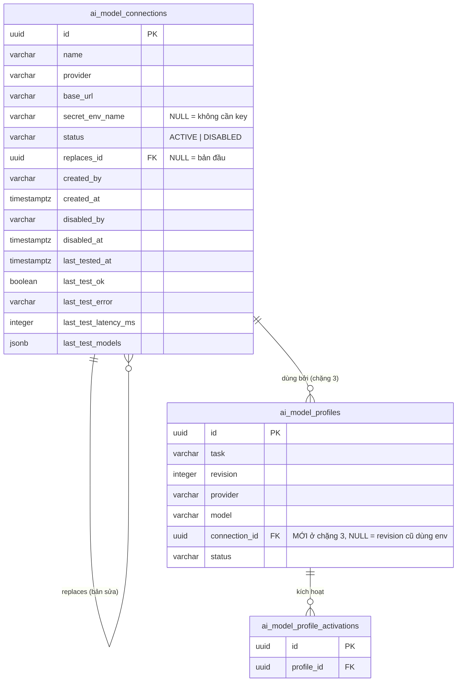
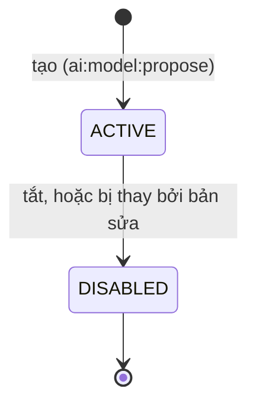

# Đề xuất lược đồ — `ai_model_connections` (ISSUE-022 chặng 2)

> Khung của skill `iplms-schema-design`, theo IPLMS [REQ-018](../../../../../../docs/requirements/10-2026/REQ-018-mo-hinh-du-lieu-va-index-chot-truoc-khi-code.md). Hồ sơ cha: [issue.md](issue.md). Quyết định gốc: IPLMS [ADR-0061](../../../../../../docs/projects/adrs/10-2026/0061-models-connections-o-ai-console-giu-kho-o-ai-db.md) §1, §6, §7.

| | |
|---|---|
| **Trạng thái** | ✅ Đã chốt 2026-10-28 — @HiTranquility duyệt nguyên đề xuất (Q-A a, Q-B b, Q-C a, Q-D a, Q-E a, Q-F a) |
| **Hiện trạng đọc từ** | `app/infra/database/model_policy_store.py` `ensure_schema()` (DDL `ai_model_profiles`, `ai_model_profile_activations`) trên `develop` 881fd24; `app/infra/llm/llm_factory.py` (provider → endpoint); `app/config/llm_config.py`. Chưa đọc DB dev thật (`\d+`), sẽ đối chiếu ở bước kiểm |
| **Bounded context / DB** | `ai-db` (Postgres `database-vector`, `AI_DATABASE_URL`), schema `public`, cạnh bảng profile. **Không** ở `ai_console` (ADR-0061 §1) |

**Cách repo `ai` tạo bảng:** không có công cụ migration. Mỗi store tự chạy `CREATE TABLE IF NOT EXISTS …` trong `ensure_schema()` dưới `pg_advisory_xact_lock`. Bảng mới đi theo cách này: thêm DDL vào `ModelPolicyStore.ensure_schema()`.

## 1. Mẫu truy cập

| # | Truy vấn / thao tác | Lọc | Sắp xếp | Tần suất | Số bản ghi | Nguồn (sẽ có) |
|---|---|---|---|---|---|---|
| Q1 | Liệt kê connection trên trang Models & Connections (F2) | không, hoặc `status =` | `status, name` | thấp (mở trang) | < 100 | `GET /models/connections` |
| Q2 | Lấy một connection để thử / gắn vào revision | `id =` | | thấp | 1 | thử kết nối, tạo revision (chặng 3) |
| Q3 | Tạo connection: không trùng tên trong các connection đang bật | `name =`, `status = 'ACTIVE'` | | rất thấp | 1 | `POST /models/connections` |
| Q4 | Tắt connection (và kiểm còn revision ACTIVE nào dùng không — chặng 3) | `id =`; `ai_model_profiles.connection_id =` + `status='ACTIVE'` | | rất thấp | 1 | `POST /models/connections/{id}/disable` |
| Q5 | Ghi kết quả thử gần nhất | `id =` | | ≤ 10/phút/thành viên | 1 | thử kết nối (F3) |
| Q6 | Inference đọc connection của revision ACTIVE (chặng 3) | `id =` | | **mỗi request Copilot** | 1 | `LlmFactory.for_task` → join profile |

Q6 là đường nóng duy nhất; nó đi qua PK.

## 2. ERD

Thực thể đổi ở chặng này: chỉ thêm `ai_model_connections`. Cột `ai_model_profiles.connection_id` vẽ để thấy đích; nó được thêm ở chặng 3 (khi revision gắn connection), không phải bây giờ.

## 3. Thuộc tính

| Bảng.cột | Kiểu | Null | Mặc định | Unique / check | FK → (on delete) | Nguồn giá trị | PII | Ghi chú |
|---|---|---|---|---|---|---|---|---|
| `id` | `uuid` | NO | sinh ở app (`uuid4`) | PK | | server | | Giống `ai_model_profiles` (uuid4, không v7 — Python 3.13 chưa có `uuid7` trong stdlib) |
| `name` | `varchar(80)` | NO | | unique partial khi `status='ACTIVE'` (Q3) | | form | | Tên hiển thị, vd "Ollama máy GPU" |
| `provider` | `varchar(16)` | NO | | `CHECK IN ('ollama','local','openai')` | | form | | `local` = llama-server, cùng tên giá trị `AI_LLM_PROVIDER` đang dùng trong `llm_factory.py` |
| `base_url` | `varchar(500)` | NO | | `CHECK (base_url ~ '^https?://')` | | form, chuẩn hoá ở server | | Host phải nằm trong allowlist **lúc tạo và lúc thử** (ADR-0061 §7); allowlist là cấu hình, không lưu DB |
| `secret_env_name` | `varchar(64)` | YES | | `CHECK (secret_env_name ~ '^[A-Z][A-Z0-9_]{0,63}$')` | | form | | **Tên** biến env chứa key, không bao giờ là giá trị (ADR-0061 §6). `NULL` = provider không cần key (Ollama, llama-server). Xem câu hỏi Q-B |
| `status` | `varchar(16)` | NO | `'ACTIVE'` | `CHECK IN ('ACTIVE','DISABLED')` | | server | | |
| `replaces_id` | `uuid` | YES | | | `ai_model_connections.id` (RESTRICT) | server | | "Sửa" = tạo bản mới trỏ về bản cũ và tắt bản cũ (REQ-020 F2). `NULL` = bản đầu tiên |
| `created_by` | `varchar(100)` | NO | | | không FK (id thành viên ở DB `ai_console`) | token console | id nội bộ | Cùng kiểu với `ai_model_profiles.created_by` |
| `created_at` | `timestamptz` | NO | `NOW()` | | | DB | | |
| `disabled_by` | `varchar(100)` | YES | | | không FK | token console | id nội bộ | `NULL` = chưa tắt |
| `disabled_at` | `timestamptz` | YES | | `CHECK ((status = 'DISABLED') = (disabled_at IS NOT NULL))` | | DB | | |
| `last_tested_at` | `timestamptz` | YES | | | | server | | `NULL` = chưa thử lần nào |
| `last_test_ok` | `boolean` | YES | | `CHECK ((last_tested_at IS NULL) = (last_test_ok IS NULL))` | | server | | |
| `last_test_error` | `varchar(24)` | YES | | `CHECK IN ('unreachable','auth_failed','timeout','no_models','blocked_host')`; `NULL` khi `last_test_ok` | | server | | Lỗi đã phân loại của REQ-020 US-1 + `blocked_host` (SSRF) |
| `last_test_latency_ms` | `integer` | YES | | `CHECK (>= 0)` | | server | | `NULL` = chưa thử hoặc lỗi trước khi có phản hồi |
| `last_test_models` | `jsonb` | YES | | | | phản hồi provider, cắt ≤ 200 tên, mỗi tên ≤ 120 ký tự | | Chỉ hiển thị, không lọc, không join (luật JSON 10) |

**Không có `updated_at`:** cấu hình của một dòng bất biến (sửa = dòng mới). Chỉ hai nhóm cột đổi sau khi tạo — tắt (`disabled_*`) và kết quả thử (`last_test_*`) — và mỗi nhóm có mốc thời gian riêng. Lịch sử thay đổi nằm ở `audit_event` của `ai_console` (REQ-020 F9).

**Không xoá:** không có `DELETE`; tắt thay cho xoá vì revision (chặng 3) tham chiếu connection.

## 4. Index

| Tên | Bảng (cột theo thứ tự) | Loại | Phục vụ | Ghi chú |
|---|---|---|---|---|
| PK `ai_model_connections_pkey` | `(id)` | B-tree | Q2, Q4, Q5, Q6 | |
| `uq_ai_model_connections_active_name` | `(name) WHERE status = 'ACTIVE'` | unique partial | Q3 | Luật "không trùng tên" nằm ở DB, không chỉ ở code |
| *(chặng 3)* `idx_ai_model_profiles_connection` | `ai_model_profiles(connection_id)` | B-tree | Q4 (kiểm còn dùng), FK | Thêm cùng cột ở chặng 3 |

Q1 không có index riêng: < 100 dòng, quét tuần tự rẻ hơn index.
FK cố ý không index: `replaces_id` — bảng < 100 dòng và không bao giờ `DELETE` dòng cha, nên không có quét khi xoá/khoá.

## 5. Vòng đời

Không bật lại connection đã tắt; muốn dùng lại thì tạo bản mới với `replaces_id`. Thử kết nối không đổi trạng thái, chỉ ghi `last_test_*`.

## 6. Hành vi

Không cần `classDiagram`. Luật nằm ở service: host phải nằm trong allowlist; **sau khi phân giải DNS** (chống DNS rebinding) luôn chặn link-local (`169.254.0.0/16`, `fe80::/10`) và địa chỉ metadata (`169.254.169.254`, `fd00:ec2::254`, `100.100.100.200`) kể cả khi host có trong allowlist. Loopback/dải riêng (Ollama, llama-server ở `127.0.0.1`/`host.docker.internal`) chỉ qua được khi host được allowlist tường minh. Không theo redirect, timeout 10 s, giới hạn 10 lần thử/phút/thành viên, không trả giá trị secret trong response/log/audit.

## 7. Triển khai bảng

| Bước | Thay đổi | Khoá bảng / rủi ro | Lùi lại |
|---|---|---|---|
| 1 | `CREATE TABLE IF NOT EXISTS ai_model_connections …` + `CREATE UNIQUE INDEX IF NOT EXISTS uq_ai_model_connections_active_name …` trong `ModelPolicyStore.ensure_schema()` | Bảng mới, không khoá bảng có dữ liệu | `DROP TABLE ai_model_connections` (chưa có bảng nào tham chiếu tới chặng 3) |
| 2 *(chặng 3)* | `ALTER TABLE ai_model_profiles ADD COLUMN IF NOT EXISTS connection_id UUID NULL REFERENCES ai_model_connections(id) ON DELETE RESTRICT` + index | Thêm cột nullable không mặc định: chỉ đổi metadata, khoá rất ngắn | Drop index, drop cột |

Backfill: không có. Revision cũ giữ `connection_id NULL` = dùng endpoint env như hôm nay.

Quyền DB: ADR-0061 hệ quả ⚠️ đòi process console dùng user DB chỉ có quyền trên các bảng model. User hạn chế đó không có quyền `CREATE`, nên DDL phải chạy từ process inference (user chủ `ai-db`); console chỉ `SELECT/INSERT/UPDATE`. Việc tạo user + `GRANT` thuộc compose/init script, ghi ở DESIGN khi làm.

## 8. Câu hỏi cho người duyệt

| # | Câu hỏi | Phương án | Đề xuất | Chốt |
|---|---|---|---|---|
| Q-A | Sửa connection thế nào? | **(a)** dòng bất biến, sửa = dòng mới + `replaces_id`, tắt dòng cũ · (b) sửa tại chỗ, audit giữ trước/sau | **(a)** — đúng chữ REQ-020 F2, và revision (chặng 3) trỏ vào một endpoint không đổi sau lưng nó, nên so sánh/quay về ở F6 có nghĩa | ✅ theo đề xuất |
| Q-B | Ràng buộc `secret_env_name` tới đâu? | (a) chỉ regex tên · **(b)** regex + tên phải bắt đầu bằng `AI_LLM_KEY_` hoặc nằm trong allowlist cấu hình · (c) chọn từ danh sách cố định | **(b)** — với (a), người có `ai:model:propose` gõ `AI_DATABASE_URL` thì lúc thử, giá trị đó bị gửi làm Bearer tới một host trong allowlist | ✅ theo đề xuất |
| Q-C | Lưu kết quả thử ở đâu? | **(a)** cột `last_test_*` trên connection + audit · (b) thêm bảng `ai_model_connection_tests` ghi mọi lần thử | **(a)** — REQ chỉ đòi "thử gần nhất"; lịch sử đã có ở `audit_event`. (b) chỉ đáng khi cần đếm rate limit qua nhiều replica, mà console chạy một process | ✅ theo đề xuất |
| Q-D | Rate limit giữ ở đâu? | **(a)** bộ đếm trong RAM của process console theo id thành viên · (b) đếm từ DB | **(a)** — console là một process (`console_main`, compose service `console`); restart thì bộ đếm về 0, chấp nhận được với ngưỡng 10/phút | ✅ theo đề xuất |
| Q-E | Tắt connection đang được revision ACTIVE dùng (chặng 3)? | **(a)** chặn 409 · (b) cho tắt, inference rơi về env | **(a)** — (b) đổi model đang chạy mà không qua step-up | ✅ theo đề xuất |
| Q-F | Thử connection **chưa lưu** (F3) có ghi gì vào DB không? | **(a)** không ghi bảng, chỉ audit · (b) ghi | **(a)** — chưa có dòng nào để ghi | ✅ theo đề xuất |

## 9. Kiểm sau triển khai (2026-10-28)

DDL ở `app/infra/database/model_policy_store.py` (`ensure_schema`), khớp mục 3–4. Test: `test/test_console_model_connections.py`.

| Kiểm | Kết quả |
|---|---|
| `ensure_schema()` chạy hai lần trên Postgres local riêng, lần hai không lỗi (idempotent) | **BLOCKED** — Docker Desktop không khởi động được từ phiên agent; test `ConnectionDatabaseTest.test_schema_idempotent_va_khop_ban_chot` đã viết, skip khi thiếu `AI_TEST_DATABASE_URL` |
| `information_schema` + `pg_indexes` khớp mục 3–4 | **BLOCKED** — cùng test trên |
| Check constraint từ chối: provider lạ, `base_url` không phải http(s), tên secret sai, `DISABLED` thiếu `disabled_at`, `ACTIVE` có `disabled_at`, thử thiếu `last_test_ok`, latency âm, mã lỗi lạ; trùng tên ACTIVE; sửa bản đã tắt | **BLOCKED** — `test_check_constraint_chan_du_lieu_sai`, `test_vong_doi_tao_sua_tat_thu` |
| `EXPLAIN` Q3 dùng `uq_ai_model_connections_active_name` | **BLOCKED** — `test_explain_q3_dung_unique_partial` |
| Test SSRF: metadata/link-local literal kể cả khi allowlist; DNS trả IP link-local → chặn trước khi mở socket; redirect 302 sang metadata không được theo; host ngoài allowlist; URL có user/pass/query; `::ffff:169.254.169.254` | **PASS** — `GuardTest`, `ProbeTest` (HTTP server thật trên loopback) |
| Rate limit: lần thử thứ 11 trong 60 s → 429 `RATE_LIMITED` qua route thật | **PASS** — `RateLimiterTest`, `HttpTest.test_quyen_va_429` |
| Timeout: server chậm → `timeout` ≤ timeout + 1 s; probe treo → route vẫn trả | **PASS** — `test_qua_thoi_gian`, `test_probe_treo_thi_tra_timeout` |
| Secret: giá trị key chỉ ở header `Authorization`, không có trong kết quả/audit; body có `api_key` → 422 | **PASS** — `test_openai_compat_va_secret_chi_o_header`, `test_tao_ghi_audit_chi_ten_secret`, `test_khong_nhan_truong_key` |
