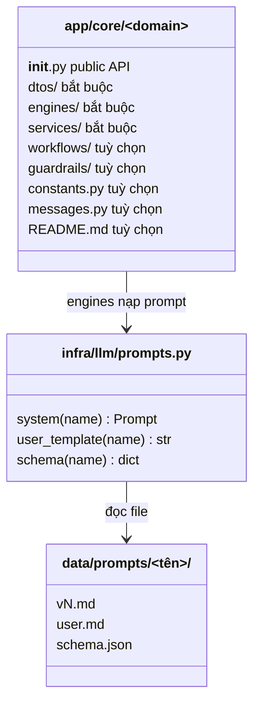
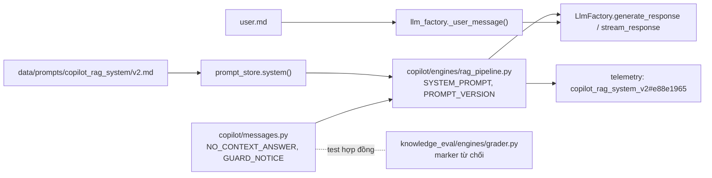

# Review 1 — ISSUE-023: `app/core/` theo khuôn ADR-0005

**Kết quả:** 8 domain theo khuôn, `script/check_core_layout.py` báo 0 lệch. Unittest 603 test, đỏ đúng 2 test có sẵn của bug-047, skip 36 (giống `develop`). Còn nợ: chạy red-team khi có LLM local.

## Sơ đồ

Khuôn một domain và nơi đặt text gửi LLM:

Luồng prompt Copilot sau refactor:

ERD: không áp dụng, refactor không đổi schema hay dữ liệu.

## Bug / OPEN

| Mã | Mức | Nội dung | Bằng chứng | Trạng thái |
|---|---|---|---|---|
| BUG-01 | 🟡 | `DEFAULT_FALLBACK_PROMPT` lệch v2 (thiếu dòng chống injection) | `core/copilot/prompts/prompt_manager.py:12` (đã xoá) | Đã sửa: bỏ fallback, thiếu file thì báo lỗi |
| BUG-02 | 🟡 | `benchmark/benchmark_anpr_latency.py` import đường cũ thì 9 test benchmark **tự skip** thay vì báo lỗi, dễ che hỏng | skip 36 → 45 ở chặng 4 | Đã sửa trong chặng 4. Kiểu "ImportError → skip" vẫn còn ở `test_anpr_benchmark.py:9-26` |
| BUG-03 | 🟠 | Cấu hình chung `.git/modules/ai/config` có `core.worktree` trỏ sang worktree ISSUE-021, nên `git status` ở worktree khác của `ai` hiện nhầm file | `git rev-parse --show-toplevel` trong worktree ISSUE-023 | Chưa sửa (cấu hình dùng chung với phiên khác); né bằng `--git-dir/--work-tree` |
| OPEN-01 | — | `dispute/fixtures.py` chạy ở runtime | `copilot_service.py:17` | Đã trả lời: chủ đích, ghi ngoại lệ ADR-0005 |
| OPEN-02 | — | `PLATE_MIN_ALNUM=6` và `_PLAUSIBLE_MIN_LEN=7` | `vision/constants.py`, `anpr/plate_text.py` | Đã trả lời: hai luật khác nhau |

## Đề xuất

| Mã | Đề xuất | Được | Mất |
|---|---|---|---|
| S1 | Tách I/O `parquet_lake_reader` sang `infra/datalake/`, giữ baseline ở forecast | Bỏ ngoại lệ cuối của ADR-0005 | Refactor 689 dòng + test e2e lake |
| S2 | Ghi nhãn prompt judge/generator vào kết quả lượt eval | Truy được điểm eval đổi do prompt nào | Thêm cột vào bảng eval |
| S3 | `test_anpr_benchmark.py` báo lỗi thay vì skip khi import module của repo hỏng (chỉ skip khi thiếu cv2/numpy) | Không che được hỏng như BUG-02 | Sửa vài dòng |

## Đã kiểm thế nào

| Kiểm | Lệnh | Kết quả |
|---|---|---|
| Unittest đủ bộ, mỗi chặng | `python -m unittest discover -s test -t .` | PASS trừ 2 test bug-047 (giống `develop` f25b747 và nhánh bug-042) |
| So danh sách skip với baseline | `-v` rồi `diff` với nhánh bug-042 | Bằng nhau (36) sau khi sửa BUG-02 |
| Script kiểm khuôn | `python -X utf8 script/check_core_layout.py` + `script/test_check_core_layout.py` | 0 lệch; 3 test PASS |
| Biên dịch | `python -m compileall -q app benchmark training test model` | PASS |
| Nhãn prompt không đổi | hash nội dung v2 trước/sau | `e88e1965` cả hai |
| Nội dung prompt eval không đổi | so `build_judge_input` cũ với khuôn `user.md` | khớp |
| Red-team | `python -m app.script.redteam_copilot` | **NOT RUN**: Ollama không chạy (`localhost:11434` từ chối) |
| Build Docker thật | `AI_RUN_CONTEXT_FIXTURE=1 python -m unittest test.test_docker_context` | NOT RUN (cần Docker daemon); allowlist đổi sang `ai/data/prompts/**` |
| CI GitHub | — | Không chạy: job không khởi động vì lỗi thanh toán tài khoản |
| Parse mermaid | `npx @mermaid-js/mermaid-cli` | NOT RUN: cần tải package, chưa hỏi người dùng |
