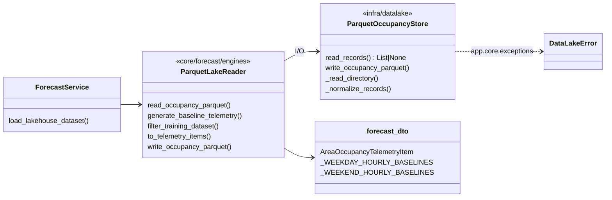

# ISSUE-024 · review-1 — tách I/O Parquet sang `infra/datalake/`

**Kết quả:** đạt hết tiêu chí trong [issue.md](../issue.md); tập test đỏ không đổi so với `develop`.

## Sơ đồ module

Use case và ERD không áp dụng: refactor nội bộ, không đổi luồng người dùng hay schema dữ liệu (cột Parquet giữ nguyên).

## Bug / OPEN

| Mã | Mức | Nội dung | Trạng thái |
|---|---|---|---|
| — | — | Không có bug mới. 2 FAIL có sẵn thuộc bug-047; 5 ERROR do thiếu stub gRPC ở checkout mới | Ngoài phạm vi |

## Đề xuất

| | Đề xuất | Được / mất |
|---|---|---|
| S1 | Cho `_resolve_default_gold_lake_path` đọc `app.config` (`datalake.local_path`) thay vì tự dò `parents[N]` | Hết phụ thuộc độ sâu thư mục / mất: đổi hành vi dò đường, cần kiểm Docker |

## Đã kiểm thế nào

- `.venv/Scripts/python.exe -m unittest discover -s test -t .` trên nhánh và trên `git archive origin/develop` → so tập `FAIL:`/`ERROR:` bằng `diff`: trùng.
- `AI_RUN_REAL_LAKEHOUSE_TESTS=1 DATALAKE_DIR=<IPLMS>/analytic/var/datalake/gold/occupancy python -m unittest test.test_lakehouse_forecast_e2e`: 8/8 trên cả hai bản.
- `python -c "import app.infra.datalake.parquet_occupancy_store; ..."` → không module `app.core.forecast.*` nào trong `sys.modules`.
- `python -X utf8 script/check_core_layout.py` → `0 lệch`.
