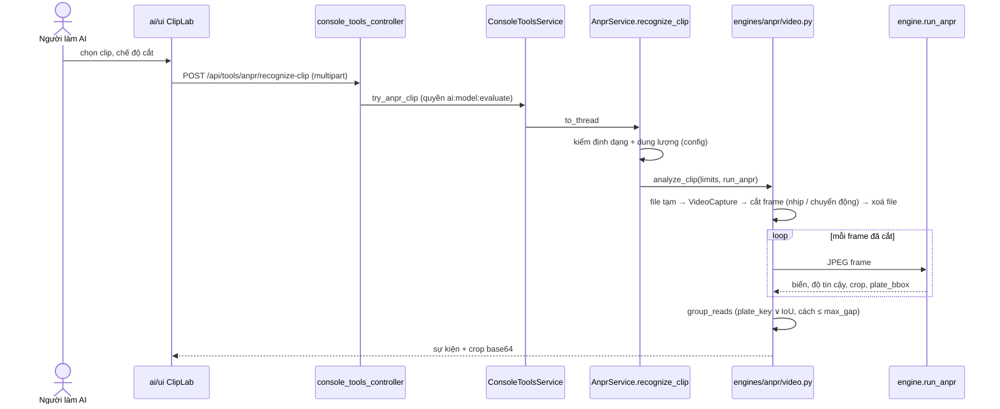

# 🏷️ ISSUE-025: Đọc biển số từ clip ở Vision Lab (IPLMS REQ-021 hướng A)

> **Đích:** `docs/projects/issues/10-2026/ISSUE-025-doc-bien-so-tu-clip-vision-lab/issue.md` · **Luật chung:** [templates/README](../../../../templates/README.md)

| | |
|---|---|
| **Trạng thái** | 🚧 In progress |
| **Người nhận** | @HiTranquility |
| **Hạn** | 2026-11-04 |
| **Ưu tiên** | 🟠 |
| **Ngày đóng** | |
| **Người phụ trách** | Claude (agent) — chờ @HiTranquility review |
| **Phạm vi** | IPLMS-AI: engine ANPR, AI Console (REST + UI) |

Bắt nguồn từ: IPLMS REQ-021 (`docs/requirements/10-2026/REQ-021-doc-bien-so-tu-video.md` ở repo gốc), F1–F3 và F7.

## Mục tiêu

Người làm AI tải một clip MP4/WebM lên Vision ở AI Console, nhận danh sách xe theo mốc giây. Mỗi xe là **một** sự kiện có biển số, mốc giây, ảnh frame tốt nhất và độ tin cậy. Clip không được lưu.

## Tiêu chí chấp nhận

- [x] **F1** Nhận MP4/WebM; dung lượng (`AI_CLIP_MAX_BYTES`, mặc định 50 MB) và độ dài (`AI_CLIP_MAX_DURATION_S`, mặc định 60 s) đọc từ config; vượt giới hạn hoặc sai định dạng thì trả 400 với thông báo rõ — `test_anpr_clip.RecognizeClipServiceTest`, `AnalyzeClipTest.test_clip_dai_qua_gioi_han…`, `test_file_khong_phai_video…`.
- [x] **F2** Gộp các frame của cùng một xe theo `plate_key` + IoU ô biển + khoảng cách thời gian. Clip mẫu 3 xe ra đúng 3 sự kiện với bộ nhận diện giả (`test_clip_mau_3_xe…`, có đọc lệch 1 ký tự mỗi 3 frame) và với `run_anpr` thật (`RealEngineClipTest`, bật bằng `AI_TEST_REAL_ANPR=1`).
- [x] **F3** Mỗi sự kiện có `plate_number`, `best_time_s` (+ `start/end_time_s`), `crop_image`, `confidence`, `frame_count`.
- [x] **F7** File tạm của OpenCV bị xoá cả khi engine lỗi giữa chừng hoặc clip bị từ chối (`assertNoClipLeft` ở mọi ca); route không ghi gì xuống `static/`. Lượt thử ở Console trả ảnh cắt dạng base64, không lưu (cùng chính sách với ANPR thử ảnh).
- [x] UI: tab **Đọc biển từ clip** ở Tổng quan Vision có dòng thời gian (bấm để tua video xem trước), danh sách sự kiện, VI/EN, light/dark.
- [x] Kiểm trên browser với console + engine thật (xem *Đã kiểm*).
- [ ] NF hiệu năng REQ-021: clip 60 s xử lý < 60 s trên CPU — **chưa đạt** trên clip tổng hợp (xem *Rủi ro*).
- [ ] Clip thật của bãi (chờ chủ dự án chọn nguồn).

## Thiết kế

| Quyết định | Phương án đã xét | Chọn vì |
|---|---|---|
| Đọc video bằng `cv2.VideoCapture` qua file tạm | PyAV / imageio-ffmpeg đọc thẳng từ bytes | `opencv-python-headless` đã có FFMPEG (kiểm `getBuildInformation`): không thêm thư viện. File tạm xoá trong `finally` + `closing()` |
| Lấy bbox biển từ độ lệch bộ nhớ của ảnh cắt (`_crop_bbox`) | Đổi chữ ký `detect_plate` trả thêm bbox; chạy detector lần hai | Không đổi hợp đồng của 2 detector và 4 test đang gọi; không tốn thêm một lượt YOLO. Ảnh cắt không phải view thì trả `None`, gộp vẫn chạy theo `plate_key` |
| Chế độ "theo chuyển động" = tỉ lệ điểm ảnh đổi ≥ 1% (ảnh thu nhỏ 160 px) | Trung bình chênh mức xám | Đo trên clip mẫu: xe có độ sáng gần nền chỉ làm trung bình lệch 4/255 nhưng tỉ lệ điểm đổi vẫn 3% |

## Đã kiểm

| Kiểm | Kết quả |
|---|---|
| `python -m unittest test.test_anpr_clip` (bộ giả + `AI_TEST_REAL_ANPR=1`) | PASS 15/15 |
| `test.test_console_tools test.test_anpr_pipeline test.test_confidence test.test_config` | PASS, trừ 2 ca không liên quan: thiếu proto stub trong worktree mới (`test_grpc_dataset_handler…`) và ca cố ý thiếu weights EasyOCR khi tôi trỏ `EASYOCR_MODULE_PATH` |
| `run_anpr` thật, clip tổng hợp 15 s / 3 xe | Theo nhịp 0,5 s: 30 frame, 52 s → 3 sự kiện đúng biển. Theo chuyển động: 21 frame, 37 s → 3 sự kiện đúng biển |
| `ui`: `tsc --noEmit`; `vitest run src/pages/Vision src/i18n` | PASS 37/37 (3 test mới `ClipLab.test.tsx`) |
| Browser: vite `ai/ui` + `app.console_main` thật + engine thật, **chỉ phiên đăng nhập bị thay bằng phiên ML cố định** (không tạo tài khoản) | WebM 3 xe → 3 sự kiện; bấm dòng thời gian tua video tới 6.0 s; light + EN đúng; thư mục tạm không còn `iplms-clip-*` |

Chưa kiểm: stack Docker đầy đủ (Docker Desktop không chạy lúc làm), đăng nhập Google + TOTP thật.

## Rủi ro / việc còn lại

- **Hiệu năng:** YOLO không bắt biển vẽ tổng hợp nên mọi frame rơi vào OCR cả khung (đắt nhất). Clip 60 s theo nhịp 0,5 s ≈ 120 frame ≈ 3,5 phút CPU, vượt NF "< 60 s". Clip thật có YOLO bắt biển sẽ đi nhánh OCR ảnh cắt, rẻ hơn, nhưng phải đo lại trên clip thật. Hướng giảm: bỏ OCR cả khung khi detector không thấy biển trong chế độ clip.
- Xe thứ 3 trong clip mẫu: ảnh "frame tốt nhất" là cả thân xe (YOLO bắt nhầm vùng). Thuộc độ đúng của detector, không phải gộp.
- Clip thật: REQ-021 mục 7 còn mở (tự quay hay dataset có giấy phép).

## Hồ sơ liên quan

- IPLMS REQ-021 (nguồn), ADR-0005 (khuôn domain), ai bug-018 (Console thử không bịa số, không lưu ảnh).
