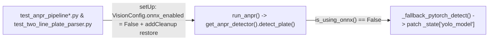

# review-1: Cô lập test ANPR khỏi `best.onnx` cục bộ và chuẩn hoá type hint tầng `config`/`core`/`mappers` (ISSUE-031)

> Hồ sơ cha: [ISSUE-031](../issue.md) · Liên quan: [AUDIT-009](../../../../audits/11-2026/AUDIT-009-naming-va-conventions-ai.md), [ISSUE-030](../../ISSUE-030-ai-naming-and-conventions/issue.md)

**Kết quả một dòng:** Khắc phục triệt để 3 ca ANPR test fail khi máy có `data/models/best.onnx` (`Ran 733 tests in 183.720s — OK (skipped=41)` toàn bộ suite) và đưa các tầng `app/config/` (`0/17`), `app/core/` (`0/412`), `app/console_main.py` (`0/12`), `app/grpc_server.py` (`0/2`), `app/api/grpc/mappers/` và `logging_interceptor.py` về `0` hàm thiếu type hint (`ai_hints.py`: giảm từ `322/1119` xuống `213/1119`).

## Sơ đồ cô lập ONNX vs PyTorch fallback trong test ANPR

ERD, sequence diagram và class diagram không áp dụng: lượt này chỉ cô lập test fixture/config và bổ sung type annotation Python không đổi schema DB, proto hay hành vi runtime.

## Phạm vi đã xử lý

1. **Cô lập test ANPR khi có `data/models/best.onnx` cục bộ:**
   - [`test/test_anpr_pipeline.py`](../../../../../../test/test_anpr_pipeline.py): thêm `setUp`/`addCleanup` gán tạm `get_config().vision.onnx_enabled = False` trong `RunAnprEvidenceImageTest` và bổ sung `test_cached_onnx_session_is_bypassed_when_onnx_disabled`.
   - [`test/test_anpr_pipeline_upgrade.py`](../../../../../../test/test_anpr_pipeline_upgrade.py): cô lập tương tự trong `RunAnprQualityFlagsIntegrationTest`.
   - [`test/test_two_line_plate_parser.py`](../../../../../../test/test_two_line_plate_parser.py): cô lập tương tự trong `RunAnprTwoLineIntegrationTest` để không gọi ONNX model thật khi đang mock `_state`.
2. **Type hint backlog (`B8` của [AUDIT-009](../../../../audits/11-2026/AUDIT-009-naming-va-conventions-ai.md)):**
   - `app/config/` (`0/17`): `runtime_override_config.py`, `telemetry_config.py`.
   - Entrypoint gRPC & Console (`0/2` & `0/12`): `app/grpc_server.py`, `app/console_main.py`.
   - Tầng gRPC mapping & interceptor (`0` thiếu): toàn bộ 7 file trong `app/api/grpc/mappers/` và `app/api/grpc/interceptors/logging_interceptor.py`.
   - Toàn bộ domain `app/core/` (`0/412`): `console`, `copilot`, `forecast`, `knowledge`, `knowledge_eval`, `model_policy`, `vision`.
   - **Tránh xung đột nhánh khác:** cố ý giữ nguyên `app/api/rest/console_access.py` và `app/main.py` cho nhánh song song `ISSUE-145`.

## Đã kiểm thế nào (sau lần sửa code cuối)

| Hạng mục | Lệnh chạy | Kết quả quan sát |
|---|---|---|
| Full Python test suite (có `best.onnx` trên đĩa) | `.\.venv\Scripts\python.exe -m unittest discover -s test -t .` | `Ran 733 tests in 183.720s — OK (skipped=41)` *(không còn failure nào)* |
| Type hints theo tầng | `python -X utf8 ..\script\audit\ai_hints.py app` | `TOTAL 213 / 1119` (`app/config: 0/17`, `app/core: 0/412`, `app/console_main.py: 0/12`, `app/grpc_server.py: 0/2`, `app/util: 0/11`, `app/api: 78/194`, `app/infra: 115/363`, `app/script: 18/105`, `app/main.py: 2/3`) |
| Biên dịch Python | `.\.venv\Scripts\python.exe -m compileall -q app model training test benchmark script` | Exit `0` |
| Core layout & script tests | `script/check_core_layout.py` · `script/test_check_core_layout.py -v` · `script/test_board_gen.py -v` · `script/test_branch_policy.py -v` | `0 lệch` · `6` ok · `10` ok (`1` skip `check_drift.py`) · `19` ok |
| UI typecheck & naming | `corepack pnpm --dir ui typecheck` · `python -X utf8 ..\docs\check_naming.py` | Exit `0` · `PASS: 0 error, 0 warn` (`4523 file`) |
| Branch & generated docs | `script/check_branch_policy.py --branch chore/ISSUE-031-2026-11-anpr-test-isolation-and-type-hints` · `script/check_generated.py --base origin/develop` | `VERIFIED_LOCAL` · Pass |
| Postgres live DB tests (`41` test skipped trong `discover`) | — | **NOT RUN** trên máy local (chỉ chạy ở CI `pgvector`); chạy lại UI Vitest không cần do `ui/` không đổi |
