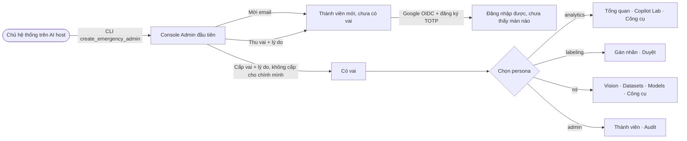
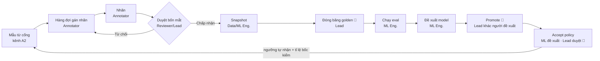
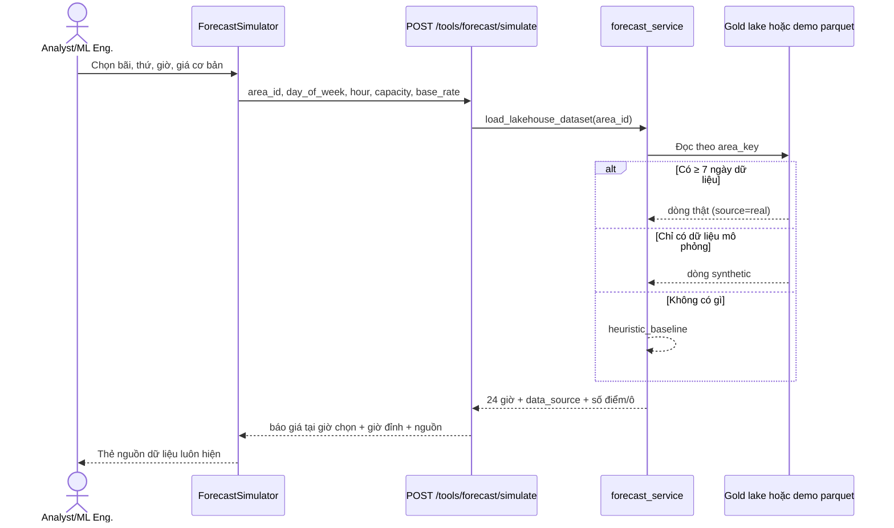

# 🌱 SUGGESTION-006: Lộ trình hoàn thiện AI Console: mức hoàn thiện, vai/quyền, Copilot đa phương tiện, Vision, Forecast

> **Đích:** `docs/projects/suggestions/10-2026/SUGGESTION-006-lo-trinh-hoan-thien-ai-console.md` · **Luật chung:** [templates/README](../../../templates/README.md)

| | |
|---|---|
| **Trạng thái** | 🔄 REVIEWING |
| **Ngày** | 2026-10-25 |
| **Người đề xuất** | Claude Code (theo yêu cầu của chủ dự án, sau AUDIT-006 vòng 2–3) |
| **Techlead duyệt** | @HiTranquility — ⏳ chờ |
| **Làm trước khi duyệt?** | Không. Phần lớn đổi API/schema/quyền, nên thuộc diện việc lớn theo IPLMS ADR-0059. Riêng **F-1** (sửa id bãi lệch) là lỗi có bằng chứng, có thể tách ra bug riêng. |
| **Phạm vi** | `ai/` (API console, `ui/`, `app/core/forecast`). Copilot nhận ảnh/file chạm tới hợp đồng với backend nên cần IDEA ở repo gốc nếu đưa ra cho khách. |
| **Liên quan** | [AUDIT-006](../../audits/10-2026/AUDIT-006-console-wip-2026-10-25.md) (S1–S10), [SUGGESTION-004](SUGGESTION-004-luu-thuoc-tinh-anh-khi-gan-nhan.md), [SUGGESTION-005](SUGGESTION-005-gom-luot-chat-vao-bo-eval.md), IPLMS ADR-0029 (guardrail LLM), ADR-0048 (quyền console), ADR-0051 (accept policy) |

Cách đọc: §1 cho biết hiện có gì và chạy thật tới đâu. §2 là ai được làm gì. §3–§5 là đề xuất cho từng mảng, mỗi đề xuất có phương án A/B/C và khuyến nghị. §6 là thứ tự làm. Mọi nhận định ở §1–§2 đều kèm file trong code (đọc ngày 2026-10-25, trên WIP chưa commit).

---

## 1. Mức hoàn thiện hiện tại

Thang đo: 🟢 chạy thật, có test · 🟡 chạy được nhưng còn chỗ mô phỏng hoặc chưa đo · 🔴 mới là khung hoặc hiển thị số không có thật.

| Màn / chức năng | Mức | Đang làm được | Còn thiếu / sạn | Bằng chứng |
|---|---|---|---|---|
| Đăng nhập (Google OIDC + TOTP, admin khẩn cấp qua CLI) | 🟢 | MFA bắt buộc. Step-up TOTP + lý do cho 4 quyền nhạy cảm. | Mở link sâu khi chưa đăng nhập chỉ giữ được qua `sessionStorage` (AUDIT-006 S7). Form khẩn cấp chưa có nhãn hiển thị. | `auth_service.py`, `AuthenticatedRoutes.tsx` (`console_return_to`) |
| Thành viên (mời, cấp/thu vai) | 🟢 | Bốn mắt: không tự cấp vai cho mình. Bắt buộc lý do. Ghi audit. | Vai không có hạn dùng. Không có luồng "xin quyền". Thu vai không cần người thứ hai. Người không có vai chỉ thấy một EmptyState. | `member_service.py:36-51` |
| Nhật ký kiểm toán | 🟢 | Lọc, xuất CSV (đã escape, bug-019). | Chưa có xem diff trước/sau cho thay đổi cấu hình. | `AuditPage.tsx` |
| Tổng quan Copilot | 🟡 | Usage, review-stats lấy từ DB. | Phụ thuộc telemetry có bật hay không; chưa phân biệt lượt thử với lượt thật trên biểu đồ. | `console_copilot_controller.py:61-76` |
| Copilot Lab (Chat Studio stream, chấm lượt, đưa vào Eval) | 🟡 | Stream SSE. Chấm CORRECT/… có phím tắt an toàn. Ô Eval lấy đúng câu hỏi gốc. | Ứng viên eval lưu ở `var/eval_candidates.json`, không có retention, chứa câu hỏi thô (A-37). **Chỉ nhận chữ**, không nhận ảnh hay file. | `copilot_lab_service.py:118-147`, `AskIn` |
| Công cụ: thử ANPR, đối chiếu loại xe | 🟢 | Gọi engine thật. | — | `console_tools_controller.py:145-160` |
| Công cụ: nạp tri thức | 🟢 | `.pdf/.docx/.txt/.md` ≤ 8 MB. Kiểm magic bytes, quét prompt-injection, ra bản nháp rồi mới qua cổng eval. | Không xem trước được chunk trước khi nạp. Đổi model embedding = nạp lại toàn bộ. | `document_parser.py:46-49`, `injection_scan.py` |
| Công cụ: **Forecast Simulator** | 🔴 | Hiện được 3 bước Datalake → Feature → Inference. | **F-1:** id bãi trên UI không khớp `area_key` ở Gold lake, nên **luôn rơi vào baseline giả**. `model_version` là hằng bịa. Không có model LightGBM/Prophet nào được nạp: service chỉ tra profile 7×24. Gợi ý giá lấy theo giờ đỉnh, nhưng hiển thị như "hiện tại". Chi tiết ở §5. | `tools_service.py` (`simulate_forecast`), `ui/src/constants/parkingLots.ts`, `analytic/var/datalake/gold/occupancy` |
| Vision: gán nhãn → duyệt → snapshot → golden → eval → đề xuất/duyệt model → accept policy | 🟢 | Đủ luồng, bốn mắt ở duyệt nhãn, promote model và duyệt policy. Có seed demo và chặn môi trường. | Người dùng không thấy "mình đang ở bước nào của cả chuỗi". Cờ ảnh khi gán nhãn chưa lưu (SUGGESTION-004). Seed ghi đè metrics eval bằng số đẹp (A-7 còn mở). | `console_vision_controller.py:223-384`, `seed_console_demo.py:563-581` |
| Cài đặt (phần cứng, ngưỡng, phiên) | 🟡 | Ngưỡng cần TOTP + lý do. Provider chỉ đổi giữa local và ollama. Phiên hiện tại không tự thu hồi được. | Process inference chỉ nhận cấu hình sau khi **khởi động lại**. Đổi ngưỡng RAG chưa qua duyệt bốn mắt và chưa có số đo trước/sau (AUDIT-006 S1/S2). | `runtime_override_config.py`, `SettingsPage.tsx` |

**Tóm lại:** phần quản trị và quyền (đăng nhập, thành viên, audit, luồng Vision) đã chín nhất. Copilot Lab chạy được nhưng chỉ nhận chữ. **Forecast là chỗ yếu nhất**: nó hiển thị số trông như của model trong khi thực chất là baseline. Điều này trái Hallmark #2 "không bịa số" của `ui/DESIGN.md`.

---

## 2. Vai trò và quyền

### 2.1 Ma trận quyền hiện tại (nguồn duy nhất: `app/core/console/engines/access_policy.py`)

✅ = có quyền · 🔐 = có quyền, phải nhập lại TOTP kèm lý do (step-up, ADR-0048 §4)

| Quyền | Nghĩa | Analyst | Annotator | Reviewer | Data Eng. | ML Eng. | Lead | Console Admin |
|---|---|:-:|:-:|:-:|:-:|:-:|:-:|:-:|
| `ai:metrics:read` | Xem số liệu, Tổng quan, Vision, Models, Forecast | ✅ | | ✅ | ✅ | ✅ | ✅ | |
| `ai:chatlog:read` | Đọc lượt chat, Copilot Lab, đưa vào Eval | ✅ | | ✅ | | ✅ | ✅ | |
| `ai:task:label` | Gán nhãn biển số | | ✅ | ✅ | | | | |
| `ai:label:approve` | Duyệt nhãn, chấm lượt Copilot | | | ✅ | | | ✅ | |
| `ai:pii:reveal` | Xem dữ liệu chưa che | | | | 🔐 | | 🔐 | |
| `ai:pipeline:manage` | Quản lý pipeline dữ liệu | | | | ✅ | | ✅ | |
| `ai:dataset:snapshot` | Tạo snapshot dataset | | | | ✅ | ✅ | ✅ | |
| `ai:golden:freeze` | Đóng băng bộ golden | | | | | | 🔐 | |
| `ai:model:evaluate` | Chạy eval, thử ANPR, Settings phần cứng | | | | | ✅ | ✅ | |
| `ai:model:propose` | Đăng ký/đề xuất model, đề xuất accept policy | | | | | ✅ | ✅ | |
| `ai:model:promote` | Đưa model lên chạy chính | | | | | | 🔐 | |
| `ai:prompt:edit` | Nạp/xoá tri thức, thử Copilot, Settings phần cứng | | | | | ✅ | ✅ | |
| `ai:policy:threshold` | Duyệt accept policy, đổi ngưỡng RAG/vision | | | | | | 🔐 | |
| `ai:member:manage` | Mời người, cấp/thu vai | | | | | | | ✅ |
| `ai:audit:read` | Đọc nhật ký kiểm toán | | | | | | ✅ | ✅ |

Luật bốn mắt đang có:
- không tự cấp vai cho mình (`member_service.py:41`);
- không tự duyệt nhãn mình gán (`console_vision_store.py:112`, constraint `ck_vision_label_four_eyes`);
- không tự promote model mình đề xuất (`model_lab_service.py:94`; `console_vision_store.py:170`);
- không tự duyệt accept policy mình đề xuất (`console_vision_store.py:208`).

Các luật này được giữ ở cả service lẫn CHECK constraint trong DB.

### 2.2 Vòng đời bổ nhiệm hiện tại

### 2.3 Sạn và đề xuất quanh quyền

| # | Sạn hiện tại | Đề xuất | Được | Mất |
|---|---|---|---|---|
| R-1 | Annotator không có quyền nào trong nhóm `metrics/member/audit`, nên **không xem và không thu hồi được phiên của chính mình**. | Tách quyền tự quản phiên: ai đăng nhập cũng xem/thu hồi được phiên của mình; xem phiên người khác cần admin/lead. | Mọi vai đăng xuất được thiết bị lạ. | Nhỏ. |
| R-2 | Một Lead giữ hầu hết quyền 🔐. Đổi ngưỡng RAG ở Settings **không cần người thứ hai**. | Ngưỡng RAG/vision đi theo mô hình "đề xuất → duyệt" như accept policy, kèm số đo held-out trước/sau (AUDIT-006 S1). | Không còn một người tự đổi luật chống bịa. | Thêm bảng có version, cần cổng schema. |
| R-3 | Vai không có hạn dùng. | Cấp vai có hạn (vd 30 ngày cho thực tập/annotator thời vụ), sắp hết hạn thì nhắc, hết hạn tự thu và ghi audit. | Bớt quyền mồ côi. | Thêm cột `expires_at` và job dọn. |
| R-4 | Người mới chưa có vai chỉ thấy "chưa có vai trò". | Màn "Quyền của tôi": đang có vai gì, mỗi vai mở màn nào, nút "Xin vai" gửi tới admin kèm lý do. Admin duyệt ngay trong Thành viên. | Hết hỏi qua chat. Có vết audit. | Vừa. |
| R-5 | Nút ẩn theo quyền nhưng người dùng không biết vì sao thiếu. | Nút bị khoá hiện tooltip "Cần vai X" (đã có `disabledHint` ở `ReasonAction`), áp chung cho mọi màn. | Dễ hiểu. | Nhỏ. |
| R-6 | Persona và vai là hai khái niệm khác nhau nhưng UI chưa giải thích. | Ở PersonaSwitcher, ghi rõ "Persona chỉ sắp xếp menu, không đổi quyền". Chỉ hiện persona mà người đó có ít nhất một màn. | Bớt nhầm. | Nhỏ. |
| R-7 | Chưa có ma trận test allow/deny đủ 7 vai qua HTTP (BOARD: Dương, ISSUE-008). | Một test lặp qua 7 vai × mọi route, đối chiếu với bảng §2.1. Bảng trong tài liệu sinh ra từ `_PERMISSION_ROLES`. | Bảng tài liệu không lệch code. | Vừa. |

---

## 3. Copilot: nhận ảnh và file

Hôm nay `AskIn` chỉ có `query` và `parking_lot_id`. Model mặc định `qwen2.5:0.5b` (A-39, chọn B) **không đọc được ảnh**. Máy dev là GTX 1650 4 GB, đang chia VRAM với ANPR.

### 3.1 Ảnh trong chat

| Phương án | Cách làm | Ưu | Nhược |
|---|---|---|---|
| **A. Ảnh → công cụ có sẵn → chữ** *(khuyến nghị)* | Người dùng đính kèm ảnh. Server chạy ANPR và phân loại xe (engine đã có) để ra kết quả có cấu trúc (biển số, loại xe, độ tin cậy), rồi đưa kết quả đó vào ngữ cảnh như **dữ liệu không tin cậy** (ADR-0029). Câu trả lời trích "Theo ANPR: 51F-123.45 (0.92)". | Không cần model mới hay thêm VRAM. Kết quả kiểm được và có số tin cậy. Đúng nguyên tắc "LLM không cầm quyền". | Chỉ hiểu những gì ANPR/phân loại hiểu, không mô tả cảnh tự do. |
| B. Model đa phương tiện cục bộ (vd Qwen2.5-VL 3B qua Ollama) | Gửi ảnh thẳng cho VLM. | Hỏi được câu tự do về ảnh. | Khoảng 3 GB VRAM, tranh chỗ với ANPR trên máy 4 GB. Dễ bịa biển số, khó kiểm tất định. Phải chạy lại bộ red-team. |
| C. VLM qua OpenAI | Bật provider `openai`. | Chất lượng cao. | Ảnh có biển số là **PII gửi ra ngoài**, trái điều khoản STRICT PRIVACY. Chỉ bật qua env, cần ADR. |

### 3.2 File trong chat

| Phương án | Cách làm | Ưu | Nhược |
|---|---|---|---|
| **A. File tạm theo phiên** *(khuyến nghị)* | Dùng lại `document_parser` (cùng 4 định dạng, ≤ 8 MB, kiểm magic bytes, quét injection). Chia chunk và embed vào **bảng tạm gắn với phiên chat**, có TTL 24 giờ. **Không** vào kho tri thức, nên không làm bẩn KB của khách. | Hỏi ngay trên tài liệu vừa thả. Dùng lại engine sẵn có. | Thêm bảng tạm và job dọn. |
| B. Đi thẳng vào kho tri thức | Thả file vào chat thì tạo bản nháp KB (như trang Công cụ). | Không thêm bảng. | Phải chờ cổng eval mới hỏi được, chậm. Dễ lẫn tài liệu thử vào KB. |
| C. Nhét nguyên văn vào prompt | Không embed. | Dễ nhất. | Vỡ context 4096 token. Injection đi thẳng vào prompt. |

### 3.3 Cải thiện trải nghiệm Copilot Lab khác

- **Hiện nguồn trích dạng thẻ:** tên tài liệu, phiên bản, đoạn, độ tương đồng. Bấm vào thì mở đúng chunk.
- **So A/B hai prompt hoặc hai ngưỡng** trên cùng câu hỏi (nối SUGGESTION-005).
- **Hiện lý do từ chối:** NO_CONTEXT (dưới ngưỡng X), OUTPUT_GUARD (lý do), hay lỗi LLM, để người chấm biết là lỗi dữ liệu hay lỗi model.
- **Chuyển ứng viên eval từ file JSON vào DB** có retention và đã redact (A-37).

---

## 4. Vision: làm rõ "đang ở bước nào"

Luồng đã đủ nhưng nằm rải ở 5 màn, nên người mới không biết việc tiếp theo là của ai.

| # | Đề xuất | Được | Mất |
|---|---|---|---|
| V-1 | **Thanh tiến trình chuỗi Vision** ở đầu Vision Overview: 9 ô như sơ đồ trên. Mỗi ô hiện số việc đang chờ, ai phải làm, và việc cũ nhất đã chờ bao lâu. Bấm vào thì nhảy tới đúng màn. | Ai cũng thấy nút thắt nằm ở đâu. | Một endpoint tổng hợp đếm. |
| V-2 | **Hộp "Việc của tôi"** theo vai: annotator thấy số mẫu chờ gán, reviewer thấy số nhãn chờ duyệt, lead thấy model hoặc policy chờ duyệt. | Bớt đi tìm. | Nhỏ. |
| V-3 | **Lưu cờ ảnh khi gán nhãn** (mờ, chói, nghiêng, ban đêm), đã có SUGGESTION-004. Sau đó eval chia sai số theo cờ. | Biết model yếu ở điều kiện nào. | Đổi schema nhãn. |
| V-4 | **Thẻ model kiểu "model card"**: weights (sha256), snapshot huấn luyện, golden đo, exact match và CER, ai đề xuất, ai duyệt, lý do. | Truy vết được một model đang chạy. | Nhỏ, dữ liệu đã có. |
| V-5 | **Eval demo ghi rõ là demo:** bỏ đoạn seed ghi đè `eval_run.metrics`, hoặc gắn cờ `demo=true` và hiện nhãn "Số demo". | Không bịa số (A-7). | Nhỏ. |
| V-6 | **Xem lại mẫu khó:** lọc theo độ tin cậy thấp hoặc theo những mẫu bị hai người gán khác nhau. | Tập trung công vào chỗ có ích. | Vừa. |

---

## 5. Forecast: dữ liệu demo và đặc tả

### 5.1 Hiện trạng (đã kiểm trên máy ngày 2026-10-25)

| Điểm | Thực tế | Hệ quả |
|---|---|---|
| **F-1** Id bãi | UI dùng `lot_landmark_81`, `lot_vincom_center`, `lot_suburban_hub`, `lot_central_01`, `lot_west_gate` (`parkingLots.ts`). Gold lake chỉ có `area-zone-a`, `area-zone-b`, `area-basement-b1`, `area-vip-c`: 3 file parquet × 96 dòng (`analytic/var/datalake/gold/occupancy/year=2026/month=10`). | Không bãi nào khớp, nên **luôn chạy nhánh `heuristic_baseline`**. Log báo "Không tìm thấy bản ghi… Kích hoạt fallback". |
| **F-2** Model | `forecast_service.get_projected_occupancy_ratio_detail` tra ma trận 7×24 từ dữ liệu lake, thiếu dữ liệu thì dùng baseline theo giờ. Không có artifact LightGBM/Prophet nào được nạp. | Nhãn `lightgbm-prophet-v1.4` là bịa, vì "Stage 2 Feature" chỉ là dữ liệu minh hoạ. |
| **F-3** Giá động | `surge_quote` tính theo **giờ đỉnh** của ngày đó, nhưng trường `current_occupancy_pct` cũng được gán bằng giá trị giờ đỉnh. | Người xem hiểu nhầm đó là giá lúc này. |
| **F-4** Dữ liệu ít | 288 dòng, tương đương 4 khu × 24 giờ × 3 ngày. | Không đủ một tuần, nên ma trận 7×24 thủng gần hết. |

### 5.2 Phương án dữ liệu demo

| Phương án | Cách làm | Ưu | Nhược |
|---|---|---|---|
| **A. Sinh dữ liệu mô phỏng có nhãn rõ** *(khuyến nghị cho demo)* | Script `app/script/seed_forecast_demo.py` ghi parquet vào một **thư mục demo riêng** (không ghi vào lake của analytic). Dữ liệu gồm 5 bãi khớp đúng id trên UI, 8 tuần, theo giờ. Mỗi bãi có một kiểu riêng (xem §5.3) cộng nhiễu có seed cố định để chạy lại ra cùng kết quả. Mỗi dòng có `source='synthetic'`, UI hiện nhãn "Dữ liệu mô phỏng". | Demo đẹp, có lặp lại được, không đụng dữ liệu thật. | Không phải số thật. Phải nhớ tắt khi lên thật. |
| B. Dùng 4 khu có thật | Đổi UI sang lấy danh sách khu từ lake (`area_key`), bỏ danh sách cứng. | Số thật. | Mới 3 ngày, đường cong rỗng; tên khu khó hiểu với người xem demo. |
| C. Kết hợp A + B | Danh sách lấy từ API. Khu nào có ≥ 7 ngày dữ liệu thật thì dùng số thật, chưa đủ thì dùng mô phỏng và **ghi rõ** trên UI. | Đúng lâu dài. | Làm nhiều hơn A khoảng một bước. |

Khuyến nghị: làm **A ngay để demo**, rồi chuyển sang **C** khi analytic có đủ dữ liệu. Dù chọn cách nào, **F-1 phải sửa**, vì danh sách bãi phải đến từ cùng một nguồn với dữ liệu.

### 5.3 Đặc tả dữ liệu mô phỏng (cho phương án A)

| Bãi (id = UI) | Sức chứa | Kiểu ngày thường | Cuối tuần | Ghi chú cho người xem |
|---|---|---|---|---|
| `lot_landmark_81` | 800 | Văn phòng: lên nhanh 7–9h, đỉnh khoảng 92% lúc 10–16h, xuống sau 18h | Thấp, khoảng 40%, nhích lên chiều tối vì khu mua sắm | Thấy rõ surge giờ hành chính |
| `lot_vincom_center` | 600 | Mua sắm: thấp buổi sáng, đỉnh khoảng 85% lúc 18–21h | Đỉnh khoảng 95% lúc 15–21h | Thấy surge buổi tối và cuối tuần |
| `lot_suburban_hub` | 400 | Gửi xe đi làm: đầy khoảng 90% từ 6–8h, giữ tới 17h, trống ban đêm | Thấp, khoảng 25% | Đường cong hình "bậc thang" |
| `lot_central_01` | 300 | Đều, khoảng 55–70%, không có đỉnh gắt | Giống ngày thường | Ca đối chứng: không surge |
| `lot_west_gate` | 250 | Hai đỉnh khoảng 80% lúc 7–8h và 17–18h | Khoảng 50% | Thấy hai đỉnh, test vùng ngưỡng 75% |

Mỗi dòng giữ đúng schema Gold đang có (`date_key, date_actual, hour_of_day, area_key, owner_id, avg_occupancy_rate, peak_occupancy_rate, total_entries`), cộng thêm `source`. Nhiễu Gaussian σ = 4 điểm %, kẹp trong 0–100, seed cố định. Ngày lễ: 1 ngày/tuần thứ 6 giảm 30% để thấy ngoại lệ.

### 5.4 Đặc tả màn Forecast Simulator (dễ hiểu nhưng đủ)

| Khối | Hiển thị | Quy tắc |
|---|---|---|
| Đầu vào | Bãi (lấy từ API), ngày trong tuần, **giờ cần báo giá**, sức chứa, giá cơ bản/giờ | Giờ báo giá là thứ mới cần thêm. Mặc định là giờ hiện tại. |
| Nguồn dữ liệu | Thẻ "Dữ liệu thật · N ngày" (xanh) hoặc "Dữ liệu mô phỏng" (vàng) hoặc "Baseline, chưa có dữ liệu" (xám) | Lấy từ `data_source` hoặc `is_fallback`. **Không bao giờ ẩn.** |
| Cách dự báo | Một câu, ví dụ "Trung bình cùng giờ, cùng thứ trong 8 tuần qua" | Tên thật của phương pháp. Bỏ `lightgbm-prophet-v1.4` cho tới khi có artifact thật (lấy tên và version từ model registry). |
| Biểu đồ 24 giờ | Cột % lấp đầy. Vạch ngưỡng 75% và 85%. Đánh dấu giờ đang chọn và giờ đỉnh | Màu theo token, đọc được ở cả theme sáng và tối. |
| Báo giá | Giá tại **giờ đã chọn**: hệ số, mức (STANDARD / MODERATE / CRITICAL), lý do dạng chữ dễ hiểu ("Dự kiến lấp đầy 88% ≥ 85% → ×1.5") | Tách hẳn "giá tại giờ chọn" với "giờ đỉnh trong ngày" (sửa F-3). |
| Độ tin cậy | Số ngày có dữ liệu cho ô giờ đó, độ lệch chuẩn | Ít hơn 3 điểm dữ liệu thì ghi "độ tin cậy thấp". |
| Chi tiết kỹ thuật (thu gọn) | Feature, số mẫu, mẫu dòng | Mặc định đóng, dành cho ML Eng. |

---

## 6. Thứ tự làm đề xuất

| Ưu tiên | Việc | Mã | Người gợi ý (theo BOARD) | Cỡ | Cần duyệt? |
|---|---|---|---|---|---|
| 1 | Sửa id bãi lệch và lấy danh sách bãi từ API | F-1, A-33 | HiTranquility (tích hợp analytic) | Nhỏ | Mở bug riêng |
| 2 | Forecast nói thật: thẻ nguồn dữ liệu, bỏ tên model bịa, tách giá giờ chọn khỏi giờ đỉnh | F-2, F-3, A-11/12 | Khoa | Nhỏ | Không |
| 3 | Seed dữ liệu forecast demo theo §5.3 (phương án A) | F-4 | Khoa | Nhỏ–vừa | Techlead |
| 4 | Tự quản phiên cho mọi vai, tooltip quyền, giải thích persona | R-1, R-5, R-6 | Phát (UI) | Nhỏ | Không |
| 5 | Thanh tiến trình Vision + "Việc của tôi" + model card | V-1, V-2, V-4 | Phát (UI), Khoa (dữ liệu) | Vừa | Techlead |
| 6 | Copilot nhận ảnh qua ANPR (3.1-A) | — | Khoa + Dương | Vừa | Techlead + chạy lại red-team |
| 7 | Copilot nhận file tạm theo phiên (3.2-A) | — | Dương | Vừa | Techlead + cổng schema |
| 8 | Ngưỡng đổi qua đề xuất → duyệt kèm số đo held-out | R-2, AUDIT-006 S1 | Dương + Khoa | Vừa–lớn | ADR |
| 9 | Vai có hạn, luồng "Xin vai", màn "Quyền của tôi" | R-3, R-4 | HiTranquility | Vừa | Cổng schema |
| 10 | Test ma trận 7 vai qua HTTP, bảng quyền sinh từ code | R-7, A-25 | Dương (ISSUE-008) | Vừa | Không |

## Bước tiếp theo

1. Techlead duyệt hoặc chọn phương án ở §3.1, §3.2 và §5.2.
2. Mục được duyệt nào thì tách ISSUE riêng, mỗi ISSUE một nhánh. Mục 1 (F-1) mở `bug-NNN` ngay vì là lỗi có bằng chứng.
3. Nếu Copilot nhận ảnh/file cũng mở ra cho khách qua backend thì mở IDEA ở repo gốc IPLMS và link hai chiều về đây.
