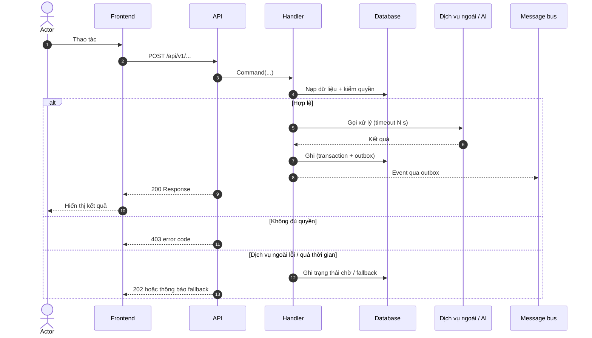
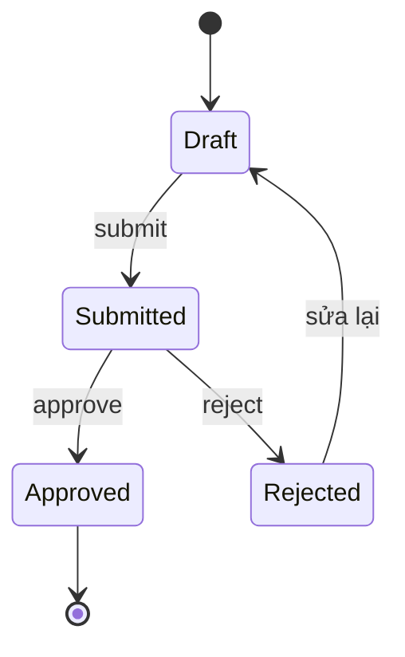
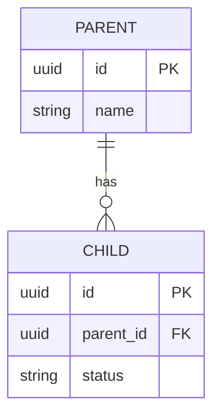

# 🎯 UC-NNN: <Actor> <động từ> <đối tượng>

> **Đích:** `docs/projects/usecases/UC-NNN-slug.md` — trong repo sở hữu code của hành vi (repo gốc nếu xuyên module, repo con nếu chỉ một module) · **Luật chung:** [templates/README](README.md)
> **Use case = đặc tả cho dev:** MỘT hành vi của hệ thống từ trigger tới kết quả, đủ để viết code và test. *"Hệ thống phải làm được gì"* ở REQ; *lý do chọn giải pháp* ở ADR; *việc triển khai* ở ISSUE.
> **[MUST]** Giữ Meta, mục 4, 5, 10, 11. Mục không áp dụng thì **xoá**, không để trống. Bảng và sơ đồ phải khớp nhau và khớp code — lệch thì sửa cùng lúc.

## 📌 Meta

| | |
|---|---|
| **ID** | UC-NNN |
| **Trạng thái** | 📝 Draft / 🔍 Reviewed / ✅ Implemented / 🗄️ Deprecated |
| **Ngày** | YYYY-MM-DD |
| **Người viết** | [Tên] |
| **Module / domain** | Ví dụ: Payment, Reservation |
| **Loại** | Command / Query / Event handler / Job |
| **Actor chính** | Ví dụ: Customer |
| **Entry point** | `POST /api/v1/...` / gRPC `Service.Method` / event `topic` / cron |
| **Code sở hữu** | Handler/service/page chính (đường dẫn file) |
| **Nguồn** | REQ-NNN (R?), IDEA/SUGGESTION, ADR |
| **Triển khai** | ISSUE-NNN |

---

## 🎯 1. Mục tiêu & phạm vi

<1–2 câu: sau use case này, ai có được kết quả gì.>

| Trong phạm vi | Ngoài phạm vi |
|---|---|
| <Hành vi UC này chịu trách nhiệm> | <Thuộc UC khác hoặc chưa làm — kèm link> |

## 👥 2. Actor & quyền

| Actor | Vai trò trong luồng | Quyền cần | Giới hạn dữ liệu |
|---|---|---|---|
| <Customer> | Khởi tạo | `permission:code` | Chỉ dữ liệu của mình — lấy từ token/server, **[NEVER]** tin ID client gửi |
| <Hệ thống/AI> | Xử lý phụ | Service account | <Phạm vi> |

## 🚦 3. Tiền điều kiện & hậu điều kiện

| Loại | Điều kiện | Kiểm ở đâu |
|---|---|---|
| Tiền điều kiện | <Đã đăng nhập, có quyền X> | <Guard / middleware / handler> |
| Hậu điều kiện — thành công | <Bản ghi ở trạng thái Y, event Z đã phát> | <DB / event> |
| Hậu điều kiện — thất bại | <Không đổi dữ liệu; transaction rollback> | <Test> |

## 🔁 4. Luồng chính

| # | Thành phần | Hành động | Dữ liệu vào → ra | Quy tắc |
|---|---|---|---|---|
| 1 | Actor → FE | <Thao tác trên màn hình> | <Input> | — |
| 2 | FE → API | <Gọi endpoint> | Request §7.1 | — |
| 3 | Handler | <Kiểm quyền, nạp dữ liệu> | <Entity> | BR-1 |
| 4 | Handler → dịch vụ ngoài | <Gọi xử lý> | <Payload → kết quả> | BR-2 |
| 5 | Handler → DB | <Ghi trong một transaction> | <Entity mới/đổi> | BR-3 |
| 6 | API → FE | <Trả kết quả, FE cập nhật cache/UI> | Response §7.2 | — |

## ⚠️ 5. Luồng thay thế & lỗi

| Mã | Điều kiện kích hoạt | Hành vi hệ thống | Phản hồi | Thông báo UI |
|---|---|---|---|---|
| A1 | <Nhánh hợp lệ khác, ví dụ lưu nháp> | <Làm gì> | 200 | `i18n.key` |
| E1 | Không đủ quyền | Không đổi dữ liệu | 403 `FORBIDDEN` | `errors.forbidden` |
| E2 | Dữ liệu không hợp lệ | Không đổi dữ liệu | 400 + lỗi theo field | Lỗi cạnh field |
| E3 | Gửi lặp / retry | Trả kết quả lần đầu (idempotent) | 200 cùng ID | — |
| E4 | Phụ thuộc lỗi (DB, dịch vụ ngoài) | <Fallback / rollback> | 503 / 202 | <Thông báo có bước khắc phục> |

## 📏 6. Quy tắc nghiệp vụ

| Mã | Quy tắc | Nguồn | Thực thi ở | Test |
|---|---|---|---|---|
| BR-1 | <Quy tắc kiểm chứng được> | REQ-NNN R? | `path/to/Handler` | `path/to/test` |
| BR-2 | | | | |

## 📦 7. Hợp đồng dữ liệu

Hợp đồng chuẩn nằm ở code / proto / schema event — ở đây ghi phần UC dùng và **link tới file**, không chép schema dài.

### 7.1. Request

| Field | Kiểu | Bắt buộc | Ràng buộc | Ghi chú |
|---|---|---|---|---|
| `fieldName` | string | Có | 1–200 ký tự | |

### 7.2. Response

| Field | Kiểu | Ghi chú |
|---|---|---|
| `id` | uuid | |

### 7.3. Event phát ra

| Event | Khi nào | Payload chính | Consumer | Khoá idempotency |
|---|---|---|---|---|
| `domain.entity.changed` | Sau commit | `{ id, ... }` | <Service nhận> | `id + version` |

## 🗃️ 8. Trạng thái & dữ liệu

Chỉ giữ khi UC đổi trạng thái hoặc schema.

| Entity / bảng | Đọc / ghi | Trường chính | Ràng buộc | Transaction |
|---|---|---|---|---|
| <Entity> | Ghi | <field> | <unique, FK> | <Cùng transaction với outbox> |

## ⚙️ 9. Yêu cầu phi chức năng

| Khía cạnh | Yêu cầu | Cách kiểm |
|---|---|---|
| Hiệu năng | <p95 < N ms> | <Đo / test tải> |
| Idempotency / retry | <Khoá, hành vi khi gửi lặp> | <Test E3> |
| Đồng thời | <Lock / version khi hai người sửa> | <Test> |
| Audit | <Ghi ai làm gì, lúc nào> | <Truy vấn log> |
| Riêng tư | <Dữ liệu nào không được lộ cho ai> | <Test quyền> |
| Khi phụ thuộc lỗi | <Fallback> | <Test E4> |

## ✅ 10. Tiêu chí chấp nhận

| # | Given | When | Then | Test / bằng chứng |
|---|---|---|---|---|
| AC-1 | <Trạng thái ban đầu> | <Hành động> | <Kết quả quan sát được> | `path/to/test` |
| AC-2 | <Actor không đủ quyền> | <Gọi endpoint> | 403, dữ liệu không đổi | |

## 🔗 11. Truy vết

| Loại | Liên kết |
|---|---|
| Yêu cầu | REQ-NNN R? |
| Ý tưởng / đề xuất | IDEA-NNN hoặc SUGGESTION-NNN |
| Quyết định | ADR-NNNN |
| Triển khai | ISSUE-NNN / phase-N |
| Code | <file chính> |
| Test | <file test> |

## ⛔ 12. Ràng buộc kiến trúc & khung code *(tuỳ chọn)*

Chỉ ghi khi repo có pattern handler/service bắt buộc: link practice/ADR của pattern đó, liệt kê **[NEVER]/[MUST]** áp cho UC này và (nếu cần) khung code ngắn. Không chép lại cả practice.

---

## 🔍 Kiểm chứng

- [ ] Sơ đồ sequence khớp bảng luồng chính và code hiện tại (`file:line`).
- [ ] Mỗi quy tắc BR và nhánh E có test hoặc lý do chưa có.
- [ ] Tiêu chí AC chạy được, kết quả ghi **PASS / FAIL / BLOCKED / NOT RUN**.

### Chọn sơ đồ

| Sơ đồ | Khi nào | Bắt buộc |
|---|---|---|
| `sequenceDiagram` | Tương tác giữa actor và các thành phần | ✅ Có |
| `stateDiagram-v2` | UC đổi trạng thái một thực thể | Khi đổi trạng thái |
| `erDiagram` | Thêm/đổi bảng hoặc quan hệ | Khi đổi schema |
| `flowchart` | Logic rẽ nhánh phức tạp trong một bước | Tuỳ chọn |
